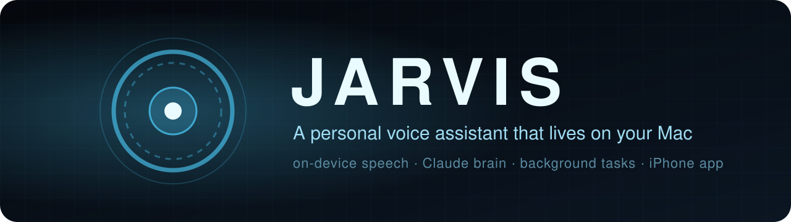
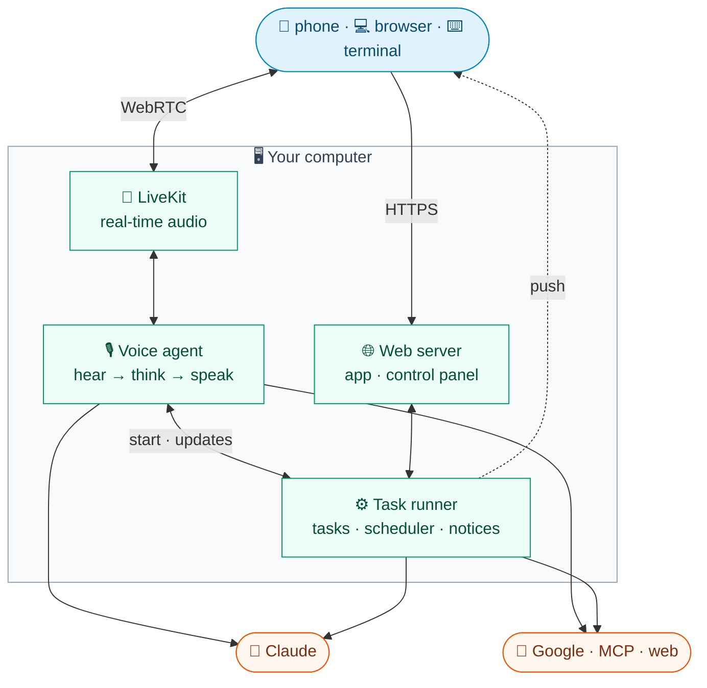

<div align="center">



<br>

[](LICENSE)
[](pyproject.toml)
[](docs/setup.md#-pick-your-platform)
[](docs/mobile.md)
[](docs/architecture.md)
[](docs/voice.md)

**[Setup](docs/setup.md)** &nbsp;·&nbsp; **[Configuration](docs/configuration.md)** &nbsp;·&nbsp; **[Architecture](docs/architecture.md)** &nbsp;·&nbsp; **[Contributing](CONTRIBUTING.md)**

</div>

---

JARVIS listens, thinks and speaks **on your own computer**: macOS, Linux, or Windows via WSL2. Speech recognition, speech synthesis, noise filtering and speaker verification all run **on-device**; only the thinking goes to **Claude**. Talk to it from the terminal, a browser, or your **phone** (iOS or Android). It reads and drafts your mail, runs your calendar, does **code and research tasks in the background** while you keep talking, and tells you what's new **before you ask**.

<table>
<tr>
<td width="33%" valign="top">

### 🔒 Private by default
Whisper, Kokoro, the noise filter and your voiceprint run locally. Data, secrets and logs never leave `data/` and `secrets/`.

</td>
<td width="33%" valign="top">

### 🧠 A real brain
The `claude` CLI with JARVIS's own tools, web search, a sandboxed shell and Google, MCP and desktop integrations.

</td>
<td width="33%" valign="top">

### 🔄 Works while you talk
Background tasks, a scheduler, the monitors you ask for and a learning review keep going after you hang up.

</td>
</tr>
</table>

## ✨ Features

<table>
<tr>
<td width="50%" valign="top">

**🗣️ Voice**<br>
Whisper in (MLX on Apple silicon, faster-whisper elsewhere), Kokoro out. A short silence ends your turn; a speech gate and voiceprint make sure only **you** get answered.

</td>
<td width="50%" valign="top">

**📬 Google**<br>
Gmail, Calendar, Sheets, Docs, Slides, Drive and Chat across several accounts. Sends and deletes wait for your spoken **yes**.

</td>
</tr>
<tr>
<td valign="top">

**🛠️ Background tasks**<br>
Code changes, code questions, research and long shell jobs, in parallel, each checked against its goal before it reports back.

</td>
<td valign="top">

**🔔 Proactive**<br>
Reminders, recurring jobs, "tell me when…" watches and monitors you choose, from a model-free script to a scheduled check; a word when a task gets stuck.

</td>
</tr>
<tr>
<td valign="top">

**🔌 Connections**<br>
Finds and connects MCP servers for the services you use, from the official registry, with keys in an **encrypted vault**.

</td>
<td valign="top">

**📱 Phone app**<br>
iOS and Android: an installable web app with a control panel, push notifications, typing instead of talking and earphone controls.

</td>
</tr>
<tr>
<td valign="top">

**💻 Desktop and web**<br>
Notifications, apps, volume, clipboard, screenshots, documents and recordings (Shortcuts on macOS); a read-only Chrome profile for pages behind your logins.

</td>
<td valign="top">

**🧩 Skills and memory**<br>
Claude Code-format skills written together by voice, plus long-term memory and a to-do list it keeps for you.

</td>
</tr>
</table>

## 🧭 How it fits together



Four **services** keep it running (launchd on macOS, systemd user units on Linux): LiveKit, the voice agent, the web app and the task runner. The full picture, including one spoken turn step by step, is in **[Architecture](docs/architecture.md)**.

## 🚀 Quickstart

| | Platform | What you need |
|:-:|---|---|
| 🍎 | **macOS** on Apple silicon (M1 or later, 8 GB is enough) | [Homebrew](https://brew.sh) |
| 🐧 | **Linux** with systemd (x86_64 or arm64) | Distro packages, including **bubblewrap** and **socat** |
| 🪟 | **Windows** via WSL2 | Ubuntu in WSL2 with **systemd** on, then the Linux steps |

> [!IMPORTANT]
> Everywhere you also need [uv](https://docs.astral.sh/uv/), Node.js 22+ and the **Claude Code CLI** with a Claude account. Package lists and per-platform steps are in **[Setup](docs/setup.md#-pick-your-platform)**.

**1. Install** — LiveKit, Python packages, models and the web app:

```sh
git clone https://github.com/anilkumarmeena/jarvis.git && cd jarvis
make install
```

**2. Sign in and configure** — JARVIS uses your Claude Code login (`make claude-login` if you aren't signed in), then `.env`, keys and your passcode:

```sh
make claude-status    # make claude-login if it says loggedIn: false
make setup            # prints your phone passcode (make passcode shows it again)
```

**3. Talk to it** — straight away in the terminal, or as always-on services:

```sh
make console          # talk through this computer's mic, no server needed
make services-install # or install the four services
open http://localhost:8787   # xdg-open on Linux
```

> [!TIP]
> Next: Google accounts, your phone over Tailscale, projects for code tasks and running with the lid closed are all in **[Setup](docs/setup.md)**.

<details>
<summary><b>Optional extras</b></summary>

<br>

| Extra | Unlocks |
|---|---|
| **Tailscale** | Reaching JARVIS from your phone over HTTPS |
| **Google Cloud OAuth client** | Gmail, Calendar, Docs, Sheets, Slides, Drive and Chat |
| **Your services' own CLIs**, signed in | Those services from the shell and background tasks |
| **`ffmpeg`** | mp3 audio files (and m4a on Linux) |
| **Linux desktop packages** | Notifications, opening files, clipboard, volume and screenshots ([list](docs/setup.md#-linux)) |
| **NVIDIA GPU** (Linux) | Whisper large-v3-turbo instead of small.en on the CPU |
| **Google Chrome** | The web browser tool (Playwright's Chromium otherwise) |
| **claude.ai subscription** | Tasks publishing artifacts |

</details>

## 🧰 Everyday commands

| | Command | What it does |
|:-:|---|---|
| ▶️ | `make console` | Talk in this terminal (no server needed) |
| ▶️ | `make dev` | Run every part in the foreground; <kbd>Ctrl</kbd>+<kbd>C</kbd> stops all |
| 🔥 | `make dev-hot` | The same with hot reload: edit the UI at http://localhost:5173 and see it live |
| 🔁 | `make services-restart` | Rebuild the web app and restart the services |
| 📊 | `make status` · `make logs` | Service health · follow all logs |
| 📋 | `make tasks` | Recent background tasks |
| ⏱️ | `make voice-timing` | Where the wait before each reply went |
| 🔑 | `make accounts` · `make servers` · `make vault` | Google accounts · MCP connections · secret names |
| 🧪 | `make test` · `make check` | Unit tests · type-check and import everything |

Run **`make help`** for the full list.

## 📚 Documentation

<table>
<tr>
<td width="50%" valign="top">

**[🚀 Setup](docs/setup.md)**<br>
Install on macOS, Linux or WSL2, Claude login, Google, your phone, running 24/7

**[⚙️ Configuration](docs/configuration.md)**<br>
Every setting with its default: `config/*.toml`, `.env` and the app

**[🗣️ Voice](docs/voice.md)**<br>
Turn-taking, noise filter, speech gate, speaker check

**[🛠️ Tasks](docs/tasks.md)**<br>
Background tasks, approvals, scheduler, monitoring

</td>
<td width="50%" valign="top">

**[🔌 Integrations](docs/integrations.md)**<br>
Google, MCP connections, browser, files, skills

**[📱 Mobile](docs/mobile.md)**<br>
iOS and Android: web app, notifications, native app

**[👩‍💻 Development](docs/development.md)**<br>
Code map, tests, web app, adding a tool

**[🏗️ Architecture](docs/architecture.md)**<br>
The deep dive: components, data, security

**[🧭 Features](docs/features.md)**<br>
Every part, tool, model role and process, generated from the code

**[🧱 Architecture review](docs/architecture-review.md)**<br>
Layers, contracts and configuration outside the package: the why and the plan

</td>
</tr>
</table>

## 🔐 Security model

JARVIS acts on your behalf, so what it may do alone is deliberately narrow. Every guard is **enforced in code**, not left to the model.

| | Guard | What it means |
|:-:|---|---|
| 🗣️ | **Spoken yes** | Emails, messages, invites and deletions are drafted, read aloud and sent only after a clear yes |
| ✋ | **Approvals** | Deleting, pushing, installing, killing processes or sending data off the computer waits for you |
| 📦 | **Sandboxes** | The voice shell runs in Claude Code's sandbox; tasks run walled in, secrets hidden: **Seatbelt** on macOS, **bubblewrap** on Linux |
| 🔌 | **Gated connections** | MCP tools that change things need a yes; unsorted tools are refused |
| 🔒 | **Encrypted vault** | Tokens and keys are AES-256-GCM encrypted; keys are pasted, never spoken |
| 🛡️ | **Injection checks** | Mail, pages, documents and tool results are screened for hidden instructions |
| 🏠 | **Local only** | The web app binds to 127.0.0.1; your phone gets in over Tailscale with a per-person passcode |

> [!NOTE]
> `.env`, `data/` and `secrets/` stay on your computer and are git-ignored. What you say, and what tools read, goes to Claude. Known limits are listed in **[Architecture](docs/architecture.md)**.

## 🙏 Built with

[Claude Code](https://docs.anthropic.com/en/docs/claude-code) · [LiveKit Agents](https://github.com/livekit/agents) · [MLX Whisper](https://github.com/ml-explore/mlx-examples) · [faster-whisper](https://github.com/SYSTRAN/faster-whisper) · [Kokoro](https://github.com/thewh1teagle/kokoro-onnx) · [Silero VAD](https://github.com/snakers4/silero-vad) · [DeepFilterNet](https://github.com/Rikorose/DeepFilterNet) · [WeSpeaker](https://github.com/wenet-e2e/wespeaker) · [bubblewrap](https://github.com/containers/bubblewrap) · [Playwright](https://playwright.dev) · [Preact](https://preactjs.com) · [AI Armory](https://github.com/anilkumarmeena/ai-armory)

## 🤝 Contributing

Contributions are welcome. **[CONTRIBUTING.md](CONTRIBUTING.md)** covers the dev setup, tests, code style and what makes a good pull request.

## 📄 License

Released under the **[MIT License](LICENSE)**.

<div align="center">
<br>

<br>
<sub>Made for talking, not typing.</sub>
</div>
