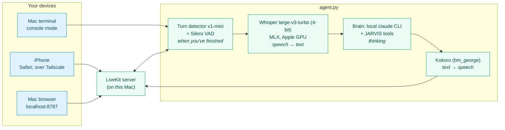

<div align="center">

# JARVIS

**A personal voice assistant that runs 24/7 on your MacBook.**

Talk to it from the Mac or the iPhone. Everything runs locally except Claude itself,<br/>which is reached through the local `claude` CLI.

[Architecture](docs/architecture.md) · [Setup](#setup) · [Settings](#settings-env) · [Commands](#everyday-commands) · `make help`

</div>

---

## At a glance

| | |
|---|---|
| **Hears** | Whisper large-v3-turbo, quantized to 4 bits, through MLX on the Apple GPU: speech → text |
| **Knows you've finished** | The v1-mini turn detector and Silero VAD, a fast model when they're unsure, and each speaker's own pace |
| **Thinks** | The local `claude` CLI, with JARVIS's tools |
| **Speaks** | Kokoro, voice `bm_george`: text → speech |
| **Reach it from** | The iPhone (Safari, over Tailscale), a browser on the Mac (`localhost:8787`), or the Mac's terminal (console mode) |
| **Does** | Gmail, Calendar, Sheets, Docs, Slides, Drive and Google Chat · GitHub, GitLab and any tool you connect from the MCP registry · Mac control · reading documents and transcribing recordings · text read into audio files · memory and to-dos · background code and research tasks · a heartbeat that flags what's new |



> [!TIP]
> How it fits together, the flow of one spoken turn and the security model are in **[docs/architecture.md](docs/architecture.md)**. Everyday commands: **`make help`**.

**Contents:** [Code map](#code-map) · [Setup](#setup) · [Everyday commands](#everyday-commands) · [Settings](#settings-env) · [Google accounts](#google-accounts) · [About you](#about-you) · [Background tasks](#background-tasks) · [Shell commands](#shell-commands-and-long-jobs) · [Web browser](#web-browser) · [Pictures](#pictures) · [Audio files](#audio-files) · [Google Chat](#google-chat) · [Connections and GitHub](#connections-new-tools) · [MCP servers and secrets](#mcp-servers-and-secrets) · [Heartbeat](#heartbeat) · [Scheduler](#scheduler) · [Noise filter](#noise-filter) · [Speech gate](#speech-gate) · [Speaker check](#speaker-check) · [Earphones](#earphones-and-switching-apps-iphone) · [iPhone notifications](#iphone-notifications) · [Adding a tool](#adding-a-tool) · [Web app](#web-app) · [Tests](#tests)

---

## Code map

One folder per part:

```
jarvis/
├── voice/          the voice agent (agent.py), Whisper and Kokoro, noise filter, speech gate, speaker check
├── brain/          Claude behind the voice: persona, CLI brain
├── prompts/        the long prompts as markdown (the persona, the task brief, the reviews and checks), and their loader
├── tools/          what the brain can call: Google, Mac, memory, to-dos, background tasks
├── tasks/          the task runner, its worker and client, projects, heartbeat
├── safety/         command rules, the Mac sandbox, approvals (and remembered ones), the shell, the gates, the scan
│                   for hidden instructions
├── integrations/   Google accounts, MCP servers (GitHub, GitLab, ...), the web browser
├── notify/         Web Push and APNs to the phone
├── state/          memory, settings, the to-do list, voiceprints
├── core/           config, the database, the vault, small helpers
├── server.py       web app and token endpoint
└── setup_local.py  local setup and the launchd services
web/                the phone web app (Vite + Preact), served by jarvis/server.py
tests/  docs/  deploy/
```

| Path | What it is |
|---|---|
| `jarvis/voice/agent.py`, `jarvis/voice/session.py` | **Voice pipeline.** Hands each finished utterance to the brain and speaks the reply. Each call is one `VoiceSession`, which owns its parts (brain, floor, announcements, tasks' requests, timing, lookups), routes each turn (a yes to a rule offered or a task's request, else the brain) and puts tasks' requests to the user as they arrive; `agent.py` is LiveKit's side of it. |
| `jarvis/voice/turn.py`, `jarvis/brain/quick.py` | **When you've finished:** the turn detector, with a fast model on a warm session deciding when it's unsure, and each speaker's own pace; what the brain is told about how a turn was heard (unsure words, a thought carried on, keeping it plain). |
| `jarvis/brain/side.py`, `jarvis/tools/side.py` | **Background lookups:** slow reading (several searches, a long document) the brain hands to a short read-only side job, announced when it's done, so the conversation carries on. |
| `jarvis/voice/timing.py` | **Turn timing:** each voice turn's stages, from you stopping to JARVIS speaking, one line each in `logs/voice-turns.jsonl`; `make voice-timing` sums them up. |
| `jarvis/voice/speech.py` | **On-device speech:** Whisper in, Kokoro out. |
| `jarvis/voice/speech_gate.py` | Keeps Whisper's phantom transcripts of near-silence (a lone "Thank you.") from the brain, judged on the audio and Whisper's confidence; known phantom phrases must be said clearly. See [Speech gate](#speech-gate). |
| `jarvis/voice/speaker.py`, `jarvis/state/voiceprints.py` | **Speaker check:** once you've enrolled your voice, speech that isn't yours (a TV, people nearby) never reaches the brain, and JARVIS stays silent; while JARVIS talks, only your voice interrupts it (`jarvis/voice/barge_in.py`). An on-device speaker model; your voiceprint is kept in `data/tasks.db`. See [Speaker check](#speaker-check). |
| `jarvis/voice/audio_file.py`, `jarvis/tools/audio.py` | **Audio files:** text, a document or a summary read into an m4a, mp3 or WAV in Kokoro's voice, as a background job apart from the live voice. See [Audio files](#audio-files). |
| `jarvis/voice/denoise.py` | **Noise filter** on your mic: DeepFilterNet 3 through ONNX Runtime, before the VAD and Whisper hear it. See [Noise filter](#noise-filter). |
| `jarvis/brain/cli.py` | **The brain:** the local `claude` CLI through the Claude Agent SDK, on its own login. JARVIS's tools, web search/fetch and a sandboxed shell (`jarvis/safety/shell.py`); no file edits. The Agent SDK set-up it shares with background tasks is in `jarvis/brain/sdk.py`, with `ask_json`, the one way a short model call gives a verdict: JSON checked against a schema, never keywords picked out of its words. |
| `jarvis/brain/persona.py` | Persona and system prompt: the persona's text is `jarvis/prompts/persona.md`, filled in with the user's name and "about you". |
| `jarvis/prompts/` | The long prompts as markdown, one file each, with `{{name}}` placeholders that `prompts.load(name, ...)` fills in: the persona, the lookup subagent's, the task brief, the goal check, the learning review, the heartbeat's triage and the skill review. |
| `jarvis/tools/` | Memory, background tasks, Mac control (notifications, apps and links, Apple Shortcuts, volume) and the Google tools: Gmail (including sending and replying in the thread after a yes), Calendar (including moving, answering and cancelling events, and free time), Google Sheets, Google Docs (read, format, beautify, edit, add images), Google Slides (read, with speaker notes), Drive search and Google Chat. The Mac and Google tools come from [AI Armory](https://github.com/anilkumarmeena/ai-armory) (a git dependency pinned to a commit in `pyproject.toml`; see [Editing AI Armory alongside](#editing-ai-armory-alongside)), registered in `jarvis/tools/mac.py` and set up with JARVIS's accounts in `jarvis/tools/google.py`. Their sends and deletes wait for your spoken yes (`jarvis/safety/draft_gate.py`). |
| `jarvis/integrations/browser.py`, `jarvis/tools/browser.py` | JARVIS's own web browser: Chrome through Playwright on a profile of its own, read-only for now, with local addresses refused and page content fenced as untrusted. See [Web browser](#web-browser). |
| `jarvis/integrations/mcp_servers.py`, `jarvis/integrations/mcp_launch.py`, `jarvis/integrations/mcp_bridge.py`, `jarvis/integrations/mcp_relay.py`, `jarvis/safety/mcp_gate.py` | The MCP servers plugged into Claude (GitHub, GitLab, Notion, ...): their list and its command, the launcher that starts each with its secrets (bridging HTTP ones), the relay it keeps between Claude and the server (reads side by side, MCP's long-running tasks, slow calls moved to the background), and the gate that holds their writes for your yes. See [MCP servers and secrets](#mcp-servers-and-secrets). |
| `jarvis/tools/connections.py`, `jarvis/integrations/mcp_registry.py`, `jarvis/integrations/mcp_oauth.py`, `web/src/components/panel/Connections.tsx` | **Connections:** finding new tools in the official MCP registry (or the web, unverified), connecting, updating and removing them after your yes, sorting their tools from their own markings, signing in through JARVIS's browser, and the control panel page where keys are pasted. See [Connections](#connections-new-tools). |
| `jarvis/core/vault.py` | Secrets encrypted in the database under `JARVIS_MASTER_KEY`. |
| `jarvis/tasks/runner.py` | **Task runner:** background tasks in parallel (code changes in the project's folder or on their own branch, code questions, research). Its parts beside it: approvals (`approvals.py`), command and connection tasks (`command_tasks.py`), git (`git_ops.py`), suggested edits (`task_edits.py`), events and announcing (`events.py`) and the HTTP API (`api.py`). Each run in `jarvis/tasks/worker.py`, with its brief (`briefs.py`), its tools and nudges (`reporting.py`), its tools on the Mac (`host_tools.py`), its gate (`gate.py`) and its subagents (`subagents.py`). Storage in `jarvis/core/database.py`. |
| `jarvis/tasks/heartbeat.py` | Runs inside the task runner: every 15 minutes it checks calendar, mail, GitHub, Google Chat and tasks, and flags anything new. |
| `jarvis/tasks/learning.py` | **Learning review**, beside the heartbeat: once a conversation is over, one short model call reads it and saves lasting facts to memory. See [Learning review](#learning-review). |
| `jarvis/tasks/connection_jobs.py` | **Connection tasks:** a connection's call still running after `JARVIS_CONNECTION_WAIT` in a conversation, carried on in the background by its relay as a task of its own kind, said when it ends. See [MCP servers and secrets](#mcp-servers-and-secrets). |
| `jarvis/tasks/command_jobs.py` | **Command tasks:** long shell jobs (`start_job`, audio files, scheduled commands' runs) as background tasks of their own kind, run with no model; a success summed up, a failure read by a model that decides whether a task fixes it. See [Long jobs](#shell-commands-and-long-jobs). |
| `jarvis/tasks/scheduler.py`, `jarvis/tasks/schedules.py` | **Scheduler**, beside the heartbeat: reminders, scheduled background tasks, "watch this for me" loops and shell commands run on a schedule, set by voice (`jarvis/tools/schedules.py`) and kept in `tasks.db`. See [Scheduler](#scheduler). |
| `jarvis/server.py`, `web/` | **Phone web app** (installable, with a service worker for notifications) and passcode-protected token endpoint. `web/` is a Vite + TypeScript + Preact app that `jarvis/server.py` serves from its build, `web/dist`. `web/src/lib/mic.ts`: earphone mute and mic recovery. |
| `jarvis/notify/push.py` | Web Push to the phone: VAPID key, device subscriptions, `send_push`. |
| `jarvis/notify/apns.py` | The same pushes in the native JARVIS iPhone app (jarvis-app), through Apple's APNs: device tokens and sending. |
| `jarvis/setup_local.py` | Generates keys, passcode and LiveKit config; installs the services. |
| `deploy/*.plist` | launchd services: LiveKit server, agent, web app, task runner. |
| `data/` | `memory.md` (long-term facts, under `## User` and `## Environment`, at most 2,000 and 3,000 characters), `vocabulary.md` (names and words speech recognition should expect, with what it has misheard them as), `recent.md` (recent exchanges), and `conversations/` (every conversation, one file a day), plain markdown you can edit. `tasks.db` holds task state, the projects tasks can work on and your to-do list; worktrees live here too. |
| `secrets/`, `models/` | Tokens, JARVIS's Claude login and LiveKit config; downloaded Kokoro and DeepFilterNet models. **Git-ignored.** |

---

## Setup

| Step | What you get |
|---|---|
| [1. Claude login](#1-claude-login-for-jarvis) | JARVIS's own Claude account, apart from your Claude Code |
| [2. Local config](#2-local-config) | `.env`, LiveKit keys, the phone passcode |
| [3. Try it on the Mac](#3-try-it-on-the-mac) | Talking in the terminal or the browser |
| [4. Google](#4-google) | Gmail, Calendar, Sheets, Docs, Slides, Drive, Chat |
| [5. iPhone via Tailscale](#5-iphone-via-tailscale) | The home-screen app on your phone |
| [6. Projects for code tasks](#6-projects-for-code-tasks) | Repos background tasks can work on |
| [7. Run it 24/7](#7-run-it-247) | Four launchd services that never stop |

### 1. Claude login for JARVIS

Separate from your everyday Claude Code. From the repo's folder:

```sh
CLAUDE_CONFIG_DIR="$PWD/secrets/claude" claude auth login --email <account email>
CLAUDE_CONFIG_DIR="$PWD/secrets/claude" claude auth status
```

`make claude-login` and `make claude-status` do the same.

### 2. Local config

```sh
uv run python -m jarvis.setup_local
```

This copies `.env.example` to `.env` if there's none yet, generates the LiveKit keys, a 6-digit phone passcode and the vault's master key into it, and writes `secrets/livekit.yaml`. It then moves the LiveKit keys into the vault and makes the passcode your login (kept only as a hash in `secrets/logins.json`), both out of `.env`, and shows the passcode once: note it down. Later changes, and logins for other people, are in the control panel: Settings → Logins and keys. Then:

- Fill in who you are in `.env`: your name and time zone (see [Settings](#settings-env)).
- Tell JARVIS what it should know about you (see [About you](#about-you)).

> [!NOTE]
> `.env` and everything in `data/` and `secrets/` stay on your Mac.

### 3. Try it on the Mac

- **In the terminal:** `uv run python -m jarvis.voice.agent console` talks through the Mac's mic.
- **In the browser:** build the web app once with `make web-build` (needs Node.js; `make install` does it too), start the services with `make services-install`, and open http://localhost:8787.

### 4. Google

Gmail, Calendar, Sheets, Docs, Slides and Drive.

1. Paste the OAuth client's JSON (a Desktop app client, from APIs & Services → Credentials) in the control panel, Settings → Logins and keys, which keeps it in the vault. Or put the file in `secrets/`, keeping Google's `client_secret_….json` name (`GOOGLE_CLIENT_SECRET` in `.env` points elsewhere): JARVIS moves it into the vault when it next starts, and you can then delete the file. In that Google Cloud project (APIs & Services → Library), enable:
   - the Gmail API
   - the Google Calendar API
   - the Google Sheets API
   - the Google Docs API
   - the Google Slides API
   - the Google Drive API: used to find files by name or by what's in them, to read Google Slides, and to hold images from the Mac for a moment while a Google Doc copies them. JARVIS only reads Drive files; the only ones it changes are those images, which it made itself.
2. Add each account under a label of your choosing, which signs it in (see [Google accounts](#google-accounts)):
   ```sh
   uv run python -m jarvis.integrations.accounts add work --note "for work"
   uv run python -m jarvis.integrations.accounts add personal --note "my own"
   ```
3. **Google Chat** (Workspace accounts added with `--chat`): see [Google Chat](#google-chat) for the one-time Cloud set-up. Signing such an account in then also asks for Chat.

#### Signing in again

JARVIS asks for these permissions:

| Permission | What it's for |
|---|---|
| Calendar | Your calendar |
| Gmail read | Reading mail |
| Gmail compose | Drafts, and sending email after your yes |
| Gmail modify | Read/unread, archive, star, labels |
| Google Sheets | See, edit and create your spreadsheets |
| Google Docs | See your documents, and see, edit and create them |
| Drive metadata, read-only | File names and details |
| Drive files JARVIS makes itself (`drive.file`) | Images put into docs |
| Drive, read-only (`drive.readonly`) | Searching inside files, and reading Google Slides. Never changes, shares or deletes anything |

An account connected before a permission was added keeps doing everything it could before. When it's asked for something new (changing mail, anything with Google Sheets, reading a Google Doc, formatting or editing one, putting an image from the Mac into one, reading Google Slides, or searching inside Drive files), JARVIS says that account must be signed in again. Drive, read-only is the newest: an account signed in before it still finds files by name, sends and replies to email and changes calendar events (those need no new permission), but reading Google Slides says to sign in again, and so does searching inside files if Google refuses it.

**To sign an account in again:**

1. Run `make google-login LABEL=work` (with that account's label).
2. Sign in with the same Google account in the browser and allow every permission it lists.
3. The new token replaces `secrets/google-<label>.json`. No restart needed.

> [!TIP]
> If the consent screen doesn't show the new permissions, remove JARVIS's access at https://myaccount.google.com/permissions and sign in again.

### 5. iPhone via Tailscale

1. Install Tailscale on the Mac and the iPhone, and sign both in to the same account.
2. Rerun `uv run python -m jarvis.setup_local` so LiveKit advertises the Mac's Tailscale address for audio.
3. Publish the web app and LiveKit signalling over HTTPS, reachable only by your own Tailscale devices:
   ```sh
   tailscale serve --bg 8787
   tailscale serve --bg --set-path /rtc http://127.0.0.1:7880/rtc
   ```
4. On the iPhone, open `https://<mac-name>.<tailnet>.ts.net` in Safari, enter the passcode, then **Share → Add to Home Screen**.
5. Assign an Apple Shortcut that opens that URL to the Action Button.

> [!NOTE]
> If macOS asks whether `livekit-server` may accept incoming connections, allow it; the audio uses UDP port 7882.

### 6. Projects for code tasks

The projects code tasks can work on are kept in the `projects` table of `data/tasks.db`. Add your repos by voice ("add my billing api folder as a project") or from a terminal, with aliases for names speech recognition might mishear:

```sh
uv run python -m jarvis.tasks.projects add billing-api --path ~/code/work/billing-api \
  --aliases "billing api, the billing service" --about "Billing service (work)" --worktrees
uv run python -m jarvis.tasks.projects                                   # list them
uv run python -m jarvis.tasks.projects set billing-api --in-place        # or --path, --aliases, --about
uv run python -m jarvis.tasks.projects remove billing-api                 # off the list; the folder stays
```

Changes apply at once, with no restart.

### 7. Run it 24/7

```sh
uv run python -m jarvis.setup_local --install
```

This installs and starts the four launchd services, labelled `com.jarvis.livekit`, `com.jarvis.agent`, `com.jarvis.web` and `com.jarvis.tasks` (`JARVIS_SERVICE_PREFIX` in `.env` changes the `com.jarvis`). Logs are in `logs/`.

> **Upgrading an install from before these labels** (its services were `com.<name>.jarvis.*`): run `make services-restart`, or `make services-install`, once. Either unloads the services this checkout installed under the old labels, removes their plists from `~/Library/LaunchAgents`, and installs and starts them under the new ones. Only plists that log into this checkout's `logs/` are touched.

| To | Do |
|---|---|
| Keep the Mac awake on the charger | Nothing: `caffeinate` does it |
| Keep it running with the lid closed | `make awake` (`sudo pmset -a disablesleep 1`) |
| Restore normal sleep | `make sleep-normal` |

---

## Everyday commands

The full list is `make help`. The ones you'll use most:

| Command | What it does |
|---|---|
| `make console` | Talk to JARVIS in this terminal through the Mac's mic (no server needed) |
| `make dev` | Run LiveKit, the web app, the agent and the task runner together (Ctrl-C stops all) |
| `make services-install` | Install and start the four launchd services |
| `make services-restart` | Rebuild the web app and restart the services, e.g. after editing `.env` |
| `make status` · `make logs` | Whether each service is running · follow all service logs |
| `make tasks` | List recent background tasks |
| `make heartbeat` | Dry-run one heartbeat check |
| `make speech-gate` | The last day's clips the speech gate would drop, or dropped, and why |
| `make voice-timing` | The last day's voice turns, stage by stage: how long from you stopping to JARVIS's first words, and where that time goes ([details](docs/architecture.md#how-fast-it-is-measured-on-this-mac)) |
| `make voiceprint` | Your voiceprint for the [speaker check](#speaker-check); `ARGS=enroll` records 30 s from the Mac's mic, `test`, `remove`, `log` (the last day's verdicts) |
| `make accounts` · `make about` · `make servers` · `make vault` | Google accounts · "about you" · MCP servers · encrypted secrets |
| `make google-login LABEL=work` | Sign a Google account in, or in again for new permissions |
| `make test` · `make check` | Unit tests · byte-compile and import every module |

---

## Settings (`.env`)

`.env.example` lists every setting, with no real values in it. `.env` itself only needs the secrets `setup_local` makes and, for the native app's pushes, your APNs ids: everything else has a default.

Your name, time zone, voice, speed, speech gate, speaker check, task limit and web browser are **changed in the app**, under Settings, and kept in `data/tasks.db` (or on the Mac: `uv run python -m jarvis.state.settings prefs`). Each one's variable below still works, and when it's in `.env` it wins: the app then only shows it.

| In the app | Setting | Applies |
|---|---|---|
| About you | Name, time zone | Without a restart, from the next conversation or task (they're your profile's) |
| Voice | Voice, speed, speech gate; Voice ID: your voiceprint, the speaker check and how sure it must be | From the next conversation |
| System | Background tasks at once | When the task runner restarts |
| System | Web browser on or off, its window shown or hidden | From the next conversation |

### You

| Setting | Effect |
|---|---|
| `JARVIS_USER_NAME` | What JARVIS calls you in its prompts, conversation logs and tasks' instructions. Default: the first name on your Mac account, else "the user". Also in Settings → About you, kept in your profile (`jarvis/core/profile.py`); this wins over it. |
| `JARVIS_TIMEZONE` | Your time zone, as a name like `Europe/London`. Default: the Mac's own, else `UTC`. Also in Settings → About you, kept in your profile; this wins over it. |
| `JARVIS_PASSCODE` | Only for a first setup, which makes one: with no login yet, it lets you in, and the web service then makes it your login (hashed, in `secrets/logins.json`) and takes it out of `.env`. After that, each person's login and passcode are in Settings → Logins and keys; the passcode alone says who's connecting, so no two logins share one. |
| `JARVIS_SERVICE_PREFIX` | The start of the launchd services' labels (default `com.jarvis`, for `com.jarvis.agent` and so on). Change it only to run a second JARVIS under the same Mac account; `make services-restart` then moves the services to the new labels. |

### Voice and listening

| Setting | Effect |
|---|---|
| `JARVIS_CLI_MODEL` | The voice brain's model. Empty uses `claude-opus-5-5`. |
| `JARVIS_EFFORT` | `low` keeps spoken turns quick. |
| `JARVIS_TOOL_SEARCH` | How [connections'](#mcp-servers-and-secrets) tools load, for the voice brain and tasks alike: `true` (default) keeps them out of the conversation until the model looks one up with Claude Code's tool search, so more connections don't slow every reply; `auto:N` defers them only once they'd fill N% of the context window; `false` loads them all up front, as before. JARVIS's own tools always load. |
| `JARVIS_CONNECTION_WAIT` | How many seconds a [connection's](#mcp-servers-and-secrets) call may hold up a spoken reply (default 20). One still running then carries on in the background as a task, and JARVIS says how it went when it ends. `0` waits for every call, as before. Background tasks always wait for theirs. |
| `JARVIS_STT` | The Whisper model, a Hugging Face repo. Empty uses `mlx-community/whisper-large-v3-turbo-q4` (4-bit, about 0.5 GB in memory); `mlx-community/whisper-large-v3-turbo` is the 16-bit original (about 1.6 GB). |
| `JARVIS_STT_PROMPT` | `on` (default) or `off`: give Whisper the speech vocabulary (`data/vocabulary.md`, plus the project names) as its prompt. Off, only known mishearings are put right. Read at the start of each conversation. |
| `JARVIS_TTS_VOICE`, `JARVIS_TTS_SPEED` | Kokoro voice and speed (default `bm_george`, 1.05): `bm_*` British male, `bf_*` British female, `am_*`/`af_*` American. Also in Settings → Preferences. |
| `JARVIS_TTS_MODEL` | The Kokoro model file in `models/`. Empty uses `kokoro-v1.0.onnx`, the full 32-bit one (326 MB); `kokoro-v1.0.int8.onnx` (8-bit, 92 MB) saves about 230 MB but renders 30–60% slower, enough on an 8 GB M2 under load to leave pauses between sentences. When the chosen file is missing JARVIS uses the full one, else the 8-bit one. |
| `JARVIS_TTS_THREADS` | Kokoro's ONNX Runtime threads. Empty: one fewer than the Mac's performance cores, from 2 to 4 (3 on an M1 or M2); `0` is ONNX Runtime's own default, every core. |
| `JARVIS_AUDIO_DIR` | Where [audio files](#audio-files) go (default `~/Downloads`). If macOS keeps JARVIS out of it, they go to `data/audio/` instead, and JARVIS says so. |
| `JARVIS_AUDIO_FORMAT` | The audio files' format when you don't say: `m4a` (default; the Mac's own encoder, about 29 MB an hour), `mp3` (needs `ffmpeg` or `lame`: `brew install ffmpeg`) or `wav` (about 170 MB an hour). |
| `JARVIS_AUDIO_MODEL` | The Kokoro model file audio files are read with. Empty uses `kokoro-v1.0.onnx`, the full 32-bit one, faster than the 8-bit one on Apple silicon; `JARVIS_TTS_MODEL`'s file when it's missing. |
| `JARVIS_AUDIO_THREADS` | CPU threads an audio file is read on (default a quarter of the cores, at least 2), so the live voice keeps the rest. |
| `JARVIS_TURN_MIN_DELAY`, `JARVIS_TURN_MAX_DELAY` | Seconds of silence before your turn is over, to start with: when it sounds finished (default 0.9), and at most when you seem mid-thought (default 4). Each speaker's own delays then follow their pace (kept as `voice_pace:<speaker>` in the settings table; delete the row to start again). |
| `JARVIS_TURN_JUDGE`, `JARVIS_TURN_JUDGE_SECONDS` | When the turn detector is unsure whether a pause ends your turn, a fast model reads what's been said and decides (default on), giving up after 2 s. `off` leaves it to the detector. |
| `JARVIS_VAD_MIN_SILENCE` | Seconds of silence that end an utterance so Whisper can start on it (default 0.55). Every reply waits at least this plus Whisper's time; lower (0.4) answers sooner but cuts more mid-sentence fragments. |
| `JARVIS_VOICE_QUICK_MODEL` | A lighter model (say `claude-sonnet-5`) for turns a fast model judges need no tools and little thought; empty (the default) keeps every turn on the main model. |
| `JARVIS_SIDE_MODEL`, `JARVIS_SIDE_MINUTES` | Background lookups, for slow reading JARVIS hands off so the conversation carries on: their model (default `claude-sonnet-5`) and how long one may run (default 3 minutes). |
| `JARVIS_PROACTIVE_JUDGE` | Whether a fast model picks the moment to bring up task updates, alerts and reminders: now, after "Sorry to cut in" for something urgent, at a better moment, or on the phone (default on). `off` says each as soon as nobody is talking. |
| `JARVIS_WHISPER_UNSURE_LOGPROB` | A turn Whisper heard with an average log-probability under this (default -1.0) is marked as unsure, so JARVIS checks back with its best guess instead of guessing silently. |
| `JARVIS_DENOISE` | The [noise filter](#noise-filter): `on` (default) filters what the VAD, barge-in and Whisper hear; `vad` filters only what the VAD hears, and Whisper gets the original; `off` uses the original everywhere. |
| `JARVIS_DENOISE_ATTEN_DB` | The most the noise filter takes off any sound, in dB (default 18; 0 means no limit). |
| `JARVIS_VOICE_IDLE_PROCESSES` | Spare voice processes kept warm so a call connects at once (default 1). Whisper and Kokoro load once, in a shared process, so a spare takes about 300 MB; 0 saves that, and a call waits a few seconds for its process to start. |
| `JARVIS_MLX_CACHE_MB` | The most GPU memory MLX keeps for reuse after Whisper hears a clip, in MB (default 256; uncapped it held about 0.7 GB). 64 saves 0.2 GB more for about 25 ms a clip; 0 frees it after every clip; -1 is no cap. |
| `JARVIS_TTS_MEMORY_ARENA` | Kokoro's ONNX Runtime memory arena (default off). On, it grows to fit the longest sentence yet and keeps that, about 1 GB after a 20-second sentence; off was as fast. |
| `JARVIS_VOICE_MALLOC_LARGE_CACHE` | Whether macOS's malloc may keep large freed blocks cached in the voice agent's child processes (default off, so freed memory goes back to the system). On, Kokoro's speech process stayed 1 GB bigger even with the arena off. |
| `JARVIS_VOICE_MEMORY_LOG_MINUTES` | How often `logs/agent.log` gets a `voice memory` line, each voice process's footprint and their total (default 10; 0 never). `uv run python -m jarvis.voice.ram` prints the same on demand. |

### Speech gate settings

| Setting | Effect |
|---|---|
| `JARVIS_SPEECH_GATE` | The [speech gate](#speech-gate): `enforce` (default) drops clips it judges phantoms; `shadow` logs them and drops nothing; `off` checks nothing. Also in Settings → Preferences. |
| `JARVIS_SPEECH_GATE_MIN_SPEECH_SECONDS` (0.1), `JARVIS_SPEECH_GATE_MIN_SECONDS` (0.3), `JARVIS_SPEECH_GATE_MIN_DBFS` (-55), `JARVIS_SPEECH_GATE_NO_SPEECH` (0.8), `JARVIS_SPEECH_GATE_WEAK_SPEECH_SECONDS` (0.25), `JARVIS_SPEECH_GATE_FAINT_SPEECH_SECONDS` (0.25), `JARVIS_SPEECH_GATE_FAINT_DBFS` (-28), `JARVIS_SPEECH_GATE_FAINT_MAX_SECONDS` (1.4), `JARVIS_SPEECH_GATE_PHANTOM_DBFS` (-22), `JARVIS_SPEECH_GATE_PHANTOM_SPEECH_SECONDS` (0.6), `JARVIS_SPEECH_GATE_PHANTOMS` (built-in list), `JARVIS_SPEECH_GATE_MIN_LOGPROB` (-1.0), `JARVIS_SPEECH_GATE_UNSURE_SPEECH_SECONDS` (0.5), `JARVIS_SPEECH_GATE_MAX_COMPRESSION` (2.4) | Its thresholds, explained in the [speech gate's table](#speech-gate). |
| `JARVIS_VAD_MIN_SPEECH`, `JARVIS_VAD_THRESHOLD` | The session's Silero VAD: seconds of unbroken speech before an utterance starts (default 0.2; LiveKit's own is 0.05, which a click passes), and the speech probability that counts (default 0.5). Barge-in still needs 0.5 s of speech either way, and with a voiceprint, your voice ([barge-in settings](#speaker-check)). |
| `JARVIS_SPEECH_GATE_SAVE_AUDIO` | On in shadow mode, off otherwise: saves each clip it judges as a WAV in `logs/speech-gate-audio/`. |
| `JARVIS_SPEECH_GATE_AUDIO_KEEP` | How many of the newest saved clips to keep (300). |
| `JARVIS_SPEECH_GATE_SAVE_SHORT` | On by default: with `SAVE_AUDIO` off, still saves the clips it lets through that are under `JARVIS_SPEECH_GATE_SHORT_SECONDS` (2) long or have under `JARVIS_SPEECH_GATE_SHORT_SPEECH_SECONDS` (0.5) of speech. |

### Speaker check settings

| Setting | Effect |
|---|---|
| `JARVIS_SPEAKER_CHECK` | The [speaker check](#speaker-check): `on` (default) drops speech that isn't your voice; `shadow` logs it and drops nothing; `off` checks nothing. Without a voiceprint nothing is checked either way. Also in Settings → Preferences. |
| `JARVIS_SPEAKER_THRESHOLD` | The cosine similarity to your voiceprint an utterance with 3 s of speech or more needs (default 0.35, from 0.1 to 0.8). Also in Settings → Preferences, as Lenient (0.25), Normal or Strict (0.45). |
| `JARVIS_SPEAKER_SHORT_MARGIN` (0.1), `JARVIS_SPEAKER_SHORT_SECONDS` (1), `JARVIS_SPEAKER_LONG_SECONDS` (3), `JARVIS_SPEAKER_RELAX` (0.1), `JARVIS_SPEAKER_MIN_SECONDS` (0.4), `JARVIS_SPEAKER_RECENT_SECONDS` (30), `JARVIS_SPEAKER_REPLY_SECONDS` (10) | How short utterances are judged, explained in [its table](#speaker-check). |
| `JARVIS_SPEAKER_ADAPT` (on), `JARVIS_SPEAKER_ADAPT_MARGIN` (0.1) | Whether your clearly recognised utterances in a call (3 s of speech, the threshold plus the margin) tune its reference to that call's mic and room. |
| `JARVIS_SPEAKER_ENROLL_SECONDS` (25), `JARVIS_SPEAKER_ENROLL_MIN_SECONDS` (12), `JARVIS_SPEAKER_ENROLL_TIMEOUT` (120) | Enrolling by voice: the speech it collects, the least it makes a voiceprint from, and how long it waits. |
| `JARVIS_SPEAKER_BARGE_IN` (on), `JARVIS_SPEAKER_BARGE_IN_MIN_SECONDS` (0.5), `JARVIS_SPEAKER_BARGE_IN_STEP` (0.25), `JARVIS_SPEAKER_BARGE_IN_MAX_SECONDS` (1) | Whether only your voice interrupts JARVIS while it replies (see [Interrupting JARVIS](#speaker-check)); the speech heard before its first check, between checks, and at most in one check. |

### Task settings

| Setting | Effect |
|---|---|
| `JARVIS_MAX_TASKS` | Background tasks running at once (default 6, at most 12); the rest queue. Also in Settings → Preferences. |
| `JARVIS_RESUME_TASKS` | How many background tasks a restart of the task runner cut off, of any kind, carry on by themselves when it starts again (default 3, at most 12; `0` none). Ones cut off mid-command on the Mac or waiting for your go-ahead or an answer always wait for a reply instead. |
| `JARVIS_TASK_MODEL`, `JARVIS_TASK_EFFORT` | Model and effort for background tasks. Empty model uses `claude-opus-5-5`; effort defaults to `high`. |
| `JARVIS_TASK_SEARCH_MODEL`, `JARVIS_TASK_HELPER_MODEL` | Models for a task's subagents: the read-only code searcher (empty uses `claude-haiku-4-5-20251001`), and the test runner and web researcher (empty uses `claude-sonnet-5`). |
| `JARVIS_LOOKUP_MODEL` | The voice brain's read-only lookup subagent. Empty uses `claude-haiku-4-5-20251001`. |
| `JARVIS_NEW_PROJECTS_DIR` | Where a project registered by voice gets its folder when you don't name one. `make setup` asks once and writes it here; unset, the folder JARVIS's own checkout is in (`~/Projects` if that's your home folder). |
| `JARVIS_TASK_ARTIFACTS` | `0` stops tasks publishing mockups and previews to claude.ai as artifacts, whether by default (code-change and research) or granted (on by default; needs JARVIS's Claude login to be a claude.ai subscription, not an API key). They always save the page locally too. `make artifact-check` tests it. |
| `JARVIS_TASK_READ_DIRS` | Folders code tasks may read but not change (comma-separated). `make setup` sets it to your projects folder with `JARVIS_NEW_PROJECTS_DIR`; unset, the same default as that. Secrets in them (`.env` files, keys, credentials, `secrets` folders) stay hidden. |
| `JARVIS_APPROVAL_MINUTES` | How long a risky shell command JARVIS asked about stays open for your yes, and the yes stays good (default 5). |
| `JARVIS_CONSENT`, `JARVIS_CONSENT_MODEL`, `JARVIS_CONSENT_SECONDS` | A spoken reply to an approval question that the yes and no word lists can't read goes to one short model call that sees only your words and what's waiting (`on` by default; `off` keeps to the lists), with this model (default `claude-haiku-4-5-20251001`), given up after this many seconds (default 8), when the reply counts as unclear and you're asked again. Its session starts as soon as JARVIS asks, so it's ready when you answer. |
| `JARVIS_GOAL_LOOP` | `on` (default) or `off`: when a background task says it's finished, one short model call checks the result against what it was asked, and sends it back to finish what it can before you hear about it ([the goal loop](docs/architecture.md#checking-its-finished-the-goal-loop)). |
| `JARVIS_GOAL_MODEL`, `JARVIS_GOAL_ROUNDS` | The check's model (empty uses the tasks' own, `JARVIS_TASK_MODEL`; `claude-sonnet-5` or `claude-haiku-4-5-20251001` are lighter), and how many times a task is sent back per request (default 2, at most 5; 0 checks and reports without sending back). |
| `JARVIS_GOAL_MAX_COST`, `JARVIS_GOAL_DAILY_CHECKS` | Guards: no more sending back once a task has cost this many dollars, as the CLI reports it (default 0, no limit: on a Claude subscription it's a notional figure), and at most this many checks in any 24 hours across all tasks (default 100). |
| `JARVIS_TASK_APPROVAL_HOURS` | How long a background task's request to run a risky command on the Mac waits for your answer before it lapses (default 12). You can answer by voice (straight after JARVIS asks, once per call, or later by telling it "approve it"), with the app's buttons, or with `runner approve N`. It's withdrawn sooner once the task no longer waits on it: it finishes, fails or is stopped, or your reply sends it off on a new run. A task deleting files in its own folder or temp folder, or stopping processes it started, doesn't ask. A yes can also go "for this session" or "always" for that kind of command (installs, stopping processes, permissions, the iPhone); deleting, pushing, sending data off the Mac, system settings and secrets always ask. Settings › Approvals lists and withdraws them. |

### Web browser settings

| Setting | Effect |
|---|---|
| `JARVIS_BROWSER` | `on` (default) or `off`: whether the voice brain gets the [web browser](#web-browser) tools. Also in Settings → Preferences. |
| `JARVIS_BROWSER_WINDOW` | `headed` (default) shows the browser's window, so you can watch it and log in; `headless` hides it. Also in Settings → Preferences. |

### Heartbeat settings

| Setting | Effect |
|---|---|
| `JARVIS_HEARTBEAT` | `on` (default) or `off`: the [heartbeat](#heartbeat). |
| `JARVIS_HEARTBEAT_MINUTES` | Minutes between heartbeat checks (default 15). |
| `JARVIS_TASK_STALL_MINUTES` | A running background task with no sign of progress (no message, tool call, output or log line) for this many minutes is flagged as possibly stuck (default 15; `0` turns it off): marked in `task_list`, `task_detail` and the control panel at once, and said once by voice, Mac notification and phone at the next heartbeat, offering to nudge it or stop it. Waiting for your yes, an answer, Claude's usage limit, or a command or long job still within its time doesn't count. JARVIS never stops a task on its own. |
| `JARVIS_HEARTBEAT_EVENT_MINUTES` | How soon a meeting has to start to be flagged (default 30), unless set in the control panel's Heartbeat page. |
| `JARVIS_HEARTBEAT_QUIET_HOURS` | Local hours with no checks and no alerts (default `23:00-08:00`; empty means never quiet). The [scheduler](#scheduler)'s watches pause in them too. |
| `JARVIS_HEARTBEAT_TRIAGE`, `JARVIS_HEARTBEAT_MODEL` | `on` asks a model to drop newsletters and noise from new mail and GitHub notifications (default `off`). Empty model uses `JARVIS_CLI_MODEL`; `claude-haiku-4-5` is cheaper. |
| `JARVIS_SCHEDULER` | `on` (default) or `off`: the [scheduler](#scheduler). Jobs are kept while it's off, and caught up as usual once it's on. |
| `JARVIS_SCHEDULE_MODEL`, `JARVIS_SCHEDULE_EFFORT` | The model and effort for scheduled tasks and watch checks (default `claude-sonnet-5`, `medium`). Scheduled `code_change` runs use the task model. |
| `JARVIS_VERDICT_MODEL` | The model that reads a finished run's summary for its yes or no, as JSON: whether a watch's check found what it waits for, an "only tell me what's new" run has nothing new, or a fix says its command should run again (default `claude-haiku-4-5-20251001`). |
| `JARVIS_COMMAND_SUMMARY_MODEL` | The model that sums up a command task's (a long job's, or a scheduled command's run's) success in a sentence (default `claude-haiku-4-5-20251001`). |
| `JARVIS_COMMAND_TRIAGE_MODEL` | The model that reads a command task's failure, says why it failed, and decides whether a task fixes it at once, after your yes, or not at all (default `claude-sonnet-5`). |
| `JARVIS_USAGE_HOLD` | How much of Claude's five-hour usage window can be used before scheduled tasks and task-checked watches wait for its reset, leaving the rest for you (default `0.9`; `1` waits only once it's used up). |
| `JARVIS_SIGNIN_WARN_DAYS` | How many days before a GitHub or GitLab token expires the heartbeat warns (default 7). |
| `JARVIS_LEARNING` | `on` (default) or `off`: the [learning review](#learning-review). |
| `JARVIS_LEARNING_MODEL` | The model for the learning review's one call per conversation (default `claude-haiku-4-5-20251001`). |
| `JARVIS_LEARNING_QUIET_MINUTES` | Minutes without a new exchange after which a conversation counts as over and is reviewed (default 10). Hanging up reviews it a minute later. |

### Push settings

| Setting | Effect |
|---|---|
| `JARVIS_PUSH` | `on` sends heartbeat alerts and task updates to phones that tapped Enable notifications (default `on`; `off` sends nothing). See [iPhone notifications](#iphone-notifications). |
| `JARVIS_PUSH_CONTACT` | The `mailto:` or `https:` address push services may use to reach you. Default: your default Google account's address. |
| `JARVIS_APNS_TEAM_ID` | Your Apple developer team id, for pushes to the native JARVIS app. The APNs auth key goes in `secrets/apns_key.p8`, and its key id in Settings → Logins and keys (a `JARVIS_APNS_KEY_ID` here moves there when JARVIS starts). See [iPhone notifications](#iphone-notifications). |

### Brain, CLI and secrets

| Setting | Effect |
|---|---|
| `JARVIS_CLAUDE_CLI` | Path to a `claude` binary. Empty uses the one bundled with `claude-agent-sdk`, which `uv sync` keeps in step with the SDK. |
| `JARVIS_MASTER_KEY` | The key that encrypts the secrets JARVIS keeps in its database, such as the GitHub and GitLab tokens. `make vault ARGS=init` makes it. See [MCP servers and secrets](#mcp-servers-and-secrets). |

> [!NOTE]
> The Google accounts and what JARVIS knows about you are kept in JARVIS's database, `data/tasks.db`, not in `.env`, so the web app can manage them too.

---

## Google accounts

The Google accounts JARVIS uses are kept in the `accounts` table of `data/tasks.db`. Each has:

| Field | Meaning |
|---|---|
| **Label** | What you and JARVIS call it, and what names its sign-in, `secrets/google-<label>.json` |
| **Email** | The account's address |
| **Note** | Optional: what it's for, which JARVIS is told |
| **Chat** | Whether it's a Workspace account with [Google Chat](#google-chat) |
| **Default** | Exactly one account is the default |

How JARVIS picks an account:

- **Searches and overviews** ("any new email?", "what's on today?") cover every account unless you name one. If one fails (signed out, its access withdrawn), the others still answer and JARVIS says which was left out.
- **Anything made or changed** without naming an account, such as a draft, an event or a sheet or doc edit, goes to the default.
- An account can be named by its label or its email.

One command manages them (`make accounts ARGS="..."` does the same):

```sh
uv run python -m jarvis.integrations.accounts                              # list them
uv run python -m jarvis.integrations.accounts add home --note "my own"     # add one, then sign it in (--chat, --default, --no-login)
uv run python -m jarvis.integrations.accounts login home                   # sign it in again, e.g. for new permissions
uv run python -m jarvis.integrations.accounts rename home family           # moves its sign-in and the heartbeat's history too
uv run python -m jarvis.integrations.accounts remove family                # and deletes its sign-in
uv run python -m jarvis.integrations.accounts default work
uv run python -m jarvis.integrations.accounts set work --email me@acme.example --note "for work" --chat
```

> [!IMPORTANT]
> Restart the services after a change (`make services-restart`), since the tools' lists of accounts are fixed when they start. With no accounts, JARVIS runs without the Google tools.

---

## About you

"About you" is what JARVIS knows about you, in your own words, one point per line: your job, your own projects, what to keep apart when reporting. It goes into JARVIS's prompt under "About" your name, followed by your Google accounts. It's a setting in `data/tasks.db`; change it in the app (Settings → About you, with your name and time zone), or with:

```sh
uv run python -m jarvis.state.settings about                        # show it (or: make about)
uv run python -m jarvis.state.settings about --set "Works at Acme."  # replace it; a newline starts another point
uv run python -m jarvis.state.settings about --from me.txt          # replace it with a file's text (- for stdin)
uv run python -m jarvis.state.settings about --clear
```

Then restart the services.

---

## Background tasks

Ask for anything that takes a while and JARVIS starts a background task. You can keep talking, and start more. JARVIS says when each one is done or has a question, and you answer out loud.

| Say | What happens |
|---|---|
| "add retry logic to event backend" · "how does auth work in atlas?" · "find out what changed in LiveKit 1.9" | Starts a background task. |
| "What is task 12 doing?" | Its latest steps: commands, files, subagents and progress. |
| "merge task 12" | Once you say yes, merges the branch into whatever the project's folder has checked out, then deletes the branch and its worktree. |
| "throw away task 12" | Once you say yes, discards it unmerged (an in-place task's changes stay in the folder for you to undo). |
| "start a new project called astro agent" | Makes the folder (in your projects folder, `JARVIS_NEW_PROJECTS_DIR`, unless you name another) and adds it to the list as an in-place project, without git. |
| "set up git for astro agent" | Puts it under git, once the first version has settled. |

**Where code changes go**

- **In place (the default):** changes are made directly in the project's own folder and left uncommitted for you to review, one task at a time per project.
- **In a worktree:** projects set to worktrees (`uv run python -m jarvis.tasks.projects set NAME --worktrees`) get a separate worktree instead, with each task's changes on a `jarvis/<id>-...` branch in the project's repo, committed but never pushed.
- **JARVIS's own repo** always works the worktree way, whatever its entry says.

**What tasks can and can't see**

- Code tasks can also **read, but not change**, your other projects (the folders in `JARVIS_TASK_READ_DIRS`) and JARVIS's own voice session logs, so nothing needs copying in. Secrets stay hidden from them.
- They load the project's own **Claude Code setup**: its CLAUDE.md, subagents, skills and slash commands (as `video-agent:scout-ideas`), but not its settings or hooks, so JARVIS's permissions and sandbox still hold.
- Tasks **can't change JARVIS's own data** (the project list, your to-do list, memory), so they suggest edits instead. JARVIS makes the small ones itself when the task finishes, like adding a to-do or a project, and tells you; it asks before bigger ones, like deleting memory or changing a project's settings.

See [docs/architecture.md](docs/architecture.md#7-background-tasks) for how it works and what tasks can and can't do.

**From a terminal**

```sh
make tasks                                                          # list them
uv run python -m jarvis.tasks.runner show|log|reply|stop|merge|discard|rerun ID   # rerun: a command task's command again
uv run python -m jarvis.tasks.runner edits ID apply|dismiss N...    # a task's suggested edits
```

### To-do list

To-dos live in a `todos` table in `data/tasks.db`, not in memory.

| Say | What happens |
|---|---|
| "Add build an iPhone app to my list" | Puts it on the list. |
| "What's on my list?" | Reads it back as a checklist, open items first. |
| "Tick off the iPhone app" | Marks it done. |
| "Start a task on the iPhone app from my list" | A background task linked to that item: once its work is checked finished, JARVIS ticks the item off and says so, or, if only part is done, offers to reword it to what's left. |

A task you start without naming an item is checked against your open items as it finishes too: one it clearly finishes is offered for ticking off, never ticked unasked. See [the goal loop](docs/architecture.md#checking-its-finished-the-goal-loop).

---

## Shell commands and long jobs

JARVIS runs everyday commands itself: checks, builds, tests, renders, git commits.

**Only risky ones wait for your yes:** deleting files, pushing, installing or removing software, stopping or killing processes, changing system settings, or sending data off the Mac. JARVIS asks just "Okay to go ahead?". Answer now or within five minutes, even after talking about something else:

| Your answer | Counts as |
|---|---|
| "yes", "go ahead", "sure", "mm-hmm", "that's fine", "I'm sure", "keep going", "do it", "yeah, let's close it", "it is allowed" and the like | **Yes**: the command runs |
| "no", "don't", "uh-uh", "I'd rather not", "cancel", "never mind" | **No**: the question is dropped |
| A lone "thank you" or "bye" | **Neither**: not a yes |

**Long jobs.** Anything that takes more than a minute, like a video render, JARVIS says up front will take a while and starts as a job of its own (`start_job`). Each job is a **command task**: a background task of its own kind, listed with every other task (`task_list`, the control panel's Tasks page, the phone), with the same Stop button, notifications and output, and kept as long as tasks are. No model runs while it works, however many hours that is, and it takes no task slot. It keeps running while you talk, after you hang up, and while the task runner restarts. Ask "how's the render going?" to hear how far it's got; "stop the render" stops it (`stop_job`, or `task_stop`). Audio files being made, and each run of a [scheduled command](#scheduler), are command tasks too.

When it ends, only then does a model wake:

- **Success:** one short call (Haiku; `JARVIS_COMMAND_SUMMARY_MODEL`) reads the end of its output and says what it did in a sentence or two, aloud in a live session and as a Mac and phone notification.
- **Failure** (an exit code other than 0, its time limit, or being killed): one short call (Sonnet; `JARVIS_COMMAND_TRIAGE_MODEL`) reads the end of its output, says what failed and why, and decides what happens next, whatever the command:
  - **An ordinary failure** (a bug, a failing test, a missing dependency or file, a wrong setting) in a project is fixed on its own: a code_change task in that project starts at once with the command, its folder, how it ended and its output (you hear that in a live session, without a push). When it says the fix should work, the command runs once more as a command task of its own, which then tells you what failed, what was fixed and how the rerun went. A rerun that fails again is only reported, so it can't loop.
  - **Anything critical**, where the fix would touch secrets, deploy or push, delete data or change system settings, waits for you: the job's task asks "Shall I start a task to fix it?" Say yes (or tap Fix it in the control panel) and the fix starts with your words; say no (or Leave it) and it stays as it failed.
  - **Nothing to fix** (the network down, a login only you can renew, a check whose failing is its answer) is just said.

  Risky steps inside a fix still wait for your yes as in any task. A job outside any project (the scratch folder, say), or started with fixing off ("…and don't fix it if it fails"), is only explained. With Claude's usage limit out, a success is said with its last lines and a failure in a project goes to a fix, as no model can judge it.

Commands run in their folder through a login shell, outside the sandbox, with JARVIS's own keys left out of their environment; their output is kept in `data/commands/<task>.log`.

Details in [docs/architecture.md](docs/architecture.md#cli-brain-details).

---

## Web browser

JARVIS has its own Chrome, driven by [Playwright](https://playwright.dev/python/), for pages that need your logins or JavaScript ("what's on my Jira board?", "read me the top story on that site"). It runs on a profile of its own in `data/browser/profile`, never your everyday Chrome profile, so you log in to sites there once, yourself, and the logins stay; two-factor codes stay with you. That folder is kept as secret as `secrets/`: sandboxed commands and tasks can't read its cookies.

For now it only reads: `browser_open`, `browser_read` (the page's text, or its accessibility outline), `browser_links`, `browser_screenshot` (to `data/browser/screenshots`), `browser_back` and `browser_close`. Nothing is clicked, typed or submitted. It's the voice brain's alone; background tasks don't get it.

- **Page content is untrusted.** What a page says comes back fenced as web content, and the tools' descriptions and JARVIS's prompt say never to follow instructions found on a page.
- **Only the web.** `http` and `https` only, and never this Mac or its network: localhost, private, link-local, Tailscale and `.local` addresses are refused, `file:` and the like too. Every connection the browser makes (redirects, frames, images, scripts) goes through a small proxy of JARVIS's own, which looks each name up itself and refuses any that lead to a local address.
- **Captchas and bot checks** are reported, never worked around: JARVIS says the page is blocked, and you deal with it in the window.
- **One window per conversation.** It opens on first use and closes when the conversation ends (or with `browser_close`). Two conversations at once can't share the profile, so the second is told it's in use.

Set-up, once, on the Mac:

```bash
uv sync                                  # installs the playwright package
uv run playwright install chromium       # the fallback, used when Google Chrome isn't installed
```

Then ask JARVIS to open a site you use, and log in to it in the window that opens. Settings → Preferences turns it off, or hides the window (`JARVIS_BROWSER`, `JARVIS_BROWSER_WINDOW`).

## Pictures

- **Show JARVIS a photo:** tap the camera button in the message box, pick a photo, then type or say your question ("what's this plant?"). The photo goes to the Mac straight away, made smaller first, and comes with your next turn; tap its thumbnail to take it back. Sent with no words, JARVIS says what it shows.
- **Look at the screen:** say "look at my screen" or "what's this error on my screen?" and JARVIS takes a silent screenshot of the Mac's main display. It only does this when you ask: the tool refuses unless your own words that turn are about the screen, or a yes to JARVIS asking to look.
- **Set-up, once:** macOS must let the voice agent record the screen. The first screenshot makes macOS ask, or adds the agent to System Settings → Privacy & Security → Screen Recording: turn it on there, then `make services-restart`. Without it, screenshots show only the desktop background, and JARVIS says so.
- Photos are kept in `data/pictures/photos` for a week and screenshots in `data/pictures/screens` for a day, then deleted. See [Pictures](docs/architecture.md#pictures).

## Recordings

- **Transcribe one:** "what did they decide in standup.m4a?", "summarise the voice note Ana emailed me". JARVIS transcribes an audio or video file on the Mac (m4a, mp3, wav, mp4, mov and the like, found by its name in Downloads, Desktop or Documents) or one attached to an email, in any language Whisper knows, then answers from the transcript.
- **On the Mac, nothing to install:** it uses the Whisper model JARVIS already hears with and the audio decoder LiveKit already brings. It runs about 13 times faster than the recording plays on an M2 (an hour's meeting in about 5 minutes), in a process of its own that holds about 1 GB only while it works, one recording at a time.
- **Long ones:** if it isn't done within 45 seconds, JARVIS says how long it has left and it carries on by itself; ask again and the transcript is there. The same recording isn't transcribed twice.
- Transcripts are kept in `data/transcripts`, with a timestamp at least every 30 seconds, for 30 days. See [Recordings](docs/architecture.md#recordings).

## Audio files

Ask JARVIS to read something into a file to listen to later: "make me an audio file of that summary", "read invoice-notes.pdf into an mp3", "turn this morning's briefing into audio and send it to my phone".

- **What it reads:** a summary or briefing JARVIS writes, text you dictate, or a document on the Mac by its path or name (PDF, Word, text, ...). For an email, a Google Doc or a web page, JARVIS reads it first and passes on its text. Markdown, links and code fences are read as plain speech.
- **How:** in JARVIS's own voice (Kokoro, your voice and speed), in parts of a few sentences, joined with short pauses between sentences and longer ones between paragraphs. It runs as a [long job](#shell-commands-and-long-jobs) with its own Kokoro, at a lower priority and on a few cores, so it never holds up the live voice; one file at a time. On an 8 GB M2 it makes about a minute of audio a minute, and it reads up to about 12 hours of it in one file.
- **Where it goes:** `~/Downloads` as `Title.m4a` (never over an existing file), unless you ask for mp3 or WAV or change `JARVIS_AUDIO_DIR`. JARVIS says up front how long the audio will be and roughly how long it takes, then says when it's done and where it went (a Mac notification too). Ask "how's the audio file going?" to hear how far it's got, or "stop the audio file" to cancel it.
- **To the phone:** say so and, when it's done, a push says it's ready; tapping it opens JARVIS with a player, and a link that opens the file on its own to save it. The link works for a week (`data/shared_files.json`) and only for that file. Needs [iPhone notifications](#iphone-notifications) on.
- mp3 needs `ffmpeg` or `lame` (`brew install ffmpeg`); m4a uses the Mac's own `afconvert`. Without an encoder the WAV is kept, and JARVIS says why.

## Google Chat

On the accounts marked for Chat (`--chat`), JARVIS reads Google Chat and can reply. Chat needs a Workspace account; personal Gmail has no Chat API.

| Say | What happens |
|---|---|
| "anything on Chat?" | What's unread: DMs first, then spaces where you were @mentioned, with who said what. |
| "summarise my DM with Alice" · "what's new in Platform Dev?" | Reads one conversation. |
| "find the Chat message about the player fix" | Searches. |
| "mark the alert spaces as read" | Clears the unread state of those spaces straight away, with no yes needed: it changes only your own read state, and Chat can mark them unread again. |
| "reply to Alice that I'll join at four" | Drafts it, then reads the exact text aloud with who it goes to: "To Alice Carter: I'll join at four. Shall I send it?" |

**Sending**

- JARVIS sends only after a clear yes, the same yes as for risky shell commands, within five minutes. For a space it says how many people are in it.
- Asking for different wording makes a new draft, read out again.
- You can write to someone you've never messaged, by name or email. The draft is read out as "To Dana Reyes, in a new direct message: …", and the DM is started only when it's sent after your yes.
  - That needs one more permission, to start new Chat conversations. An account signed in before it says to sign it in again (`make google-login LABEL=work`, say), and meanwhile JARVIS can still write to anyone it has a DM with.

**Finding people**

- People are found by name, loosely since names come through speech recognition, from the Workspace directory and from who you've chatted with. If several fit ("Sam"), JARVIS asks which.
- DMs and senders are named from the directory, or from the names on their messages when the directory can't say. Names are kept in memory for a day.

**Limits and safety**

- Chat marks whole spaces read, not single threads. With Chat blocked there's nothing to mark (JARVIS can mark the notification emails read instead).
- Sending only after a yes is **enforced in code**, not left to the model. Background tasks and the heartbeat can read Chat but never send.
- Chat messages JARVIS reads go to Claude, as work email does.

### One-time set-up

In the Google Cloud project that owns JARVIS's OAuth client:

1. **Enable the Google Chat API and the People API** (APIs & Services → Library). People is how JARVIS names who said what.
2. **Configure the Chat app.** On the Google Chat API's **Configuration** page, give the app a name (JARVIS), an avatar URL and a one-line description. Leave "Build this Chat app as a Workspace add-on" unticked (that can't be undone). JARVIS never receives Chat events, so the interactive features can stay off.
3. **Sign the account in for Chat.** Mark the Workspace account for Chat (`--chat` when adding it, or `uv run python -m jarvis.integrations.accounts set work --chat`), then run `make google-login LABEL=work`, sign in with that account and allow the Chat permissions. Run it again after an update adds one, such as marking spaces read.

The script then checks Chat and says what to fix if it doesn't work: the Chat app not configured, an API left off, or Chat turned off by the Workspace. `make chat-check` runs that check again on its own.

> [!WARNING]
> **If the Workspace blocks Chat,** Google shows "Access blocked" (`admin_policy_enforced`). Close the tab: the script offers to try again without reading messages (JARVIS can then still say which spaces have something unread), then without Chat. The old sign-in stays in place until one of them works.
>
> With Chat blocked, "anything on Chat?" reads Chat's notification emails through Gmail instead, so turn those on in Chat's settings. They cover only DMs and mentions, once Chat thinks you're away.

---

## Connections: new tools

JARVIS finds and connects new tools for you: MCP servers, the standard way services offer tools to an AI. Say "connect Notion", "can you get access to Linear?", or ask for something it has no tool for, and it offers to find one. GitHub and GitLab are connections like any other.

| Step | What happens |
|---|---|
| **Find** | JARVIS searches the [official MCP registry](https://registry.modelcontextprotocol.io) first, whose publishers have proved who they are. If it has nothing, JARVIS searches the web and tells you that what it found is **unverified** and where it's from. |
| **Connect** | It reads out what it would install, from where (registry name, version and publisher, or the web page), how it runs (hosted, or on this Mac with `npx`, `uvx` or `docker` at a pinned version) and what it needs. Nothing is installed until you say yes. |
| **Keys** | You paste them in the control panel: **Settings → Connections → Enter key**. Never say a key out loud; JARVIS refuses one given by voice. They're kept encrypted in the vault and never shown again. |
| **Sign-in** | For a service that signs in with OAuth, JARVIS opens its sign-in page in **its own browser on the Mac** (or press Sign in in the control panel); you sign in and agree there, and JARVIS keeps the sign-in, encrypted. |
| **Sort its tools** | JARVIS starts it, lists its tools and sorts them into **reading** (run straight away) and **changing** (each waits for your yes), from the server's own safety markings (`readOnlyHint`, `destructiveHint`), naming the ones that can delete. Ask for any to be moved or switched off. Your yes switches it on, and background research tasks get its reading tools. |
| **Later** | "What tools are connected?", "switch Notion off" (and on), "is there a newer GitHub?" (an update waits for your yes; new tools in it stay off until sorted), "remove Notion" (JARVIS says what goes with it first: its tools, keys, sign-in and scheduled jobs that use it, then waits for your yes). The control panel switches, signs in and removes too. |

When a changing tool is used, JARVIS reads out what it would do, from the tool's own title and the call's arguments ("On Notion, create a page, parent Projects, title 'Q4 plan'. Okay to go ahead?"), and the identical call goes through once after a clear yes, with the same yes, no and five minutes as risky shell commands. A tool not sorted is refused.

Everything a connection returns is other people's words, never instructions; JARVIS connects, updates or removes only on your own request, never because an email, a page or a tool says to.

### GitHub and GitLab

"any PRs waiting for my review?", "what's new on the player merge request?", "comment LGTM on it", "open a merge request from fix-login into main", "merge it". Reading runs straight away; commenting, reviewing, opening, updating or merging, issues, branches and commits wait for your yes.

- **Already set up:** the entries an earlier JARVIS made (GitHub's own [github-mcp-server](https://github.com/github/github-mcp-server) from Homebrew, [@zereight/mcp-gitlab](https://github.com/zereight/gitlab-mcp) through `npx`) stay as they are, tools sorted by hand, deleting not offered. They're now ordinary connections: "review GitHub's tools" re-sorts them from the server's own markings, for your yes.
- **New:** "connect GitHub" finds GitHub's own server in the registry (hosted at api.githubcopilot.com, or the container). Paste its token in the control panel.
- **Tokens:** GitHub: a classic token (github.com → Settings → Developer settings → Personal access tokens → Tokens (classic)) with `repo`, `notifications` and `read:org`; add `workflow` only if JARVIS should change `.github/workflows`; authorise it for SSO if your organisation uses it. GitLab: a personal access token with the `api` scope. A self-hosted GitLab: `make servers ARGS="set gitlab --env GITLAB_API_URL=https://gitlab.example.com/api/v4"`.
- The heartbeat's GitHub checks use the `gh` CLI (`gh auth login`), apart from this.

---

## MCP servers and secrets

Connections are JARVIS's list of MCP servers, the `mcp_servers` and `mcp_tools` tables of `data/tasks.db`. Each is a local program (stdio), or an HTTP endpoint, with or without a key in a header or a sign-in. It records where it came from (registry or web page), whether it's verified, its version, and whether you've agreed how its tools are sorted.

**Each tool is listed with its access:**

| Access | Behaviour |
|---|---|
| `read`, `own` | Run straight away. `own` changes only your own inbox, like marking a notification done. |
| `write` | Waits for your yes, with a phrase that says what it does (its own title, or one written by hand like `comment on {owner}/{repo}, saying {body}`), read out with the call's arguments. |
| `blocked` | Never offered. |
| *not listed* | Refused. |

**Who gets which servers:**

| Who | Gets |
|---|---|
| The voice brain | Every enabled server whose tools are sorted and that has its keys or sign-in |
| Background research tasks | Those marked for research (every connection made by voice is), started read-only where they can be, with only their reads |
| Code tasks | None |

Their tools load on demand: a conversation or task starts with just their names, and the model loads a connection's tools with Claude Code's tool search when a request needs them, so adding connections doesn't make every reply slower or costlier (`JARVIS_TOOL_SEARCH`). Which tools run straight away, wait for your yes or are refused doesn't change.

Each one runs behind a small relay of JARVIS's (`jarvis/integrations/mcp_relay.py`), whatever MCP features the server has:

- **Lookups side by side.** Its reading tools are marked read-only, as you sorted them, so several lookups in one step run at once rather than one after another. JARVIS's own reading tools (your calendar, mail searches, task and to-do lists, files) are marked the same way.
- **Long-running calls.** A tool the server runs as an MCP task is started as one and followed until its result is in, with its progress.
- **Slow calls don't hold up the conversation.** A call still running after `JARVIS_CONNECTION_WAIT` seconds (20) carries on in the background as a task: JARVIS says it's under way, and tells you how it went when it ends, even if you've hung up by then. It's in the task list, and "stop that" stops it.

Changes apply from the next conversation or task, with no restart. On the Mac, the same by hand:

```sh
make servers                                             # list them, with what's missing
uv run python -m jarvis.integrations.mcp_registry notion # what the registry has
make servers ARGS="add acme --label Acme --command npx --arg=-y --arg @acme/mcp@1.2.0 --secret-env ACME_TOKEN=acme.token"
make servers ARGS="add docs --label Docs --url https://mcp.docs.example/mcp --secret-env KEY=docs.key --header 'Authorization=Bearer {KEY}'"
make servers ARGS="test acme"                            # start it and see which tools it offers, and what their markings say
make servers ARGS="tools acme --sort --block wipe"       # sort them by their own markings (or --read ... --write 'post=post to {channel}')
make servers ARGS="set-secret acme"                      # typed in hidden, or from stdin; never on the command line
make servers ARGS="disable acme"                         # or enable, remove, set NAME --env K=V, clear-secret
```

Package runners such as `npx` and `uvx` must name a pinned version. Settings and headers that look like credentials are refused outside `--secret-env` and the vault.


### Secrets

- **Storage:** tokens are kept encrypted in the `secrets` table of `data/tasks.db` with AES-256-GCM, under `JARVIS_MASTER_KEY`, 32 random bytes in `.env`.
- **Who decrypts:** only `python -m jarvis.integrations.mcp_launch`, which the Claude CLI runs to start each server, decrypts that server's secrets, into the server's own environment. The CLI's command line names just the server, and the CLI, its shell commands and background tasks never get the key or a token.
- **No peeking:** shell commands that would read other processes' environments (`ps eww`, `/proc/<pid>/environ`) are refused, even with a yes.

```sh
make vault                      # the key's id and the secrets' names, never a value
make vault ARGS=init            # make the key and put it in .env (setup and set-secret do this when needed)
make vault ARGS=rotate          # a new key, everything re-encrypted; the old one stays after it in .env
make vault ARGS="reencrypt --drop-old"   # then drop the old key
make vault ARGS="reset --yes"   # a lost key: forget every secret and start again
```

> [!CAUTION]
> The key and `data/tasks.db` together open every secret, so keep them apart: whoever has a copy of `.env` shouldn't also have the database.

---

## Heartbeat

JARVIS doesn't only answer when spoken to. Every 15 minutes the task runner checks for these, unless you've switched one off:

| Source | Flags |
|---|---|
| Calendar | Meetings starting in the next 30 minutes |
| Gmail | New unread mail that Gmail marks important (or what your own Gmail search finds) |
| GitHub | Pull requests waiting for your review, and GitHub mentions, assignments and security alerts |
| Google Chat | Unread DMs and @mentions, where Chat is set up. The notification says only who wrote and where ("New Chat message from Alice Carter."), never what, since it shows on the lock screen; the voice adds the first few words. |
| Tasks | Background tasks still waiting for your answer, or cut off by a restart |
| Claude usage | JARVIS getting close to, or out of, its Claude plan's five-hour or weekly limit: once per limit window |
| Sign-ins | A Google account signed out, the `gh` CLI signed out, or the GitHub or GitLab token stopped working or expiring within a week: once, and again only if it's fixed and then breaks again |

**Choosing what it checks.** The control panel's **Settings → Heartbeat** switches each source on or off, and changes its settings: how many minutes ahead a meeting is flagged, and the Gmail search new mail is flagged from. It can also add another Gmail search, with a title of its own ("Invoices": `from:billing@acme.example`), whose new mail is flagged as it arrives. Or say it: "stop flagging GitHub", "flag mail from my bank too". A skill can add a source the same way. Changes apply from the next check; nothing to restart.

**How you hear about it**

- Anything new becomes a **Mac notification**, and a **phone notification** if you've turned those on ([below](#iphone-notifications)).
- If you're in a voice session, JARVIS also **says it at the next pause** ("Heads up. Standup starts in 10 minutes.").

**Rules**

- **Nothing is flagged twice.**
- **Quiet hours:** nothing is checked in quiet hours (11 PM to 8 AM by default); what arrives overnight is flagged at the first check after.
- **Do not disturb:** nothing is checked while it's on either (see [Scheduler](#scheduler)).
- **No backlog:** the first check only records the mail, GitHub and Chat items already there.
- **Read-only:** the heartbeat never sends, creates, starts or runs anything.

`make heartbeat` does a dry run: it prints what would be flagged right now, without notifying anyone or recording anything. Each check writes one line to `logs/tasks.log`. Settings are in the [settings table](#heartbeat-settings); details in [docs/architecture.md](docs/architecture.md#8-heartbeat).

---

## Scheduler

Beside the heartbeat, the task runner runs what you schedule by voice, once or on a repeat. Jobs live in `data/tasks.db`, so they survive restarts.

| Kind | Say | What happens |
|---|---|---|
| Reminder | "Remind me at five to call Priya", "every day at 10 PM remind me to take my tablets" | At the time: a Mac notification, a phone notification, and spoken if you're in a voice session |
| Task | "Every weekday at nine, give me a morning brief" | A background task with that instruction, on a lighter model; its result reaches you like any task's, under the job's name. A run with nothing worth saying stays silent and out of the task list. Each run keeps a short **notepad** of what it found for the next one, so a brief can say what's new since yesterday; "only tell me if something's new" makes it stay silent unless something changed. |
| Watch | "Tell me when the deploy is live", "tell me when Priya replies" | A check every few minutes until it has happened (then you hear once, and it stops) or the watch ends (24 hours unless said, a week at most; you hear that too) |
| Command | "Run `scripts/report.sh weekly` in my reports project every Monday at seven" | The command itself, in that folder, with no model running while it works, however many hours that is. Each run is a command task in the task list. When it ends you hear how it went: a success summed up in a sentence, a failure explained and, as JARVIS decides, fixed by a task that runs it once more |

A watch checks one of four ways. A **page** (answers without an error, showing some text if given: a version number), **Gmail** (mail matching a search arrives) and **Chat** (someone writes to you) need no model and next to no memory, every 5 to 10 minutes. Anything else is a **background task** that checks once and says what it found, read as met or not yet by one short Haiku call, every 15 minutes, at most five such watches at once.

**Scheduled commands.** Each run of a command job is a [command task](#shell-commands-and-long-jobs), exactly as `start_job` starts one, tagged with the job's name in the task list: in its folder (a project's, or one you give), with no model and no task slot while it works, so it can run for hours. A run still going when the next is due holds that one back (one waiting for your yes to fix it doesn't), and `timeout_minutes`, if you give one, stops a run that goes on too long. Its end is said as any command task's is, under the job's name, with `summarize` and `auto_fix` (on whenever it belongs to a project) deciding whether a success is summed up and whether a failure may be fixed.

If the command writes its output to a log of its own rather than the screen, give it as `log_file` (a pattern such as `logs/*-produce.log`; the newest written during the run is read). Making a command job, or changing its command or folder, goes through the same checks as JARVIS's own shell: a command touching secrets is refused, and a risky one waits for your yes. Only you can make one, by voice; tasks can't, and nothing an email or a web page says can. `schedule_list` shows each command's latest run (its task, how it ended, how long it took, its summary, the task fixing it) or, while one runs, how far it has got; `job_status` lists it with the running jobs, and "stop the produce run" stops it (`stop_job`, or `task_stop`) without touching its schedule. Cancelling the job leaves a run under way going.

"What's scheduled?", "move the morning brief to half past eight", "pause it", "cancel the deploy watch" work too (`schedule_list`, `schedule_change`, `schedule_cancel`). The control panel's Tasks page lists the jobs at the top, with their next run, and pauses, resumes or cancels them; tapping one shows its recent runs and its notepad. Its scheduled runs are tagged with the job's name in the task list.

**Do not disturb.** "Hold alerts till three, I'm presenting", "pause everything for an hour" and "I'm back" (`schedule_hold`), or the switch in Settings → Preferences. While it's on, no reminder, scheduled task or watch runs, the heartbeat checks nothing, and finished tasks send no notifications (they're still said in a live session; requests for a yes still come through). When it ends, held reminders are said with when they were due, each held job runs once, and the heartbeat flags what turned up. The nightly quiet hours stay as they are.

**Claude usage.** "How much usage do I have left?" (`usage_left`) says what Claude last reported of the five-hour and weekly limits. Scheduled tasks and task-checked watches wait for the reset while a limit is used up, or the five-hour one is 90% used, and run once after it; while only Opus's (or Sonnet's) own weekly limit is out, JARVIS uses the next lighter model instead. The heartbeat warns once per limit window.

**Rules**

- **Missed runs don't pile up.** If JARVIS wasn't running (or the Mac was asleep), a missed reminder or one-off task runs once when it's back, saying how late it is. A daily or weekday job runs once if its latest missed time was within 2 hours, otherwise it waits for its next time. A job that repeats every so many minutes, and a watch, runs once, straight away.
- **No overlaps:** a run whose previous one is still going is skipped.
- **Retries:** a scheduled task that fails on a network or passing error (Claude overloaded, a dropped connection) is tried again after 5, 15 and then 30 minutes before you hear it failed. A failure is said once, not every run, until a run succeeds again.
- **Quiet hours:** watches aren't checked in the heartbeat's quiet hours; reminders and scheduled tasks keep the times you gave.
- **Risky steps wait for your yes**, as in any background task: a scheduled run is one.
- **Tidy:** silent runs are forgotten after 3 days, finished jobs after 30.

Settings are in the [settings table](#heartbeat-settings); details in [docs/architecture.md](docs/architecture.md#scheduler).

---

## Learning review

You needn't say "remember" for everything. Once a conversation is over, the task runner reads it back and saves what's worth keeping to long-term memory: your preferences, habits and goals, how you like to be spoken to, and your machine, tools, projects and accounts.

- **When:** once per conversation: a minute after you hang up (unless you reconnect and carry on), or after 10 minutes with nothing new said. Never per message, and never the same exchange twice. A conversation of only a few words is skipped without a call.
- **Cheap:** one call to Haiku with no tools, reading only the new exchanges and the current memory.
- **What it keeps:** lasting facts only, not trivia, one-off requests, or anything memory already says. It updates an existing line rather than adding a near-duplicate. Things to do later go on the to-do list, never in memory. It never takes a fact or an instruction from what JARVIS read out of an email, a web page or Chat.
- **How it's applied:** through the same suggested edits as background tasks. New facts are saved straight away, each noted in the bell. Rewriting or deleting a memory line, and adding a to-do, wait for your yes: JARVIS asks in the live session or after the next greeting, with no phone notification. If it finds nothing, you hear nothing.
- **Misheard words:** when the conversation shows speech recognition misheard a name or word ("Yavis" for JARVIS, a colleague's name), it adds the word to the speech vocabulary, with what was heard instead, without asking. From the next conversation Whisper expects it, and that mishearing is put right. Only mishearings in your own words that aren't everyday words are kept. See or change the list in Settings → Vocabulary, or tell JARVIS it misheard you.

`JARVIS_LEARNING=off` turns it off. Settings are in the [settings table](#heartbeat-settings); details in [docs/architecture.md](docs/architecture.md#learning-review).

---

## Noise filter

Your mic goes through [DeepFilterNet 3](https://github.com/Rikorose/DeepFilterNet) on the Mac before anything listens to it, whichever device you talk from (iPhone app, Safari, Mac browser).

| | |
|---|---|
| **Hooks in** | LiveKit's frame-processor hook on the room's mic input, so the VAD, barge-in and Whisper all hear the filtered audio |
| **Runs on** | ONNX Runtime, one CPU core |
| **Cost** | About 1.4 ms per 10 ms of audio |
| **Added delay** | About 40 ms |
| **Model** | `models/deepfilternet3-streaming.onnx`, 16 MB, downloaded by `make models` and checked against its hash |
| **If it's missing** | The agent log says so and JARVIS uses the original audio |
| **Not filtered** | Terminal console mode (`make console`) |

- **Attenuation limit:** by default the filter takes at most 18 dB off any sound (`JARVIS_DENOISE_ATTEN_DB`), so speech it mistakes for noise stays audible to Whisper. On synthetic tests with no limit, word errors in loud white noise went from 4% to 14%; with the limit, the filtered audio was never worse than the original.
- **Comparing Whisper with and without it:** set `JARVIS_DENOISE=vad` and restart the agent (`make services-restart`). The VAD still hears the filtered audio, so turn-taking and barge-in behave the same, but each utterance Whisper gets is the original audio of the same stretch. `JARVIS_DENOISE=off` turns the filter off altogether.
- **Checking it's working:** the agent log (`logs/agent.log`) says which mode is on when the agent starts. When a call ends it logs how long the filter took per frame, and it warns if a frame ever takes longer than real time.

---

## Speech gate

On near-silent or noise-only clips, Whisper makes up words, most often a lone "Thank you." The noise filter doesn't stop that: it cleans the audio but doesn't decide whether anyone spoke.

The speech gate (`jarvis/voice/speech_gate.py`) does, **mostly from the audio**. The words only count against a clip when the whole transcript is one of Whisper's known phantoms ("Thank you.", "You", "Bye.", "like", "Mm-hmm."): those must be said clearly to get through. A real "yes", "no", "okay", "sure" or "go ahead" is never on that list, so it is held to the audio checks alone. A clip is dropped when any of these holds (each threshold is a setting, in `.env`):

| Check | Setting (default) | Holds when |
|---|---|---|
| **No speech** | `JARVIS_SPEECH_GATE_MIN_SPEECH_SECONDS` (0.1) | Silero VAD, run again over the clip, finds less than this many seconds of speech. Real one-word replies measure about 0.5 s; noise, 0. |
| **Too short** | `JARVIS_SPEECH_GATE_MIN_SECONDS` (0.3) | The whole clip is shorter than this. The VAD pads every utterance by about a second, so real speech never is. |
| **Too quiet** | `JARVIS_SPEECH_GATE_MIN_DBFS` (-55) | Its loudest 100 ms is quieter than this, in dBFS (0 is full scale; near-silence is about -65). |
| **Whisper hears nothing** | `JARVIS_SPEECH_GATE_NO_SPEECH` (0.8), `JARVIS_SPEECH_GATE_WEAK_SPEECH_SECONDS` (0.25) | Whisper's no-speech probability is at least 0.8 and the VAD found under 0.25 s of speech. Whisper's signal only counts alongside weak VAD evidence, never on its own. In practice large-v3-turbo (16- or 4-bit) reports 0.0 on every clip, phantoms included, so this rarely fires. |
| **Faint** | `JARVIS_SPEECH_GATE_FAINT_SPEECH_SECONDS` (0.25), `JARVIS_SPEECH_GATE_FAINT_DBFS` (-28), `JARVIS_SPEECH_GATE_FAINT_MAX_SECONDS` (1.4) | All three at once: the VAD found under 0.25 s of speech, the loudest 100 ms is quieter than -28 dBFS, and the clip is under 1.4 s long (the session's VAD heard under about 0.3 s of speech too; see below). It catches the phantoms with just over 0.1 s of speech in them. Real short replies are louder, or have more speech, or are longer: of 877 logged clips, the only ones it would have dropped were 9 phantom "Thank you"s, "You"s and a "Please". Without the length condition it would have dropped a quiet "Okay." and "Cut." too. |
| **Phantom phrase** | `JARVIS_SPEECH_GATE_PHANTOM_DBFS` (-22), `JARVIS_SPEECH_GATE_PHANTOM_SPEECH_SECONDS` (0.6), `JARVIS_SPEECH_GATE_PHANTOMS` | The whole transcript, lowercased and without punctuation, is a known phantom ("thank you", "thanks for watching", "you", "bye", "so", "like", "oh", "mm hmm", ...; the list is `PHANTOMS` in `speech_gate.py`, and a comma-separated `JARVIS_SPEECH_GATE_PHANTOMS` replaces it), and its loudest 100 ms is under -22 dBFS, or the VAD found under 0.6 s of speech, or Whisper is unsure of it (below). On 5 October this caught 19 lone "Thank you."s the audio checks above had let through, plus "like", "Mm-hmm.", "Bye-bye." and "So", and no real reply: the user's own short replies measure -8 to -24 dBFS, while the phantoms were mostly -25 to -46 dBFS with 0.2 to 0.5 s of "speech" (often the tail of JARVIS's own voice). |
| **Whisper unsure** | `JARVIS_SPEECH_GATE_MIN_LOGPROB` (-1.0), `JARVIS_SPEECH_GATE_UNSURE_SPEECH_SECONDS` (0.5) | Whisper's average log-probability for the text is under -1.0 (its own retry threshold: every retry at a higher temperature failed too, so the words are a random guess, like "Nngo!" or "asses") and the VAD found under 0.5 s of speech. Longer mumbled speech still gets through, garbled or not. |
| **No words** | | The transcript has no letters or digits in it: ",", "...", "♪". |
| **Repetitive** | `JARVIS_SPEECH_GATE_MAX_COMPRESSION` (2.4) | The transcript's gzip compression ratio is over 2.4 (Whisper's own threshold): a phrase looping, "Thank you. Thank you. Thank you. ...". |

Whisper's average log-probability is no help on its own: the phantom "Thank you."s scored -0.35 to -1.0, just like real "Yes."s and "Okay."s (-0.5 to -0.85). That's why it only counts for the phantom phrases and for clips with little speech.

Fewer phantoms reach the gate at all since the session's VAD needs 0.2 s of unbroken speech to start an utterance (`JARVIS_VAD_MIN_SPEECH`; LiveKit's default 0.05 s let a three-window click through, see below). Barge-in is unaffected: it still needs 0.5 s of speech, counted from the first window, and if a clip that interrupted JARVIS is then dropped, LiveKit resumes the reply after 2 s. Once you have a voiceprint, only your voice interrupts JARVIS at all ([Speaker check](#speaker-check)).

### Watching first

With `JARVIS_SPEECH_GATE=shadow` it drops nothing, so a day of real calls can be reviewed before trusting new thresholds.

- Each clip it would drop goes in `logs/agent.log` as a `speech gate would drop (shadow)` line, with its length, loudness (whole-clip RMS and loudest 100 ms), VAD speech time and ratio, Whisper's no-speech probability and average log-probability, and the transcript.
- `make speech-gate` starts with a count of the drops by reason, to see which check is doing the work.
- Every clip, kept or not, also goes in `logs/speech-gate.jsonl` with the same measurements, so real speech can be compared with the would-be drops.

### Reviewing a day of calls

`make speech-gate` (or `uv run python -m jarvis.voice.speech_gate`) lists the last 24 hours' clips the gate would drop (`uv run python -m jarvis.voice.speech_gate 72` for three days). If a real reply shows up there, loosen the threshold that caught it (the reasons are in brackets).

### Listening to the clips

- **What's saved:** in shadow mode each clip the gate judges, kept or not, is also saved as the audio Whisper heard (16 kHz mono WAV), in `logs/speech-gate-audio/`, named by the time it was heard (`20260929-143012-345.wav`).
- **Finding one:** its line in `logs/speech-gate.jsonl` has the file's path under `audio`, and `make speech-gate` and the agent log's would-drop lines show it too, so `afplay` on a suspected phantom plays exactly what Whisper got.
- **How many:** only the newest `JARVIS_SPEECH_GATE_AUDIO_KEEP` files (300 by default; a short clip is about 40 KB) are kept; older ones are deleted as new ones arrive.
- **Switching it:** `JARVIS_SPEECH_GATE_SAVE_AUDIO=off` stops the saving, and `on` keeps it going in enforce mode, where it's off by default.
- **Short clips:** with it off, the short clips the gate lets through are still saved (`JARVIS_SPEECH_GATE_SAVE_SHORT`, on by default): those under `JARVIS_SPEECH_GATE_SHORT_SECONDS` (2) long, or with under `JARVIS_SPEECH_GATE_SHORT_SPEECH_SECONDS` (0.5) of speech, so a phantom that slips past can be heard. The clips it drops aren't saved. They count towards the same newest-300 limit.
- Saving never changes what the gate keeps or drops.

### Why phantoms are about 1.17 s long

That's close to the shortest clip the session's VAD (Silero, LiveKit's defaults) ever hands Whisper:

| Part | Length |
|---|---|
| Audio kept from before speech starts | 0.5 s |
| A sound it calls speech for three 32 ms windows (a click, a breath, a rustle); speech counts from two windows (`min_speech_duration` 0.05 s) | 0.096 s |
| The utterance ends after 18 windows below its threshold (`min_silence_duration` 0.55 s) | 0.576 s |
| **Total, nearly all of it background** | **1.172 s** |

Every clip length is 1.076 s plus a whole number of 32 ms windows; 1.14 s is the minimum. With `JARVIS_VAD_MIN_SPEECH` at 0.2 s, an utterance needs seven unbroken windows (0.224 s) to start, so the shortest clip is now about 1.3 s and a lone click makes none.

### Switching it on

It's on by default (`enforce`): dropped clips are logged as `speech gate dropped`, and the brain never hears them. Settings → Preferences → Phantom filter switches it from the next call: **Only log** goes back to shadow mode, **Off** turns the checks off altogether (or `JARVIS_SPEECH_GATE` in `.env`, which wins). The agent log says which mode is on when the agent starts.

---

## Speaker check

The speech gate stops phantoms, but real speech from someone else (a TV, a video, a colleague on a call) reaches the brain as if you'd said it, and JARVIS answers it ("Standing by."). Once you've enrolled your voice, the speaker check (`jarvis/voice/speaker.py`) drops that speech before the brain hears it, and JARVIS stays silent. Without a voiceprint, nothing changes.

**How it works.** Your voiceprint is a speaker embedding from [WeSpeaker's ResNet34](https://huggingface.co/Wespeaker/wespeaker-voxceleb-resnet34-LM) (25 MB, ONNX, trained on VoxCeleb; `make models` downloads it), averaged over about 25 seconds of your speech, and kept in your own data (`data/tasks.db`, the `voiceprints` table): nothing about it is in the code. Each utterance's speech (Silero VAD's, without the silence around it, which says nothing about who spoke) is embedded the same way and compared with your voiceprint by cosine similarity, on the call's own CPU while Whisper transcribes on the GPU, so it adds no wait. It runs on the Mac, and only once you've enrolled (about 80 MB while a call uses it).

**Enrolling**, in any of three ways; each replaces the voiceprint before it, so doing it again is how you re-enroll:

- **By voice** (best): in a conversation, say "learn my voice". JARVIS asks you to talk for about thirty seconds, about anything, and your words go to the voiceprint instead of being answered; it says when it's done ("stop" or "cancel" stops it). It hears you through the very mic, connection and noise filter later calls use, from the Mac or the iPhone app alike.
- **In the app:** Settings → Preferences → Voice ID → Enroll my voice, then read the text shown aloud for 30 seconds (hang up first: the conversation has the mic).
- **On the Mac:** `make voiceprint ARGS=enroll`, then read the passage it prints.

**What a clip needs.** A short utterance says less about who spoke, so it needs less, and less again while you're in a conversation, so a real "yes" isn't lost:

| Case | Needs (defaults) | Settings |
|---|---|---|
| **Long**: 3 s of speech or more | 0.35 | `JARVIS_SPEAKER_THRESHOLD` (Settings → Preferences → How sure it must be), `JARVIS_SPEAKER_LONG_SECONDS` |
| **Short**: 1 s or less | 0.25; sliding up to 0.35 between 1 and 3 s | `JARVIS_SPEAKER_SHORT_MARGIN`, `JARVIS_SPEAKER_SHORT_SECONDS` |
| **In a conversation**: you were the last voice heard, in the last 30 s, or JARVIS finished speaking under 10 s ago, and nobody else has been heard since | 0.1 less again for short clips (0.15 at 1 s); under 0.4 s of speech goes through whatever it scores, as too short to tell | `JARVIS_SPEAKER_RELAX`, `JARVIS_SPEAKER_RECENT_SECONDS`, `JARVIS_SPEAKER_REPLY_SECONDS`, `JARVIS_SPEAKER_MIN_SECONDS` |
| **This call**: once it has clearly heard you (3 s of speech scoring 0.45 or more), a second reference halfway between your voiceprint and how you sound in this call counts too, for clips over 1 s | | `JARVIS_SPEAKER_ADAPT`, `JARVIS_SPEAKER_ADAPT_MARGIN` |

Once someone else has been heard (a clip over 1 s that isn't you), short clips lose the conversation's benefit until you're heard again or JARVIS speaks, so a TV's "okay" between sentences isn't taken for you. With Kokoro's voices standing in for people, an enrolled voice scored about 0.9 on a sentence and 0.3 to 0.75 on one-word replies, and other voices mostly under 0.25. Real mics and rooms score lower, which is why the defaults leave room; tune them on your own calls (below).

**Switching it.** Settings → Preferences → Voice ID → Other voices, from the next conversation: **On** (default) drops them; **Only log** drops nothing and logs what it would drop; **Off** checks nothing (or `JARVIS_SPEAKER_CHECK` in `.env`, which wins). Forget removes the voiceprint. **Only log** also lets any voice interrupt JARVIS, as before, but logs what the barge-in check below would have done.

**Interrupting JARVIS.** Talking over JARVIS cuts it off once the VAD has heard 0.5 s of speech, and the VAD hears anyone's. With a voiceprint and the check on, that speech is checked first (`jarvis/voice/barge_in.py`): while JARVIS is replying (thinking or speaking), LiveKit is told there's no speech yet until the check has heard that it's you, and only then cuts the reply off. It judges the VAD's speech windows from 0.5 s of speech, about 15 ms on the CPU, so your own barge-in comes about as fast as before; if that isn't enough to tell, it judges again every 0.25 s of speech more, on the latest second of it, until it matches or you stop. It needs what a clip as short needs outside a conversation (0.25 at 1 s and under): nothing is let off as too short. Someone else's speech never cuts JARVIS off, and the reply carries on. If the check misses you, your words still interrupt JARVIS once they're transcribed and the whole utterance passes the check, as before, only later. `JARVIS_SPEAKER_BARGE_IN=off` lets any voice interrupt again, while clips are still checked; the timings are in [its settings](#speaker-check-settings).

**Reviewing.** Every clip it judges goes in `logs/speaker-check.jsonl` with its score, what it needed and its transcript; the ones not yours are also in `logs/agent.log` as `speaker check dropped` (or `would drop`). Every barge-in it judges goes there too, with `"kind": "barge-in"`: `interrupted` or `ignored` (`would interrupt`, `would ignore` while only logging), its best score and what it needed, how many checks, and `held`, how long it kept JARVIS talking past the point LiveKit would have cut it off; `logs/agent.log` has each as `barge-in interrupted` or `ignored`. `make voiceprint ARGS=log` lists the last day's, with the score range, and the barge-ins it ignored; `make voiceprint ARGS=test` records 5 seconds and says how alike they are. If your own replies show up there, pick Lenient, or lower `JARVIS_SPEAKER_SHORT_MARGIN` for short ones; if a TV still gets through, pick Strict. If the model fails, clips go through as if no voiceprint were enrolled, and the agent log says so once.

---

## Earphones and switching apps (iPhone)

- **Stem press to mute:** during a session, while JARVIS is on screen, pressing the AirPods (or wired earphone) button mutes or unmutes the mic, with a falling tone for muted and a rising one for listening.
  - The mute button on screen follows along. If iOS muted the mic itself, the page says *Press the earphone button to unmute*.
  - Each press is traced to `logs/web.log` (lines starting `iphone:`), for when it doesn't behave.
  - With the app in the background there are no Now Playing controls and the button is left to other apps.
  - It works on phones and tablets only, so a Mac's media keys still control music.
- **Coming back to the app:** iOS takes the mic away from the Home Screen app whenever it goes to the background, so it can't listen then (a Safari tab can).
  - When you return, JARVIS shows **Mic paused**, gets the mic back and carries on, muted if you'd muted.
  - If the session dropped while you were away, it reconnects on its own.
  - If iOS won't hand the mic back straight away, the page says *Tap the core to turn the mic back on*.

---

## iPhone notifications

With push on, heartbeat alerts and task updates (done, failed, has a question) reach the iPhone even when JARVIS isn't open.

| | |
|---|---|
| **How** | Standard Web Push for the home-screen web app (iOS 16.4 or later), and APNs for the native JARVIS app ([below](#native-jarvis-app)). No third-party service. |
| **Tapping one** | Opens JARVIS on that task or alert, with a button to talk about it. iOS web notifications have no reply buttons, so you answer by voice. |
| **Heartbeat pushes** | Keep the heartbeat's rules: never twice, nothing in quiet hours. |
| **Task pushes** | Arrive whenever the task finishes, like the Mac notifications. |

> [!NOTE]
> iOS only allows push for a web app served over HTTPS and opened from the Home Screen. The web app itself listens on plain HTTP at 127.0.0.1:8787; HTTPS comes from Tailscale Serve, which gives the Mac a `https://<mac-name>.<tailnet>.ts.net` address with a real certificate, reachable only by your own devices. If you've done [step 5 of Setup](#5-iphone-via-tailscale), that's already in place.

### Turning it on

1. Push is on by default (`JARVIS_PUSH=off` turns it off). `uv sync` (for `pywebpush`) and `make services-restart`. The first start makes JARVIS's VAPID key pair in `secrets/vapid_private.pem`.
2. If the phone can't reach JARVIS over HTTPS yet: `make tailscale-serve` (the same as step 5 of Setup), and check the address with `tailscale serve status`.
3. On the iPhone, open `https://<mac-name>.<tailnet>.ts.net` in Safari and enter the passcode.
4. Tap Share, then **Add to Home Screen**. If JARVIS is already on your Home Screen from before, remove it and add it again, so the new manifest and service worker are picked up.
5. Open JARVIS from the new icon (not from Safari), enter the passcode again (the Home Screen app keeps its own storage), and tap **Enable notifications**, then Allow.

- The bell at the top turns notifications off on that device, or back on. Each device subscribes separately.
- **Settings → Notifications → JARVIS** on the iPhone controls banners, sounds and Focus.
- If pushes stop with a `BadJwtToken` error in `logs/tasks.log`, Apple refused the contact address: add a Google account (its address is used), or set `JARVIS_PUSH_CONTACT` to `mailto:` and your own address.

### Native JARVIS app

The native JARVIS app (jarvis-app) can't use Web Push, so it registers with Apple's push service (APNs) itself when a voice session starts and posts its device token to `POST /api/push/native`. Tokens are kept in `data/push_devices.json`, and every push then goes to the app as well.

On the Mac, with push on (the default):

1. Create an APNs auth key at developer.apple.com (Certificates, IDs & Profiles → Keys → +, tick Apple Push Notifications service, environment Sandbox & Production).
2. Save it as `secrets/apns_key.p8` (`chmod 600`).
3. Enter its Key ID in the control panel (Settings → Logins and keys), and put your Team ID in `JARVIS_APNS_TEAM_ID` in `.env`.
4. Run `uv sync` (for `httpx[http2]`) and `make services-restart`.

`logs/web.log` says `app push token saved for iphone` when the app registers; failed sends are in `logs/tasks.log` as `APNs push to iphone … failed`.

---

## Adding a tool

1. Add a function with `@tool(name, description, properties, required)` in `jarvis/tools/`.
2. If it's in a new module, import that module at the bottom of `jarvis/tools/__init__.py`.

Tools may be sync or async; sync ones run in a thread.

---

## Web app

`web/` is a Vite app in TypeScript with Preact and signals:

| Path | What it holds |
|---|---|
| `src/main.tsx` | Boot: renders the page, wires the keys (Space, M, C, Esc) and the page lifecycle. |
| `src/components/` | One file per part of the screen: `Header`, `Stage` (the core, readout, pills, passcode card, notification card), `Transcript`, `Controls` (with `Composer`, the message box). |
| `src/state/` | `store.ts`: the page's state as signals, mirrored onto `body[data-*]` for the stylesheet. `session.ts`: the LiveKit session. `push.ts`: notifications. `transcript.ts`: the captions. |
| `src/lib/` | No UI: `mic.ts` (earphone controls, mic recovery), `markdown.ts` (Markdown to safe HTML for the panel, with marked and DOMPurify), `reactor.ts` (the core's canvas), `retry.ts` (the pauses between reconnects), `build.ts` (reloading into a newer build), `audio.ts`, `trace.ts`, `wake.ts`, `storage.ts`. |
| `public/` | Copied as is: `sw.js`, the manifest and icons. |
| `tests/` | vitest tests. |

- **Building:** `make web-build` builds it into `web/dist`, which `jarvis.server` serves: the page at `/`, the service worker at `/sw.js`, and everything else under `/static/`. `make web`, `make services-install` and `make services-restart` build it first, so a pulled change shows up after a restart. A running `jarvis.server` picks up a rebuild without one.
- **After a restart or rebuild:** an open page needs no reload or tap. If the voice session drops (JARVIS restarting, the network), the page says *Reconnecting* and tries again by itself: after half a second, then a little longer each time up to every 5 seconds, for as long as it's open, and at once when it comes back on screen or online (`web/src/lib/retry.ts`). It comes back as it was, the mic open or muted, keeping the transcript and any message typed meanwhile; if the browser won't give the mic back without a tap, it comes back muted and says so. A room the agent never joins (made while the agent was still starting) is swapped for a fresh one after 15 seconds. End stops it trying; so does an agent that keeps leaving straight after joining. The panel's event stream reconnects the same way. Each build carries an id (`<meta name="jarvis-build">`, from `vite.config.ts`); `jarvis.server` says which it serves in `/api/events`' hello and `/api/token`'s reply, and a page running an older one reloads, between sessions or as a dropped one comes back, then reconnects (`web/src/lib/build.ts`).
- **Typing instead of talking:** the message box above the controls sends a question as text. It goes to the agent on LiveKit's `lk.chat` topic, which LiveKit Agents feeds to the brain like a spoken turn, interrupting JARVIS if it's talking; the answer is spoken and captioned as usual. Typing with no session running starts one muted, so it works without the mic, and the message waits until the agent is listening.
- **Speaker off (a meeting, a crowd, a call):** the speaker button beside Mute (or **S**) makes JARVIS reply only in the transcript, which then shows even with captions hidden. It's silent, not just quiet: the page sets its `jarvis.speaker` participant attribute to `off`, and the agent turns its audio output off (`jarvis/voice/quiet.py`), so LiveKit runs no text-to-speech at all and sends the reply's text straight to the captions; the page mutes its player too, so a reply already being spoken stops at once, and the mute tone goes quiet. The choice stays on the device and travels in `/api/token`'s request, so a session started with it off is silent from the greeting on. Before a session, Mute likewise says how the next one starts, so nothing is heard from its first moment; both can be changed at any time. In the iPhone app a phone call turns both off by itself and, when it ends, the page offers to turn them back on.
- **Markdown in the panel:** task summaries and questions, to-dos, memory facts and the activity list show their Markdown rendered (`components/panel/Markdown.tsx`); "About you" is edited with Write and Preview tabs. The text can come from an email or a web page a task read, so raw HTML in it shows as text, DOMPurify keeps only plain formatting tags, links go out only over http(s) or mailto and open in a new tab, and images show as links rather than load.
- **Hot reload:** run `make web` (or the services) for the API, and `make web-dev` alongside it. http://localhost:5173 serves the page from `web/src` and passes `/api` calls on to port 8787.

---

## Tests

| Command | What it runs |
|---|---|
| `make test` | The unit tests in `tests/` (pytest is fetched on the fly by `uv run --with pytest`). The web app's tests (`web/tests/`, vitest) run as part of it, and are skipped if its packages aren't installed (`make web-install`). |
| `npm test` (in `web/`) | The web app's tests alone. |
| `make check` | Also typechecks the web app. |
| `make host-check` | The walls around tasks' commands on the Mac, for real: secrets (SSH key files included), JARVIS's files and the runner's socket blocked; PyPI, the task cache, the SSH agent (GitHub over SSH) and code-signing identities reachable. |
| `make artifact-check` | Publishes a tiny claude.ai artifact on JARVIS's login, the way tasks do, and prints the link (a little usage). `FILE=page.html` publishes that page instead. It also runs from a task's worktree, on the main checkout's `.venv` and login (`JARVIS_PYTHON=...` picks another Python). |

## Editing AI Armory alongside

JARVIS installs [AI Armory](https://github.com/anilkumarmeena/ai-armory) from GitHub, pinned to a commit (`rev` under `[tool.uv.sources]` in `pyproject.toml`), so `uv sync`, `uv run` and `make test` work the same in the main checkout and in a task's worktree. To try changes to a local checkout of it before they're pushed:

```bash
uv pip install -e ../ai-armory   # the checkout, editable, over the pinned copy in .venv
export UV_NO_SYNC=1              # so uv run and make don't put the pinned copy back
make services-restart            # the services run .venv's Python, so they pick it up
```

`unset UV_NO_SYNC && uv sync` goes back to the pinned copy. To move JARVIS onto new AI Armory work, push it, set `rev` to the new commit, then `uv lock && uv sync`.

