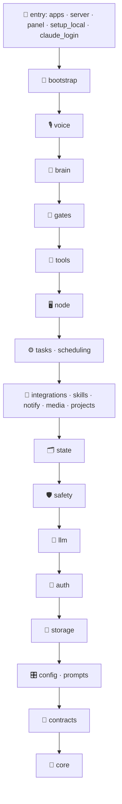
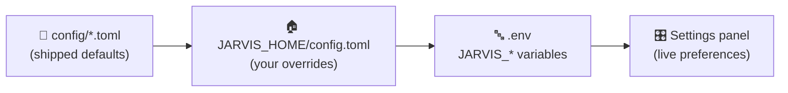

<div align="center">


# 🧱 Architecture Review

**Why the code was restructured into layers with contracts and configuration outside the package, what changed, and what is still open.**

[🏠 Home](../README.md) · [⚙️ Configuration](configuration.md) · [👩‍💻 Development](development.md) · [🏗️ Architecture](architecture.md) · [🧭 Features](features.md) · **🧱 Review**

</div>

---

> [!NOTE]
> **TL;DR.** After a long run of features, every package imported almost every other, settings were frozen into Python constants, model ids were hardcoded and 24 files talked to the Claude SDK directly. JARVIS now has **17 enforced layers with zero import breaks**, **one door to Claude** (`jarvis/llm/`), **models asked for by role** from `config/models.toml`, **every default in `config/jarvis.toml`** outside the package, **contracts plus a composition root** where lower parts need higher ones, and a **features catalogue generated from the code**. All 3,928 tests, pyright and the web type check pass.

<details>
<summary><b>📑 On this page</b></summary>

1. [Before and after](#-before-and-after)
2. [What was wrong](#-what-was-wrong)
3. [The layers](#-the-layers)
4. [Configuration outside the package](#️-configuration-outside-the-package)
5. [Models by role](#-models-by-role)
6. [Contracts and the composition root](#-contracts-and-the-composition-root)
7. [Knowing what features we have](#-knowing-what-features-we-have)
8. [Roadmap status](#️-roadmap-status)
9. [Still open](#-still-open)
10. [Ground rules](#-ground-rules)

</details>

## 📊 Before and after

Measured on `master` @ `c635e14` (before) and after the restructuring (2026-10-17).

| Metric | Before | After | |
|---|---:|---:|---|
| Imports that break the layers | **116** across 19 package cycles | **0** | ✅ enforced by `tests/test_architecture.py` |
| Files importing `claude_agent_sdk` | **24** | **5**, all in `jarvis/llm/` | ✅ the rest go through `jarvis/llm/sdk.py` |
| Files importing `ai_armory` | **11** | **1** (`integrations/armory.py`) | ✅ |
| Claude model ids in `jarvis/` | **4 files, 30 constants** | **0** | ✅ roles in `config/models.toml` |
| Defaults written in Python | **~150** env reads with literals | **0** | ✅ all in `config/jarvis.toml` |
| Settings read from the database at import | **5** | **0** | ✅ `state/preferences.py`, read when used |
| Duplicated warm-session code | **3 copies** | **1** each kind (`llm/quick.py`, `llm/standby.py`) | ✅ |
| `panel.py` | **1,222 lines, 93 actions** | **13 modules**, largest 238 lines | ✅ |
| Front/back drift on panel actions | unchecked (`panelCall<any>(string)`) | **type-checked** against generated `PanelAction` | ✅ |
| Features documented | by hand | **generated** (`docs/features.md`) | ✅ |
| Modules doing `from jarvis.config import NAME` | 64 | 59 | ➖ see [Still open](#-still-open) |
| Files running SQL directly | 20 | 21 | ➖ |
| Tests patching UPPER_CASE constants | 303 | 302 | ➖ |
| `safety/commands.py` | 2,262 lines | 2,264 lines | ➖ |

## 🔍 What was wrong

| Finding | Example | Now |
|---|---|---|
| **No layers** | `core` imported `safety`, `state` and `brain`; `safety` imported `tasks` and `voice`; `brain` imported `tasks` for a time formatter | Layers enforced; `core` imports nothing of JARVIS's |
| **Configuration was code** | `config.py`: 514 lines, ~165 constants, `.env`, `mkdir` and SQLite reads at import, data tied to the checkout | Defaults in `config/*.toml`; preferences read when used; `JARVIS_HOME` |
| **No single door to the LLM** | Four ways to reach Claude, fallback logic at each call site | `jarvis/llm/` only; roles; fallback inside `usage.available(role)` |
| **God files** | `panel.py`, `runner.py` with node calls woven through, `host.py` holding its own self-test | Panel split; runner takes its machines by contract; self-test in `apps/host_check.py` |
| **Things in the wrong home** | `Store` in `core/database.py`; `documents`, `transcribe`, `vault`, `claude_logins` in `core`; `conversation` holding brain types | Moved (see the [code map](architecture.md#-code-map)) |
| **Hardcoded values everywhere** | Model ids, Whisper and Kokoro names, risk kinds as free strings matched across files | In `config/*.toml`; `safety/risk.py` |

> [!WARNING]
> **Living proof.** A `git clean -fdx` wiped `data/node`, `.venv`, `.env` and `secrets/` on 2026-10-17 because **an install's data lived inside the source checkout**. `JARVIS_HOME` and `make home-move` now let the checkout hold only code.

## 🧱 The layers

Imports point **down**. Parts in one layer don't import each other, except two explicit, commented pairs. The entry points, which nothing imports, may use each other.



<details>
<summary><b>Why this order, where it differs from the first plan</b></summary>

<br>

| Decision | Why |
|---|---|
| **`gates/` between brain and tools** | The shell, draft and MCP gates and the injection hook read the conversation, the tool registry and the task runner. Their pure parts stayed below: MCP wording in `integrations/mcp_words.py`, draft tool names in `integrations/drafts.py` |
| **`node` above `tasks`** | Node runs tasks on another machine; the runner takes its machines through `contracts/remote.py` and runs everything locally without them (`tasks/local.py`) |
| **`state` below the services, `safety` below `state`** | Tasks and brain read what's kept for the user; safety's policy reads nothing above it. The per-call objects in the conversation are typed by `contracts/call.py` |
| **`llm` below `safety`** | Consent and the injection check may ask a model to judge; the provider knows nothing of policy |
| **`auth` low** | The vault and keys are used by integrations, notify, safety and node alike |
| **Allowed siblings** | `media → integrations` (HTML read the way `gmail_read` does) and `notify → integrations` (the Web Push contact falls back to the Google account's address) |
| **A custom AST test, not import-linter** | No new dependency, and it also checks vendor owners and model ids. Imports under `if __name__ == "__main__":` and in `__main__.py` count as entry points |

</details>

The test keeps a baseline file of known breaks that can only shrink; it is now **empty**, so any new break fails the build.

## ⚙️ Configuration outside the package



| Kind of value | Home |
|---|---|
| **Defaults of every setting** | `config/jarvis.toml`, grouped by area, each with the variable that overrides it |
| **Model ids** | `config/models.toml`: tiers, roles, choices, families |
| **Your overrides** | `JARVIS_HOME/config.toml` (or `JARVIS_CONFIG`), same tables |
| **Secrets and quick overrides** | `JARVIS_HOME/.env` |
| **Live preferences** | The settings table, read through `jarvis/state/preferences.py` when used, so they apply without a restart |
| **Ranges and parsing** | Code (`jarvis/config/__init__.py`): a bad value is clamped or falls back, never crashes a turn |

**JARVIS_HOME** is the `JARVIS_HOME` variable, else `~/.jarvis` once it holds an install, else the checkout (installs made before it keep working untouched). `make home-move` moves `.env`, `data/`, `secrets/`, `models/` and `logs/` there, repairs task worktrees and leaves a `data` link for paths kept in the database. The sandbox walls protect JARVIS_HOME the way they protect the checkout; when both are the same folder, the profile is byte-for-byte what it was.

## 🤖 Models by role

```toml
# config/models.toml
[tiers]
deep = "claude-opus-5-5"
balanced = "claude-sonnet-5"
fast = "claude-haiku-4-5-20251001"

[roles]          # a tier, another role, or a model id
voice = "deep"
announce = "fast"
goal = "task"
# ... 22 roles in all, each with the variable that overrides it
```

```python
# before
from jarvis.config import ANNOUNCE_MODEL
reply, _ = await sdk.ask(text, system(), usage.available(ANNOUNCE_MODEL))

# after
reply, _ = await claude.ask(text, system(), Role.ANNOUNCE)
```

- `jarvis/llm/roles.py` names the roles. `usage.available(Role.X)` falls back a tier while a family's weekly window is used up; the families come from `models.toml`.
- **Upgrading a model is one line** in `config/models.toml` or `config.toml`. Every old `JARVIS_*_MODEL` variable still works.

## 🔌 Contracts and the composition root

| Contract | Filled in by | Replaces |
|---|---|---|
| `contracts/call.py`: `Lookups`, `BackgroundCalls`, `SpeakerCheck` | the voice process | the conversation importing brain and voice types |
| `contracts/runner.py`: `RunnerUnavailable`, `ConnectionRunner` | `tasks.client`, handed to the MCP relay by `apps/mcp_launch.py` | `integrations → tasks` |
| `contracts/remote.py`: `Place`, `Offline`, `Machines`, `Links`, `Offload` | `node.offload.wire`, handed to `Runner` by `apps/runner.py` | 30 `tasks → node` calls |
| `worker.SessionTools`, `tool_watch.Registry` | `jarvis/bootstrap.py` | `tasks → brain`, `tasks → tools` |
| `vocabulary.load(projects)`, `project_terms(projects)` | the caller | `state → tasks` |
| `media.audio_file.make(deliver=…)` | `apps/audio_file.py` | `media → notify` |

**`jarvis/bootstrap.py`** is the composition root: every process calls `wire()` at start. That covers the runner, the node, the voice process (per job process), the web server and the tests' conftest. It hands task sessions JARVIS's tools and gives watches the tool registry. **`jarvis/apps/`** holds the processes. The old `python -m` paths the installed services run (`jarvis.voice.agent`, `jarvis.tasks.runner`, `jarvis.node`) stay as thin `__main__` shims, so no reinstall is needed.

## 🧭 Knowing what features we have

`make features` writes **[docs/features.md](features.md)** from the code itself:
- every part and its layer
- 63 tools by module, with flags
- the 22 model roles and which parts use each
- the processes, the contracts and the make targets

It reads statically, so the output is the same on macOS and Linux. It also writes `web/src/lib/panelActions.ts`, which makes the web app's panel calls type-checked against the server's real actions. `tests/test_features_doc.py` fails when either file is stale.

## 🗺️ Roadmap status

| # | Phase | Status | What landed |
|---|---|:-:|---|
| **0** | 🚧 Guardrails | ✅ | `tests/test_architecture.py`: layers, vendor owners, no model ids; a baseline that only shrinks, now empty |
| **1** | ⚙️ Config outside the package | ✅ | `config/jarvis.toml`, `config/models.toml`, `jarvis/config/` (files, models), `state/preferences.py`, `JARVIS_HOME`, `make home-move`, Makefile and service templates following it |
| **2** | 🤖 LLM gateway | ✅ | `jarvis/llm/`: roles, `claude.py`, `sdk.py` facade, `quick.py`, `standby.py`, `usage.py`, `retry.py`, `claude_logins.py` |
| **3** | ✂️ Cut the cycles | ✅ | `core` made pure; `auth`, `media`, `storage` split out; `projects` its own part; URL guard to `safety/urls.py`; `Risk` enum; `asks_question` and `speakable` to `core` |
| **4** | 💾 Storage | 🟡 | `storage/database.py` is connections and migrations only; the task store moved to `tasks/store.py`; the settings table to `storage/settings_table.py`. Each part still owns its table and SQL |
| **5** | 🔧 Composition root | 🟡 | `bootstrap.py`, `apps/`, panel split by area, the runner's machines injected. Module-level settings constants remain |
| **6** | ⏳ Tasks and node | 🟡 | The node↔tasks knot is gone (`contracts/remote.py`, `tasks/local.py`); `runner.py` and `offload.py` are still large |
| **7** | 📜 Wire contracts | 🟡 | Panel action names generated and type-checked; request and response shapes still hand-written |
| **8** | 🧭 Modules and catalogue | 🟡 | Generated features page; the `commands.py` split and policy files not started |

## 🔎 Second review

A second pass compared the changes against the old code, one area at a time. **Settings values, model choices, SDK options, all 93 panel actions and the sandbox profiles all match the old code.** Every bug it found was in the new `JARVIS_HOME` handling, and every one is now fixed with a test:

| Severity | Found | Fixed |
|---|---|---|
| 🔴 **Security** | Once the home was outside the checkout, a task's sandboxed shell could read `~/.jarvis/.env`, which holds the vault key | Task deny rules cover the install's own secrets and `.env` files wherever JARVIS_HOME is |
| 🟠 High | `make home-move` refused to run, because importing config had already made empty `data/` and `secrets/` folders, and left the services stopped | Empty folders don't count as a clash; a refused move restarts the services |
| 🟠 High | After a move, the services still pointed at the checkout (LiveKit config, `.env`, Linux log paths) | `home-move` rewrites every service (`setup_local install`) |
| 🟠 High | A `~/.jarvis` holding only a `config.toml` switched the install to an empty home | `~/.jarvis` counts only once it holds a `.env` or `data/` |
| 🟡 Medium | A quoted `"off"` in `config.toml` read as on; three on/off preferences ignored their `config.toml` default | Strings parse like the variables; the preferences fall back to the shipped default |
| 🟡 Medium | A non-hidden JARVIS_HOME could be registered as a project or written by a task grant | It is protected like the checkout |
| 🟢 Low | Symlinked items were skipped without a word; a custom home wasn't saved; the `data` link wasn't git-ignored; worktrees outside the checkout broke the projects folder; the Projects panel showed a dead command; two old `-m` paths ran nothing; `host-check` tested the checkout's `.env`; tests read a personal `config.toml` | Each fixed |

## 🧩 Still open

| Item | Why it's open | Suggested next step |
|---|---|---|
| **Settings as module constants** (59 modules import them by name) | Reading them at import is safe now that their values come from files, but they can't be swapped per profile or injected | A typed `Settings` object handed down from `bootstrap`, one area at a time |
| **Import-time `mkdir` and `.env` load in `jarvis/config`** | Many writers assume `data/` and `secrets/` exist | Move to `bootstrap.wire()` once writers create their own folders |
| **SQL spread across 21 files** | Each part owns its table through `storage.database.table()`, a consistent pattern; a repo per aggregate would be a large change with little behaviour gained | Repos where a table is shared by several parts (tasks, schedules) |
| **`safety/commands.py`, 2,264 lines** | It's the most safety-critical file; splitting it, and moving its rule tables to data files, deserves its own careful change | Split by concern (lexicon, shell parsing, risk rules, secrets) behind the current API, then tables into `safety/policy/*.toml` |
| **`tasks/runner.py` (1,026), `node/offload.py` (828), `node/work.py` (777)** | Their coupling is cut; their size is not | An event bus for task endings (chains, scheduler verdicts, push), then split offload and work by job kind |
| **Typed panel requests and responses** | 93 actions' shapes | Dataclasses per action → JSON Schema → generated TS types, area by area |

## 📏 Ground rules

- **The baseline only shrinks.** `tests/architecture_baseline.txt` is empty: keep it that way.
- **A lower part never imports a higher one.** Name what it needs in `jarvis/contracts/` and hand it in from `bootstrap.py` or the process's entry point.
- **No model id, default or vendor import outside its home.** Roles in `config/models.toml`, defaults in `config/jarvis.toml`, Claude in `jarvis/llm/`, AI Armory in `integrations/armory.py`.
- **Generated files are regenerated, never edited:** `make features`.

---

<div align="center">

[⬆ Back to top](#-architecture-review)

</div>
