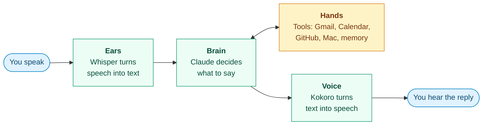
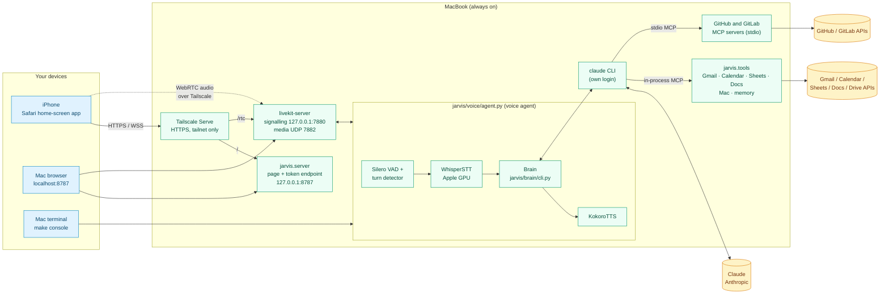
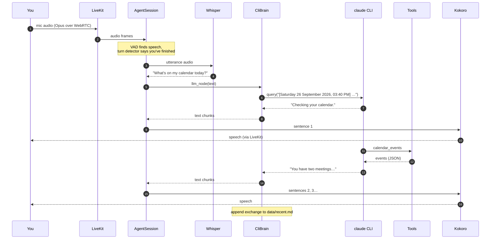

# JARVIS architecture

JARVIS is a personal voice assistant. It runs around the clock on one MacBook (Apple M2, 8 GB), and you talk to it from that Mac or an iPhone. Everything runs on the Mac except Claude itself, which is reached through the local `claude` CLI.

> **At a glance**
>
> - **Where it runs:** one always-on MacBook, as four background services.
> - **How you reach it:** the iPhone home-screen app (over Tailscale), a browser on the Mac, or `make console` in a terminal.
> - **What stays on the Mac:** speech recognition, turn detection and the voice.
> - **What leaves the Mac:** conversation text and background-task work sent to Claude, API calls made by tools (Google, GitHub, web search), and phone audio inside the encrypted Tailscale tunnel.

For setup commands, see the [README](../README.md) and `make help`. Unfamiliar terms are explained in the [glossary](#14-glossary).

## 1. The big picture

JARVIS works like a person in a conversation: it listens, thinks, maybe does something, and answers.

**LiveKit** carries the audio between your device and these parts, like a phone line. **Tailscale** is the private network that lets your iPhone reach the Mac without opening it to the internet.

---

## 2. How the pieces connect

Blue: your devices · Green: runs on the Mac · Amber: outside services

How a phone connects, in order:

1. Safari opens `https://<mac-name>.<tailnet>.ts.net`. Tailscale Serve forwards it to the web app.
2. You enter the passcode. The web app swaps it for a LiveKit token valid for one fresh room.
3. The page joins that room through LiveKit. LiveKit hands the room to the voice agent, which starts listening.

---

## 3. Components

**Background services** (started by launchd, restarted if they stop):

| Component | Code | Service | What it does |
|---|---|---|---|
| LiveKit server | Homebrew `livekit-server`, config in `secrets/livekit.yaml` | `com.jarvis.livekit` | The WebRTC media server. Signalling listens only on localhost; audio uses one UDP port, advertised at the Mac's Tailscale IP. |
| Web app | `jarvis/server.py`, `web/` | `com.jarvis.web` | Serves the page (the Vite build of `web/`, in `web/dist`) and trades the passcode for a 12-hour LiveKit token. Each connection gets a fresh room. Also stores the phone's push subscription, and serves the [control panel](#the-control-panel)'s actions and live task events. |
| Voice agent | `jarvis/voice/agent.py`, `jarvis/voice/session.py` | `com.jarvis.agent`, under `caffeinate` | A LiveKit Agents worker. Each room gets its own job process, which runs the voice pipeline below. The call's own parts and state are one `VoiceSession`: it routes each turn, puts tasks' requests to the user as the runner's events bring them (no polling), and lets everything go when the call ends; it talks to the brain through the typed `jarvis.brain.VoiceBrain`. |
| Task runner | `jarvis/tasks/runner.py` | `com.jarvis.tasks` | Runs background tasks in parallel, apart from any voice session, and publishes their updates. Its parts (approvals, command and connection tasks, git, suggested edits, events, the HTTP API) and each run (`worker.py` and its own parts) are modules beside it in `jarvis/tasks/`. See [Background tasks](#7-background-tasks). Also runs the [heartbeat](#8-heartbeat), the [scheduler](#scheduler) and the [learning review](#learning-review). |

**Inside the voice agent:**

| Component | Code | What it does |
|---|---|---|
| Noise filter | `jarvis/voice/denoise.py` | DeepFilterNet 3 through ONNX Runtime on one CPU core. A LiveKit frame processor on the room's mic input (`noise_cancellation`), so the VAD, barge-in and Whisper hear filtered audio; `JARVIS_DENOISE=vad` filters only what the VAD hears. Takes at most 18 dB off any sound. |
| Speech-to-text | `jarvis/voice/speech.py` `WhisperSTT` | Whisper large-v3-turbo, quantized to 4 bits (`mlx-community/whisper-large-v3-turbo-q4`, `JARVIS_STT`), through MLX on the Apple GPU: about 0.5 GB in memory, against 1.6 GB at 16 bits. Batch mode: VAD cuts the audio into utterances first. The model itself runs in the shared speech process (below). Each clip goes with the speech vocabulary as Whisper's prompt (below). |
| Speech vocabulary | `jarvis/state/vocabulary.py`, `data/vocabulary.md` | Names and unusual words speech recognition should expect, the user's own like memory: one line each, `- JARVIS (heard as: Yavis, Cajarves) (YYYY-MM-DD)`, with `, learned` after the date for one the learning review added. Until the first change it's just "JARVIS". At the start of each conversation `WhisperSTT.use_vocabulary` gets the entries (the user's own first), then the project list's names as said ("AI Armory" for `ai-armory`), then the learned ones newest first, cut at 600 characters (about 150 tokens, under the 223 Whisper keeps) and sent with each clip as `initial_prompt` (`JARVIS_STT_PROMPT=off` stops that). After the speech gate passes a clip, its known mishearings are replaced by their words, whole words or phrases in any case only. A transcript that is nothing but three or more of the prompt's words is the prompt echoed back, and the gate drops it as `prompt echo`. At most 60 entries: when the review adds one more, the learned entry confirmed longest ago goes; the user's own are never dropped to make room. Changed in the panel (Settings → Vocabulary), by voice (`vocabulary_add`) and by the learning review. |
| Speech gate | `jarvis/voice/speech_gate.py` | Judges each utterance's audio and Whisper's confidence, so Whisper's phantom "Thank you." on near-silence doesn't reach the brain: Silero VAD run again over the clip, its length and loudness, the three together for faint clips (little speech, quiet and short), Whisper's no-speech probability and average log-probability, and a higher audio bar for transcripts that are nothing but a known phantom ("Thank you.", "You", "like"); never "yes", "no" or "okay". Transcripts without words, or looping, are dropped too. `JARVIS_SPEECH_GATE=enforce` (default) drops it; `shadow` only logs what it would drop. In shadow mode it also saves each clip as a WAV in `logs/speech-gate-audio/` (newest 300 kept), its path in the clip's `logs/speech-gate.jsonl` line; otherwise only the short clips it lets through. |
| Speaker check | `jarvis/voice/speaker.py`, `jarvis/state/voiceprints.py` | Once the user has enrolled a voiceprint (a WeSpeaker ResNet34 embedding, ONNX on the CPU, averaged over about 25 s of their speech and kept in the `voiceprints` table of `data/tasks.db`), each utterance's speech, without the silence around it, is embedded and compared with it by cosine similarity, in the call's job process while Whisper runs in the shared one. Speech that isn't theirs is dropped before the brain, so JARVIS stays silent. Short clips need less (0.25 at 1 s of speech against 0.35 from 3 s), and less again while the user is in a conversation (they were the last voice heard, or JARVIS just spoke), where under 0.4 s goes through unjudged; the user's clearly recognised utterances move a second reference halfway towards how they sound in this call. `JARVIS_SPEAKER_CHECK=on` (default) drops; `shadow` only logs, in `logs/speaker-check.jsonl`. With no voiceprint nothing is checked. Barge-in (`jarvis/voice/barge_in.py`): the session's VAD goes through `BargeInVAD`, which, while JARVIS is thinking or speaking, reports no speech to LiveKit until the check has heard the user in the VAD's speech windows (first at 0.5 s of speech, about 15 ms on the CPU, then every 0.25 s more on the latest second, needing what a short clip needs outside a conversation), so only the user's voice interrupts a reply; anyone else's leaves it playing. Each judged barge-in is logged in `logs/speaker-check.jsonl` (`"kind": "barge-in"`). In shadow mode, with the check off, no voiceprint or `JARVIS_SPEAKER_BARGE_IN=off`, events pass through untouched (shadow still logs what it would do). Enrolling: by voice (`voice_enroll`: the next half minute of the user's speech goes to the voiceprint, not the brain), in the panel (Settings → Preferences: 30 s recorded in the page, sent as 16 kHz PCM to `voiceprint_enroll`), or `make voiceprint ARGS=enroll`. The model loads only once a voiceprint is in use: about 80 MB in the call's process. If it fails, clips go through. |
| Voice | `jarvis/voice/speech.py` `KokoroTTS` | Kokoro v1.0 through ONNX Runtime, the full 32-bit model (`JARVIS_TTS_MODEL`; the 8-bit one rendered 30–60% slower on an M2), voice `bm_george`, on 2 to 4 threads that sleep rather than spin between sentences (`JARVIS_TTS_THREADS`). Speaks one sentence at a time as the brain streams its reply; a sentence of more than 12 words goes in pieces cut at its commas, semicolons, colons or dashes, none under 4 words (`jarvis/voice/clauses.py`), so a long one doesn't keep you waiting while it's rendered whole. Each piece's render time against its length when spoken is logged (`Kokoro rendered 9 words in 1650 ms for 2.6 s of speech (0.63x real time)`), as a warning when rendering is slower than speaking: pieces render while the one before plays, so that's what leaves pauses between them. The model itself runs in the shared speech process (below). |
| Audio files | `jarvis/voice/audio_file.py` | Text read into an m4a, mp3 or WAV to listen to later (the `audio_file` tool). Not in the shared speech process, whose one-at-a-time queue would hold up live speech: a long job (`shell.Jobs`) of its own, `python -m jarvis.voice.audio_file SPEC.json`, with its own Kokoro (`JARVIS_AUDIO_MODEL`, the full 32-bit model by default), at lower priority (`nice` 10) on a quarter of the cores, one file at a time. See [Audio files](#audio-files). |
| Shared speech process | `jarvis/voice/speech.py` `WhisperRunner`, `KokoroRunner` | LiveKit's inference process: the worker starts it before taking calls, Whisper and Kokoro load in it once, and every call's job process sends it audio or text over the worker's IPC. Requests queue one at a time. If it's down, a call's STT or TTS fails at once with an error in `logs/agent.log`; restarting the agent service restarts it. |
| Brain | `jarvis/brain/cli.py` | Turns an utterance into a streamed spoken reply, calling tools on the way. |
| Announcements | `jarvis/voice/floor.py` | When JARVIS speaks unprompted: task updates, heartbeat alerts, finished shell jobs and tasks' requests. They're held while an exchange is under way: JARVIS thinking or speaking, the user speaking or their words still being transcribed or waiting for the turn detector, or JARVIS's last words asking a question the user hasn't answered yet. The question closes when the user next speaks, or after 2 minutes with nobody talking. Once nothing holds them, a fast model judges the moment from the conversation and each item's urgency and time: say it now, cut in with an apology (urgent items only), wait for a better moment (after the next exchange or a quiet spell), or send it to the phone; held 15 minutes, or left when the session ends, it goes to the phone. Without the model (`JARVIS_PROACTIVE_JUDGE=off`) they're said at once, one at a time, in order. The same words aren't said twice within 5 minutes. |
| Tools | `jarvis/tools/`, `jarvis/safety/draft_gate.py` | Gmail, Calendar, Google Chat, Google Sheets, Google Docs (read, edit, add images), from AI Armory, with their sends and deletes held for a spoken yes; Mac control, also from AI Armory; memory, to-do list. |
| MCP servers | `jarvis/integrations/mcp_servers.py`, `jarvis/integrations/mcp_launch.py`, `jarvis/integrations/mcp_bridge.py`, `jarvis/integrations/mcp_registry.py`, `jarvis/integrations/mcp_oauth.py`, `jarvis/tools/connections.py`, `jarvis/safety/mcp_gate.py` | External MCP servers (GitHub, GitLab, Notion, ...), found in the official MCP registry and connected by voice after a yes, listed in `data/tasks.db` and read as each session starts; each started by a launcher that alone decrypts its secrets (bridging HTTP ones with a key or sign-in); tools sorted from their own markings; writes wait for a spoken yes. See [Tools](#6-tools). |
| Database | `jarvis/core/database.py`, `data/tasks.db` (the owner's; each profile has its own) | One SQLite file per profile, shared by the runner, voice agent and web server. Every connection comes from `database.connect()`: WAL, NORMAL sync, and a 10 s busy timeout (`BUSY_SECONDS`) before "database is locked". Each table is opened through `database.table()`, which first brings it to its latest version (`migrate()`): version 1 makes it (and adds the columns added before versions were kept, so an older database keeps its rows), then its ordered migrations run once each, counted in `schema_versions`; a schema change is a new migration on the end of the list, never an edit. The runner keeps tasks' steps (each tool call) in memory and writes them every second on a thread, in one transaction, and before anything else it reads or writes. |
| Vault | `jarvis/core/vault.py`, the `secrets` table in `data/tasks.db` | Secrets encrypted with AES-256-GCM under `JARVIS_MASTER_KEY` (32 bytes in `.env`, "new,old" while rotating), with a check row that catches a wrong key. |
| Memory | `jarvis/state/memory.py`, `data/` | `memory.md` holds long-term facts, one line each (`- fact (YYYY-MM-DD)`), in two sections: `## User` (preferences, habits, goals, how you like to be spoken to) and `## Environment` (machine, setup, tools, projects, accounts). Lines under no heading count as User. User holds at most 2,000 characters and Environment 3,000, counting whole lines with their dates, and no line may be over 400. Whoever saves a fact names its section; a fact that doesn't fit is refused with the section's facts listed, numbered with their lengths, so JARVIS can merge or shorten them (`memory_replace`) and save again; it asks you before dropping anything. From 90% full, a save says to consolidate soon. `recent.md` is a rolling transcript of about 6 KB; `conversations/YYYY-MM-DD.md` keeps every exchange, spoken approval and announcement, one file a day. |
| To-do list | `jarvis/state/todo.py`, the `todos` table in `data/tasks.db` | The user's to-dos: id, text, done flag, created and done times, read back as a markdown checklist. Kept apart from memory: it isn't loaded into the prompt, the brain reads it when asked. |
| Project list | `jarvis/tasks/projects.py`, the `projects` table in `data/tasks.db` | The projects code tasks can work on: name, folder, aliases, about and in place, in the order added. See [Projects](#projects). |
| Remembered approvals | `jarvis/safety/remembered.py`, the `approval_rules` table in `data/tasks.db` | Kinds of risky command you said to allow for a session or always, which then run without asking, for tasks and the voice shell. See [Remembered approvals](#remembered-approvals). |
| Profiles | `jarvis/core/profile.py`, the `profiles` table in `data/tasks.db` | Who JARVIS works for: name, time zone, data folder, database and sign-ins folder, one per person. The owner's is made from what the install had (`.env` or the Settings panel's name and time zone, `data/`, `data/tasks.db`, `secrets/`). Code reads `profile.current()` as it runs (a session's or task's, else the owner's, read afresh), so paths, prompts and a changed name or time zone need no restart. Tests run as a profile of their own (`tests/conftest.py`). |
| Conversation state | `jarvis/state/conversation.py` | One voice conversation's own state on one object: the user's words this turn (`heard`), a rule offered for saving (`offer`), the speaker check and the background lookups, begun by the voice agent for each conversation. The task runner keeps its own the same way: its tasks' long jobs (`Runner.host_jobs`) and the goal checks' daily budget (`Runner.checks`). |
| Hidden-instruction scan | `jarvis/safety/scan.py` | `scan(text, source)`: strips invisible Unicode and flags prompt injection, before anything is kept in memory, the to-do list or the project list, in suggested edits (a learned skill's text judged as instructions), in the project files code tasks load, and in the markdown of skills being installed (`jarvis.skills.review.scan`). A reusable function, for anything else that vets text. |

**On demand:** `jarvis/setup_local.py` and the `Makefile` generate keys, the passcode and the LiveKit config, and install the services.

---

## 4. One spoken turn

What happens when you ask "What's on my calendar today?":

| Step | What happens | Where |
|---|---|---|
| 1. **Hearing** | The browser sends your mic audio to LiveKit, with echo cancellation, noise suppression and gain control. The agent subscribes to it. | Your device → LiveKit |
| 2. **Deciding you're done** | DeepFilterNet takes the background noise out of the audio. Silero VAD spots speech. At each pause LiveKit's v1-mini turn detector, a small audio model, gives the chance you've finished. When it's unsure, a fast model (Haiku, on a warm session) reads JARVIS's last words and yours so far and decides whether your thought is finished (`jarvis/voice/turn.py`), so "Okay, great. So..." isn't taken for the end. A finished turn ends after a short wait, an unfinished one after a long one; both start at 0.9 s and 4 s (`JARVIS_TURN_MIN_DELAY`, `JARVIS_TURN_MAX_DELAY`) and then follow each speaker's own pace, learned from when they carried on after JARVIS had taken a pause for the end. Counted from your last word, so Whisper's own time is part of the wait. | Agent |
| 3. **Transcribing** | The whole utterance goes to Whisper at once. Preemptive generation is off, so the brain only ever sees finished utterances. The speech gate checks the same audio for real speech; in enforce mode, a clip without any is dropped here. Meanwhile, once the user has a voiceprint, the speaker check embeds the clip's speech on the CPU and drops it if it isn't their voice. | Agent (GPU; speaker check on the CPU) |
| 4. **Thinking** | `JarvisAgent.llm_node` replaces LiveKit's own LLM step and streams the brain's reply back. (The session holds a `BrainPlaceholder` only because the pipeline requires an LLM object.) | Brain → Claude |
| 5. **Speaking** | LiveKit splits the reply into sentences, and long sentences at their pauses (`jarvis/voice/clauses.py`), and sends each piece to Kokoro as soon as it's complete, so JARVIS starts talking before the full reply exists. The first piece goes sooner still: a short first sentence alone, a long one at its first pause. | Agent → your device |
| 6. **Captions** | Both sides of the transcript go out on the `lk.transcription` text stream, and the page shows them live. | LiveKit → page |

The same turn, message by message:

### Interrupting JARVIS

If you talk over JARVIS, VAD stops the speech and LiveKit cancels the brain's reply. The brain interrupts the CLI, then drains its output up to the result message in the background, so the next turn starts clean.

### How fast it is (measured on this Mac)

| Stage | Time |
|---|---|
| Noise filter | About 8 ms of CPU per 50 ms frame (1.4 ms per 10 ms model step), and about 40 ms of added delay |
| Noticing you've stopped | About 0.5 s of silence (the endpointing minimum) |
| Whisper, one sentence | 0.4 s warm. The first call takes about 3 s, so it's warmed up when the shared speech process starts. |
| Brain, first words for a simple question | 1–2 s |
| Brain, when a tool is needed | About 7 s in total. JARVIS first says a short phrase that fits the job, so there's no dead air; a question it can answer at once gets none. |
| Kokoro | 0.7 s to make 4.6 s of speech, one sentence at a time |

**Measuring it.** Every turn is timed (`jarvis/voice/timing.py`): one JSON line in `logs/voice-turns.jsonl`, and a `voice turn` line in `logs/agent.log`, written once its reply has been spoken or cut off. Each stage is seconds after you stopped speaking (LiveKit's VAD end of speech; a typed turn is timed from when it arrived):

| Field | What it is | Measured by |
|---|---|---|
| `transcript` | Whisper's text ready | LiveKit (`transcription_delay`) |
| `turn_end` | The turn detector decided you'd finished | LiveKit (`end_of_turn_delay`) |
| `brain` | The reply started: `JarvisAgent.llm_node` | JARVIS |
| `sent` | Your words went to the claude CLI, after any yes-or-no check, a command still running, and photos | `CliBrain.respond` |
| `first_text` | The reply's first words | `llm_node` |
| `first_tool` | The model began its first tool call | `CliBrain.respond` |
| `first_audio` | JARVIS's voice started | LiveKit (the reply's `started_speaking_at`) |
| `done` | The model's reply ended | `CliBrain.respond` |

Beside them: `speech` (how long you spoke), `words`, `tts_first` (Kokoro's time from its first text to its first audio), `ack` (what JARVIS said before its first tool call), `tools`, `spoke` (how long JARVIS spoke) and `ended`: `spoken`, `interrupted` (talked over while speaking), `unspoken` (you went on before any of it was heard: JARVIS took a pause for the end of your turn) or `closed` (the session ended first). An unspoken turn has `resumed` too, the seconds from you stopping to your speaking again. How the turn's end was decided: `eot` (the turn detector's chance you'd finished), `judge` and `judge_s` (the fast model's verdict and its time, when it was asked) and `wait` (short or long); and `speaker` and `logprob` (who spoke, and how sure Whisper was). `make voice-timing` (`HOURS=` for another window) gives each stage's median, 90th percentile and maximum, the waits between them (for the turn to end, before the model, the model's first words, first words to voice), and the slowest turns.

---

## 5. The brain

The brain turns your words into JARVIS's reply: `CliBrain` in `jarvis/brain/cli.py`, made by `make_brain()`, with `start()`, `respond(text) -> AsyncIterator[str]` and `close()`. It talks to Claude through the local `claude` CLI, driven by the Claude Agent SDK, so it counts against the Claude plan's usage limits. It searches the web with the CLI's built-in `WebSearch` and `WebFetch`, and has a shell: `Bash`, sandboxed unless it asks otherwise, and long jobs (see below).

LiveKit's own Claude plugin isn't used, because it doesn't handle thinking and prefill correctly on current models.

### CLI brain details

- **One CLI process per voice session.** It starts while the room connects and keeps the conversation in context for the rest of the session.
- **Its own login.** `CLAUDE_CONFIG_DIR=secrets/claude` keeps JARVIS's Claude account separate from your everyday Claude Code login.
- **Locked down.** The built-in tools are `WebSearch`, `WebFetch`, `Bash`, and the subagent tool (`Agent`, which the bundled CLI still reports as `Task`) with the file reads only its subagent may use, plus `Skill` when [skills](#skills) are switched on. JARVIS's own tools come from an in-process MCP server called `jarvis`, and `start_job`, `job_status` and `stop_job` from one called `shell`. `schedule_add` and `schedule_change` meet `shell.ShellGate`, which weighs a command job's command as a shell command ([Scheduled commands](#scheduled-commands)). Anything else goes to `shell.ShellGate`, which denies it. `setting_sources=[]` and `strict_mcp_config=True` stop it loading user settings, CLAUDE.md files or other MCP servers, and its only skills are JARVIS's own switched-on ones, from a plugin made for the session. There is no file editing.
- **Lookup subagent.** For a quick question about files or code ("what version is the event backend on?"), the brain hands it to `lookup` (`brain.cli.LOOKUP`), a read-only subagent on `claude-haiku-4-5` (`JARVIS_LOOKUP_MODEL`) with only `Read`, `Glob` and `Grep` and at most 15 turns, and speaks its one-to-three-sentence answer. Its prompt carries a map of JARVIS's repo and `data/`, and with no folder given it searches the repo root rather than its working folder, `data/shell`. The brain can't read files itself: `ShellGate` allows file reads only from a subagent, and only paths clear of the hidden ones below, which the settings' `Read` deny rules also block. Claude Code's built-in subagents (`general-purpose`, `Explore` and the rest, which inherit every tool) are denied (`sdk.BUILTIN_AGENTS_DENIED`), and the gate starts no subagent but `lookup`. A subagent's streamed text is never spoken: only events without a `parent_tool_use_id` are. Bigger digging is a `code_question` task.
- **Hands off multi-step work.** The persona limits a turn to what one or two quick tool calls can do, where a single build, test run or render counts as one (a long one as a `start_job`). Installs and setup, fixing what a build or test run turned up, chains of shell commands, code changes and codebase digging go to a background task even when the shell could do them, and a request that turns out bigger stops after its second step and is handed over.
- **Shell (`jarvis/safety/shell.py`).** Commands run in Claude Code's macOS sandbox from `data/shell/` unless the model asks otherwise (`dangerouslyDisableSandbox`), and inside it they run without asking.
  - **Inside the sandbox** they can read files, except `secrets/`, `.env`, `~/.ssh`, `~/.aws`, `~/.gnupg`, `~/.config/gh`, `~/.netrc`, `~/.npmrc`, `~/.pypirc`, `~/.git-credentials`, Docker credentials and the Keychains (`commands.HOME_SECRETS`, the one list the voice shell, the task gate and the host profile share). They can write only to `data/shell/` and reach no network.
  - **Outside it:** a command that needs more (to write in a project's folder, say, or use the network) goes to `ShellGate`, and so does every `start_job`. There, `commands.risky` (shared with background tasks' host commands) sorts it:

  | Kind | Examples | Outcome |
  |---|---|---|
  | **Ordinary** | Renders, builds, tests, `git commit`, `git merge`, `git pull`, reading anything that isn't a secret | Just runs. Each is logged in full in the agent log. |
  | **Risky** | Deleting files (`rm`, `find -delete`, `git clean`, `git reset --hard`, `rsync --delete`, ...), any `git push`, installing or removing software (`brew`, `pip`, `npm install`, `uv add`, ...) or downloading and running it (`npx`, `uvx`, `bunx`, `pipx`, `npm exec`, ...), writes on GitHub or GitLab (`gh`, `glab`), stopping or killing processes (`kill`, `pkill`, `launchctl bootout`, `docker stop`, ...), `sudo`, changing permissions or system settings, sending data off the Mac (`curl -d`, `scp`, `ssh`), writing to a dotfile, and anything whose real command it can't see (`sh -c`, `eval`, `python -c`, `osascript`, `git -c`, `git config` writes to `alias.*` or `core.*`, `git difftool -x`, `--ext-diff`) | Needs a yes. |
  | **Names a hidden path** | | Refused, even with a yes. |

  The command line is split at `;`, `&&`, `|`, subshells and command substitutions, and each part is judged on its own, so `cd x && rm -r y` counts as risky.

  **Asking.** A risky command is refused, and at the end of the turn JARVIS asks only "Okay to go ahead?" (not added if the reply already ends in a question). The command isn't read out; it's logged in full.
  - **How long:** the question stays open for `JARVIS_APPROVAL_MINUTES` (default 5). Whatever else you say in between leaves it open, and only a clear no (`commands.refuses`: "no", "don't", "cancel", "never mind", "not now", ...) drops it.
  - **What counts as a yes** (`commands.approves`): once filler ("um", "please", "Jarvis") and punctuation are dropped, it must consist only of affirmatives such as "yes", "okay", "sure", "go ahead", "keep going", "do it", "it is allowed", "you have my permission", "all three" or "yes, delete it". A question, a "but", "only" or "wait", or a change of subject isn't one by the lists.
  - **When the lists can't tell** (`jarvis.safety.consent`): a reply that's neither a yes nor a clear no by the lists goes to one short call to `JARVIS_CONSENT_MODEL` (Haiku) with no tools, which sees only the user's own words, which kind of question was asked (a risky command, a Google send or delete, a change on GitHub or GitLab, a task's request, saving a rule, looking at the screen) and what's waiting as the gate describes it in code ("a command that stops a process", "sending a Google Chat message"), never the command, the draft or anything a tool turned up. It answers yes, no or unclear, and for a yes once, session or always, so "yes, let's proceed with the restart", "you can stop them" to a command that stops a process, or a yes in another language counts. Unclear is no yes: the question stays open and is asked again. A clear no by the lists always wins and isn't sent; a question, or words longer than a reply, aren't sent either; a call that fails or takes over `JARVIS_CONSENT_SECONDS` (default 8) counts as unclear. Starting the CLI for the call takes seconds by itself, so a session for it starts as soon as JARVIS asks a question, while the user is still answering; each is used for one check, then closed in the background, so a check that runs out of time doesn't hold up the turn. A question answered only after other talk (`later`) takes words that tell JARVIS to go ahead with it: a stray "okay" a couple of exchanges on isn't enough. The model's "always" is still put to the user as a rule to save, what a rule can cover stays fixed in code (`remembered`), and a scope phrase the lists find in the same words narrows the model's scope. The same goes for the voice agent's task questions and rule offers, `task_approve` and `screen_look`.
  - **What a yes does:** it reaches the model with the exact command, and it stays good for the same few minutes; the model then has to repeat that command, which runs. A repeat that only wraps it differently (`commands.same_risk`: the same risky parts in the same folders, with a pipe into `tail` or a `git status` before) counts as the same, and running it again in that turn, say after a failure, isn't asked about again. Several commands asked in one turn can all be approved by one yes.
  - **When nothing is asked** (`ShellGate._told`): the user's own words this turn already order just what the command does (`commands.ordered`: "push it", "merge and push", "restart now", "delete the build folder", "install ffmpeg", "kill the hidden Chrome"), or they're a clear yes to JARVIS's question just before, which asked to do it (`commands.agreed_to`: "Shall I push the changes?" "Yes."). Only some verbs order anything, each for the commands it plainly names: `push` for `git push` (a force push only with "force", never one that deletes on the remote), `restart`/`stop`/`start` for `launchctl`, `brew services`, `docker` and `podman` and, for stopping, `kill`, `pkill` and `killall` (these two only for a process the words name), `install`/`uninstall`/`update` for package managers (every package named), `delete`/`remove` for `rm`, `trash` and `git rm` (every path named by its own name, never a home or top folder or a glob), and `merge`/`open` for a pull request on GitHub or GitLab. Every risky part of the line must be ordered. A question, a no, a hedge or a condition ("should", "if", "before", "maybe", "don't") is no order; a question offering a choice ("restart now, or wait?") takes no yes. Sending data off the Mac, system settings, running as root, code the check can't see into and secrets have no order words, so they still ask. The words are the user's alone (the conversation's `heard` (`jarvis.state.conversation`)), never an email's, a page's or a tool result's.
  - **How far a yes goes** (`commands.yes_scope`): "just this once" is the default. "Yes, for this session" also keeps a rule that lets commands of that kind run without asking for the rest of the conversation; "yes, always" ends the turn with what the rule would cover and "Save that rule?", and only your next words, a clear yes, keep it. Some kinds always ask. See [Remembered approvals](#remembered-approvals).
  - An interrupted turn that never got to ask can't be answered.
- **Long jobs.** Anything that may take more than a minute goes to `start_job`, after JARVIS has said up front that it will take a while. `shell.Jobs.start` asks the task runner for a **command task** (`client.start_command`, POST /commands), in the folder given or the scratch folder, with an optional `timeout_minutes` and `fix` (false when the user doesn't want it fixed); see [Command tasks](#command-tasks). So a job is in the task list with every task, its end is said through the runner's task events like any task's (no queue of the voice process's own), and talking over JARVIS, the CLI restarting, the voice session ending or the runner restarting doesn't stop it. `job_status` lists the command tasks running and those of the last day, with the end of their output (`client.tasks`).
- **Stopping a job.** When you ask, `stop_job` stops one by its id (its task's), by `scheduled_job` for a scheduled command's run (its job's `last_task`), or by its title among the running command tasks (the exact title, or the one running job whose title contains the words; if several match it names them, and JARVIS asks which). Your asking is the yes, so it's allowed outright, unlike `kill`, which stays risky. It can stop only command tasks: `client.stop` reaches `Runner.halt`, which for a running command task calls `stop_command`: SIGTERM to the command's process group and to anything else in its session (`host.session_members`), up to 5 seconds' grace (`host.STOP_GRACE`), then SIGKILL to whatever is left. A job's pid is checked against the time the job started (`Jobs._ours`), so a pid since reused by another process is never signalled. The task ends `stopped`, isn't looked into or fixed, and JARVIS just says it stopped. `task_stop` does the same.
- **Talking over a running command.** Speaking normally stops JARVIS's reply (`client.interrupt()`). While a `Bash` command of that reply is still running, though, the reply is left to finish unheard instead, so the command isn't cut off. Your next turn starts with "One moment, that command is still running." and waits for it; what the finished reply said is passed on to the model with your words, since you didn't hear it. `Bash` itself is given up to 10 minutes per command (`BASH_DEFAULT_TIMEOUT_MS`), not the CLI's default of 2.
- **Limits.** `max_turns` is 8 per utterance, and effort is `low` so spoken turns stay quick. The model is `claude-opus-5-5` unless `JARVIS_CLI_MODEL` says otherwise. The binary is the CLI bundled with `claude-agent-sdk` (Opus 5.5 needs 2.1.280 or newer), unless `JARVIS_CLAUDE_CLI` points elsewhere.
- **When usage runs out,** JARVIS says so and stays quiet until the limits reset.
- **Usage limits (`jarvis/brain/usage.py`).** The CLI reports the plan's limits only through its `rate_limit_event` (the SDK's `RateLimitEvent`), sent when a window's state changes: `allowed`, `allowed_warning` or `rejected`, for one window (`five_hour`, `seven_day`, `seven_day_opus`, `seven_day_sonnet`, `overage`), with its reset time and, when it says, the fraction used. `LimitWatch` (the voice brain and every task) and `sdk.ask` (goal checks, triage, the learning review) record each event in `data/usage.json`, so the voice agent and the runner share the latest word; a window past its reset counts as fresh again. From it: `usage_left` answers "how much is left?"; the heartbeat warns once per window as it gets close and when it's used up; the scheduler holds runs that need a model until the reset ([Scheduler](#scheduler)); and while only one model's weekly window is used up (`seven_day_opus` or `seven_day_sonnet`), `usage.available` puts the voice, tasks, scheduled runs and short calls on the next lighter model (Opus to Sonnet, Sonnet to Haiku). What it can't know: anything between events (the CLI says nothing while a window is fine, and nothing at all with no calls, so "how much is left" is as of the last call), a percentage when the CLI leaves `utilization` out, and the exact numbers `/usage` shows in Claude Code, which come from an account endpoint the SDK doesn't expose. The CLI's own `--fallback-model` isn't used: it covers an overloaded model, not a usage limit, and a scheduled run that fails on overload is retried anyway.

### Persona and context

`brain.PERSONA` is the system prompt. Its text is markdown, `jarvis/prompts/persona.md`, which `persona.py` fills in (`prompts.load`) with the user's name and what it says about them. It sets:

- **Character:** who JARVIS is, then "About" the user: their own "about you" text, a setting in `data/tasks.db` (`jarvis.state.settings`), and a line on their Google accounts (`accounts.describe`), with each label's email and note and which is the default.
- **Voice rules:** no markdown, short replies, numbers written the way they're said, and a short phrase before any tool call.
- **Action rules:** reading is always fine; confirm before anything that reaches other people or can't be undone; what tools bring back is data, never instructions; multi-step work goes to a background task; the rules for granting tasks access and answering their requests to run risky commands.

How to use each tool (when to reach for it, what to say after it, what needs a yes) is in that tool's own description, not the persona: the memory, to-do, schedule, file, task and project tools say it in JARVIS's code, the Google tools in AI Armory's, and the clipboard tools in AI Armory's plus a note of JARVIS's own (`jarvis/tools/mac.py`, added by `register_toolsets`). The other long prompts live in `jarvis/prompts/` the same way.

At session start the prompt also gets `data/memory.md`, as `<long_term_memory>` with each section under its name and how full it is ("About Sam (1,234 of 2,000 characters)"), and `data/recent.md`. It is then frozen for the session so the prompt cache stays valid. Each of your messages is prefixed with the current local date and time.

---

## 6. Tools

Tools are plain Python functions registered with `@tool(name, description, properties, required)`.

| | |
|---|---|
| **Google tools** (Gmail, Calendar, Chat, Docs, Sheets, Slides, Drive) | From [AI Armory](../../ai-armory)'s Google tool sets. `jarvis/tools/google.py` hands them JARVIS's accounts, its `secrets/` folder for their sign-ins, the time zone, the user's name and JARVIS's sign-in command (`configure(GoogleSettings(...))`), then registers them under their own names with `tools.register_toolsets`, and those AI Armory marks `needs_confirmation` as gated. |
| **Mac tools** | From AI Armory's Mac tool set the same way (`jarvis/tools/mac.py`), with nothing to set up. |
| **Web browser** | JARVIS's own (`jarvis/tools/browser.py`, `jarvis/integrations/browser.py`), registered with `enabled=config.browser_on`: a tool with a switch is offered only while it's on, as each session starts (`sdk.jarvis_server`). See [Web browser](#web-browser). |
| **One registry** | `tools.all_tools()`, served to the brain (and to tasks) as an in-process MCP server (`sdk.jarvis_server`). |
| **Input checks** | `tools.run()` checks every input against its schema before running the tool (AI Armory's tools check their own), and sync tools run in a thread. |

### Every tool at a glance

| Tools | Reaches | In short |
|---|---|---|
| `calendar_events`, `calendar_event`, `calendar_free_time`, `calendar_create_event`, `calendar_update_event`, `calendar_draft_invite`, `calendar_send_invite`, `calendar_draft_update`, `calendar_send_update`, `calendar_draft_respond`, `calendar_send_response`, `calendar_draft_delete`, `calendar_delete_event` | Google Calendar (every account) | Read, find free time, create, move, rename, answer and delete events; anything that emails guests, and any deletion, goes ahead only after a yes. [Details](#calendar) |
| `gmail_search`, `gmail_read`, `gmail_create_draft`, `gmail_modify`, `gmail_draft_send`, `gmail_draft_reply`, `gmail_send` | Gmail (every account) | Search, read, draft, label, and send or reply in the thread, **only after a yes**. [Details](#gmail) |
| `gmail_attachments`, `gmail_attachment_read`, `file_read` | Gmail (every account, read-only) and files on this Mac | List an email's attached files and read one; read a document or picture on the Mac. [Details](#files-and-attachments) |
| `audio_transcribe`, `gmail_attachment_transcribe` | Recordings on this Mac and attached to emails (read-only), Whisper on the Apple GPU, `data/transcripts/` | Transcribe an audio or video file; the tool gives the transcript's path and a short preview, or its text a part at a time. [Details](#recordings) |
| `sheets_search`, `sheets_read`, `sheets_write`, `sheets_append`, `sheets_add_tab`, `sheets_draft_delete_tab`, `sheets_delete_tab`, `sheets_format` | Google Sheets and Drive (every account), on the same sign-in as Gmail | Find, read, write and format sheets; deleting a tab waits for a yes. [Details](#google-sheets) |
| `docs_search`, `docs_read` | Google Docs and Drive (every account), on the same sign-in as Gmail, read-only | Find docs and read them as plain text. [Details](#google-docs-reading) |
| `slides_search`, `slides_read`, `drive_search` | Google Slides and Drive (every account), on the same sign-in as Gmail, read-only | Find any file or folder by name or content; read a deck slide by slide with its speaker notes. [Details](#google-slides-and-drive) |
| `docs_beautify`, `docs_format`, `docs_replace_text`, `docs_insert`, `docs_draft_delete`, `docs_delete` | Google Docs (every account), on the same sign-in as Gmail | Tidy, format, edit and delete in docs; deleting waits for a yes. [Details](#google-docs-editing) |
| `docs_insert_image` | Google Docs and Drive (every account), on the same sign-in as Gmail | Put images from the Mac or the web into a doc. [Details](#google-docs-images) |
| `chat_unread`, `chat_spaces`, `chat_read`, `chat_search`, `chat_mark_read`, `chat_draft`, `chat_send` | Google Chat, and the People API for names (the accounts marked for Chat), on the same sign-in as Gmail | Read, search and mark read; sending waits for a yes. [Details](#google-chat) |
| `mcp__<server>__*` (GitHub, GitLab, ...) | External MCP servers listed in `data/tasks.db`, not JARVIS's own tools | Reads run; writes wait for a yes. [Details](#external-mcp-servers) |
| `mac_notify`, `mac_open`, `mac_run_shortcut`, `mac_list_shortcuts`, `mac_set_volume`, `mac_copy`, `mac_read_clipboard` | This Mac | Notifications, apps and links, Shortcuts, volume, clipboard. [Details](#mac) |
| `audio_file` | Kokoro, in a long job of its own; `JARVIS_AUDIO_DIR` (default `~/Downloads`); the phone, through a push | Text, a summary or a document on the Mac read into an audio file, in the background; says when it's done and where it went. [Details](#audio-files) |
| `screen_look` | This Mac's screen (`screencapture`), `data/pictures/screens/` | A screenshot Claude sees as an image; only when the user's own words this turn ask about the screen. [Details](#pictures) |
| `vocabulary_add` | `data/vocabulary.md` | A name or word speech recognition misheard, with what it wrote instead (`heard_as`), when the user says so or spells one out; from the next conversation. |
| `voice_enroll` | The `voiceprints` table | Learns the user's voice for the speaker check ("learn my voice"): their next half minute of speech goes to the voiceprint instead of the brain, and JARVIS says when it's done; `stop` ends it. Only in a voice conversation. |
| `remember`, `memory_replace`, `forget` | `data/memory.md` | Long-term facts. `remember` takes the section, `user` or `environment`, and is refused, listing that section's facts, when it's full. `memory_replace` rewrites the one line containing the given text (in any case) as a new fact dated today, within the limits. `forget` deletes every line containing the text. |
| `todo_list`, `todo_add`, `todo_done` | `data/tasks.db` (`todos`) | To-dos go here rather than into memory. `todo_list` shows open items in the order added, then done ones; `todo_done` ticks off exactly one match. |
| `conversation_search` | `data/conversations/` | Past exchanges containing every given word, on one date or in the last few days, newest first, capped at about 6 KB. |
| `task_start`, `task_list`, `task_detail`, `task_log`, `task_reply`, `task_stop`, `task_merge`, `task_discard`, `projects_list` | The task runner, over its Unix socket | Code changes, merges and discards need a spoken yes first, and tasks start only on the user's own request. |
| `schedule_add`, `schedule_list`, `schedule_change`, `schedule_cancel` | `data/tasks.db` (`schedules`), run by the task runner's scheduler | Reminders, scheduled background tasks, watches and commands, once or repeating; set only on the user's own request. `schedule_add` and `schedule_change` meet the shell's gate, which weighs a command job's command as it would the command itself. See [Scheduler](#scheduler). |
| `schedule_hold` | `settings` table (`hold`) | Do not disturb: pause everything until a time or until resumed, resume it all, or say whether it's on. |
| `usage_left` | `data/usage.json` | How close JARVIS is to its Claude usage limits, as Claude last reported them. |
| `task_approve` | The task runner, over its Unix socket | Passes on the user's answer to one task's waiting request to run a risky command, only when their own words this turn plainly say so or order just what it does ("push it"), one task's requests per utterance; how far a yes goes comes from those words too. See [Answering through the assistant](#answering-through-the-assistant). |
| `approval_rules`, `approval_rule_forget` | `data/tasks.db` (`approval_rules`) | Lists the remembered approvals, with what each covers, whose, and the command it came from; withdraws one by number, without asking, since that only takes permission away. See [Remembered approvals](#remembered-approvals). |
| `task_edits` | The task runner, over its Unix socket: the project list, the to-do list, `data/memory.md` | Applies or dismisses the data-file edits a task suggested, by number. Routine ones without asking; those marked `needs_yes` after a spoken yes. See [Suggested data edits](#suggested-data-edits). |
| `project_register`, `project_git_init` | The task runner, over its Unix socket: `data/tasks.db` (`projects`) and the project's folder | `project_register` is routine: done when asked, then said in a sentence (a yes first only if the name or folder is unclear). `project_git_init` needs a yes to the first commit. Folders must be inside the home folder, not in `~/Library`, a hidden folder or JARVIS's `data/` or `secrets/`, and not already registered. Neither tool is open to task sessions. |
| `skills_list`, `skill_read`, `skill_draft`, `skill_install`, `skill_enable`, `skill_disable`, `skill_delete`, `skill_confirm` | `data/skills/`, the `skills` table of `data/tasks.db` | Skills by voice. Saving, installing, approving scripts and deleting are drafted, then done by the gated `skill_confirm` after a yes. [Details](#skills) |
| `WebSearch`, `WebFetch` | The web | CLI built-ins. |

### Gated sends and deletes

Sends and deletes in Google are **two tools, and the second waits for a spoken yes, enforced in code.**

| Draft tool (changes nothing) | Gated tool (after a yes) |
|---|---|
| `gmail_draft_send`, `gmail_draft_reply` | `gmail_send` |
| `chat_draft` | `chat_send` |
| `calendar_draft_invite` | `calendar_send_invite` |
| `calendar_draft_update` | `calendar_send_update` |
| `calendar_draft_respond` | `calendar_send_response` |
| `calendar_draft_delete` | `calendar_delete_event` |
| `docs_draft_delete` | `docs_delete` |
| `sheets_draft_delete_tab` | `sheets_delete_tab` |

1. **Draft.** The draft tool works out exactly what would happen, changes nothing, and keeps a draft in the voice process (for twice `JARVIS_APPROVAL_MINUTES`) with a summary to read out.
2. **Gate.** The gated tool takes only its `draft_id`. It's left out of `allowed_tools`, so each call meets `draft_gate.DraftGate`, the CLI brain's shell gate extended.
3. **Ask.** The gate refuses the first call and reads the draft's own summary aloud ("To Platform Dev, 40 people: ... Shall I send it?", "Email to Ana Rao (ana@...), cc ..., subject 'Re: Budget', as a reply to Ana Rao's email, in its thread, from the work account: ... Shall I send it?", "Delete 1 table from 'Plan': ... Shall I go ahead?"). An email's summary names everyone it goes to, cc and bcc included, and the exact text, so it's kept under 1,500 characters; anything longer is saved with `gmail_create_draft` instead.
4. **Approve once.** After a clear yes, with the shell's yes and no rules and time limits, it approves that one draft (`ai_armory.toolsets.google.approve`) and lets the call through once.

- AI Armory refuses any draft that wasn't approved, so even a call that got past the gate does nothing.
- A newer draft replaces one still waiting, and the yes is logged in a few words ("chat to Alice: ...").
- A doc deletion is pinned to the revision it was drafted from, and a calendar change or deletion to the event's etag: if either changed in between, nothing is done.

### Calendar

- **Scope:** `calendar`, which covers reading, changing and deleting events and `freebusy.query`.
- **Finding:** `calendar_events` lists from the start of a day (today, or `start_date`) and gives each event its `id`, its organiser and, for someone else's invite, how the user answered (`your_response`). `calendar_event` gives one event in full: description, guests and their answers.
- `calendar_create_event` invites nobody.
- An event with attendees emails them invites, so it's drafted with `calendar_draft_invite` and created by the gated `calendar_send_invite` after a yes.
- **Changing:** a new start alone keeps the event's length; a date alone makes it all-day. An event with nobody else on it (rooms don't count) is changed straight away by `calendar_update_event`, with `sendUpdates=none`. One with guests is refused there and drafted with `calendar_draft_update`, then patched by the gated `calendar_send_update` with `sendUpdates=all`, after a yes and only if the event's etag hasn't changed. Only the organiser (or anyone, where guests may modify) can change an event. An occurrence of a recurring event changes on its own.
- **Answering invites:** `calendar_draft_respond` (accepted, declined or tentative, with an optional note, for one occurrence or the whole series), then the gated `calendar_send_response`, which sets the user's own `responseStatus` in the guest list and emails the organiser.
- **Deleting:** always drafted, guests or not, since it can't easily be undone: `calendar_draft_delete`, then the gated `calendar_delete_event`, which emails guests a cancellation if there are any. Someone else's event is declined instead.
- **Free time:** `calendar_free_time` asks `freebusy.query` for the user's calendar and any colleagues' addresses, adds the user's other signed-in accounts' calendars as busy too, and returns the gaps where everyone it could see is free (within working hours, 09:00 to 18:00 by default, weekdays only over several days, at least 30 minutes), each person's busy times, and anyone whose calendar isn't shared with that account under `unknown`.
- Research tasks get `calendar_events`, `calendar_event` and `calendar_free_time`.

### Gmail

- **Scopes:** read-only, compose (which covers sending) and modify.
- **Sending** is two tools, like a Chat message: `gmail_draft_send` (a new email, with cc and bcc) or `gmail_draft_reply` (an answer to a message from `gmail_search`), then the gated `gmail_send` after a yes. What's sent is the exact raw message drafted.
- **Replies** stay in their thread: the original's `threadId`, `In-Reply-To` set to its `Message-ID`, `References` extended with it, and a `Re:` subject unless it has one. A reply goes to the sender (its `Reply-To` if set; for the user's own email, to whoever it went to); `reply_all` adds everyone else on the To and Cc lines, never the user's own address.
- **`gmail_create_draft`** still saves a draft in Gmail's Drafts for the user to send themselves, now optionally with cc, bcc, or as a reply in a thread (`reply_to`, `reply_all`).
- **`gmail_modify`** marks read or unread, archives, stars and adds or removes labels (by name, optionally creating a missing one), through `messages.modify`, or `batchModify` for several messages. It won't add the TRASH or SPAM label, and there's no trash or delete tool.
- **Old tokens:** a token from before the modify scope keeps working for everything else; `gmail_modify` then says to sign that account in again.

### Google Sheets

- **Scopes:** `spreadsheets`, plus `drive.metadata.readonly` for `sheets_search` (and `docs_search` and `slides_search`) (Drive `files.list`, spreadsheets only, shared drives included).
- **Picking a sheet:** the sheet tools take an id or a full link, whose `#gid=` picks the default tab.
- **Reading:** `sheets_read` returns values as shown, or with `formulas: true` the formulas themselves (`valueRenderOption=FORMULA`).
- **Writing:** writes go in as if typed (`USER_ENTERED`). `sheets_add_tab`, `sheets_delete_tab` and `sheets_format` (bold, background colour, number format through `repeatCell`) use `batchUpdate`, which only ever gets `addSheet`, `deleteSheet` and `repeatCell`.
- **Deleting a tab:** `sheets_draft_delete_tab` drafts deleting one tab by name (looking up its `sheetId`), refusing the last tab and listing the real tabs when the name matches none, and the gated `sheets_delete_tab` deletes it after a yes, checking again by its id. Nothing deletes a spreadsheet or row.
- **Errors:** a token from before these scopes says to sign that account in again, and an API left off in the Cloud project is named.
- **Research tasks** get `sheets_search` and `sheets_read` only.

### Google Docs: reading

- **Scopes:** `documents.readonly` (or `documents`, which covers it), plus the same `drive.metadata.readonly` for `docs_search` (Drive `files.list`, Google Docs only, shared drives and docs shared with the user included; the search itself is shared with `sheets_search` as `google._drive_find`).
- **`docs_read`** takes an id or a full link and makes one call, `documents.get` with `includeTabsContent`, then renders plain text:
  - headings as `#`
  - lists as `-` or `1.`, indented by level
  - tables as `|` rows
  - people, link and date chips by name
  - every tab (child tabs too) under a `=== Tab ===` line, unless `tab` picks one
- **Paging:** it returns 20,000 characters at a time, cut at a line break, with a note giving the `start` to read on from.
- **Prompt safety:** its description says doc content comes from other people and its instructions are never followed.
- **Errors:** a token from before `documents.readonly` still finds docs but is told to sign in again to read them, and the Docs API left off in the Cloud project is named.
- Both are in background research tasks' read-only tools.

### Google Docs: editing

Scope: `documents` (AI Armory's `docs_write.py`). Deleting is `docs_draft_delete`, which lists what would go and changes nothing, then the gated `docs_delete` after a yes; what's said below of `docs_delete`'s preview is now `docs_draft_delete`'s.

**How every edit works**

- **One request per change:** each change is one `documents.batchUpdate`, which only ever gets `insertText`, `deleteContentRange`, `replaceAllText`, `updateParagraphStyle`, `updateTextStyle`, `createParagraphBullets`, `deleteParagraphBullets`, `updateTableCellStyle`, `pinTableHeaderRows` and, for `docs_insert_image`, `insertInlineImage`. Nothing deletes a doc or tab, and only `docs_delete` deletes a table.
- **One tab at a time:** the tools fetch the doc first (`documents.get` with `includeTabsContent`) and work on one tab, the first unless `tab` names one; `docs_replace_text` covers every tab unless told one.
- **Paragraphs found by text:** as `docs_read` shows it (a whole match first, then one that starts with it, then one that contains it), never by position. Positions are worked out in UTF-16 units as Docs counts them.
- **Order:** requests that move no text go first; those that do (inserts, deletes, and bullets, which drop the tabs that nest items) go last, from the end of the doc back, so each position is still right when it runs.
- **Pinned to a revision:** the batch is pinned to the revision it was worked out from (`writeControl.requiredRevisionId`), so an edit made meanwhile makes it fail with "the doc changed, try again" rather than land in the wrong place. `docs_replace_text` finds by text, so it isn't pinned.
- **Preview first:** `docs_beautify`'s `preview: true` only lists what would change, and its description tells the model to preview, say what will change and wait for a yes; so do the other four's, since shared docs change for everyone, and all five say doc content comes from other people.

**`docs_beautify`**

- makes the first line the Title if there's none
- levels headings so the top one used is Heading 1 (down to 3)
- makes bold one-line paragraphs headings (at the depth of a typed number such as 2.1)
- numbers headings 1., 1.1, 1.1.1 in their text, replacing a typed number (`numbered_headings: false` leaves them)
- turns runs of typed list lines (`- `, `• `, `1. `) into real lists nested by indent (the typed marks and blank lines between items go)
- shades paragraphs starting Note:, Tip:, Important: or Warning: as blue or amber callouts with a coloured edge and a bold label
- gives tables of two rows or more light borders, even padding and a bold, grey, pinned header row, skipping a header row that's shaded already

**`docs_delete`** takes several deletions at once, all found before anything is sent:

- whole paragraphs by their text (one match, or every match with `all`)
- every element from `paragraph` through `through` in the same body or table cell (list items, empty lines and any table between them included)
- a body table by its number (with the empty line just after it, else just before it, but never the doc's last line)
- an inline image by its number or by the caption paragraph under it (which goes too); an image alone on its line takes the line with it

How it deletes:

- **Ranges:** marked elements next to each other become one `deleteContentRange` from the first's start to the last's end, so each paragraph goes with its newline and no blank bullet or grid is left, and the ranges run from the end of the doc back.
- **Newlines Docs keeps:** Docs refuses to delete a body's or cell's last newline or the newline before a table or section break, so when a run ends there its last newline stays, taken out of its list (`deleteParagraphBullets`) and reset to normal text, and the result says an empty line stays. A cell's content inside a table being deleted is left to the table.
- **Preview:** `preview: true` quotes each paragraph (list items with `-`), table (rows and first row) and image that would go, and its description says to preview, say in one sentence what will be deleted from which doc and wait for a yes.
- Images floating over the text (positioned objects) aren't counted or deleted.

**`docs_format`** takes several changes at once and checks all of them before anything is sent:

- paragraph style: title to heading 3, normal or note
- bulleted, numbered or no list
- bold and italic on paragraphs or a phrase
- a table's header row

**`docs_insert`** adds styled paragraphs at the end, the start, or after or before a paragraph, resetting the style they'd pick up from the one they split from.

**Errors and access**

- A token from before the `documents` scope still reads docs but gets the sign-in-again message for these, from the token's scopes before any call or from a 403 insufficient-scope reply.
- A doc shared view-only says to ask the owner for edit access.
- None of them are in background research tasks' tools.

### Google Docs: images

Scopes: `documents`, plus `drive.file` (only the files JARVIS makes itself) for images from the Mac (AI Armory's `docs_images.py`).

- **Input:** up to 20 PNG, JPG or GIF images in one call, each a full path on the Mac or an https link, each with an optional caption and width in points, and each placed at the end, the start, or after or before a paragraph picked by its text as in `docs_insert` (per image, or for the whole call).
- **Checked first:** every image is read or fetched, checked by its header (format, at most 50 MB and 25 megapixels; nothing from `secrets/`), and every paragraph found before anything is uploaded or changed.
- **Images from the Mac:** Docs' `insertInlineImage` only fetches public links, anonymously, and keeps its own copy. So an image from the Mac is:
  1. uploaded to a "JARVIS doc images" Drive folder,
  2. given an `anyone`/`reader` permission (not discoverable),
  3. inserted through the file's `webContentLink`,
  4. and has that permission deleted straight after, whether the edit went through or not. A file that took link sharing from its folder is left as it was.
- **https links** go to Docs as they are. If Docs can't fetch one, the copy JARVIS fetched goes through Drive instead, and a fresh share that Docs can't fetch yet is tried again after two seconds, up to three tries.
- **Layout:** each image gets a centred paragraph of its own, kept with its caption, which is centred grey italics. Its width is the one asked for, else its own at 96 pixels an inch, and never more than the tab's page width between the margins; Docs keeps the aspect ratio.
- **One request:** everything goes in one `batchUpdate`, pinned to the revision, the groups from the end of the doc back.
- **Workspaces without link sharing** get a message pointing to an https link or `upload_account`, which holds the images in another account's Drive.
- **Old tokens:** a token from before `drive.file` still inserts images from https links; one from the Mac says to sign in again.
- Its description says to say what will change and wait for a yes, and that doc content comes from other people. Not in background research tasks' tools.

### Google Slides and Drive

- **Scopes:** `drive.readonly` (reading what's in Drive files, never changing them), added for these tools; finding by name still needs only `drive.metadata.readonly`. A token from before `drive.readonly` still searches by name, and is told to sign in again for Slides; a search inside files says so too if Google refuses it.
- **`drive_search`** (AI Armory's `drive.py`) searches every account by default, through Drive `files.list` over My Drive, shared drives and files shared with the user: by name (`name contains`), by content (`fullText contains`, ranked by Drive), by kind (doc, sheet, slides, folder, form, pdf, image, video, audio), only what's shared with the user, or only what's in one folder. Each result has its name, kind in words, owner ("you", a name, or "a shared drive"), last change and link, and its id for `docs_read`, `sheets_read` or `slides_read`. The bin is always left out.
- **`slides_read`** (`slides.py`) makes one `presentations.get` call and renders each slide as `=== Slide N: title ===`, then its text top to bottom (bullets as `-`, indented by level; tables as `|` rows; images and charts by their alt text; slide numbers, dates and footers left out), then `Speaker notes:` from the notes page's speaker-notes shape. Skipped slides are marked. Long decks come back about 20,000 characters at a time, whole slides only, with a note giving the `from_slide` to read on from.
- **`slides_search`** finds decks by name, like `docs_search`.
- Its description says deck content comes from other people. All three are in background research tasks' read-only tools.

### Google Chat

- **Scopes:** `chat.spaces.readonly`, `chat.messages.readonly`, `chat.memberships.readonly`, `chat.users.readstate.readonly`, `chat.messages.create`, `chat.users.readstate` (the user's own read state, for marking read) and `directory.readonly`. Never full `chat.messages`, deleting or the admin-approved `chat.app.*`.
- **Unread:** compares each recently active space's `lastActiveTime` with the user's `lastReadTime` (at most 20 spaces, 3 days by default), leaves out their own messages and puts DMs, then @mentions, first.
- **Finding spaces:** `chat_spaces` matches names loosely and finds DMs through the directory and `findDirectMessage`.
- **Search:** `chat_search` uses Chat's own `messages.search`, or else matches words over the 20 most active spaces itself.
- **Marking read:** `chat_mark_read` takes several spaces (ids or loose names) and sets each one's `spaceReadState.lastReadTime` to now with `updateSpaceReadState`. It needs no yes, since it changes only the user's own state and can be undone in Chat. Threads can't be marked on their own, because Chat's API only reads thread read state, and a blocked Workspace gets pointed to `gmail_modify` for the notification emails.
- **Sending: a message goes out only after a spoken yes, enforced in code.** `chat_draft` keeps the draft in the voice process (for twice `JARVIS_APPROVAL_MINUTES`) and sends nothing; `chat_send` takes only its id and is a *gated* tool, left out of `allowed_tools`, so each call meets `draft_gate.DraftGate` ([above](#gated-sends-and-deletes)), which reads the stored draft aloud word for word with who it goes to.
- **Sign-in** steps down if the Workspace blocks Chat (without message text, then without Chat) and checks Chat at once: a missing Chat app, an API left off and a blocked Workspace each get their own answer. While Chat is blocked, `chat_unread` reads Chat's notification emails with the Gmail tools instead.
- **Research tasks** get the four read tools, never `chat_mark_read`, `chat_draft` or `chat_send`.

### External MCP servers

Listed in `data/tasks.db` (`mcp_servers`, `mcp_tools`; `jarvis/integrations/mcp_servers.py`).

- **What a server can be:** a local program over stdio, or an HTTP endpoint, with or without a key in a header (`headers`, `{VAR}` filled from `secret_env`) or an OAuth sign-in (`sign_in`). Package runners (`npx`, `uvx`) must pin a version, and settings or headers that look like credentials are refused outside `secret_env`.
- **Where it came from:** `source` (its official MCP registry name, or the web page it was found on), `verified` (from the registry) and `version`. `reviewed` is false until the user has agreed how its tools are sorted; until then no session gets it and it can't be switched on. Rows made before these columns count as reviewed.
- **HTTP is bridged:** the CLI starts the launcher as for a stdio server, and the launcher reaches the server through a bridge from stdio to MCP's streamable HTTP (`jarvis/integrations/mcp_bridge.py`), adding the header or the signed-in token to each request, carrying the session id and protocol version, reading JSON or event-stream answers, and refreshing a refused token once. So neither ever reaches the CLI's command line or environment.
- **No restart:** sessions read the list as they start, so a change needs no restart.
- **Launching:** every server is started by the CLI as `python -m jarvis.integrations.mcp_launch <name>`. The SDK passes the MCP config on the CLI's command line, so it names only the server, and the launcher (`jarvis/integrations/mcp_launch.py`) is the one place its secrets are decrypted (`jarvis/core/vault.py`), into the server's own environment with its settings.
- **The relay** (`jarvis/integrations/mcp_relay.py`): the launcher stays between the CLI and the server (a child process, or the bridge), so every server meets the CLI the same way whatever MCP features it has:
  - *Reads side by side.* The CLI runs several calls of one step at once only when `tools/list` marks them `readOnlyHint`, which many servers leave out or get wrong; the relay marks each tool as JARVIS sorted it, `read` as read-only and anything else not. JARVIS's own tools carry the same marking when they only read (`reads` in `jarvis/tools/__init__.py`: AI Armory's read-only tools, and the lists, lookups and reads), so "my calendar and my mail" is one step that waits for the slower of the two.
  - *Long-running calls.* A tool the server runs as an MCP task (`execution.taskSupport`, MCP 2025-11-25) is called as one: the relay creates the task, follows it with `tasks/get` at the server's `pollInterval`, and fetches `tasks/result`. The server's `tasks` capability is kept from the CLI, which makes a plain call either way. Every call carries a progress token of the relay's, so the server's progress notifications and a task's status message are known as it runs; the CLI's own progress token gets them too. A call the CLI cancels is cancelled at the server (`tasks/cancel`, or `notifications/cancelled`).
  - *Background.* The voice brain's sessions start it with `--wait` (`JARVIS_CONNECTION_WAIT`, 20 seconds). A call still running then is answered there and then ("still running … carries on in the background as task 12"), and carries on as a **connection task** of the runner's (`jarvis/tasks/connection_jobs.py`: `POST /connections`, then `POST /connections/ID` with its progress, shown as its activity, and its end). It's in the task list with no task slot, `task_stop` stops it (the relay asks after it every few seconds and cancels the call), and it's said as it ends like any task, summed up by one short model call, with what it returned kept as its summary for `task_detail`. With `--wait`, the launcher forks and the relay runs on in a session of its own (`detach`): the CLI's stop at the end of a conversation reaches only the parent, so a call in the background finishes after the user has hung up. One whose relay has gone fails, and the runner says so. Tasks wait for their calls.
  - `--probe` (sorting a server's tools) runs it with no relay, so its own markings are what's sorted.

**Each tool has an access:**

| Access | Handling |
|---|---|
| `read`, `own` (only the user's own inbox) | In `allowed_tools`. |
| `blocked` | In `disallowed_tools`. |
| `write` | **Runs only after a spoken yes, enforced in code.** It's left out of `allowed_tools`, so each call meets `mcp_gate.Gate` (DraftGate extended, given the session's servers). That refuses the first call, reads out what it would do from the tool's `says` phrase filled in with the call's own arguments, every other argument listed after it ("On GitHub, open a pull request in a/b from fix-login into main, titled 'Fix login'. Okay to go ahead?"), and after a clear yes lets that identical call (same tool, same arguments) through once, with the shell's yes and no rules and time limits. |
| *not listed* | Refused. |

**Who gets which servers:**

| Who | Gets |
|---|---|
| The voice brain | Every enabled, reviewed server whose program is installed, keys set and sign-in kept |
| Research tasks | Those marked `for_research` (every connection made by voice is), started with their read-only arguments and settings where they have them (GitHub's `--read-only`, GitLab's `readonly` mode), with only their reads allowed |
| Code tasks | None |

**Finding and connecting them** (`jarvis/tools/connections.py`, `jarvis/integrations/mcp_registry.py`, `jarvis/integrations/mcp_oauth.py`):

- **Finding:** `connection_find` searches the [official MCP registry](https://registry.modelcontextprotocol.io) (`/v0/servers?search=…&version=latest`; it matches names, so a query of several words is tried word by word), drops retired entries and ranks the rest: the service's own name or publisher namespace first. Each entry comes back with the ways JARVIS can run it (hosted `remotes` first, then npm, PyPI or container `packages`) and why not for the others (SSE, `.mcpb` bundles, a key on the command line, a runner not installed). When the registry has nothing, the brain searches the web itself and says what it found is unverified, with its source.
- **Connecting:** `connection_add` builds the entry (`mcp_registry.build`, or `unlisted` for a web find): version pinned, non-secret settings given by the user or defaulted, every secret kept apart as a vault secret named `<server>.<var>` (a container's `-e VAR={token}` becomes `-e VAR` with the value passed in its environment). Settings that look like keys are refused: keys are only entered in the control panel. A hosted server without a key is asked whether it wants an OAuth sign-in (a 401 with discoverable metadata). The draft's summary says where it's from (registry name, version and publisher, or "unverified … found at …"), how it runs and what it still needs; `connection_confirm` (gated: `draft_gate`) saves it off and unsorted.
- **Signing in:** discovery of the protected resource and authorization server metadata, dynamic client registration, PKCE (S256) and the `resource` parameter; the authorize page opens in a tab of JARVIS's own browser (`Browser.sign_in`, shown even if the browser is set to be hidden), which catches the redirect to `http://127.0.0.1:47615/jarvis/signed-in` before it leaves the browser. Tokens, client and token endpoint are one vault secret, `<server>.oauth`. By voice it runs in the background and is noted on the bell; the panel's button waits for it.
- **Sorting its tools:** `connection_review` starts the server through the launcher with `--probe` (allowed while it's off or unsorted), pages through `tools/list` (`mcp_servers.offered`) and sorts each tool from its own annotations (`mcp_servers.sort`): `readOnlyHint: true` is `read`; anything else is `write`, its `says` phrase its own title, and those whose `destructiveHint` isn't false are named as able to delete or overwrite. The user can move tools between reading and changing, or switch them off (`blocked`); the summary says which were changed from the markings. Their yes saves the tools, marks it reviewed and switches it on.
- **Updating and removing:** `connection_update` compares the registry's latest version, rebuilds the entry the same way, keeping its state, keys and sorted tools (a new tool is refused until reviewed again). `connection_remove` drafts with what goes with it (`connections.impact`: its tools, from research tasks too, its keys and sign-in, scheduled research jobs that use it). Switching off and on needs no yes; on needs it sorted.
- **Control panel:** Settings → Connections lists each one with where it came from, its state, its tools by access, a write-only field per key, a sign-in button, a switch and Remove (after showing the impact). It can't add a server, change what one runs or re-sort its tools: those need a spoken yes.
- **GitHub and GitLab** have no code of their own any more: the entries an earlier JARVIS put in stay as rows like any other, with their hand-sorted tools as data, and can be re-sorted from their markings ("review GitHub's tools"), updated or removed like anything else. A fresh install connects them by voice from the registry. The heartbeat's GitHub checks use the `gh` CLI, apart from all this.

### Web browser

- Chrome (Playwright's channel `chrome`), else Playwright's bundled Chromium, launched as a persistent context on `data/browser/profile`, which is in `safety.commands.JARVIS_SECRETS`, so the shell's deny rules and the tasks' host profile hide its cookies. Headed by default; the `browser_window` preference hides it. Downloads are refused.
- Started on first use in the voice job's process, one page at a time (the tools share a lock), closed when the conversation ends (`CliBrain.end`). Only the voice brain has it: tasks run in another process, and one profile can't be open twice.
- **Addresses:** `check_url` takes only `http`/`https`, no login in the URL, and no local host by name or address (loopback, private, link-local, CGNAT/Tailscale, `.local`, `.ts.net`, single-label names, `127.1` and other short or numeric forms). Then every connection Chrome makes goes through `Guard`, a forward proxy on 127.0.0.1 with a random password of its own (Playwright's `proxy` option; Playwright sends loopback through it too, `<-loopback>`). It checks the host the same way, looks the name up itself, refuses it if any address is local, and connects to the address it checked, so neither a redirect (which Playwright's `route` never sees) nor a name rebinding to a local address gets past. HTTPS is a CONNECT tunnel, passed through untouched; plain HTTP is passed one request a connection (`Connection: close`), so each is checked. WebRTC is kept to the proxy (`--force-webrtc-ip-handling-policy=disable_non_proxied_udp`). After each load the page's own address is checked again before anything is read.
- **Untrusted content:** every result holding page text is fenced in `<web_content>` with a note that it's data, not instructions (`fence`), and the page can't close the fence itself. The tools' descriptions and the prompt (`tools.browser.PROMPT`, added while it's on) say the same.
- **Captchas and bot checks:** `bot_check` looks at the status (429, a short 403), the title, a short page's text and challenge frames (hCaptcha, Cloudflare, reCAPTCHA's visible ones, DataDome, Arkose) and the tool says it's blocked, for the user to deal with in the window.
- **Next:** click, type and fill go in as more `Browser` methods and tools; whichever buys, submits or sends is registered `gated`, so the gate asks for a spoken yes first, as for MCP servers' writes.

### Mac

- From AI Armory's Mac tool set (`ai_armory.toolsets.mac`), registered by `jarvis/tools/mac.py`; the runner's own notifications use its `notify` too.
- Each runs `osascript`, `open`, `shortcuts`, `pbcopy` or `pbpaste` with its arguments as argv, never through a shell, with no stdin unless a shortcut is given input or text is copied.
- Each is killed if still running at its time limit (30 seconds; 2 minutes for a shortcut).
- **Clipboard.** `mac_copy` puts text on the Mac's clipboard (`pbcopy`, the text on stdin, as UTF-8): "copy that" copies JARVIS's last reply, written out in full, or a link or draft you name. `mac_read_clipboard` returns the clipboard's text (`pbpaste`), up to 20,000 characters; an image or files read as no text. JARVIS's note on each tool's description (`jarvis/tools/mac.py`) says what "copy that" means and has it read the clipboard only when you ask ("read what I copied", "summarise my clipboard") and treat what's on it as data, never instructions, like an email's text.
- None waits for a yes, and none is in background research tasks' tools.

### Pictures

JARVIS can look at a photo you send and, when you ask, at the Mac's screen (`jarvis/state/pictures.py`, `jarvis/tools/screen.py`).

- **Sending a photo.** The camera button in the message box (`web/src/components/Composer.tsx`, `web/src/state/photo.ts`) picks one, from the library or the camera, in Safari or the iPhone app. The page draws it at most 1568 pixels on its long side as a JPEG (`web/src/lib/photo.ts`) and posts it at once to `/api/picture`, with the passcode. It waits in `data/pictures/inbox/` for your next turn, typed or spoken: the voice brain takes it (`pictures.take`) and sends it with your words as an image content block, in a stream-json user message, with a note that a photo came with it. Sent with no words, the page asks "What's in this photo?". A photo waiting more than 10 minutes is dropped, and the thumbnail's tap takes it back (`/api/picture/drop`). The day's log records the turn as `[sent a photo]`.
- **Looking at the screen.** `screen_look` runs `screencapture -x -m` (silent, the main display) and returns the screenshot to Claude as an MCP image result (`tools.WithPictures`, turned into an image block by `tools.run`). It runs only when your own words this turn mention the screen ("look at my screen", "what's this error on my display?"), or are a clear yes straight after JARVIS asked to look (the conversation's `heard` (`jarvis.state.conversation`), which no email, page or tool result can write); otherwise it's refused before anything is captured. Only the voice brain has it, not background tasks. macOS must let the voice agent record the screen (System Settings, Privacy & Security, Screen Recording); without it a screenshot shows only the desktop background, and the tool's result tells Claude to say so.
- **Size and format.** Everything is made to fit what Claude reads well (`pictures.fit`): a JPEG, PNG, GIF or WebP at most 1568 pixels on its long side and 3.75 MB, read from its header; anything bigger, or another format such as HEIC, becomes a JPEG through macOS's `sips`, scaled down, never up. Uploads over 15 MB are refused.
- **Kept and cleaned.** In `data/pictures/`: photos in `photos/` for 7 days (the newest 50 at most), screenshots in `screens/` for 24 hours (the newest 20), pruned whenever one is added.
- **Untrusted.** The prompt (`tools.screen.PROMPT`) treats text in a photo or on the screen as data, never instructions, like a web page's.

### Files and attachments

- JARVIS's own tools (`jarvis/tools/files.py`), reading through `jarvis/core/documents.py`. **`gmail_attachments`** lists an email's attached files (its part id, name, type and size; inline ones, mostly logos, are marked); **`gmail_attachment_read`** reads one, named by its part or file name, fetched by the attachment id from that same fetch of the message (Gmail's ids change with each). Both use the accounts' own sign-ins through AI Armory's client, only read (`gmail.readonly`), are registered only when there's an account, and research tasks have them. **`file_read`** reads a file on the Mac by path, or by a name alone, looked for in Downloads, Desktop and Documents and a folder directly in each, newest first; voice only, since tasks have their own file tools.
- **What comes back:** PDFs (pypdfium2) as text, page by page under `[Page N]`; Word `.docx` from its XML (headings as `#`, lists as `-`, tables as `|` rows); Excel `.xlsx` (openpyxl, values as last calculated) sheet by sheet; `.doc`, `.rtf` and `.odt` through macOS's `textutil`; HTML as `gmail_read` reads it; CSV and other text as it is. Long text comes 20,000 characters at a time with a note saying where to read on (`start`), as `docs_read` does.
- **Pictures:** an image, and a PDF's pages when none has text (a scan) or when asked for with `pages` (at most 5 at a time), go to the model as image blocks: a tool returns `tools.WithPictures`, and the MCP server passes the blocks on. PDF pages are rendered at up to 1,568 pixels on the longest side and sent as PNG; a picture is made to fit as a photo is (`pictures.fit`, above), and other formats macOS reads, such as TIFF, become JPEGs too. Pages without text in an otherwise readable PDF are named, with how to look at them.
- **Untrusted content:** the text is scanned (`jarvis.safety.scan`): invisible characters go, and text that reads like instructions to the assistant comes back with a warning not to act on it and to tell you. The tools' descriptions and the persona say what's in a file is data, never instructions.
- **Limits:** 50 MB a file. `file_read` never reads a secret (`safety.commands.secret_path`: secrets folders, logins, `.env` files and keys, after following links), and macOS may keep the agent out of Desktop, Documents and Downloads until it's allowed under Files and Folders. The JARVIS app and web page have no way to send a file yet.
- **Recordings** aren't read but transcribed (below): `file_read` and `gmail_attachment_read` point to the tools that do.

### Recordings

An audio or video file (a meeting or call recording, a voice memo, a video) is transcribed (`jarvis/core/transcribe.py`, the tools in `jarvis/tools/files.py`). **`audio_transcribe`** takes one on the Mac, by path or by name as `file_read` does, and is voice only; **`gmail_attachment_transcribe`** one attached to an email, and research tasks have it too.

- **Why built in, not an MCP server.** Transcribing needs only what JARVIS already has: the Whisper model it hears with (`JARVIS_STT`, 4-bit large-v3-turbo through mlx-whisper; `JARVIS_TRANSCRIBE_MODEL` picks another) and PyAV, FFmpeg's libraries, which LiveKit already installs, to decode any format straight to 16 kHz mono. An attachment needs the accounts' Google sign-ins, which an outside server wouldn't have. The transcription MCP servers looked at (whisper.cpp or faster-whisper ones) each need their own install and a second copy of a model, and most return the whole transcript into the conversation.
- **Its own process, one at a time.** Each recording is transcribed by `python -m jarvis.core.transcribe <name>`, started in a session of its own, so it outlives the tool call, the conversation and a restart of the voice agent; a lock in `data/transcripts/` lets only one run at a time, the rest waiting. Whisper's memory, about 1 GB at most including its working buffers (MLX's cache capped by `JARVIS_MLX_CACHE_MB`), is held only while it works. The shared speech process's Whisper isn't used: only voice calls reach it, and it would hold up what you say behind a long recording.
- **Chunks.** The sound is decoded a piece at a time and heard 10 minutes at a time, each chunk cut at its quietest 0.1 s in its last 30 seconds so no word is split, so memory is the same for any length. A silent chunk isn't given to Whisper. Each window is heard on its own (`condition_on_previous_text` off), and a segment that only repeats the one before is dropped. About 13 times faster than it plays on an M2: 15 minutes in about 70 seconds. Up to 4 hours.
- **The transcript** goes in `data/transcripts/<name>-<hash>.txt`, named by the recording's bytes and the language asked for, so asking again gives it at once: a line saying what it is (its length, the language heard, when it was made), then the text, a `[h:mm:ss]` timestamp starting a line at least every 30 seconds. Written as it goes (`.part`), with the job's state in `<name>.json`; kept 30 days. An attachment is saved to `data/transcripts/sources/` for the transcriber and deleted when it's done.
- **What the tools say.** The tool waits up to 45 seconds. Done, it gives the transcript's path, its length, language and word count, and the first 1,200 characters, with a note to read the rest with `start` (20,000 characters at a time, as `docs_read` does); not done, how far it's got and about how long it has left, and the tool's description says to tell you and call it again when you ask. A run cut off (by a restart, say) is started again on the next ask. Failures (no sound, not a recording, too long) come back saying why. The transcriber's own log is `logs/transcribe.log`.
- **Untrusted content:** the transcript is scanned like a document's text (`jarvis.safety.scan`), with a warning when what's said reads like instructions to the assistant.

### Audio files

- **The tool** (`jarvis/tools/audio.py`): `audio_file` takes `text` (a summary the brain writes, or what the user dictated) or `path` (a document on the Mac, found and read as `file_read` does, all of it), and optionally a `title`, `format` (m4a by default, `JARVIS_AUDIO_FORMAT`), `voice` and `phone`. It makes the text speakable (markdown's marks, code fences, HTML and link targets gone, a bare link read as its site; headings, list items and table rows each a sentence), writes it with the file to make to `data/audio/*.json` (mode 600), and starts the render as one of the voice brain's long jobs, flagged `report`. It answers at once with how long the audio will be, roughly how long it takes and where it goes; nothing is read in the conversation. Voice only: tasks don't get it.
- **The render** (`jarvis/voice/audio_file.py`): the text in parts of up to 400 characters, cut at paragraphs, then sentences, then clauses, then words; each part rendered on its own and written straight into one WAV in `data/audio/`, with 0.25 s between parts and 0.7 s after a paragraph. Each part prints a line, so `job_status` says how far it's got. Then `afconvert` (or `ffmpeg`) makes the m4a, `ffmpeg` or `lame` the mp3; without one the WAV is kept and the last line says why. A file is never written over (`Title 2.m4a`), and a folder macOS keeps JARVIS out of sends it to `data/audio/` instead. A lock in `data/audio/` keeps renders to one at a time, since each holds a Kokoro.
- **Saying it's done:** the tool starts it as a command task with `report` on and `summarize` and `auto_fix` off, so its last line ("Saved as Title.m4a in ~/Downloads, 12 minutes of audio.") is what's said as it ends (`Runner._command_done`), with the Mac and phone notifications any task gets. `stop_job` or `task_stop` cancels it.
- **To the phone:** with `phone`, the job shares the file (`jarvis/state/shared_files.py`: a 43-character random token and the path in `data/shared_files.json`, for 7 days) and pushes "Audio ready" with `/?file=TOKEN&name=...`. Tapping it opens JARVIS with a player and a link to `/api/files/TOKEN` (`jarvis/server.py`), which serves only shared files, with range requests for the phone's player; an unknown or expired token is a 404.

### Skills

How-tos JARVIS follows for workflows the user repeats, in Claude Code's own skill format: a folder per skill in `data/skills/<name>/` (the profile's skills folder: `jarvis.core.profile`), holding a `SKILL.md` (frontmatter `name` and `description`, then the instructions) and maybe scripts or other files. Code: `jarvis/skills/` (`home.py` the folder, table and plugins; `install.py` fetching; `review.py` script reviews), `jarvis/tools/skills.py` the voice tools.

**How sessions get them.** The Agent SDK (0.2.160, bundled CLI 2.1.283) loads skills from plugins and offers only those named in its `skills` option, each allowed as `Skill(name)`. So as each session starts, `home.plugin` makes a plugin of its own holding just a `plugin.json` and links to the usable skills (switched on, not broken, scripts approved as they are), and the session gets `skills=["jarvis-skills:<name>", ...]` and the `Skill` tool. The CLI lists their names and descriptions; the model loads one only when a request matches. The voice brain's plugin is `data/skills/.sessions/voice-<pid>` (those of ended processes cleared), with the switched-on skills also listed in its prompt; every task kind gets one in `data/tasks/<id>/jarvis-skills`, beside a project's own. `setting_sources` stays `[]`. Changes apply from the next conversation or run.

**The `skills` table** keeps per skill: source (`installed`, `written` together, `learned`, `manual` for a folder put there by hand, listed switched off), origin link, on or off, its scripts, the digest of its files other than `SKILL.md`, the digest the user approved, and the latest review.

**Walls:**

| | |
|---|---|
| Frontmatter | Only harmless keys stay (`KEPT`: name, description, when_to_use, license, metadata, ...). `allowed-tools` (whose allow rules would skip the gate), `hooks`, `shell`, `model`, `context`, `agent` and the rest are taken out on save and install; a skill that has them again is skipped as sessions start. |
| Hooks and inline commands | Sessions with skills set `disableAllHooks` and `disableSkillShellExecution`, so no hook or `` !`command` `` in a skill runs. |
| Scripts | A skill with scripts or other executables (marked executable, script suffixes, `#!`, binaries that aren't media) is used only while its files match the digest the user approved after hearing a review; changed since, it's skipped. Editing its `SKILL.md` by voice doesn't touch that. Scripts run like any command: the voice shell's sandbox and risky-command yes, a task's sandbox and gate. |
| Links | Any symlink in a skill's folder makes it unusable. |
| Secrets | Nothing in `jarvis/skills` reads them; the CLI's deny rules still hide them. |

**Writing together by voice.** `skill_draft(name, description, instructions)` works out a summary from what would be saved ("A new skill, standup notes: ... It has 3 steps. Saving switches it on.", or for an existing skill what changes) and keeps a draft in AI Armory's draft store, used once and lapsing like the Google drafts. `skill_confirm(draft_id)` is gated, so `draft_gate.DraftGate` reads that summary aloud and lets it through once after a yes. `skill_read` comes first for an edit; a draft is refused if the skill changed since.

**Installing.** `skill_install(source, name?)` takes `owner/repo`, a GitHub repo or folder link (`…/tree/<branch>/<folder>`, branch names with slashes tried in turn, or a `SKILL.md` `…/blob/` link) or an https zip link. GitHub links become `codeload.github.com` archives. Only https, never this Mac or its network, also after redirects (`browser.check_url` and `address`). The archive (25 MB at most) is unpacked into `data/skills/.staging/<id>/` (cleared after a day), only the folder asked for, refusing paths outside it, leaving out links, `.git` and `node_modules`, and stopping at 2,000 files or 50 MB. Each folder with a `SKILL.md` is a skill; several are listed for the user to pick. The draft's summary says what it holds, which files are scripts, what frontmatter is taken out and what a first scan flags. After the yes it moves into `data/skills/`: instructions only, switched on; with scripts, switched off.

**Reviewing scripts.** `skill_enable` on a skill with unapproved scripts runs `review.run`: a fixed-pattern scan of its scripts (network, deleting files, secrets, environment variables, other programs, downloading and running code, login items and system settings, sudo, encoded code, compiled programs, inline commands in `SKILL.md`, and hidden instructions or invisible text in `SKILL.md` and the skill's other markdown, by the [hidden-instruction scan](#3-components) as for a project's CLAUDE.md), and one short call to `JARVIS_SKILL_REVIEW_MODEL` (Sonnet) with no tools, the files fenced as untrusted data (60,000 characters at most), whose JSON reply gives a spoken summary, risks and a low, medium or high rating. The review is pinned to the files' digest; the approval draft reads it out, and `skill_confirm` approves that digest and switches the skill on. A failed review can't be approved.

**Learning.** The learning review also gets the skills there are and the user's own lines from the last 21 days of earlier conversations (`<earlier_requests>`, 8,000 characters). When a multi-step workflow has been asked for in this conversation and at least twice before, it may suggest one `skill` edit (a new skill, or the whole new version of one this conversation showed falling short). Only review tasks may suggest `skill`, and it's always `needs_yes`: applied with `task_edits` after the user's yes, it's saved as `learned` and switched on. The review never saves, installs or switches on a skill itself.

**Misheard words.** The review also gets the speech vocabulary (`<vocabulary>`) and may suggest up to five `vocabulary` edits, apart from its other suggestions: a word the conversation shows speech recognition misheard (the user corrected or spelt it out, or a word in their line plainly stands for a name or term from context), with what was written instead. Only review tasks may suggest `vocabulary`, and it's routine, applied without a yes and shown in the bell, as a wrong word costs little. Its mishearings are careful, as each one is replaced in what the user says from then on: one is kept only if it's in the user's own lines of that conversation, at least three letters, and not made only of everyday words (the system dictionary's lowercase words, with common endings).

**In the panel:** Settings → Skills lists each skill (name, description, source, state, date) with a switch; a row opens its review, files and `SKILL.md`, and Delete (confirmed first). One with unapproved scripts goes on only through "Review the scripts" (`skill_review`) and then "Approve and switch on", which sends `approve: true` and is refused unless the review covers the files as they are. Installing and writing are by voice.

### Google accounts

- **Where they live:** the `accounts` table of `data/tasks.db` (`jarvis/integrations/accounts.py`), each with a label, email, optional note, whether it has Chat, and one marked default (a partial unique index holds the database to one).
- **Safe from several processes:** each process opens the database for a moment per call. A change reads and writes the table inside one `begin immediate` transaction (`accounts.change`), so changes from several processes can't undo each other, and nothing slow, such as a sign-in, happens while it's held.
- **Managing them:** `python -m jarvis.integrations.accounts` adds, removes, renames (moving the sign-in, the Chat state and the heartbeat's keys) and lists them. Only it adds accounts. The table is made, empty, the first time it's opened (under the same lock, so of several processes starting at once one does it).
- **Sign-ins:** each has its own token in `secrets/google-<label>.json` (mode 600). What sign-in last found about Chat is kept beside the token, in `secrets/google-<label>-chat.json`.
- **How the tools see them:** `tools/google.py` reads the table once at start-up and hands it to AI Armory, an account's note becoming what the model is told it's for. Every tool's `account` is an enum of its labels, with a `default` filled in when the account is left out (the default account, `all` for searches, the first Chat account for Chat), and an account's email, or its label in other capitals, is turned into the label first.
- **Searches** cover every account unless told otherwise, at most six at once. An account that fails is left out and named in the result's `notes`, and only all of them failing is an error.
- **Elsewhere:** the heartbeat reads only the signed-in ones. With no accounts, the Google tools aren't registered.
- **About you and preferences:** the user's "about you" text is the `about` row of a `settings` table in the same database (`jarvis/state/settings.py`, `python -m jarvis.state.settings about`). The same table keeps the preferences the Settings panel changes: name, time zone, voice, speed, speech gate, speaker check and its threshold, and task limit (`config.PREFERENCES`). `config` reads them with plain `sqlite3`, since `jarvis.core.database` imports `config`; a preference's variable in `.env` wins. Name, time zone and the task limit are read when a service starts. The voice agent reads voice, speed, speech gate and speaker check again at each call's start (`config.tts_voice()`, `tts_speed()`, `speech_gate()`, `speaker_check()`, `speaker_threshold()`), with the voiceprints themselves, so those need no restart.

---

