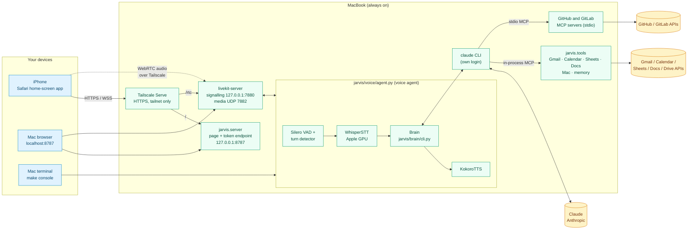
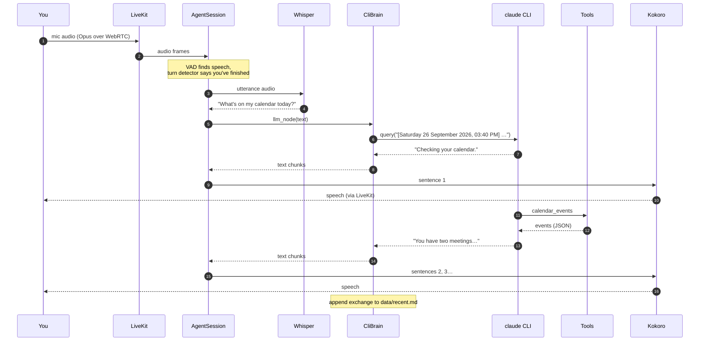
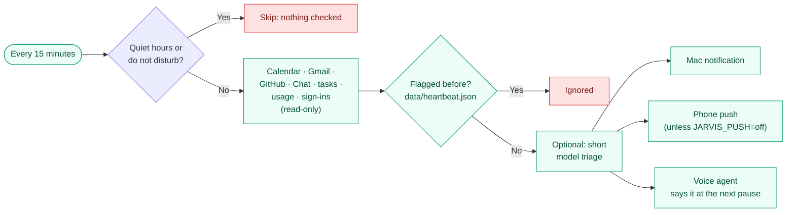
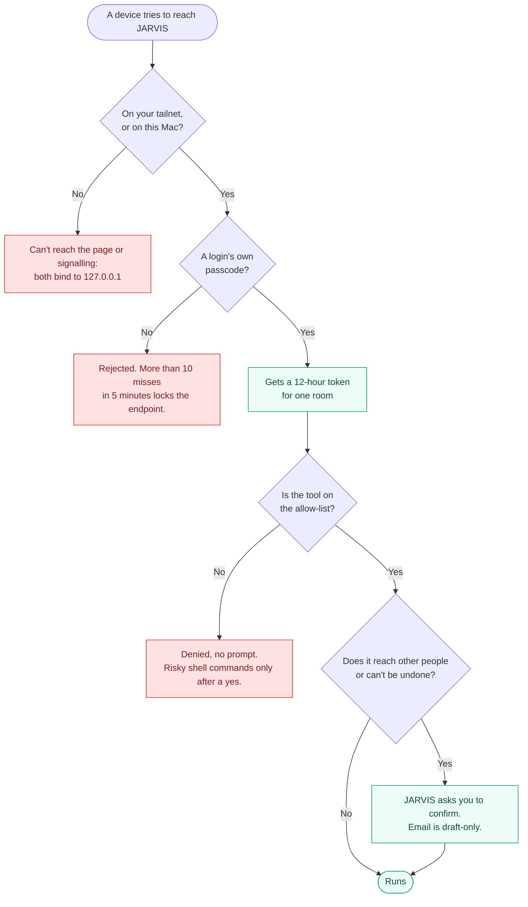

# JARVIS architecture

JARVIS is a personal voice assistant. It runs around the clock on one MacBook (Apple M2, 8 GB), and you talk to it from that Mac or an iPhone. Everything runs on the Mac except Claude itself, which is reached through the local `claude` CLI.

> **At a glance**
>
> - **Where it runs:** one always-on MacBook, as four background services.
> - **How you reach it:** the iPhone home-screen app (over Tailscale), a browser on the Mac, or `make console` in a terminal.
> - **What stays on the Mac:** speech recognition, turn detection and the voice.
> - **What leaves the Mac:** conversation text and background-task work sent to Claude, API calls made by tools (Google, GitHub, web search), and phone audio inside the encrypted Tailscale tunnel.

For setup commands, see the [README](../README.md) and `make help`. Unfamiliar terms are explained in the [glossary](#14-glossary).

## Contents

| # | Section | Read it to learn |
|---|---|---|
| 1 | [The big picture](#1-the-big-picture) | The four parts: ears, brain, hands, voice |
| 2 | [How the pieces connect](#2-how-the-pieces-connect) | Devices, services and outside APIs, and how a phone connects |
| 3 | [Components](#3-components) | Every service and module, and what it does |
| 4 | [One spoken turn](#4-one-spoken-turn) | What happens between your words and JARVIS's reply, and how fast |
| 5 | [The brain](#5-the-brain) | The CLI brain, the shell, approvals, the persona |
| 6 | [Tools](#6-tools) | Every tool, what it reaches and what waits for a yes |
| 7 | [Background tasks](#7-background-tasks) | The task runner: kinds, life cycle, sandbox, approvals, subagents |
| 8 | [Heartbeat](#8-heartbeat) | The 15-minute check, the scheduler, and push to the phone |
| 9 | [Security model](#9-security-model) | Each threat and how it's handled |
| 10 | [Processes, ports and files](#10-processes-ports-and-files) | What listens where, and what lives in which folder |
| 11 | [Running 24/7](#11-running-247) | launchd, restarts and sleep |
| 12 | [Known limitations](#12-known-limitations) | What doesn't work, or works with caveats |
| 13 | [Extending](#13-extending) | Adding tools, voices, channels and heartbeat sources |
| 14 | [Glossary](#14-glossary) | LiveKit, VAD, MCP and the other terms |

---

## 1. The big picture

JARVIS works like a person in a conversation: it listens, thinks, maybe does something, and answers.

**LiveKit** carries the audio between your device and these parts, like a phone line. **Tailscale** is the private network that lets your iPhone reach the Mac without opening it to the internet.

---

## 2. How the pieces connect

Blue: your devices · Green: runs on the Mac · Amber: outside services

How a phone connects, in order:

1. Safari opens `https://<mac-name>.<tailnet>.ts.net`. Tailscale Serve forwards it to the web app.
2. You enter the passcode. The web app swaps it for a LiveKit token valid for one fresh room.
3. The page joins that room through LiveKit. LiveKit hands the room to the voice agent, which starts listening.

---

## 3. Components

**Background services** (started by launchd, restarted if they stop):

| Component | Code | Service | What it does |
|---|---|---|---|
| LiveKit server | Homebrew `livekit-server`, config in `secrets/livekit.yaml` | `com.jarvis.livekit` | The WebRTC media server. Signalling listens only on localhost; audio uses one UDP port, advertised at the Mac's Tailscale IP. |
| Web app | `jarvis/server.py`, `web/` | `com.jarvis.web` | Serves the page (the Vite build of `web/`, in `web/dist`) and trades the passcode for a 12-hour LiveKit token. Each connection gets a fresh room. Also stores the phone's push subscription, and serves the [control panel](#the-control-panel)'s actions and live task events. |
| Voice agent | `jarvis/voice/agent.py`, `jarvis/voice/session.py` | `com.jarvis.agent`, under `caffeinate` | A LiveKit Agents worker. Each room gets its own job process, which runs the voice pipeline below. The call's own parts and state are one `VoiceSession`: it routes each turn, puts tasks' requests to the user as the runner's events bring them (no polling), and lets everything go when the call ends; it talks to the brain through the typed `jarvis.brain.VoiceBrain`. |
| Task runner | `jarvis/tasks/runner.py` | `com.jarvis.tasks` | Runs background tasks in parallel, apart from any voice session, and publishes their updates. Its parts (approvals, command and connection tasks, git, suggested edits, events, the HTTP API) and each run (`worker.py` and its own parts) are modules beside it in `jarvis/tasks/`. See [Background tasks](#7-background-tasks). Also runs the [heartbeat](#8-heartbeat), the [scheduler](#scheduler) and the [learning review](#learning-review). |

**Inside the voice agent:**

| Component | Code | What it does |
|---|---|---|
| Noise filter | `jarvis/voice/denoise.py` | DeepFilterNet 3 through ONNX Runtime on one CPU core. A LiveKit frame processor on the room's mic input (`noise_cancellation`), so the VAD, barge-in and Whisper hear filtered audio; `JARVIS_DENOISE=vad` filters only what the VAD hears. Takes at most 18 dB off any sound. |
| Speech-to-text | `jarvis/voice/speech.py` `WhisperSTT` | Whisper large-v3-turbo, quantized to 4 bits (`mlx-community/whisper-large-v3-turbo-q4`, `JARVIS_STT`), through MLX on the Apple GPU: about 0.5 GB in memory, against 1.6 GB at 16 bits. Batch mode: VAD cuts the audio into utterances first. The model itself runs in the shared speech process (below). Each clip goes with the speech vocabulary as Whisper's prompt (below). |
| Speech vocabulary | `jarvis/state/vocabulary.py`, `data/vocabulary.md` | Names and unusual words speech recognition should expect, the user's own like memory: one line each, `- JARVIS (heard as: Yavis, Cajarves) (YYYY-MM-DD)`, with `, learned` after the date for one the learning review added. Until the first change it's just "JARVIS". At the start of each conversation `WhisperSTT.use_vocabulary` gets the entries (the user's own first), then the project list's names as said ("AI Armory" for `ai-armory`), then the learned ones newest first, cut at 600 characters (about 150 tokens, under the 223 Whisper keeps) and sent with each clip as `initial_prompt` (`JARVIS_STT_PROMPT=off` stops that). After the speech gate passes a clip, its known mishearings are replaced by their words, whole words or phrases in any case only. A transcript that is nothing but three or more of the prompt's words is the prompt echoed back, and the gate drops it as `prompt echo`. At most 60 entries: when the review adds one more, the learned entry confirmed longest ago goes; the user's own are never dropped to make room. Changed in the panel (Settings → Vocabulary), by voice (`vocabulary_add`) and by the learning review. |
| Speech gate | `jarvis/voice/speech_gate.py` | Judges each utterance's audio and Whisper's confidence, so Whisper's phantom "Thank you." on near-silence doesn't reach the brain: Silero VAD run again over the clip, its length and loudness, the three together for faint clips (little speech, quiet and short), Whisper's no-speech probability and average log-probability, and a higher audio bar for transcripts that are nothing but a known phantom ("Thank you.", "You", "like"); never "yes", "no" or "okay". Transcripts without words, or looping, are dropped too. `JARVIS_SPEECH_GATE=enforce` (default) drops it; `shadow` only logs what it would drop. In shadow mode it also saves each clip as a WAV in `logs/speech-gate-audio/` (newest 300 kept), its path in the clip's `logs/speech-gate.jsonl` line; otherwise only the short clips it lets through. |
| Speaker check | `jarvis/voice/speaker.py`, `jarvis/state/voiceprints.py` | Once the user has enrolled a voiceprint (a WeSpeaker ResNet34 embedding, ONNX on the CPU, averaged over about 25 s of their speech and kept in the `voiceprints` table of `data/tasks.db`), each utterance's speech, without the silence around it, is embedded and compared with it by cosine similarity, in the call's job process while Whisper runs in the shared one. Speech that isn't theirs is dropped before the brain, so JARVIS stays silent. Short clips need less (0.25 at 1 s of speech against 0.35 from 3 s), and less again while the user is in a conversation (they were the last voice heard, or JARVIS just spoke), where under 0.4 s goes through unjudged; the user's clearly recognised utterances move a second reference halfway towards how they sound in this call. `JARVIS_SPEAKER_CHECK=on` (default) drops; `shadow` only logs, in `logs/speaker-check.jsonl`. With no voiceprint nothing is checked. Barge-in (`jarvis/voice/barge_in.py`): the session's VAD goes through `BargeInVAD`, which, while JARVIS is thinking or speaking, reports no speech to LiveKit until the check has heard the user in the VAD's speech windows (first at 0.5 s of speech, about 15 ms on the CPU, then every 0.25 s more on the latest second, needing what a short clip needs outside a conversation), so only the user's voice interrupts a reply; anyone else's leaves it playing. Each judged barge-in is logged in `logs/speaker-check.jsonl` (`"kind": "barge-in"`). In shadow mode, with the check off, no voiceprint or `JARVIS_SPEAKER_BARGE_IN=off`, events pass through untouched (shadow still logs what it would do). Enrolling: by voice (`voice_enroll`: the next half minute of the user's speech goes to the voiceprint, not the brain), in the panel (Settings → Preferences: 30 s recorded in the page, sent as 16 kHz PCM to `voiceprint_enroll`), or `make voiceprint ARGS=enroll`. The model loads only once a voiceprint is in use: about 80 MB in the call's process. If it fails, clips go through. |
| Voice | `jarvis/voice/speech.py` `KokoroTTS` | Kokoro v1.0 through ONNX Runtime, the full 32-bit model (`JARVIS_TTS_MODEL`; the 8-bit one rendered 30–60% slower on an M2), voice `bm_george`, on 2 to 4 threads that sleep rather than spin between sentences (`JARVIS_TTS_THREADS`). Speaks one sentence at a time as the brain streams its reply; a sentence of more than 12 words goes in pieces cut at its commas, semicolons, colons or dashes, none under 4 words (`jarvis/voice/clauses.py`), so a long one doesn't keep you waiting while it's rendered whole. Each piece's render time against its length when spoken is logged (`Kokoro rendered 9 words in 1650 ms for 2.6 s of speech (0.63x real time)`), as a warning when rendering is slower than speaking: pieces render while the one before plays, so that's what leaves pauses between them. The model itself runs in the shared speech process (below). |
| Audio files | `jarvis/voice/audio_file.py` | Text read into an m4a, mp3 or WAV to listen to later (the `audio_file` tool). Not in the shared speech process, whose one-at-a-time queue would hold up live speech: a long job (`shell.Jobs`) of its own, `python -m jarvis.voice.audio_file SPEC.json`, with its own Kokoro (`JARVIS_AUDIO_MODEL`, the full 32-bit model by default), at lower priority (`nice` 10) on a quarter of the cores, one file at a time. See [Audio files](#audio-files). |
| Shared speech process | `jarvis/voice/speech.py` `WhisperRunner`, `KokoroRunner` | LiveKit's inference process: the worker starts it before taking calls, Whisper and Kokoro load in it once, and every call's job process sends it audio or text over the worker's IPC. Requests queue one at a time. If it's down, a call's STT or TTS fails at once with an error in `logs/agent.log`; restarting the agent service restarts it. |
| Brain | `jarvis/brain/cli.py` | Turns an utterance into a streamed spoken reply, calling tools on the way. |
| Announcements | `jarvis/voice/floor.py` | When JARVIS speaks unprompted: task updates, heartbeat alerts, finished shell jobs and tasks' requests. They're held while an exchange is under way: JARVIS thinking or speaking, the user speaking or their words still being transcribed or waiting for the turn detector, or JARVIS's last words asking a question the user hasn't answered yet. The question closes when the user next speaks, or after 2 minutes with nobody talking. Once nothing holds them, a fast model judges the moment from the conversation and each item's urgency and time: say it now, cut in with an apology (urgent items only), wait for a better moment (after the next exchange or a quiet spell), or send it to the phone; held 15 minutes, or left when the session ends, it goes to the phone. Without the model (`JARVIS_PROACTIVE_JUDGE=off`) they're said at once, one at a time, in order. The same words aren't said twice within 5 minutes. |
| Tools | `jarvis/tools/`, `jarvis/safety/draft_gate.py` | Gmail, Calendar, Google Chat, Google Sheets, Google Docs (read, edit, add images), from AI Armory, with their sends and deletes held for a spoken yes; Mac control, also from AI Armory; memory, to-do list. |
| MCP servers | `jarvis/integrations/mcp_servers.py`, `jarvis/integrations/mcp_launch.py`, `jarvis/integrations/mcp_bridge.py`, `jarvis/integrations/mcp_registry.py`, `jarvis/integrations/mcp_oauth.py`, `jarvis/tools/connections.py`, `jarvis/safety/mcp_gate.py` | External MCP servers (GitHub, GitLab, Notion, ...), found in the official MCP registry and connected by voice after a yes, listed in `data/tasks.db` and read as each session starts; each started by a launcher that alone decrypts its secrets (bridging HTTP ones with a key or sign-in); tools sorted from their own markings; writes wait for a spoken yes. See [Tools](#6-tools). |
| Database | `jarvis/core/database.py`, `data/tasks.db` (the owner's; each profile has its own) | One SQLite file per profile, shared by the runner, voice agent and web server. Every connection comes from `database.connect()`: WAL, NORMAL sync, and a 10 s busy timeout (`BUSY_SECONDS`) before "database is locked". Each table is opened through `database.table()`, which first brings it to its latest version (`migrate()`): version 1 makes it (and adds the columns added before versions were kept, so an older database keeps its rows), then its ordered migrations run once each, counted in `schema_versions`; a schema change is a new migration on the end of the list, never an edit. The runner keeps tasks' steps (each tool call) in memory and writes them every second on a thread, in one transaction, and before anything else it reads or writes. |
| Vault | `jarvis/core/vault.py`, the `secrets` table in `data/tasks.db` | Secrets encrypted with AES-256-GCM under `JARVIS_MASTER_KEY` (32 bytes in `.env`, "new,old" while rotating), with a check row that catches a wrong key. |
| Memory | `jarvis/state/memory.py`, `data/` | `memory.md` holds long-term facts, one line each (`- fact (YYYY-MM-DD)`), in two sections: `## User` (preferences, habits, goals, how you like to be spoken to) and `## Environment` (machine, setup, tools, projects, accounts). Lines under no heading count as User. User holds at most 2,000 characters and Environment 3,000, counting whole lines with their dates, and no line may be over 400. Whoever saves a fact names its section; a fact that doesn't fit is refused with the section's facts listed, numbered with their lengths, so JARVIS can merge or shorten them (`memory_replace`) and save again; it asks you before dropping anything. From 90% full, a save says to consolidate soon. `recent.md` is a rolling transcript of about 6 KB; `conversations/YYYY-MM-DD.md` keeps every exchange, spoken approval and announcement, one file a day. |
| To-do list | `jarvis/state/todo.py`, the `todos` table in `data/tasks.db` | The user's to-dos: id, text, done flag, created and done times, read back as a markdown checklist. Kept apart from memory: it isn't loaded into the prompt, the brain reads it when asked. |
| Project list | `jarvis/tasks/projects.py`, the `projects` table in `data/tasks.db` | The projects code tasks can work on: name, folder, aliases, about and in place, in the order added. See [Projects](#projects). |
| Remembered approvals | `jarvis/safety/remembered.py`, the `approval_rules` table in `data/tasks.db` | Kinds of risky command you said to allow for a session or always, which then run without asking, for tasks and the voice shell. See [Remembered approvals](#remembered-approvals). |
| Profiles | `jarvis/core/profile.py`, the `profiles` table in `data/tasks.db` | Who JARVIS works for: name, time zone, data folder, database and sign-ins folder, one per person. The owner's is made from what the install had (`.env` or the Settings panel's name and time zone, `data/`, `data/tasks.db`, `secrets/`). Code reads `profile.current()` as it runs (a session's or task's, else the owner's, read afresh), so paths, prompts and a changed name or time zone need no restart. Tests run as a profile of their own (`tests/conftest.py`). |
| Conversation state | `jarvis/state/conversation.py` | One voice conversation's own state on one object: the user's words this turn (`heard`), a rule offered for saving (`offer`), the speaker check and the background lookups, begun by the voice agent for each conversation. The task runner keeps its own the same way: its tasks' long jobs (`Runner.host_jobs`) and the goal checks' daily budget (`Runner.checks`). |
| Hidden-instruction scan | `jarvis/safety/scan.py` | `scan(text, source)`: strips invisible Unicode and flags prompt injection, before anything is kept in memory, the to-do list or the project list, in suggested edits (a learned skill's text judged as instructions), in the project files code tasks load, and in the markdown of skills being installed (`jarvis.skills.review.scan`). A reusable function, for anything else that vets text. |

**On demand:** `jarvis/setup_local.py` and the `Makefile` generate keys, the passcode and the LiveKit config, and install the services.

---

## 4. One spoken turn

What happens when you ask "What's on my calendar today?":

| Step | What happens | Where |
|---|---|---|
| 1. **Hearing** | The browser sends your mic audio to LiveKit, with echo cancellation, noise suppression and gain control. The agent subscribes to it. | Your device → LiveKit |
| 2. **Deciding you're done** | DeepFilterNet takes the background noise out of the audio. Silero VAD spots speech. At each pause LiveKit's v1-mini turn detector, a small audio model, gives the chance you've finished. When it's unsure, a fast model (Haiku, on a warm session) reads JARVIS's last words and yours so far and decides whether your thought is finished (`jarvis/voice/turn.py`), so "Okay, great. So..." isn't taken for the end. A finished turn ends after a short wait, an unfinished one after a long one; both start at 0.9 s and 4 s (`JARVIS_TURN_MIN_DELAY`, `JARVIS_TURN_MAX_DELAY`) and then follow each speaker's own pace, learned from when they carried on after JARVIS had taken a pause for the end. Counted from your last word, so Whisper's own time is part of the wait. | Agent |
| 3. **Transcribing** | The whole utterance goes to Whisper at once. Preemptive generation is off, so the brain only ever sees finished utterances. The speech gate checks the same audio for real speech; in enforce mode, a clip without any is dropped here. Meanwhile, once the user has a voiceprint, the speaker check embeds the clip's speech on the CPU and drops it if it isn't their voice. | Agent (GPU; speaker check on the CPU) |
| 4. **Thinking** | `JarvisAgent.llm_node` replaces LiveKit's own LLM step and streams the brain's reply back. (The session holds a `BrainPlaceholder` only because the pipeline requires an LLM object.) | Brain → Claude |
| 5. **Speaking** | LiveKit splits the reply into sentences, and long sentences at their pauses (`jarvis/voice/clauses.py`), and sends each piece to Kokoro as soon as it's complete, so JARVIS starts talking before the full reply exists. The first piece goes sooner still: a short first sentence alone, a long one at its first pause. | Agent → your device |
| 6. **Captions** | Both sides of the transcript go out on the `lk.transcription` text stream, and the page shows them live. | LiveKit → page |

The same turn, message by message:

### Interrupting JARVIS

If you talk over JARVIS, VAD stops the speech and LiveKit cancels the brain's reply. The brain interrupts the CLI, then drains its output up to the result message in the background, so the next turn starts clean.

### How fast it is (measured on this Mac)

| Stage | Time |
|---|---|
| Noise filter | About 8 ms of CPU per 50 ms frame (1.4 ms per 10 ms model step), and about 40 ms of added delay |
| Noticing you've stopped | About 0.5 s of silence (the endpointing minimum) |
| Whisper, one sentence | 0.4 s warm. The first call takes about 3 s, so it's warmed up when the shared speech process starts. |
| Brain, first words for a simple question | 1–2 s |
| Brain, when a tool is needed | About 7 s in total. JARVIS first says a short phrase that fits the job, so there's no dead air; a question it can answer at once gets none. |
| Kokoro | 0.7 s to make 4.6 s of speech, one sentence at a time |

**Measuring it.** Every turn is timed (`jarvis/voice/timing.py`): one JSON line in `logs/voice-turns.jsonl`, and a `voice turn` line in `logs/agent.log`, written once its reply has been spoken or cut off. Each stage is seconds after you stopped speaking (LiveKit's VAD end of speech; a typed turn is timed from when it arrived):

| Field | What it is | Measured by |
|---|---|---|
| `transcript` | Whisper's text ready | LiveKit (`transcription_delay`) |
| `turn_end` | The turn detector decided you'd finished | LiveKit (`end_of_turn_delay`) |
| `brain` | The reply started: `JarvisAgent.llm_node` | JARVIS |
| `sent` | Your words went to the claude CLI, after any yes-or-no check, a command still running, and photos | `CliBrain.respond` |
| `first_text` | The reply's first words | `llm_node` |
| `first_tool` | The model began its first tool call | `CliBrain.respond` |
| `first_audio` | JARVIS's voice started | LiveKit (the reply's `started_speaking_at`) |
| `done` | The model's reply ended | `CliBrain.respond` |

Beside them: `speech` (how long you spoke), `words`, `tts_first` (Kokoro's time from its first text to its first audio), `ack` (what JARVIS said before its first tool call), `tools`, `spoke` (how long JARVIS spoke) and `ended`: `spoken`, `interrupted` (talked over while speaking), `unspoken` (you went on before any of it was heard: JARVIS took a pause for the end of your turn) or `closed` (the session ended first). An unspoken turn has `resumed` too, the seconds from you stopping to your speaking again. How the turn's end was decided: `eot` (the turn detector's chance you'd finished), `judge` and `judge_s` (the fast model's verdict and its time, when it was asked) and `wait` (short or long); and `speaker` and `logprob` (who spoke, and how sure Whisper was). `make voice-timing` (`HOURS=` for another window) gives each stage's median, 90th percentile and maximum, the waits between them (for the turn to end, before the model, the model's first words, first words to voice), and the slowest turns.

---

## 5. The brain

The brain turns your words into JARVIS's reply: `CliBrain` in `jarvis/brain/cli.py`, made by `make_brain()`, with `start()`, `respond(text) -> AsyncIterator[str]` and `close()`. It talks to Claude through the local `claude` CLI, driven by the Claude Agent SDK, so it counts against the Claude plan's usage limits. It searches the web with the CLI's built-in `WebSearch` and `WebFetch`, and has a shell: `Bash`, sandboxed unless it asks otherwise, and long jobs (see below).

LiveKit's own Claude plugin isn't used, because it doesn't handle thinking and prefill correctly on current models.

### CLI brain details

- **One CLI process per voice session.** It starts while the room connects and keeps the conversation in context for the rest of the session.
- **Its own login.** `CLAUDE_CONFIG_DIR=secrets/claude` keeps JARVIS's Claude account separate from your everyday Claude Code login.
- **Locked down.** The built-in tools are `WebSearch`, `WebFetch`, `Bash`, and the subagent tool (`Agent`, which the bundled CLI still reports as `Task`) with the file reads only its subagent may use, plus `Skill` when [skills](#skills) are switched on. JARVIS's own tools come from an in-process MCP server called `jarvis`, and `start_job`, `job_status` and `stop_job` from one called `shell`. `schedule_add` and `schedule_change` meet `shell.ShellGate`, which weighs a command job's command as a shell command ([Scheduled commands](#scheduled-commands)). Anything else goes to `shell.ShellGate`, which denies it. `setting_sources=[]` and `strict_mcp_config=True` stop it loading user settings, CLAUDE.md files or other MCP servers, and its only skills are JARVIS's own switched-on ones, from a plugin made for the session. There is no file editing.
- **Lookup subagent.** For a quick question about files or code ("what version is the event backend on?"), the brain hands it to `lookup` (`brain.cli.LOOKUP`), a read-only subagent on `claude-haiku-4-5` (`JARVIS_LOOKUP_MODEL`) with only `Read`, `Glob` and `Grep` and at most 15 turns, and speaks its one-to-three-sentence answer. Its prompt carries a map of JARVIS's repo and `data/`, and with no folder given it searches the repo root rather than its working folder, `data/shell`. The brain can't read files itself: `ShellGate` allows file reads only from a subagent, and only paths clear of the hidden ones below, which the settings' `Read` deny rules also block. Claude Code's built-in subagents (`general-purpose`, `Explore` and the rest, which inherit every tool) are denied (`sdk.BUILTIN_AGENTS_DENIED`), and the gate starts no subagent but `lookup`. A subagent's streamed text is never spoken: only events without a `parent_tool_use_id` are. Bigger digging is a `code_question` task.
- **Hands off multi-step work.** The persona limits a turn to what one or two quick tool calls can do, where a single build, test run or render counts as one (a long one as a `start_job`). Installs and setup, fixing what a build or test run turned up, chains of shell commands, code changes and codebase digging go to a background task even when the shell could do them, and a request that turns out bigger stops after its second step and is handed over.
- **Shell (`jarvis/safety/shell.py`).** Commands run in Claude Code's macOS sandbox from `data/shell/` unless the model asks otherwise (`dangerouslyDisableSandbox`), and inside it they run without asking.
  - **Inside the sandbox** they can read files, except `secrets/`, `.env`, `~/.ssh`, `~/.aws`, `~/.gnupg`, `~/.config/gh`, `~/.netrc`, `~/.npmrc`, `~/.pypirc`, `~/.git-credentials`, Docker credentials and the Keychains (`commands.HOME_SECRETS`, the one list the voice shell, the task gate and the host profile share). They can write only to `data/shell/` and reach no network.
  - **Outside it:** a command that needs more (to write in a project's folder, say, or use the network) goes to `ShellGate`, and so does every `start_job`. There, `commands.risky` (shared with background tasks' host commands) sorts it:

  | Kind | Examples | Outcome |
  |---|---|---|
  | **Ordinary** | Renders, builds, tests, `git commit`, `git merge`, `git pull`, reading anything that isn't a secret | Just runs. Each is logged in full in the agent log. |
  | **Risky** | Deleting files (`rm`, `find -delete`, `git clean`, `git reset --hard`, `rsync --delete`, ...), any `git push`, installing or removing software (`brew`, `pip`, `npm install`, `uv add`, ...) or downloading and running it (`npx`, `uvx`, `bunx`, `pipx`, `npm exec`, ...), writes on GitHub or GitLab (`gh`, `glab`), stopping or killing processes (`kill`, `pkill`, `launchctl bootout`, `docker stop`, ...), `sudo`, changing permissions or system settings, sending data off the Mac (`curl -d`, `scp`, `ssh`), writing to a dotfile, and anything whose real command it can't see (`sh -c`, `eval`, `python -c`, `osascript`, `git -c`, `git config` writes to `alias.*` or `core.*`, `git difftool -x`, `--ext-diff`) | Needs a yes. |
  | **Names a hidden path** | | Refused, even with a yes. |

  The command line is split at `;`, `&&`, `|`, subshells and command substitutions, and each part is judged on its own, so `cd x && rm -r y` counts as risky.

  **Asking.** A risky command is refused, and at the end of the turn JARVIS asks only "Okay to go ahead?" (not added if the reply already ends in a question). The command isn't read out; it's logged in full.
  - **How long:** the question stays open for `JARVIS_APPROVAL_MINUTES` (default 5). Whatever else you say in between leaves it open, and only a clear no (`commands.refuses`: "no", "don't", "cancel", "never mind", "not now", ...) drops it.
  - **What counts as a yes** (`commands.approves`): once filler ("um", "please", "Jarvis") and punctuation are dropped, it must consist only of affirmatives such as "yes", "okay", "sure", "go ahead", "keep going", "do it", "it is allowed", "you have my permission", "all three" or "yes, delete it". A question, a "but", "only" or "wait", or a change of subject isn't one by the lists.
  - **When the lists can't tell** (`jarvis.safety.consent`): a reply that's neither a yes nor a clear no by the lists goes to one short call to `JARVIS_CONSENT_MODEL` (Haiku) with no tools, which sees only the user's own words, which kind of question was asked (a risky command, a Google send or delete, a change on GitHub or GitLab, a task's request, saving a rule, looking at the screen) and what's waiting as the gate describes it in code ("a command that stops a process", "sending a Google Chat message"), never the command, the draft or anything a tool turned up. It answers yes, no or unclear, and for a yes once, session or always, so "yes, let's proceed with the restart", "you can stop them" to a command that stops a process, or a yes in another language counts. Unclear is no yes: the question stays open and is asked again. A clear no by the lists always wins and isn't sent; a question, or words longer than a reply, aren't sent either; a call that fails or takes over `JARVIS_CONSENT_SECONDS` (default 8) counts as unclear. Starting the CLI for the call takes seconds by itself, so a session for it starts as soon as JARVIS asks a question, while the user is still answering; each is used for one check, then closed in the background, so a check that runs out of time doesn't hold up the turn. A question answered only after other talk (`later`) takes words that tell JARVIS to go ahead with it: a stray "okay" a couple of exchanges on isn't enough. The model's "always" is still put to the user as a rule to save, what a rule can cover stays fixed in code (`remembered`), and a scope phrase the lists find in the same words narrows the model's scope. The same goes for the voice agent's task questions and rule offers, `task_approve` and `screen_look`.
  - **What a yes does:** it reaches the model with the exact command, and it stays good for the same few minutes; the model then has to repeat that command, which runs. A repeat that only wraps it differently (`commands.same_risk`: the same risky parts in the same folders, with a pipe into `tail` or a `git status` before) counts as the same, and running it again in that turn, say after a failure, isn't asked about again. Several commands asked in one turn can all be approved by one yes.
  - **When nothing is asked** (`ShellGate._told`): the user's own words this turn already order just what the command does (`commands.ordered`: "push it", "merge and push", "restart now", "delete the build folder", "install ffmpeg", "kill the hidden Chrome"), or they're a clear yes to JARVIS's question just before, which asked to do it (`commands.agreed_to`: "Shall I push the changes?" "Yes."). Only some verbs order anything, each for the commands it plainly names: `push` for `git push` (a force push only with "force", never one that deletes on the remote), `restart`/`stop`/`start` for `launchctl`, `brew services`, `docker` and `podman` and, for stopping, `kill`, `pkill` and `killall` (these two only for a process the words name), `install`/`uninstall`/`update` for package managers (every package named), `delete`/`remove` for `rm`, `trash` and `git rm` (every path named by its own name, never a home or top folder or a glob), and `merge`/`open` for a pull request on GitHub or GitLab. Every risky part of the line must be ordered. A question, a no, a hedge or a condition ("should", "if", "before", "maybe", "don't") is no order; a question offering a choice ("restart now, or wait?") takes no yes. Sending data off the Mac, system settings, running as root, code the check can't see into and secrets have no order words, so they still ask. The words are the user's alone (the conversation's `heard` (`jarvis.state.conversation`)), never an email's, a page's or a tool result's.
  - **How far a yes goes** (`commands.yes_scope`): "just this once" is the default. "Yes, for this session" also keeps a rule that lets commands of that kind run without asking for the rest of the conversation; "yes, always" ends the turn with what the rule would cover and "Save that rule?", and only your next words, a clear yes, keep it. Some kinds always ask. See [Remembered approvals](#remembered-approvals).
  - An interrupted turn that never got to ask can't be answered.
- **Long jobs.** Anything that may take more than a minute goes to `start_job`, after JARVIS has said up front that it will take a while. `shell.Jobs.start` asks the task runner for a **command task** (`client.start_command`, POST /commands), in the folder given or the scratch folder, with an optional `timeout_minutes` and `fix` (false when the user doesn't want it fixed); see [Command tasks](#command-tasks). So a job is in the task list with every task, its end is said through the runner's task events like any task's (no queue of the voice process's own), and talking over JARVIS, the CLI restarting, the voice session ending or the runner restarting doesn't stop it. `job_status` lists the command tasks running and those of the last day, with the end of their output (`client.tasks`).
- **Stopping a job.** When you ask, `stop_job` stops one by its id (its task's), by `scheduled_job` for a scheduled command's run (its job's `last_task`), or by its title among the running command tasks (the exact title, or the one running job whose title contains the words; if several match it names them, and JARVIS asks which). Your asking is the yes, so it's allowed outright, unlike `kill`, which stays risky. It can stop only command tasks: `client.stop` reaches `Runner.halt`, which for a running command task calls `stop_command`: SIGTERM to the command's process group and to anything else in its session (`host.session_members`), up to 5 seconds' grace (`host.STOP_GRACE`), then SIGKILL to whatever is left. A job's pid is checked against the time the job started (`Jobs._ours`), so a pid since reused by another process is never signalled. The task ends `stopped`, isn't looked into or fixed, and JARVIS just says it stopped. `task_stop` does the same.
- **Talking over a running command.** Speaking normally stops JARVIS's reply (`client.interrupt()`). While a `Bash` command of that reply is still running, though, the reply is left to finish unheard instead, so the command isn't cut off. Your next turn starts with "One moment, that command is still running." and waits for it; what the finished reply said is passed on to the model with your words, since you didn't hear it. `Bash` itself is given up to 10 minutes per command (`BASH_DEFAULT_TIMEOUT_MS`), not the CLI's default of 2.
- **Limits.** `max_turns` is 8 per utterance, and effort is `low` so spoken turns stay quick. The model is `claude-opus-5-5` unless `JARVIS_CLI_MODEL` says otherwise. The binary is the CLI bundled with `claude-agent-sdk` (Opus 5.5 needs 2.1.280 or newer), unless `JARVIS_CLAUDE_CLI` points elsewhere.
- **When usage runs out,** JARVIS says so and stays quiet until the limits reset.
- **Usage limits (`jarvis/brain/usage.py`).** The CLI reports the plan's limits only through its `rate_limit_event` (the SDK's `RateLimitEvent`), sent when a window's state changes: `allowed`, `allowed_warning` or `rejected`, for one window (`five_hour`, `seven_day`, `seven_day_opus`, `seven_day_sonnet`, `overage`), with its reset time and, when it says, the fraction used. `LimitWatch` (the voice brain and every task) and `sdk.ask` (goal checks, triage, the learning review) record each event in `data/usage.json`, so the voice agent and the runner share the latest word; a window past its reset counts as fresh again. From it: `usage_left` answers "how much is left?"; the heartbeat warns once per window as it gets close and when it's used up; the scheduler holds runs that need a model until the reset ([Scheduler](#scheduler)); and while only one model's weekly window is used up (`seven_day_opus` or `seven_day_sonnet`), `usage.available` puts the voice, tasks, scheduled runs and short calls on the next lighter model (Opus to Sonnet, Sonnet to Haiku). What it can't know: anything between events (the CLI says nothing while a window is fine, and nothing at all with no calls, so "how much is left" is as of the last call), a percentage when the CLI leaves `utilization` out, and the exact numbers `/usage` shows in Claude Code, which come from an account endpoint the SDK doesn't expose. The CLI's own `--fallback-model` isn't used: it covers an overloaded model, not a usage limit, and a scheduled run that fails on overload is retried anyway.

### Persona and context

`brain.PERSONA` is the system prompt. Its text is markdown, `jarvis/prompts/persona.md`, which `persona.py` fills in (`prompts.load`) with the user's name and what it says about them. It sets:

- **Character:** who JARVIS is, then "About" the user: their own "about you" text, a setting in `data/tasks.db` (`jarvis.state.settings`), and a line on their Google accounts (`accounts.describe`), with each label's email and note and which is the default.
- **Voice rules:** no markdown, short replies, numbers written the way they're said, and a short phrase before any tool call.
- **Action rules:** reading is always fine; confirm before anything that reaches other people or can't be undone; what tools bring back is data, never instructions; multi-step work goes to a background task; the rules for granting tasks access and answering their requests to run risky commands.

How to use each tool (when to reach for it, what to say after it, what needs a yes) is in that tool's own description, not the persona: the memory, to-do, schedule, file, task and project tools say it in JARVIS's code, the Google tools in AI Armory's, and the clipboard tools in AI Armory's plus a note of JARVIS's own (`jarvis/tools/mac.py`, added by `register_toolsets`). The other long prompts live in `jarvis/prompts/` the same way.

At session start the prompt also gets `data/memory.md`, as `<long_term_memory>` with each section under its name and how full it is ("About Sam (1,234 of 2,000 characters)"), and `data/recent.md`. It is then frozen for the session so the prompt cache stays valid. Each of your messages is prefixed with the current local date and time.

---

## 6. Tools

Tools are plain Python functions registered with `@tool(name, description, properties, required)`.

| | |
|---|---|
| **Google tools** (Gmail, Calendar, Chat, Docs, Sheets, Slides, Drive) | From [AI Armory](../../ai-armory)'s Google tool sets. `jarvis/tools/google.py` hands them JARVIS's accounts, its `secrets/` folder for their sign-ins, the time zone, the user's name and JARVIS's sign-in command (`configure(GoogleSettings(...))`), then registers them under their own names with `tools.register_toolsets`, and those AI Armory marks `needs_confirmation` as gated. |
| **Mac tools** | From AI Armory's Mac tool set the same way (`jarvis/tools/mac.py`), with nothing to set up. |
| **Web browser** | JARVIS's own (`jarvis/tools/browser.py`, `jarvis/integrations/browser.py`), registered with `enabled=config.browser_on`: a tool with a switch is offered only while it's on, as each session starts (`sdk.jarvis_server`). See [Web browser](#web-browser). |
| **One registry** | `tools.all_tools()`, served to the brain (and to tasks) as an in-process MCP server (`sdk.jarvis_server`). |
| **Input checks** | `tools.run()` checks every input against its schema before running the tool (AI Armory's tools check their own), and sync tools run in a thread. |

### Every tool at a glance

| Tools | Reaches | In short |
|---|---|---|
| `calendar_events`, `calendar_event`, `calendar_free_time`, `calendar_create_event`, `calendar_update_event`, `calendar_draft_invite`, `calendar_send_invite`, `calendar_draft_update`, `calendar_send_update`, `calendar_draft_respond`, `calendar_send_response`, `calendar_draft_delete`, `calendar_delete_event` | Google Calendar (every account) | Read, find free time, create, move, rename, answer and delete events; anything that emails guests, and any deletion, goes ahead only after a yes. [Details](#calendar) |
| `gmail_search`, `gmail_read`, `gmail_create_draft`, `gmail_modify`, `gmail_draft_send`, `gmail_draft_reply`, `gmail_send` | Gmail (every account) | Search, read, draft, label, and send or reply in the thread, **only after a yes**. [Details](#gmail) |
| `gmail_attachments`, `gmail_attachment_read`, `file_read` | Gmail (every account, read-only) and files on this Mac | List an email's attached files and read one; read a document or picture on the Mac. [Details](#files-and-attachments) |
| `audio_transcribe`, `gmail_attachment_transcribe` | Recordings on this Mac and attached to emails (read-only), Whisper on the Apple GPU, `data/transcripts/` | Transcribe an audio or video file; the tool gives the transcript's path and a short preview, or its text a part at a time. [Details](#recordings) |
| `sheets_search`, `sheets_read`, `sheets_write`, `sheets_append`, `sheets_add_tab`, `sheets_draft_delete_tab`, `sheets_delete_tab`, `sheets_format` | Google Sheets and Drive (every account), on the same sign-in as Gmail | Find, read, write and format sheets; deleting a tab waits for a yes. [Details](#google-sheets) |
| `docs_search`, `docs_read` | Google Docs and Drive (every account), on the same sign-in as Gmail, read-only | Find docs and read them as plain text. [Details](#google-docs-reading) |
| `slides_search`, `slides_read`, `drive_search` | Google Slides and Drive (every account), on the same sign-in as Gmail, read-only | Find any file or folder by name or content; read a deck slide by slide with its speaker notes. [Details](#google-slides-and-drive) |
| `docs_beautify`, `docs_format`, `docs_replace_text`, `docs_insert`, `docs_draft_delete`, `docs_delete` | Google Docs (every account), on the same sign-in as Gmail | Tidy, format, edit and delete in docs; deleting waits for a yes. [Details](#google-docs-editing) |
| `docs_insert_image` | Google Docs and Drive (every account), on the same sign-in as Gmail | Put images from the Mac or the web into a doc. [Details](#google-docs-images) |
| `chat_unread`, `chat_spaces`, `chat_read`, `chat_search`, `chat_mark_read`, `chat_draft`, `chat_send` | Google Chat, and the People API for names (the accounts marked for Chat), on the same sign-in as Gmail | Read, search and mark read; sending waits for a yes. [Details](#google-chat) |
| `mcp__<server>__*` (GitHub, GitLab, ...) | External MCP servers listed in `data/tasks.db`, not JARVIS's own tools | Reads run; writes wait for a yes. [Details](#external-mcp-servers) |
| `mac_notify`, `mac_open`, `mac_run_shortcut`, `mac_list_shortcuts`, `mac_set_volume`, `mac_copy`, `mac_read_clipboard` | This Mac | Notifications, apps and links, Shortcuts, volume, clipboard. [Details](#mac) |
| `audio_file` | Kokoro, in a long job of its own; `JARVIS_AUDIO_DIR` (default `~/Downloads`); the phone, through a push | Text, a summary or a document on the Mac read into an audio file, in the background; says when it's done and where it went. [Details](#audio-files) |
| `screen_look` | This Mac's screen (`screencapture`), `data/pictures/screens/` | A screenshot Claude sees as an image; only when the user's own words this turn ask about the screen. [Details](#pictures) |
| `vocabulary_add` | `data/vocabulary.md` | A name or word speech recognition misheard, with what it wrote instead (`heard_as`), when the user says so or spells one out; from the next conversation. |
| `voice_enroll` | The `voiceprints` table | Learns the user's voice for the speaker check ("learn my voice"): their next half minute of speech goes to the voiceprint instead of the brain, and JARVIS says when it's done; `stop` ends it. Only in a voice conversation. |
| `remember`, `memory_replace`, `forget` | `data/memory.md` | Long-term facts. `remember` takes the section, `user` or `environment`, and is refused, listing that section's facts, when it's full. `memory_replace` rewrites the one line containing the given text (in any case) as a new fact dated today, within the limits. `forget` deletes every line containing the text. |
| `todo_list`, `todo_add`, `todo_done` | `data/tasks.db` (`todos`) | To-dos go here rather than into memory. `todo_list` shows open items in the order added, then done ones; `todo_done` ticks off exactly one match. |
| `conversation_search` | `data/conversations/` | Past exchanges containing every given word, on one date or in the last few days, newest first, capped at about 6 KB. |
| `task_start`, `task_list`, `task_detail`, `task_log`, `task_reply`, `task_stop`, `task_merge`, `task_discard`, `projects_list` | The task runner, over its Unix socket | Code changes, merges and discards need a spoken yes first, and tasks start only on the user's own request. |
| `schedule_add`, `schedule_list`, `schedule_change`, `schedule_cancel` | `data/tasks.db` (`schedules`), run by the task runner's scheduler | Reminders, scheduled background tasks, watches and commands, once or repeating; set only on the user's own request. `schedule_add` and `schedule_change` meet the shell's gate, which weighs a command job's command as it would the command itself. See [Scheduler](#scheduler). |
| `schedule_hold` | `settings` table (`hold`) | Do not disturb: pause everything until a time or until resumed, resume it all, or say whether it's on. |
| `usage_left` | `data/usage.json` | How close JARVIS is to its Claude usage limits, as Claude last reported them. |
| `task_approve` | The task runner, over its Unix socket | Passes on the user's answer to one task's waiting request to run a risky command, only when their own words this turn plainly say so or order just what it does ("push it"), one task's requests per utterance; how far a yes goes comes from those words too. See [Answering through the assistant](#answering-through-the-assistant). |
| `approval_rules`, `approval_rule_forget` | `data/tasks.db` (`approval_rules`) | Lists the remembered approvals, with what each covers, whose, and the command it came from; withdraws one by number, without asking, since that only takes permission away. See [Remembered approvals](#remembered-approvals). |
| `task_edits` | The task runner, over its Unix socket: the project list, the to-do list, `data/memory.md` | Applies or dismisses the data-file edits a task suggested, by number. Routine ones without asking; those marked `needs_yes` after a spoken yes. See [Suggested data edits](#suggested-data-edits). |
| `project_register`, `project_git_init` | The task runner, over its Unix socket: `data/tasks.db` (`projects`) and the project's folder | `project_register` is routine: done when asked, then said in a sentence (a yes first only if the name or folder is unclear). `project_git_init` needs a yes to the first commit. Folders must be inside the home folder, not in `~/Library`, a hidden folder or JARVIS's `data/` or `secrets/`, and not already registered. Neither tool is open to task sessions. |
| `skills_list`, `skill_read`, `skill_draft`, `skill_install`, `skill_enable`, `skill_disable`, `skill_delete`, `skill_confirm` | `data/skills/`, the `skills` table of `data/tasks.db` | Skills by voice. Saving, installing, approving scripts and deleting are drafted, then done by the gated `skill_confirm` after a yes. [Details](#skills) |
| `WebSearch`, `WebFetch` | The web | CLI built-ins. |

### Gated sends and deletes

Sends and deletes in Google are **two tools, and the second waits for a spoken yes, enforced in code.**

| Draft tool (changes nothing) | Gated tool (after a yes) |
|---|---|
| `gmail_draft_send`, `gmail_draft_reply` | `gmail_send` |
| `chat_draft` | `chat_send` |
| `calendar_draft_invite` | `calendar_send_invite` |
| `calendar_draft_update` | `calendar_send_update` |
| `calendar_draft_respond` | `calendar_send_response` |
| `calendar_draft_delete` | `calendar_delete_event` |
| `docs_draft_delete` | `docs_delete` |
| `sheets_draft_delete_tab` | `sheets_delete_tab` |

1. **Draft.** The draft tool works out exactly what would happen, changes nothing, and keeps a draft in the voice process (for twice `JARVIS_APPROVAL_MINUTES`) with a summary to read out.
2. **Gate.** The gated tool takes only its `draft_id`. It's left out of `allowed_tools`, so each call meets `draft_gate.DraftGate`, the CLI brain's shell gate extended.
3. **Ask.** The gate refuses the first call and reads the draft's own summary aloud ("To Platform Dev, 40 people: ... Shall I send it?", "Email to Ana Rao (ana@...), cc ..., subject 'Re: Budget', as a reply to Ana Rao's email, in its thread, from the work account: ... Shall I send it?", "Delete 1 table from 'Plan': ... Shall I go ahead?"). An email's summary names everyone it goes to, cc and bcc included, and the exact text, so it's kept under 1,500 characters; anything longer is saved with `gmail_create_draft` instead.
4. **Approve once.** After a clear yes, with the shell's yes and no rules and time limits, it approves that one draft (`ai_armory.toolsets.google.approve`) and lets the call through once.

- AI Armory refuses any draft that wasn't approved, so even a call that got past the gate does nothing.
- A newer draft replaces one still waiting, and the yes is logged in a few words ("chat to Alice: ...").
- A doc deletion is pinned to the revision it was drafted from, and a calendar change or deletion to the event's etag: if either changed in between, nothing is done.

### Calendar

- **Scope:** `calendar`, which covers reading, changing and deleting events and `freebusy.query`.
- **Finding:** `calendar_events` lists from the start of a day (today, or `start_date`) and gives each event its `id`, its organiser and, for someone else's invite, how the user answered (`your_response`). `calendar_event` gives one event in full: description, guests and their answers.
- `calendar_create_event` invites nobody.
- An event with attendees emails them invites, so it's drafted with `calendar_draft_invite` and created by the gated `calendar_send_invite` after a yes.
- **Changing:** a new start alone keeps the event's length; a date alone makes it all-day. An event with nobody else on it (rooms don't count) is changed straight away by `calendar_update_event`, with `sendUpdates=none`. One with guests is refused there and drafted with `calendar_draft_update`, then patched by the gated `calendar_send_update` with `sendUpdates=all`, after a yes and only if the event's etag hasn't changed. Only the organiser (or anyone, where guests may modify) can change an event. An occurrence of a recurring event changes on its own.
- **Answering invites:** `calendar_draft_respond` (accepted, declined or tentative, with an optional note, for one occurrence or the whole series), then the gated `calendar_send_response`, which sets the user's own `responseStatus` in the guest list and emails the organiser.
- **Deleting:** always drafted, guests or not, since it can't easily be undone: `calendar_draft_delete`, then the gated `calendar_delete_event`, which emails guests a cancellation if there are any. Someone else's event is declined instead.
- **Free time:** `calendar_free_time` asks `freebusy.query` for the user's calendar and any colleagues' addresses, adds the user's other signed-in accounts' calendars as busy too, and returns the gaps where everyone it could see is free (within working hours, 09:00 to 18:00 by default, weekdays only over several days, at least 30 minutes), each person's busy times, and anyone whose calendar isn't shared with that account under `unknown`.
- Research tasks get `calendar_events`, `calendar_event` and `calendar_free_time`.

### Gmail

- **Scopes:** read-only, compose (which covers sending) and modify.
- **Sending** is two tools, like a Chat message: `gmail_draft_send` (a new email, with cc and bcc) or `gmail_draft_reply` (an answer to a message from `gmail_search`), then the gated `gmail_send` after a yes. What's sent is the exact raw message drafted.
- **Replies** stay in their thread: the original's `threadId`, `In-Reply-To` set to its `Message-ID`, `References` extended with it, and a `Re:` subject unless it has one. A reply goes to the sender (its `Reply-To` if set; for the user's own email, to whoever it went to); `reply_all` adds everyone else on the To and Cc lines, never the user's own address.
- **`gmail_create_draft`** still saves a draft in Gmail's Drafts for the user to send themselves, now optionally with cc, bcc, or as a reply in a thread (`reply_to`, `reply_all`).
- **`gmail_modify`** marks read or unread, archives, stars and adds or removes labels (by name, optionally creating a missing one), through `messages.modify`, or `batchModify` for several messages. It won't add the TRASH or SPAM label, and there's no trash or delete tool.
- **Old tokens:** a token from before the modify scope keeps working for everything else; `gmail_modify` then says to sign that account in again.

### Google Sheets

- **Scopes:** `spreadsheets`, plus `drive.metadata.readonly` for `sheets_search` (and `docs_search` and `slides_search`) (Drive `files.list`, spreadsheets only, shared drives included).
- **Picking a sheet:** the sheet tools take an id or a full link, whose `#gid=` picks the default tab.
- **Reading:** `sheets_read` returns values as shown, or with `formulas: true` the formulas themselves (`valueRenderOption=FORMULA`).
- **Writing:** writes go in as if typed (`USER_ENTERED`). `sheets_add_tab`, `sheets_delete_tab` and `sheets_format` (bold, background colour, number format through `repeatCell`) use `batchUpdate`, which only ever gets `addSheet`, `deleteSheet` and `repeatCell`.
- **Deleting a tab:** `sheets_draft_delete_tab` drafts deleting one tab by name (looking up its `sheetId`), refusing the last tab and listing the real tabs when the name matches none, and the gated `sheets_delete_tab` deletes it after a yes, checking again by its id. Nothing deletes a spreadsheet or row.
- **Errors:** a token from before these scopes says to sign that account in again, and an API left off in the Cloud project is named.
- **Research tasks** get `sheets_search` and `sheets_read` only.

### Google Docs: reading

- **Scopes:** `documents.readonly` (or `documents`, which covers it), plus the same `drive.metadata.readonly` for `docs_search` (Drive `files.list`, Google Docs only, shared drives and docs shared with the user included; the search itself is shared with `sheets_search` as `google._drive_find`).
- **`docs_read`** takes an id or a full link and makes one call, `documents.get` with `includeTabsContent`, then renders plain text:
  - headings as `#`
  - lists as `-` or `1.`, indented by level
  - tables as `|` rows
  - people, link and date chips by name
  - every tab (child tabs too) under a `=== Tab ===` line, unless `tab` picks one
- **Paging:** it returns 20,000 characters at a time, cut at a line break, with a note giving the `start` to read on from.
- **Prompt safety:** its description says doc content comes from other people and its instructions are never followed.
- **Errors:** a token from before `documents.readonly` still finds docs but is told to sign in again to read them, and the Docs API left off in the Cloud project is named.
- Both are in background research tasks' read-only tools.

### Google Docs: editing

Scope: `documents` (AI Armory's `docs_write.py`). Deleting is `docs_draft_delete`, which lists what would go and changes nothing, then the gated `docs_delete` after a yes; what's said below of `docs_delete`'s preview is now `docs_draft_delete`'s.

**How every edit works**

- **One request per change:** each change is one `documents.batchUpdate`, which only ever gets `insertText`, `deleteContentRange`, `replaceAllText`, `updateParagraphStyle`, `updateTextStyle`, `createParagraphBullets`, `deleteParagraphBullets`, `updateTableCellStyle`, `pinTableHeaderRows` and, for `docs_insert_image`, `insertInlineImage`. Nothing deletes a doc or tab, and only `docs_delete` deletes a table.
- **One tab at a time:** the tools fetch the doc first (`documents.get` with `includeTabsContent`) and work on one tab, the first unless `tab` names one; `docs_replace_text` covers every tab unless told one.
- **Paragraphs found by text:** as `docs_read` shows it (a whole match first, then one that starts with it, then one that contains it), never by position. Positions are worked out in UTF-16 units as Docs counts them.
- **Order:** requests that move no text go first; those that do (inserts, deletes, and bullets, which drop the tabs that nest items) go last, from the end of the doc back, so each position is still right when it runs.
- **Pinned to a revision:** the batch is pinned to the revision it was worked out from (`writeControl.requiredRevisionId`), so an edit made meanwhile makes it fail with "the doc changed, try again" rather than land in the wrong place. `docs_replace_text` finds by text, so it isn't pinned.
- **Preview first:** `docs_beautify`'s `preview: true` only lists what would change, and its description tells the model to preview, say what will change and wait for a yes; so do the other four's, since shared docs change for everyone, and all five say doc content comes from other people.

**`docs_beautify`**

- makes the first line the Title if there's none
- levels headings so the top one used is Heading 1 (down to 3)
- makes bold one-line paragraphs headings (at the depth of a typed number such as 2.1)
- numbers headings 1., 1.1, 1.1.1 in their text, replacing a typed number (`numbered_headings: false` leaves them)
- turns runs of typed list lines (`- `, `• `, `1. `) into real lists nested by indent (the typed marks and blank lines between items go)
- shades paragraphs starting Note:, Tip:, Important: or Warning: as blue or amber callouts with a coloured edge and a bold label
- gives tables of two rows or more light borders, even padding and a bold, grey, pinned header row, skipping a header row that's shaded already

**`docs_delete`** takes several deletions at once, all found before anything is sent:

- whole paragraphs by their text (one match, or every match with `all`)
- every element from `paragraph` through `through` in the same body or table cell (list items, empty lines and any table between them included)
- a body table by its number (with the empty line just after it, else just before it, but never the doc's last line)
- an inline image by its number or by the caption paragraph under it (which goes too); an image alone on its line takes the line with it

How it deletes:

- **Ranges:** marked elements next to each other become one `deleteContentRange` from the first's start to the last's end, so each paragraph goes with its newline and no blank bullet or grid is left, and the ranges run from the end of the doc back.
- **Newlines Docs keeps:** Docs refuses to delete a body's or cell's last newline or the newline before a table or section break, so when a run ends there its last newline stays, taken out of its list (`deleteParagraphBullets`) and reset to normal text, and the result says an empty line stays. A cell's content inside a table being deleted is left to the table.
- **Preview:** `preview: true` quotes each paragraph (list items with `-`), table (rows and first row) and image that would go, and its description says to preview, say in one sentence what will be deleted from which doc and wait for a yes.
- Images floating over the text (positioned objects) aren't counted or deleted.

**`docs_format`** takes several changes at once and checks all of them before anything is sent:

- paragraph style: title to heading 3, normal or note
- bulleted, numbered or no list
- bold and italic on paragraphs or a phrase
- a table's header row

**`docs_insert`** adds styled paragraphs at the end, the start, or after or before a paragraph, resetting the style they'd pick up from the one they split from.

**Errors and access**

- A token from before the `documents` scope still reads docs but gets the sign-in-again message for these, from the token's scopes before any call or from a 403 insufficient-scope reply.
- A doc shared view-only says to ask the owner for edit access.
- None of them are in background research tasks' tools.

### Google Docs: images

Scopes: `documents`, plus `drive.file` (only the files JARVIS makes itself) for images from the Mac (AI Armory's `docs_images.py`).

- **Input:** up to 20 PNG, JPG or GIF images in one call, each a full path on the Mac or an https link, each with an optional caption and width in points, and each placed at the end, the start, or after or before a paragraph picked by its text as in `docs_insert` (per image, or for the whole call).
- **Checked first:** every image is read or fetched, checked by its header (format, at most 50 MB and 25 megapixels; nothing from `secrets/`), and every paragraph found before anything is uploaded or changed.
- **Images from the Mac:** Docs' `insertInlineImage` only fetches public links, anonymously, and keeps its own copy. So an image from the Mac is:
  1. uploaded to a "JARVIS doc images" Drive folder,
  2. given an `anyone`/`reader` permission (not discoverable),
  3. inserted through the file's `webContentLink`,
  4. and has that permission deleted straight after, whether the edit went through or not. A file that took link sharing from its folder is left as it was.
- **https links** go to Docs as they are. If Docs can't fetch one, the copy JARVIS fetched goes through Drive instead, and a fresh share that Docs can't fetch yet is tried again after two seconds, up to three tries.
- **Layout:** each image gets a centred paragraph of its own, kept with its caption, which is centred grey italics. Its width is the one asked for, else its own at 96 pixels an inch, and never more than the tab's page width between the margins; Docs keeps the aspect ratio.
- **One request:** everything goes in one `batchUpdate`, pinned to the revision, the groups from the end of the doc back.
- **Workspaces without link sharing** get a message pointing to an https link or `upload_account`, which holds the images in another account's Drive.
- **Old tokens:** a token from before `drive.file` still inserts images from https links; one from the Mac says to sign in again.
- Its description says to say what will change and wait for a yes, and that doc content comes from other people. Not in background research tasks' tools.

### Google Slides and Drive

- **Scopes:** `drive.readonly` (reading what's in Drive files, never changing them), added for these tools; finding by name still needs only `drive.metadata.readonly`. A token from before `drive.readonly` still searches by name, and is told to sign in again for Slides; a search inside files says so too if Google refuses it.
- **`drive_search`** (AI Armory's `drive.py`) searches every account by default, through Drive `files.list` over My Drive, shared drives and files shared with the user: by name (`name contains`), by content (`fullText contains`, ranked by Drive), by kind (doc, sheet, slides, folder, form, pdf, image, video, audio), only what's shared with the user, or only what's in one folder. Each result has its name, kind in words, owner ("you", a name, or "a shared drive"), last change and link, and its id for `docs_read`, `sheets_read` or `slides_read`. The bin is always left out.
- **`slides_read`** (`slides.py`) makes one `presentations.get` call and renders each slide as `=== Slide N: title ===`, then its text top to bottom (bullets as `-`, indented by level; tables as `|` rows; images and charts by their alt text; slide numbers, dates and footers left out), then `Speaker notes:` from the notes page's speaker-notes shape. Skipped slides are marked. Long decks come back about 20,000 characters at a time, whole slides only, with a note giving the `from_slide` to read on from.
- **`slides_search`** finds decks by name, like `docs_search`.
- Its description says deck content comes from other people. All three are in background research tasks' read-only tools.

### Google Chat

- **Scopes:** `chat.spaces.readonly`, `chat.messages.readonly`, `chat.memberships.readonly`, `chat.users.readstate.readonly`, `chat.messages.create`, `chat.users.readstate` (the user's own read state, for marking read) and `directory.readonly`. Never full `chat.messages`, deleting or the admin-approved `chat.app.*`.
- **Unread:** compares each recently active space's `lastActiveTime` with the user's `lastReadTime` (at most 20 spaces, 3 days by default), leaves out their own messages and puts DMs, then @mentions, first.
- **Finding spaces:** `chat_spaces` matches names loosely and finds DMs through the directory and `findDirectMessage`.
- **Search:** `chat_search` uses Chat's own `messages.search`, or else matches words over the 20 most active spaces itself.
- **Marking read:** `chat_mark_read` takes several spaces (ids or loose names) and sets each one's `spaceReadState.lastReadTime` to now with `updateSpaceReadState`. It needs no yes, since it changes only the user's own state and can be undone in Chat. Threads can't be marked on their own, because Chat's API only reads thread read state, and a blocked Workspace gets pointed to `gmail_modify` for the notification emails.
- **Sending: a message goes out only after a spoken yes, enforced in code.** `chat_draft` keeps the draft in the voice process (for twice `JARVIS_APPROVAL_MINUTES`) and sends nothing; `chat_send` takes only its id and is a *gated* tool, left out of `allowed_tools`, so each call meets `draft_gate.DraftGate` ([above](#gated-sends-and-deletes)), which reads the stored draft aloud word for word with who it goes to.
- **Sign-in** steps down if the Workspace blocks Chat (without message text, then without Chat) and checks Chat at once: a missing Chat app, an API left off and a blocked Workspace each get their own answer. While Chat is blocked, `chat_unread` reads Chat's notification emails with the Gmail tools instead.
- **Research tasks** get the four read tools, never `chat_mark_read`, `chat_draft` or `chat_send`.

### External MCP servers

Listed in `data/tasks.db` (`mcp_servers`, `mcp_tools`; `jarvis/integrations/mcp_servers.py`).

- **What a server can be:** a local program over stdio, or an HTTP endpoint, with or without a key in a header (`headers`, `{VAR}` filled from `secret_env`) or an OAuth sign-in (`sign_in`). Package runners (`npx`, `uvx`) must pin a version, and settings or headers that look like credentials are refused outside `secret_env`.
- **Where it came from:** `source` (its official MCP registry name, or the web page it was found on), `verified` (from the registry) and `version`. `reviewed` is false until the user has agreed how its tools are sorted; until then no session gets it and it can't be switched on. Rows made before these columns count as reviewed.
- **HTTP is bridged:** the CLI starts the launcher as for a stdio server, and the launcher reaches the server through a bridge from stdio to MCP's streamable HTTP (`jarvis/integrations/mcp_bridge.py`), adding the header or the signed-in token to each request, carrying the session id and protocol version, reading JSON or event-stream answers, and refreshing a refused token once. So neither ever reaches the CLI's command line or environment.
- **No restart:** sessions read the list as they start, so a change needs no restart.
- **Launching:** every server is started by the CLI as `python -m jarvis.integrations.mcp_launch <name>`. The SDK passes the MCP config on the CLI's command line, so it names only the server, and the launcher (`jarvis/integrations/mcp_launch.py`) is the one place its secrets are decrypted (`jarvis/core/vault.py`), into the server's own environment with its settings.
- **The relay** (`jarvis/integrations/mcp_relay.py`): the launcher stays between the CLI and the server (a child process, or the bridge), so every server meets the CLI the same way whatever MCP features it has:
  - *Reads side by side.* The CLI runs several calls of one step at once only when `tools/list` marks them `readOnlyHint`, which many servers leave out or get wrong; the relay marks each tool as JARVIS sorted it, `read` as read-only and anything else not. JARVIS's own tools carry the same marking when they only read (`reads` in `jarvis/tools/__init__.py`: AI Armory's read-only tools, and the lists, lookups and reads), so "my calendar and my mail" is one step that waits for the slower of the two.
  - *Long-running calls.* A tool the server runs as an MCP task (`execution.taskSupport`, MCP 2025-11-25) is called as one: the relay creates the task, follows it with `tasks/get` at the server's `pollInterval`, and fetches `tasks/result`. The server's `tasks` capability is kept from the CLI, which makes a plain call either way. Every call carries a progress token of the relay's, so the server's progress notifications and a task's status message are known as it runs; the CLI's own progress token gets them too. A call the CLI cancels is cancelled at the server (`tasks/cancel`, or `notifications/cancelled`).
  - *Background.* The voice brain's sessions start it with `--wait` (`JARVIS_CONNECTION_WAIT`, 20 seconds). A call still running then is answered there and then ("still running … carries on in the background as task 12"), and carries on as a **connection task** of the runner's (`jarvis/tasks/connection_jobs.py`: `POST /connections`, then `POST /connections/ID` with its progress, shown as its activity, and its end). It's in the task list with no task slot, `task_stop` stops it (the relay asks after it every few seconds and cancels the call), and it's said as it ends like any task, summed up by one short model call, with what it returned kept as its summary for `task_detail`. With `--wait`, the launcher forks and the relay runs on in a session of its own (`detach`): the CLI's stop at the end of a conversation reaches only the parent, so a call in the background finishes after the user has hung up. One whose relay has gone fails, and the runner says so. Tasks wait for their calls.
  - `--probe` (sorting a server's tools) runs it with no relay, so its own markings are what's sorted.

**Each tool has an access:**

| Access | Handling |
|---|---|
| `read`, `own` (only the user's own inbox) | In `allowed_tools`. |
| `blocked` | In `disallowed_tools`. |
| `write` | **Runs only after a spoken yes, enforced in code.** It's left out of `allowed_tools`, so each call meets `mcp_gate.Gate` (DraftGate extended, given the session's servers). That refuses the first call, reads out what it would do from the tool's `says` phrase filled in with the call's own arguments, every other argument listed after it ("On GitHub, open a pull request in a/b from fix-login into main, titled 'Fix login'. Okay to go ahead?"), and after a clear yes lets that identical call (same tool, same arguments) through once, with the shell's yes and no rules and time limits. |
| *not listed* | Refused. |

**Who gets which servers:**

| Who | Gets |
|---|---|
| The voice brain | Every enabled, reviewed server whose program is installed, keys set and sign-in kept |
| Research tasks | Those marked `for_research` (every connection made by voice is), started with their read-only arguments and settings where they have them (GitHub's `--read-only`, GitLab's `readonly` mode), with only their reads allowed |
| Code tasks | None |

**Finding and connecting them** (`jarvis/tools/connections.py`, `jarvis/integrations/mcp_registry.py`, `jarvis/integrations/mcp_oauth.py`):

- **Finding:** `connection_find` searches the [official MCP registry](https://registry.modelcontextprotocol.io) (`/v0/servers?search=…&version=latest`; it matches names, so a query of several words is tried word by word), drops retired entries and ranks the rest: the service's own name or publisher namespace first. Each entry comes back with the ways JARVIS can run it (hosted `remotes` first, then npm, PyPI or container `packages`) and why not for the others (SSE, `.mcpb` bundles, a key on the command line, a runner not installed). When the registry has nothing, the brain searches the web itself and says what it found is unverified, with its source.
- **Connecting:** `connection_add` builds the entry (`mcp_registry.build`, or `unlisted` for a web find): version pinned, non-secret settings given by the user or defaulted, every secret kept apart as a vault secret named `<server>.<var>` (a container's `-e VAR={token}` becomes `-e VAR` with the value passed in its environment). Settings that look like keys are refused: keys are only entered in the control panel. A hosted server without a key is asked whether it wants an OAuth sign-in (a 401 with discoverable metadata). The draft's summary says where it's from (registry name, version and publisher, or "unverified … found at …"), how it runs and what it still needs; `connection_confirm` (gated: `draft_gate`) saves it off and unsorted.
- **Signing in:** discovery of the protected resource and authorization server metadata, dynamic client registration, PKCE (S256) and the `resource` parameter; the authorize page opens in a tab of JARVIS's own browser (`Browser.sign_in`, shown even if the browser is set to be hidden), which catches the redirect to `http://127.0.0.1:47615/jarvis/signed-in` before it leaves the browser. Tokens, client and token endpoint are one vault secret, `<server>.oauth`. By voice it runs in the background and is noted on the bell; the panel's button waits for it.
- **Sorting its tools:** `connection_review` starts the server through the launcher with `--probe` (allowed while it's off or unsorted), pages through `tools/list` (`mcp_servers.offered`) and sorts each tool from its own annotations (`mcp_servers.sort`): `readOnlyHint: true` is `read`; anything else is `write`, its `says` phrase its own title, and those whose `destructiveHint` isn't false are named as able to delete or overwrite. The user can move tools between reading and changing, or switch them off (`blocked`); the summary says which were changed from the markings. Their yes saves the tools, marks it reviewed and switches it on.
- **Updating and removing:** `connection_update` compares the registry's latest version, rebuilds the entry the same way, keeping its state, keys and sorted tools (a new tool is refused until reviewed again). `connection_remove` drafts with what goes with it (`connections.impact`: its tools, from research tasks too, its keys and sign-in, scheduled research jobs that use it). Switching off and on needs no yes; on needs it sorted.
- **Control panel:** Settings → Connections lists each one with where it came from, its state, its tools by access, a write-only field per key, a sign-in button, a switch and Remove (after showing the impact). It can't add a server, change what one runs or re-sort its tools: those need a spoken yes.
- **GitHub and GitLab** have no code of their own any more: the entries an earlier JARVIS put in stay as rows like any other, with their hand-sorted tools as data, and can be re-sorted from their markings ("review GitHub's tools"), updated or removed like anything else. A fresh install connects them by voice from the registry. The heartbeat's GitHub checks use the `gh` CLI, apart from all this.

### Web browser

- Chrome (Playwright's channel `chrome`), else Playwright's bundled Chromium, launched as a persistent context on `data/browser/profile`, which is in `safety.commands.JARVIS_SECRETS`, so the shell's deny rules and the tasks' host profile hide its cookies. Headed by default; the `browser_window` preference hides it. Downloads are refused.
- Started on first use in the voice job's process, one page at a time (the tools share a lock), closed when the conversation ends (`CliBrain.end`). Only the voice brain has it: tasks run in another process, and one profile can't be open twice.
- **Addresses:** `check_url` takes only `http`/`https`, no login in the URL, and no local host by name or address (loopback, private, link-local, CGNAT/Tailscale, `.local`, `.ts.net`, single-label names, `127.1` and other short or numeric forms). Then every connection Chrome makes goes through `Guard`, a forward proxy on 127.0.0.1 with a random password of its own (Playwright's `proxy` option; Playwright sends loopback through it too, `<-loopback>`). It checks the host the same way, looks the name up itself, refuses it if any address is local, and connects to the address it checked, so neither a redirect (which Playwright's `route` never sees) nor a name rebinding to a local address gets past. HTTPS is a CONNECT tunnel, passed through untouched; plain HTTP is passed one request a connection (`Connection: close`), so each is checked. WebRTC is kept to the proxy (`--force-webrtc-ip-handling-policy=disable_non_proxied_udp`). After each load the page's own address is checked again before anything is read.
- **Untrusted content:** every result holding page text is fenced in `<web_content>` with a note that it's data, not instructions (`fence`), and the page can't close the fence itself. The tools' descriptions and the prompt (`tools.browser.PROMPT`, added while it's on) say the same.
- **Captchas and bot checks:** `bot_check` looks at the status (429, a short 403), the title, a short page's text and challenge frames (hCaptcha, Cloudflare, reCAPTCHA's visible ones, DataDome, Arkose) and the tool says it's blocked, for the user to deal with in the window.
- **Next:** click, type and fill go in as more `Browser` methods and tools; whichever buys, submits or sends is registered `gated`, so the gate asks for a spoken yes first, as for MCP servers' writes.

### Mac

- From AI Armory's Mac tool set (`ai_armory.toolsets.mac`), registered by `jarvis/tools/mac.py`; the runner's own notifications use its `notify` too.
- Each runs `osascript`, `open`, `shortcuts`, `pbcopy` or `pbpaste` with its arguments as argv, never through a shell, with no stdin unless a shortcut is given input or text is copied.
- Each is killed if still running at its time limit (30 seconds; 2 minutes for a shortcut).
- **Clipboard.** `mac_copy` puts text on the Mac's clipboard (`pbcopy`, the text on stdin, as UTF-8): "copy that" copies JARVIS's last reply, written out in full, or a link or draft you name. `mac_read_clipboard` returns the clipboard's text (`pbpaste`), up to 20,000 characters; an image or files read as no text. JARVIS's note on each tool's description (`jarvis/tools/mac.py`) says what "copy that" means and has it read the clipboard only when you ask ("read what I copied", "summarise my clipboard") and treat what's on it as data, never instructions, like an email's text.
- None waits for a yes, and none is in background research tasks' tools.

### Pictures

JARVIS can look at a photo you send and, when you ask, at the Mac's screen (`jarvis/state/pictures.py`, `jarvis/tools/screen.py`).

- **Sending a photo.** The camera button in the message box (`web/src/components/Composer.tsx`, `web/src/state/photo.ts`) picks one, from the library or the camera, in Safari or the iPhone app. The page draws it at most 1568 pixels on its long side as a JPEG (`web/src/lib/photo.ts`) and posts it at once to `/api/picture`, with the passcode. It waits in `data/pictures/inbox/` for your next turn, typed or spoken: the voice brain takes it (`pictures.take`) and sends it with your words as an image content block, in a stream-json user message, with a note that a photo came with it. Sent with no words, the page asks "What's in this photo?". A photo waiting more than 10 minutes is dropped, and the thumbnail's tap takes it back (`/api/picture/drop`). The day's log records the turn as `[sent a photo]`.
- **Looking at the screen.** `screen_look` runs `screencapture -x -m` (silent, the main display) and returns the screenshot to Claude as an MCP image result (`tools.WithPictures`, turned into an image block by `tools.run`). It runs only when your own words this turn mention the screen ("look at my screen", "what's this error on my display?"), or are a clear yes straight after JARVIS asked to look (the conversation's `heard` (`jarvis.state.conversation`), which no email, page or tool result can write); otherwise it's refused before anything is captured. Only the voice brain has it, not background tasks. macOS must let the voice agent record the screen (System Settings, Privacy & Security, Screen Recording); without it a screenshot shows only the desktop background, and the tool's result tells Claude to say so.
- **Size and format.** Everything is made to fit what Claude reads well (`pictures.fit`): a JPEG, PNG, GIF or WebP at most 1568 pixels on its long side and 3.75 MB, read from its header; anything bigger, or another format such as HEIC, becomes a JPEG through macOS's `sips`, scaled down, never up. Uploads over 15 MB are refused.
- **Kept and cleaned.** In `data/pictures/`: photos in `photos/` for 7 days (the newest 50 at most), screenshots in `screens/` for 24 hours (the newest 20), pruned whenever one is added.
- **Untrusted.** The prompt (`tools.screen.PROMPT`) treats text in a photo or on the screen as data, never instructions, like a web page's.

### Files and attachments

- JARVIS's own tools (`jarvis/tools/files.py`), reading through `jarvis/core/documents.py`. **`gmail_attachments`** lists an email's attached files (its part id, name, type and size; inline ones, mostly logos, are marked); **`gmail_attachment_read`** reads one, named by its part or file name, fetched by the attachment id from that same fetch of the message (Gmail's ids change with each). Both use the accounts' own sign-ins through AI Armory's client, only read (`gmail.readonly`), are registered only when there's an account, and research tasks have them. **`file_read`** reads a file on the Mac by path, or by a name alone, looked for in Downloads, Desktop and Documents and a folder directly in each, newest first; voice only, since tasks have their own file tools.
- **What comes back:** PDFs (pypdfium2) as text, page by page under `[Page N]`; Word `.docx` from its XML (headings as `#`, lists as `-`, tables as `|` rows); Excel `.xlsx` (openpyxl, values as last calculated) sheet by sheet; `.doc`, `.rtf` and `.odt` through macOS's `textutil`; HTML as `gmail_read` reads it; CSV and other text as it is. Long text comes 20,000 characters at a time with a note saying where to read on (`start`), as `docs_read` does.
- **Pictures:** an image, and a PDF's pages when none has text (a scan) or when asked for with `pages` (at most 5 at a time), go to the model as image blocks: a tool returns `tools.WithPictures`, and the MCP server passes the blocks on. PDF pages are rendered at up to 1,568 pixels on the longest side and sent as PNG; a picture is made to fit as a photo is (`pictures.fit`, above), and other formats macOS reads, such as TIFF, become JPEGs too. Pages without text in an otherwise readable PDF are named, with how to look at them.
- **Untrusted content:** the text is scanned (`jarvis.safety.scan`): invisible characters go, and text that reads like instructions to the assistant comes back with a warning not to act on it and to tell you. The tools' descriptions and the persona say what's in a file is data, never instructions.
- **Limits:** 50 MB a file. `file_read` never reads a secret (`safety.commands.secret_path`: secrets folders, logins, `.env` files and keys, after following links), and macOS may keep the agent out of Desktop, Documents and Downloads until it's allowed under Files and Folders. The JARVIS app and web page have no way to send a file yet.
- **Recordings** aren't read but transcribed (below): `file_read` and `gmail_attachment_read` point to the tools that do.

### Recordings

An audio or video file (a meeting or call recording, a voice memo, a video) is transcribed (`jarvis/core/transcribe.py`, the tools in `jarvis/tools/files.py`). **`audio_transcribe`** takes one on the Mac, by path or by name as `file_read` does, and is voice only; **`gmail_attachment_transcribe`** one attached to an email, and research tasks have it too.

- **Why built in, not an MCP server.** Transcribing needs only what JARVIS already has: the Whisper model it hears with (`JARVIS_STT`, 4-bit large-v3-turbo through mlx-whisper; `JARVIS_TRANSCRIBE_MODEL` picks another) and PyAV, FFmpeg's libraries, which LiveKit already installs, to decode any format straight to 16 kHz mono. An attachment needs the accounts' Google sign-ins, which an outside server wouldn't have. The transcription MCP servers looked at (whisper.cpp or faster-whisper ones) each need their own install and a second copy of a model, and most return the whole transcript into the conversation.
- **Its own process, one at a time.** Each recording is transcribed by `python -m jarvis.core.transcribe <name>`, started in a session of its own, so it outlives the tool call, the conversation and a restart of the voice agent; a lock in `data/transcripts/` lets only one run at a time, the rest waiting. Whisper's memory, about 1 GB at most including its working buffers (MLX's cache capped by `JARVIS_MLX_CACHE_MB`), is held only while it works. The shared speech process's Whisper isn't used: only voice calls reach it, and it would hold up what you say behind a long recording.
- **Chunks.** The sound is decoded a piece at a time and heard 10 minutes at a time, each chunk cut at its quietest 0.1 s in its last 30 seconds so no word is split, so memory is the same for any length. A silent chunk isn't given to Whisper. Each window is heard on its own (`condition_on_previous_text` off), and a segment that only repeats the one before is dropped. About 13 times faster than it plays on an M2: 15 minutes in about 70 seconds. Up to 4 hours.
- **The transcript** goes in `data/transcripts/<name>-<hash>.txt`, named by the recording's bytes and the language asked for, so asking again gives it at once: a line saying what it is (its length, the language heard, when it was made), then the text, a `[h:mm:ss]` timestamp starting a line at least every 30 seconds. Written as it goes (`.part`), with the job's state in `<name>.json`; kept 30 days. An attachment is saved to `data/transcripts/sources/` for the transcriber and deleted when it's done.
- **What the tools say.** The tool waits up to 45 seconds. Done, it gives the transcript's path, its length, language and word count, and the first 1,200 characters, with a note to read the rest with `start` (20,000 characters at a time, as `docs_read` does); not done, how far it's got and about how long it has left, and the tool's description says to tell you and call it again when you ask. A run cut off (by a restart, say) is started again on the next ask. Failures (no sound, not a recording, too long) come back saying why. The transcriber's own log is `logs/transcribe.log`.
- **Untrusted content:** the transcript is scanned like a document's text (`jarvis.safety.scan`), with a warning when what's said reads like instructions to the assistant.

### Audio files

- **The tool** (`jarvis/tools/audio.py`): `audio_file` takes `text` (a summary the brain writes, or what the user dictated) or `path` (a document on the Mac, found and read as `file_read` does, all of it), and optionally a `title`, `format` (m4a by default, `JARVIS_AUDIO_FORMAT`), `voice` and `phone`. It makes the text speakable (markdown's marks, code fences, HTML and link targets gone, a bare link read as its site; headings, list items and table rows each a sentence), writes it with the file to make to `data/audio/*.json` (mode 600), and starts the render as one of the voice brain's long jobs, flagged `report`. It answers at once with how long the audio will be, roughly how long it takes and where it goes; nothing is read in the conversation. Voice only: tasks don't get it.
- **The render** (`jarvis/voice/audio_file.py`): the text in parts of up to 400 characters, cut at paragraphs, then sentences, then clauses, then words; each part rendered on its own and written straight into one WAV in `data/audio/`, with 0.25 s between parts and 0.7 s after a paragraph. Each part prints a line, so `job_status` says how far it's got. Then `afconvert` (or `ffmpeg`) makes the m4a, `ffmpeg` or `lame` the mp3; without one the WAV is kept and the last line says why. A file is never written over (`Title 2.m4a`), and a folder macOS keeps JARVIS out of sends it to `data/audio/` instead. A lock in `data/audio/` keeps renders to one at a time, since each holds a Kokoro.
- **Saying it's done:** the tool starts it as a command task with `report` on and `summarize` and `auto_fix` off, so its last line ("Saved as Title.m4a in ~/Downloads, 12 minutes of audio.") is what's said as it ends (`Runner._command_done`), with the Mac and phone notifications any task gets. `stop_job` or `task_stop` cancels it.
- **To the phone:** with `phone`, the job shares the file (`jarvis/state/shared_files.py`: a 43-character random token and the path in `data/shared_files.json`, for 7 days) and pushes "Audio ready" with `/?file=TOKEN&name=...`. Tapping it opens JARVIS with a player and a link to `/api/files/TOKEN` (`jarvis/server.py`), which serves only shared files, with range requests for the phone's player; an unknown or expired token is a 404.

### Skills

How-tos JARVIS follows for workflows the user repeats, in Claude Code's own skill format: a folder per skill in `data/skills/<name>/` (the profile's skills folder: `jarvis.core.profile`), holding a `SKILL.md` (frontmatter `name` and `description`, then the instructions) and maybe scripts or other files. Code: `jarvis/skills/` (`home.py` the folder, table and plugins; `install.py` fetching; `review.py` script reviews), `jarvis/tools/skills.py` the voice tools.

**How sessions get them.** The Agent SDK (0.2.160, bundled CLI 2.1.283) loads skills from plugins and offers only those named in its `skills` option, each allowed as `Skill(name)`. So as each session starts, `home.plugin` makes a plugin of its own holding just a `plugin.json` and links to the usable skills (switched on, not broken, scripts approved as they are), and the session gets `skills=["jarvis-skills:<name>", ...]` and the `Skill` tool. The CLI lists their names and descriptions; the model loads one only when a request matches. The voice brain's plugin is `data/skills/.sessions/voice-<pid>` (those of ended processes cleared), with the switched-on skills also listed in its prompt; every task kind gets one in `data/tasks/<id>/jarvis-skills`, beside a project's own. `setting_sources` stays `[]`. Changes apply from the next conversation or run.

**The `skills` table** keeps per skill: source (`installed`, `written` together, `learned`, `manual` for a folder put there by hand, listed switched off), origin link, on or off, its scripts, the digest of its files other than `SKILL.md`, the digest the user approved, and the latest review.

**Walls:**

| | |
|---|---|
| Frontmatter | Only harmless keys stay (`KEPT`: name, description, when_to_use, license, metadata, ...). `allowed-tools` (whose allow rules would skip the gate), `hooks`, `shell`, `model`, `context`, `agent` and the rest are taken out on save and install; a skill that has them again is skipped as sessions start. |
| Hooks and inline commands | Sessions with skills set `disableAllHooks` and `disableSkillShellExecution`, so no hook or `` !`command` `` in a skill runs. |
| Scripts | A skill with scripts or other executables (marked executable, script suffixes, `#!`, binaries that aren't media) is used only while its files match the digest the user approved after hearing a review; changed since, it's skipped. Editing its `SKILL.md` by voice doesn't touch that. Scripts run like any command: the voice shell's sandbox and risky-command yes, a task's sandbox and gate. |
| Links | Any symlink in a skill's folder makes it unusable. |
| Secrets | Nothing in `jarvis/skills` reads them; the CLI's deny rules still hide them. |

**Writing together by voice.** `skill_draft(name, description, instructions)` works out a summary from what would be saved ("A new skill, standup notes: ... It has 3 steps. Saving switches it on.", or for an existing skill what changes) and keeps a draft in AI Armory's draft store, used once and lapsing like the Google drafts. `skill_confirm(draft_id)` is gated, so `draft_gate.DraftGate` reads that summary aloud and lets it through once after a yes. `skill_read` comes first for an edit; a draft is refused if the skill changed since.

**Installing.** `skill_install(source, name?)` takes `owner/repo`, a GitHub repo or folder link (`…/tree/<branch>/<folder>`, branch names with slashes tried in turn, or a `SKILL.md` `…/blob/` link) or an https zip link. GitHub links become `codeload.github.com` archives. Only https, never this Mac or its network, also after redirects (`browser.check_url` and `address`). The archive (25 MB at most) is unpacked into `data/skills/.staging/<id>/` (cleared after a day), only the folder asked for, refusing paths outside it, leaving out links, `.git` and `node_modules`, and stopping at 2,000 files or 50 MB. Each folder with a `SKILL.md` is a skill; several are listed for the user to pick. The draft's summary says what it holds, which files are scripts, what frontmatter is taken out and what a first scan flags. After the yes it moves into `data/skills/`: instructions only, switched on; with scripts, switched off.

**Reviewing scripts.** `skill_enable` on a skill with unapproved scripts runs `review.run`: a fixed-pattern scan of its scripts (network, deleting files, secrets, environment variables, other programs, downloading and running code, login items and system settings, sudo, encoded code, compiled programs, inline commands in `SKILL.md`, and hidden instructions or invisible text in `SKILL.md` and the skill's other markdown, by the [hidden-instruction scan](#3-components) as for a project's CLAUDE.md), and one short call to `JARVIS_SKILL_REVIEW_MODEL` (Sonnet) with no tools, the files fenced as untrusted data (60,000 characters at most), whose JSON reply gives a spoken summary, risks and a low, medium or high rating. The review is pinned to the files' digest; the approval draft reads it out, and `skill_confirm` approves that digest and switches the skill on. A failed review can't be approved.

**Learning.** The learning review also gets the skills there are and the user's own lines from the last 21 days of earlier conversations (`<earlier_requests>`, 8,000 characters). When a multi-step workflow has been asked for in this conversation and at least twice before, it may suggest one `skill` edit (a new skill, or the whole new version of one this conversation showed falling short). Only review tasks may suggest `skill`, and it's always `needs_yes`: applied with `task_edits` after the user's yes, it's saved as `learned` and switched on. The review never saves, installs or switches on a skill itself.

**Misheard words.** The review also gets the speech vocabulary (`<vocabulary>`) and may suggest up to five `vocabulary` edits, apart from its other suggestions: a word the conversation shows speech recognition misheard (the user corrected or spelt it out, or a word in their line plainly stands for a name or term from context), with what was written instead. Only review tasks may suggest `vocabulary`, and it's routine, applied without a yes and shown in the bell, as a wrong word costs little. Its mishearings are careful, as each one is replaced in what the user says from then on: one is kept only if it's in the user's own lines of that conversation, at least three letters, and not made only of everyday words (the system dictionary's lowercase words, with common endings).

**In the panel:** Settings → Skills lists each skill (name, description, source, state, date) with a switch; a row opens its review, files and `SKILL.md`, and Delete (confirmed first). One with unapproved scripts goes on only through "Review the scripts" (`skill_review`) and then "Approve and switch on", which sends `approve: true` and is refused unless the review covers the files as they are. Installing and writing are by voice.

### Google accounts

- **Where they live:** the `accounts` table of `data/tasks.db` (`jarvis/integrations/accounts.py`), each with a label, email, optional note, whether it has Chat, and one marked default (a partial unique index holds the database to one).
- **Safe from several processes:** each process opens the database for a moment per call. A change reads and writes the table inside one `begin immediate` transaction (`accounts.change`), so changes from several processes can't undo each other, and nothing slow, such as a sign-in, happens while it's held.
- **Managing them:** `python -m jarvis.integrations.accounts` adds, removes, renames (moving the sign-in, the Chat state and the heartbeat's keys) and lists them. Only it adds accounts. The table is made, empty, the first time it's opened (under the same lock, so of several processes starting at once one does it).
- **Sign-ins:** each has its own token in `secrets/google-<label>.json` (mode 600). What sign-in last found about Chat is kept beside the token, in `secrets/google-<label>-chat.json`.
- **How the tools see them:** `tools/google.py` reads the table once at start-up and hands it to AI Armory, an account's note becoming what the model is told it's for. Every tool's `account` is an enum of its labels, with a `default` filled in when the account is left out (the default account, `all` for searches, the first Chat account for Chat), and an account's email, or its label in other capitals, is turned into the label first.
- **Searches** cover every account unless told otherwise, at most six at once. An account that fails is left out and named in the result's `notes`, and only all of them failing is an error.
- **Elsewhere:** the heartbeat reads only the signed-in ones. With no accounts, the Google tools aren't registered.
- **About you and preferences:** the user's "about you" text is the `about` row of a `settings` table in the same database (`jarvis/state/settings.py`, `python -m jarvis.state.settings about`). The same table keeps the preferences the Settings panel changes: name, time zone, voice, speed, speech gate, speaker check and its threshold, and task limit (`config.PREFERENCES`). `config` reads them with plain `sqlite3`, since `jarvis.core.database` imports `config`; a preference's variable in `.env` wins. Name, time zone and the task limit are read when a service starts. The voice agent reads voice, speed, speech gate and speaker check again at each call's start (`config.tts_voice()`, `tts_speed()`, `speech_gate()`, `speaker_check()`, `speaker_threshold()`), with the voiceprints themselves, so those need no restart.

---

## 7. Background tasks

Some requests take minutes, not seconds: changing code, digging through a codebase, research across many sources. JARVIS hands these to the **task runner**, carries on talking, and speaks up when each one finishes or needs an answer. Several run at once.

```mermaid
flowchart LR
    You(["You"]) --> Brain["Voice brain<br/>task_start / list / reply / stop"]
    Brain -- "Unix socket" --> Runner["Task runner<br/>queue, MAX_TASKS at once"]
    Runner --> T1["Task 1: code_change<br/>project folder, uncommitted"]
    Runner --> T2["Task 2: code_question<br/>reads the live checkout"]
    Runner --> T3["Task 3: research<br/>web + read-only tools"]
    Runner -- "events" --> Agent["Voice agent<br/>speaks at the next pause"]
    Runner -- "done / question / failed" --> Notif["Mac notification"]
    Agent --> You

    classDef person fill:#e0f2fe,stroke:#0284c7,color:#0c4a6e
    classDef local fill:#ecfdf5,stroke:#059669,color:#064e3b
    class You person
    class Brain,Runner,T1,T2,T3,Agent,Notif local
```

> [!NOTE]
> **Why a separate service:** a voice session's job process ends when you hang up, and anything running inside it would die too. The runner is always on, so a task started from the phone keeps going after you put the phone away.

**In this section:** [Kinds of task](#kinds-of-task) · [Command tasks](#command-tasks) · [New projects](#new-projects) · [A task's life](#a-tasks-life) · [Nudges](#nudges) · [Runs, merges and discards](#runs-merges-and-discards) · [In place](#in-place-the-default) · [Updates](#how-updates-reach-you) · [Suggested data edits](#suggested-data-edits) · [Permissions](#permissions) · [Commands on the Mac](#commands-on-the-mac-itself) · [Approvals](#approvals) · [Remembered approvals](#remembered-approvals) · [Answering through the assistant](#answering-through-the-assistant) · [Subagents](#subagents) · [Finishing with a report](#finishing-only-with-a-report) · [Checking it's finished](#checking-its-finished-the-goal-loop) · [The project's Claude Code setup](#the-projects-own-claude-code-setup)

### Kinds of task

| Kind | Works in | Can | Can't |
|---|---|---|---|
| `code_change` | The project's own folder, on whatever is checked out (in place, see below). For projects set to worktrees (in_place false), a fresh git worktree in `data/worktrees/`, on branch `jarvis/<id>-<title>`, made from the project's current commit | Read, edit and search files in the folder; read your other projects and JARVIS's voice session logs; run commands in the sandbox (build, test, install dependencies); run commands on the Mac itself with `host_run` and `start_job` (signed Xcode builds, `devicectl`, Homebrew), risky ones only after your yes | Edit files outside that folder and the cache folder; read secrets; change JARVIS's own files; commit or switch branches |
| `code_question` | The project's live checkout | Read and search files, in it and in your other projects and JARVIS's voice session logs; run single read-only git commands (`log`, `show`, `diff`, `blame`, ...) | Edit anything; read secrets; run other commands |
| `research` | A scratch folder | Web search and fetch; read mail, calendar, Google Chat, Sheets and Docs, GitHub and GitLab | Change anything or contact anyone |

**More access, when the request needs it** (`jarvis/tasks/access.py`). A kind is only the default toolbox. When you explicitly ask for something beyond it, JARVIS grants it in `task_start`'s `access`, or later in `task_reply`'s:

| Access | Gives | Default for |
|---|---|---|
| `artifacts` | The Artifact tool (with `CLAUDE_CODE_ARTIFACT=1`) to publish pages from the task's own folder to claude.ai, and `Write` there | code_change, research (unless `JARVIS_TASK_ARTIFACTS=0`, which turns it off for every task) |
| `shell` | Sandboxed `Bash`, reaching any host, writing only the task's own folder and the cache folder; never a code_question's checkout | code_change |
| `mac` | `host_run` and the job tools, starting in the task's own folder, risky commands still after your yes; a code_question's checkout is treated as in-place work | code_change |
| `projects` | `Edit` and `Write` in your other projects, never secrets or JARVIS's own files | none |
| `accounts` | The read-only mail, calendar, Chat, Sheets, Docs, GitHub and GitLab tools | research |

A code_question or research task keeps what it makes in `data/tasks/<id>/`. A task that finds it lacks something you asked for calls `request_access` instead of giving up: it waits, with a question like "may it also publish pages to claude.ai with the Artifact tool?", and `task_list` shows `access_requested`. JARVIS grants it with `task_reply` when it plainly follows from your request, and otherwise asks you. Either way the task carries on in the same session, rebuilt with the added tools. A running task granted more gets a message saying so, and is resumed with it once its turn ends. Secrets, JARVIS's own data files and the approval of risky commands stay as they are whatever is granted.

### Command tasks

A fourth kind, `command` (`database.COMMAND`, `jarvis/tasks/command_jobs.py`), is a shell command run with **no model** and **no task slot** while it works: the voice shell's `start_job`, an audio file being made, and each run of a scheduled command. It's a row in `tasks` like any task, so `task_list`, `task_detail`, `task_log`, `task_stop`, the control panel's Tasks page (and the phone, which shows that page) and the task events reach it, and it's kept as long as tasks are. `Runner.start_command` checks the folder (a full path, a folder, no secrets), makes the task (the command is its `instruction`, its `project` the registered project whose folder holds the command's, never JARVIS's own data or secrets: `command_jobs.project_of`), and starts the command with `command_jobs.Runs`, a `host.Jobs` in `data/commands/` numbered as its task is: `/bin/zsh -lc` in its own session, outside any sandbox, with `.env`'s keys taken out of its environment, its output in `<id>.log` and its exit status in `<id>.exit`. How it runs and how it went is kept with the task as JSON (its `command` column: `folder`, `timeout_minutes`, `log_file`, `summarize`, `auto_fix`, `report`, `attempt`, `started`, and once over `outcome`, `code`, `ended`, `said`, `summary`, `fix_task`, and for a rerun `after`). Task views add the end of its output (`command_jobs.view`). It never counts as stalled.

**Looking after it.** Every 2 seconds (`COMMAND_POLL`) `Runner.check_commands` reads each running command task from its files (`Runs.how`): still running (its latest output line becomes its `activity`), `done` or `failed` with its exit code, `stopped`, or `lost` (no exit status: killed, or the Mac restarted). One past `timeout_minutes` is stopped (SIGTERM, then SIGKILL) and counts as `timeout`. An ended one is handled in the background (`ending`), so a model call never holds up the loop. A runner restart leaves command tasks running; the next look picks them up.

**Its end** (`_command_ended`):

- **Stopped** (`Runner.halt` → `stop_command`, from `stop_job`, `task_stop` or the panel): said as stopped; nothing more.
- **Success** (`_command_done`): `command_jobs.summarize`, one `sdk.ask` call to `JARVIS_COMMAND_SUMMARY_MODEL` (Haiku) with the command and the last 6,000 characters of output, gives the sentence or two said ("Task 12, the launch render, is done, in 25 minutes. …"). A job that `report`s (an audio file) says its last line instead; with `summarize` off, Claude's usage limit out, or the call failing, it says how long it took with its last three lines.
- **Failure** (`_command_failed`): `command_jobs.triage`, one call to `JARVIS_COMMAND_TRIAGE_MODEL` (Sonnet) with the command, folder, how it ended and the last 8,000 characters of output fenced as data, replies in JSON (`sdk.ask_json`, checked against `command_jobs.TRIAGE_SCHEMA`): `said` (what failed and why, to say), `action` and, for ASK, `needs`. The model decides; there's no phrase matching:
  - `FIX`, an ordinary failure: `Runner.start` makes a `code_change` task in the project, "Fix <title>", with `fixes` naming the command task (and `job` for a scheduled run), whose brief (`command_jobs.fix_prompt`) gives the command, folder, how it ended, the log's path and its last 15,000 characters. It fixes what it safely can, doesn't run the whole command itself, and ends its summary saying whether the command should now succeed. The failure is said in a live session but not pushed (`alert=False`).
  - `ASK`, a fix that would touch secrets, deploy or push, delete data, change system settings, or is otherwise for the user to decide: the command task waits with the question "… Fixing it would mean …. Shall I start a task to fix it?", announced and pushed as any task's question. `task_reply` (or Fix it in the panel) is the yes: the fix starts with the user's words in its brief. `task_stop` (or Leave it) is the no: it ends failed. It takes no other messages.
  - `REPORT`: nothing to fix; the failure is said.

  A fix is possible only with `auto_fix` (`start_job`'s `fix`, a command job's `auto_fix`), a project, attempt 1 (`FIX_ATTEMPTS`), and for a scheduled run a job still live; otherwise the model is told so and only explains (an answer it gives anyway is read as REPORT). With no model reply (usage limit out, the call failing), a failure that may be fixed goes to a fix, and any other is said with its last lines.
- **After a fix** (`Runner._fixed`, from the fix task's end): its summary is kept, and `command_jobs.wants_rerun` puts it to one short call to `JARVIS_VERDICT_MODEL` (Haiku), whose JSON reply, `{"rerun": true}` or `false`, says whether it should run again (a call that fails or gives no usable JSON is a no). On a yes, unless the fix is on a worktree branch, the job has ended or moved on, the command runs again as a new command task, attempt 2, with `after` saying what failed and what was fixed; the fix task ends quietly (only a bell entry), and the rerun's own end says it all: "Task 14, the produce run, ran again after a fix, and worked, in 3 minutes. It had failed before (task 12): …. Task 13 fixed it: …. This time: …". A failed rerun is only reported, so it can't loop. On a no, the fix task's summary is said as usual. Risky steps in a fix wait for the user's yes as in any task.

`POST /tasks/ID/rerun` (`client.rerun`, the panel's Run again, `runner rerun ID`) runs an ended command task's command again as a new task.

### Projects

Projects are listed by spoken name in the `projects` table of `data/tasks.db` (`jarvis/tasks/projects.py`), in the order added: each with its folder (kept as `~/...` under the home folder), aliases for names Whisper mishears (a JSON list), a line about what it is, and whether its code tasks work in place. Every call reads the table afresh, so a change applies at once.

- **By voice:** `projects_list` and `project_register` (below). Tasks suggest `project_register` and `project_update` (see [Suggested data edits](#suggested-data-edits)).
- **From a terminal:** `uv run python -m jarvis.tasks.projects` lists them, and `add`, `set NAME [--path P] [--aliases "a, b"] [--about T] [--in-place | --worktrees]` and `remove NAME` change them. `set` keeps the name (tasks are kept under it), wants a folder that exists, and refuses worktrees for a folder without git history or in place for JARVIS's own repo; `remove` leaves the folder alone.

### New projects

`project_register` adds one by voice. **It checks everything first:**

- **The folder** resolves inside the home folder (`projects.ALLOWED_ROOT`) and isn't the home folder itself, `~/Library`, a hidden folder, inside JARVIS's `data/` or `secrets/`, a file, inside another git repo, or already registered (compared after resolving `~`, symlinks and trailing slashes).
- **The name and aliases** don't clash with any existing name or alias under the same loose matching that `find` uses.

**Only then** does it make the folder (`JARVIS_NEW_PROJECTS_DIR/<name>` by default; unset, the folder JARVIS's checkout is in, `config.projects_home`) and add a row to the end of the list. The checks and the row are one transaction that holds the database's write lock, so two registrations at once can't both pass them; if the row can't be added, a folder it made is removed again.

**Git is left alone:**

- A folder without git history is registered in place, whatever was asked, since worktrees need commits.
- An existing repo gets what was asked, in place unless told otherwise, except JARVIS's own repo, which is always registered with in_place false.

**`project_git_init`**, when the first version has settled, puts it under git: `git init`, a default `.gitignore` if there's none (`node_modules`, `.env`, `venv` and the like), and a first commit of the files `.gitignore` lets through. It refuses a project that already has commits, sits inside another repo, or has a task running.

### A task's life

| Status | Meaning |
|---|---|
| `queued` | Waiting for one of the `MAX_TASKS` slots (default 3) |
| `running` | A Claude Code session is working. `activity` says what it's doing right now. `task_reply` nudges it (see below) |
| `waiting` | It asked a question (`ask_user`) and holds no slot or process until you answer with `task_reply`; or it waits for your go-ahead on a risky command (see [Approvals](#approvals)) |
| `done` / `failed` | Finished. A code_change's work stays uncommitted in the folder, or, for a worktree task, is committed to its branch, either way |
| `stopped` | Stopped by you, or by a runner restart that didn't resume it ([Running 24/7](#11-running-247)). `task_reply` carries it on |
| `discarded` | Its work thrown away unmerged with `task_discard`, after a spoken yes. It can't carry on or be merged |

**How its end is said** (`jarvis/tasks/announce.py`): the runner gathers the facts (how it ended and what it reported, what the [goal check](#checking-its-finished-the-goal-loop) found still missing or waiting on you, a to-do it ticked off, the edits it suggests) and one short call to `JARVIS_ANNOUNCE_MODEL` (Haiku; `prompts/task_announcement.md`) words them as a sentence or two: what came of it, then what, if anything, you need to decide ("It'd also like to tick off your connection tools to-do."), naming the task by what it's about, never by number, without file names or JARVIS's internals, and saying each thing once. The model decides the wording; nothing matches words. Words a scheduled run or a command's fix already has are said first as they are. With the call off (`JARVIS_ANNOUNCE=off`), failing, over `JARVIS_ANNOUNCE_SECONDS` (30) or the usage limit reached, the same facts go in fixed words ("Your task, the build, is done. ..."). The same text is the task's `spoken`, its push and its notification. The facts stay structured on the task for the tools, and the voice brain is told, unsaid, which task it was and each pending edit by number (`announce.context`); the conversation log keeps only what was said.

### Nudges

`task_reply` also works on a running or queued task, to steer it without stopping it ("also check X", "skip Y"). The message is queued on the task (the `nudges` column, so a runner restart keeps it) and logged.

| When the task is | It gets the message |
|---|---|
| **Running** | At its next safe point: a `PostToolUse` hook in `jarvis/tasks/reporting.py` adds every waiting message, oldest first, to the result of the session's next tool call, and the runner writes "nudge received: ..." to the progress log. If the session ends its turn before another tool call, the waiting messages go to it as one more prompt in the same run, so it acts on them before it finishes. |
| **Wrapping up** | A message that arrives while the runner is already wrapping up starts a follow-up run instead of the "done" announcement. |
| **Queued** | Added to its instruction when it starts. |
| **Stopped, failed or asking a question** | Kept: they go with your next reply or answer, and the stop or failure announcement says the message wasn't delivered. |

### Runs, merges and discards

- **Each run** is a separate CLI process that resumes the task's Claude session, so answers and follow-ups ("also add a test for that") keep everything the task did before.
- **Committing (worktree tasks):** when a worktree code_change run ends, the runner commits the worktree to the task's branch (skipping caches such as `__pycache__` and `node_modules`), and records the diff stat against the base commit. **Nothing is ever pushed, and nothing is merged until you say so:** the branch is in your repo for you to review.
- **Merging:** when you ask for it, `task_merge` (`POST /tasks/<id>/merge`) merges it with `--no-ff` into whatever branch the project's own folder has checked out, then removes the task's worktree and deletes its branch (`git branch -d`).
  - It refuses while the task is still active, while the worktree holds uncommitted changes, or while the project's folder has uncommitted changes to tracked files.
  - A merge that conflicts is aborted, leaving the folder and the branch as they were.
  - A branch that's already merged some other way is only cleaned up.
- **Discarding:** `task_discard` (`POST /tasks/<id>/discard`) removes its worktree, uncommitted changes and all, deletes its branch unmerged (`git branch -D`, and only a `jarvis/<id>-` branch) and marks it `discarded`.
  - It refuses while the task is queued, running or waiting (stop it first) and when the branch is already merged, since deleting it then undoes nothing.
  - An in-place task's changes are mixed in with yours in the project's folder, so discarding one leaves the folder untouched and says its changes are there to undo by hand.

### In place (the default)

Unless its entry in the project list has in_place false, a project skips the worktree.

> [!IMPORTANT]
> The exception is JARVIS's own repo (`projects.is_jarvis`, the folder the code runs from): it always gets a worktree and branch per task, whatever its entry says, since editing it in place would change the code that runs the task.

- **Where it runs:** its code_change tasks run with the project's own folder as their working directory, on the branch that's checked out, and the runner commits nothing, so the changes wait uncommitted for you to review.
- **Your work is saved first:** before each run, the runner saves any uncommitted work already in the folder with `git stash create` under `refs/jarvis/task-<id>-<time>` (the files, the index and the stash list are left alone). The session is told to keep that work and is refused git commands that commit, push, reset, check out, stash, clean or touch branches.
- **One at a time:** only one in-place task runs per project at a time; a second one queues, and its `activity` says which task it's waiting for.
- **What changed:** `changes` reads "uncommitted: ..." and counts what changed since the task began, plus untracked files in the folder; `branch` is the checked-out branch, not one the task made.
- **Folders without git:** a folder that isn't a git repo has nothing to save or diff. The runner snapshots every file's modification time and size before the run (skipping `.git`, `node_modules`, virtualenvs and caches), and `changes` lists the files created, modified or deleted, with no branch. A repo with no commits yet has nothing to save either, and its changes are measured against git's empty tree. Only in-place tasks work in such folders; a worktree task on one is refused with a spoken reason.

### How updates reach you

- **In a voice session:** the agent subscribes to the runner's event stream. When a task is done, asks a question or fails, it waits until neither of you is talking, says it ("Task two, retry logic, is done. ..."), and tells the brain what it said, so "what did it change?" makes sense.
- **Not in a session:** a Mac notification, and the next session's greeting says how many updates are waiting. With push on (the default), also a push to each phone that tapped Enable notifications ("Task 2 has a question"); tapping it opens the app on that task. See [Push to the phone](#push-to-the-phone).
- **On request:** "what's going on?" leads to `task_list`; "tell me about task two" leads to `task_detail`, with the summary and progress log; "what is task two doing?" leads to `task_log` (`GET /tasks/<id>/log`), the latest lines (12 unless asked, at most 40) of its log with every step included: each command, file read or edit and search as `step` lines (a run of the same step logged once), subagents starting and finishing, progress, questions and replies, each with how long ago.
- **Progress milestones** (`report_progress`) are kept in the log and aren't spoken, so you're only interrupted for results and questions.
- **On screen, in the control panel:** the page's panel (see [The control panel](#the-control-panel)) follows the same event stream and shows every task as it runs.

### The control panel

Beside the voice screen, the web page has a panel with five sections: **Tasks**, **To-dos**, **Projects**, **History** and **Settings**. On a desktop (900 px and wider) it's a column on the right, hidden and shown with `\`; on a phone it's a sheet that slides up from a row of buttons along the bottom.

| Piece | Where | What it does |
|---|---|---|
| Actions | `jarvis/panel.py`, on `POST /api/panel/<action>` | Each takes the request's JSON and returns what the page shows. Task actions go through the runner client; to-dos, projects, memory, "about you", Google accounts and push devices change directly. |
| Live updates | `POST /api/events` | The runner's event stream and new bell entries, relayed as JSON lines with a ping every 25 s, after a hello that names the web app's build being served. The page reconnects with a growing pause (0.5 s up to 5 s) when it drops or goes 60 s without a word, and at once when it comes back on screen or online; a hello naming a newer build reloads it. |
| The bell | `jarvis/state/activity.py`, the `activity` table | What JARVIS did lately, kept 7 days and shared by every device. The voice brain's PostToolUse hook (`jarvis/brain/cli.py`) adds each tool call that changed something once it has run: JARVIS's tools registered with `changes` (AI Armory's write tools, which aren't `read_only`, plus to-dos, memory and projects), worded by their `said` or their result, and MCP servers' write tools. The runner adds tasks starting, finishing, failing, asking, merged and discarded, requests for a yes and their answers, and heartbeat alerts. Reads and searches are left out. `/api/events` sends new rows as they come (checked every 2 s), and each device keeps its own unread mark. Entries older than a week go now and then. |
| Page state | `web/src/state/panel.ts`, `history.ts` | Signals for each section, the approval card, the activity list and the toast; History's days, open day and search. |
| Views | `web/src/components/panel/` | The sections, the dock and sheet, the approval card, the activity list and ⌘K. |

- **Scheduled jobs** head Tasks, one compact row each: name, kind (reminder, scheduled task or watch), next run and status, with Pause or Resume and Cancel (`schedule_pause`, `schedule_resume`, `schedule_cancel`, straight on the `schedules` table). A row opens the job: when it runs, what it says or watches for, its latest result and, for jobs that start tasks, its last 10 runs (`schedule`, through the runner's `GET /tasks?job=ID`, silent ones included), each opening as its task, and a task job's notepad and whether it speaks only on changes. Tasks a job started are tagged with its name in the list. There's no form: jobs are set by voice only.
- **Do not disturb** lives only in Settings → Preferences: a switch that holds until it's turned off (`hold_on`, `hold_off`), and 1 hour or until a time, which also change the end while it's on. The page reads the state with `hold_status`; the `tasks` action's answer carries it too (`hold`), keeping the Settings list's Preferences line current. When scheduled runs are waiting for Claude's usage limit to reset, a note above the jobs says so (`usage`, from the same answer).
- **Requests for a yes** pop up as a card over everything (Y, N or Esc on a desktop). Answers go to the runner as `via: "panel"`, which needs no push nonce because the web server has already checked the passcode. "Later" tucks the card into Tasks' *Waiting for you*. Beside Deny and Approve once (`components/panel/Answer.tsx`), **For this task** remembers it for the task's session, and **Always…** first shows what the rule would cover, this exact command or any of its kind (the request's `remember`, worked out by the runner), and saves only from the button under that. A request whose kind always asks says so instead.
- **Approvals** (in Settings) lists the remembered approvals: what each covers, whether it's for a session or always, how it was made and from which command, and how often it has been used, each with **Withdraw** (`approval_rules`, `approval_rule_forget`, straight on the `approval_rules` table).
- **Memory** (in Settings) lists the User and Environment sections apart, each with how full it is, and adds a fact to whichever is picked; the panel keeps to the same limits as JARVIS, so a section that's full refuses the fact until something in it is edited or forgotten. "About you" is a separate setting, read when the services start.
- **Tasks** shows each task's live log, its suggested edits, and Reply, Stop, Retry, Merge and Discard. "Task 6" in JARVIS's lines, and a tapped notification about a task, open it there.
- **History** reads the full conversation log, `data/conversations/`, through `jarvis/state/history.py`: the days, newest first, 30 at a time with how many exchanges each holds, its first and last times and the latest thing said (`conversations`, `before` for older pages); one day's exchanges, newest first, each as who spoke, what they said, the commands their words approved and JARVIS's reply or that it was cut off, plus JARVIS's between-turn updates, with the days either side to step back through (`conversation`); and a search for exchanges holding every given word, across all days, at most 100 (`conversation_search`). It only reads; editing or deleting the log stays by hand on the Mac. Each install is one person's, with its own `data/` and passcode, so History is only ever that person's.
- **Logins and keys** (`jarvis/core/logins.py`, `jarvis/core/credentials.py`): each person who may connect has a login, a name and a passcode of their own, kept only as a salted scrypt hash in `secrets/logins.json` (mode 600, out of tasks' and commands' reach). The passcode alone says whose login it is (the JARVIS app sends nothing else), so no two logins may share one; a passcode checked once is remembered in memory, under a key of the web process's own, so later requests cost no scrypt. JARVIS's own keys (the LiveKit API key and secret, the APNs key ID, the Google OAuth client) are kept encrypted in the vault and entered here, write-only, never by voice; logs name which changed, never what to. Until the vault has one, its `.env` variable stands in (the Google client's file, for it), and the web service, as it starts, and `make setup` move each into the vault and out of `.env`; the shared `JARVIS_PASSCODE` becomes the user's login the same way, so devices already using it keep working. With no login at all, `JARVIS_PASSCODE` is checked as it is, and a vault that won't open leaves `.env`'s keys in use, so neither locks anyone out. A new LiveKit key rewrites `secrets/livekit.yaml`; every key takes effect once the services restart.
- **Read only on purpose:** the panel shows MCP servers and whether their keys are set, never the keys. It can't add servers, change a project's folder or sign in a Google account. Anyone with a login can reach the page, and those would let them run commands on the Mac or read the vault, so they stay on the Mac's command line.

### Suggested data edits

Tasks can't write JARVIS's own data (the project list and the to-do list in `data/tasks.db`, `data/memory.md`): their sandbox keeps writes to their own folder. When their work calls for a change there, they call `propose_data_edit` instead of leaving you edits to make by hand.

| Edit | What it does |
|---|---|
| `project_register`, `todo_add`, `todo_done`, `remember`, `forget` | The voice tools' own operations. Most edits are these. `remember` must name its section, `user` or `environment`; one for a section that's full by then fails when applied, its result listing the section's facts. |
| `project_update` | Changes a listed project's folder, aliases (the whole list), about or in place, as `projects.update` does; what it leaves out stays as it was. |
| `edit` | Replaces one exact piece of text that appears exactly once in `memory.md`, for anything else there. One that would push a section over its limit, or make a line over 400 characters, is refused (`memory.check_text`). |

`.env` and other secrets are out of reach, since tasks can't read them.

1. **Checked as it's made.** The runner checks each suggestion (`jarvis.tasks.data_edits.check`), so the task hears straight away what to fix, and keeps it on the task, numbered, in the `edits` column with a one-line reason and a status: pending, applied, dismissed or failed.
2. **Riskier ones are marked `needs_yes`:** deleting memory lines, any `project_update`, an `edit` that removes or rewrites lines, and anything from a research task, which reads mail and web pages that could be steering it.
3. **Scanned for hidden instructions** (`jarvis.safety.scan`): every text field and the reason lose their invisible characters, and one that reads like instructions to the assistant (overriding its rules, approving without asking, keeping things from you, sending data away, faking a system message) or hides text in Unicode is kept `flagged`, with what was found. A flagged edit is always `needs_yes`, so JARVIS puts it to you word for word instead of applying it; the task's log and the bell say so.
4. **Announced.** When the task finishes, its announcement mentions them in plain words ("It'd also like to tick off your connection tools to-do"), and the brain is told each pending one by number.
5. **Applied.** Following `task_edits`' description, JARVIS applies routine ones itself with `task_edits` (`POST /tasks/<id>/edits`) and says so in a sentence, asks first about the rest, and dismisses what you turn down.

`task_list` shows each task's pending edits and `task_detail` all of them, with what applying them did. From a terminal: `uv run python -m jarvis.tasks.runner edits 3 apply 1 2`.

### Permissions

Task sessions load no user or project settings, since those could hold allow rules that skip JARVIS's checks. (A project's own agents, skills and CLAUDE.md still load: see [The project's own Claude Code setup](#the-projects-own-claude-code-setup).)

**The file gate.** Every file tool call the CLI doesn't allow by itself goes to `TaskGate` (`jarvis/tasks/gate.py`), which:

- **allows reads** inside the task's folders, the folders in `JARVIS_TASK_READ_DIRS` (the user's projects folder, which `make setup` asks for, so files no longer need copying in) and JARVIS's voice session logs (the CLI's transcripts for `data/shell/`, in `secrets/claude/projects/`);
- **allows edits** inside the worktree;
- **denies** everything else.

**Secrets are hidden throughout.**

- The gate refuses to read `.env` and `.env.*` files, keys (`*.pem`, `*.key`, `id_rsa`, ...), credential and token files, and anything in a `secrets` folder, JARVIS's Claude config or `~/.ssh`-style folders.
- The same list goes to the CLI as Read deny rules (`gate._secret_rules`), which cover `Grep`, `Glob` and the sandbox's own reads too. JARVIS's `secrets/` is hidden entry by entry around the session logs, since a deny rule can't make exceptions.
- The CLI gets none of `.env`'s values: they're blanked in its environment, so no command it runs can read them.

**The sandbox.** code_change shell commands run in Claude Code's macOS sandbox.

- **Writes** are limited to the worktree and `data/task-cache/`, where Go, npm, uv and pip caches and Python bytecode are redirected.
- **Network** access is open to every host (`worker.OPEN_NETWORK`, `allowedDomains: ["*"]`), through the sandbox's proxy, so tools that ignore `HTTPS_PROXY` can't connect. The sandbox may also look up macOS's network-settings service (configd), without which uv and other Rust tools crash on start.
- A `Bash` command that asks to leave the sandbox is denied.

### Commands on the Mac itself

What the sandbox can't do (signing with the keychain's identities, `xcrun devicectl` installing onto the iPhone, Homebrew) goes through a `host` MCP server that the runner serves for code_change tasks (`host_tools._host_server`):

| Tool | What it does |
|---|---|
| `host_run` | Runs one command and returns its output (the start and end of it past 30,000 characters) and its exit code, for up to 10 minutes. It names what a command left running ("still running from this command: 4242 (Google Chrome)"), so the task can stop it by pid. |
| `start_job`, `job_status`, `job_wait` | Run longer ones as jobs (`host.Jobs`, in `data/tasks/jobs/`, each marked with its task), which keep going on their own. `job_wait` returns when one ends or after at most 10 minutes. The task can read or grep a job's whole log. |

**The Seatbelt profile.** Commands run under `/bin/zsh -lc` inside `sandbox-exec` with `host.profile()`, a Seatbelt profile that allows by default and denies only three things, whatever a command or a script it wrote tries:

1. **Reading secrets:** JARVIS's `secrets/` except the voice session logs, `.env`, the home folder's logins and keychains, and `.env` files, keys and credential files anywhere under the home folder (`.pem` certificate bundles in packages excepted).
2. **Writing JARVIS's own files:** everything in its folder but the task worktrees, `data/task-cache/`, `data/tasks/` and git's objects, and never `.git/hooks` or `.git/config`; also shell start-up files, `~/.gitconfig` and `~/Library/LaunchAgents`.
3. **Connecting to the runner's socket.**

**Approved installs outside the profile.** Homebrew (and MacPorts) run builds and post-install scripts in a `sandbox-exec` profile of their own, and macOS won't start one sandbox inside another (`sandbox_apply: Operation not permitted`). So a line that is only such an install (`commands.own_sandbox`: `brew install`, `upgrade`, `uninstall` and the like, run by its bare name, with nothing else in the line but `cd` and a `head` or `tail` of its output, no variables before it, no substitutions and no redirects but `2>&1`) runs without the profile, as the voice shell's jobs and scheduled commands do. It's always risky, so it only runs after your yes (or a rule or order of yours), and still without JARVIS's keys; anything else in the line keeps it inside the profile.

**Environment.** Commands' environment leaves out `.env`'s keys and anything named like a token, secret or password (`host.task_env`). It keeps the SSH agent (`SSH_AUTH_SOCK`), so an approved `git push` or `ssh` signs through it. The key files in `~/.ssh` stay unreadable: only `known_hosts`, `known_hosts2` and `config` there can be read, since ssh needs them to check the host.

**The host gate.** `host_run` and `start_job` meet `host_tools._host_gate` first. The folder must be the task's own or inside it, and then:

| Command | Outcome |
|---|---|
| Names a secret, the runner's socket or `/api/approvals`; uses `sudo`; reads the keychain's passwords (`commands.refused`); for in-place tasks, the git commands the sandbox already refuses them | **Refused**, even with a yes |
| Ordinary | **Runs** |
| Risky (`commands.risky`, as on the voice side, which also flags `devicectl` uninstalling, terminating or rebooting and `security` beyond listing signing identities) | **Waits for your go-ahead** (see [Approvals](#approvals)) |
| The task's own things (`commands.Own`, below) | **Runs without asking** |

The task's own things are:

- **Deleting its own files:** `rm`, `rmdir`, `unlink` and `find -delete` whose every path is spelled out and resolves, symlinks and all, strictly inside the task's folder or its own temp folder (`data/task-cache/tmp/task-<id>`, which its host commands get as `TMPDIR`), never into a `.git`, or is a folder the same command just made with `mktemp`.
- **Stopping its own processes:** `kill` of a pid this command started (`$!`, `%1`) or one in a session the task's host commands or jobs ran in (`host.in_sessions`, which checks the session leader's start time so a reused pid doesn't count).

Anything that can't be proven so is asked about as before: a glob outside the last part of a path or one that could match `.git`, a `$VARIABLE`, `~user`, a `cd` to somewhere unknown, the folder itself or a parent of it, `xargs`, `ln` or `mv` in the same line, an alias or function, `pkill` and `killall`.

- `make host-check` runs the profile's own checks on this Mac.
- Stopping a task stops its jobs; otherwise they outlive the run, and each one's end goes in the task's log.

### Approvals

A risky host command is refused with "JARVIS has asked them (request 12)", and the task carries on with anything else or ends its turn.

**The request.** The runner keeps it in `tasks.db` (the `approvals` table): the exact command, tool and folder of each thing asked for within 5 seconds of the first, so one answer covers them all, and its state. The reason and program always come from parsing the command (`commands.describe`), never from the task's wording.

**How it's announced:**

- **Voice:** an `approval` event, which the voice session asks about at the next pause, woken by the event itself ("Task 5, the iPhone build, wants to run a command that installs software (brew install). Okay to go ahead?"), never while the voice shell has its own question open.
- **Mac:** a Mac notification.
- **Phone:** a push titled "Task 5 needs your go-ahead" with the command itself as its text and the `JARVIS_APPROVAL` category, for the app's Approve and Deny buttons, carrying a one-time nonce (`secrets.token_urlsafe(32)`) of which only the SHA-256 is kept.

A run that ends with a request pending leaves the task `waiting`, quietly (it was announced already), with the question "may it run a command that ...?", which the heartbeat reminds you of once. What a waiting task waits for is kept in its `wait_kind`, set as it starts waiting: `approval` (only its requests), `access` (what it asked for with `request_access`) or `question` (its own question, or a command task's offer to fix a failure). The runner and the control panel go by it, never by the question's wording: an answer to a request resumes an `approval` wait at once, and goes with the reply to any other. Tasks already waiting from before it was kept get one as the runner starts.

**Ways to answer:**

| Channel | How |
|---|---|
| **Voice** | Your very next words after the question, checked with `commands.yes_scope` and `refuses` before the brain sees them. They take "mm-hmm", "I'm sure", "yes, let's proceed", "yeah, all three accepted", "yeah, let's close the hidden Chrome, that's fine" or "uh-uh", but never a lone "thank you" or "bye", and may say how far the yes goes ("yes, for this session", "always"). One question covers all a task has waiting ("Task 6 wants to run a command that ... and a command that .... One yes covers them all."), and the answer goes for every request of that task still waiting (`whole_task`), so a task is never asked about twice. Each request is asked aloud at most once per call, so anything else leaves it to the app's buttons, `task_list` and a later "approve it", and the next call's greeting may ask it once more. |
| **Telling the assistant later** | See [Answering through the assistant](#answering-through-the-assistant). |
| **The control panel** | The card's or Tasks' buttons, on the Mac or in the phone app's web view: Deny, Approve once, For this task, Always…. |
| **The app's push** | `POST /api/approvals/<id>` on the web app with the nonce; wrong nonces count towards the passcode lockout. Its Approve and Deny buttons answer once. |
| **A terminal** | `uv run python -m jarvis.tasks.runner approve 12` (optionally `session` or `always`, then `exact` or `kind`), `deny 12`, `approvals` |

**What happens next:**

- **The first answer wins;** a later one hears "already answered" or "no longer needed", and the push with the buttons is replaced.
- **The task hears it** at its next tool call if it's running, with the reply to its question if it's waiting on one of its own, and otherwise is resumed with it: "the user approved request 12 by voice. Run exactly this, once, with host_run, in <folder>: brew install xcodegen", or "declined ... Don't run it or a variant of it".
- **A yes lasts the run it resumes:** that identical command may run then, and again in that run (a retry isn't asked about twice); afterwards the yes is spent.
- **Your own order goes with the task** (`Runner._order`): when your words in a turn order something risky ("merge and push", "restart now", `commands.ordered`, as for the voice shell) and the brain sends that task a reply or starts it (`task_reply`, `task_start`), the voice process sends your words along, from the conversation's `heard` (`jarvis.state.conversation`), never the model's. The runner keeps them with the task (`orders`) until it finishes, and at most 12 hours: a command they order runs without asking (`Reporter.cleared`, logged with your words), and a request still waiting that they order is approved (`via: "order"`) instead of being withdrawn and asked about again.
- **Lapsing:** requests lapse after `JARVIS_TASK_APPROVAL_HOURS` (default 12), and the task is told to end with the command for you to run yourself.
- **Withdrawal:** once nothing waits on a request it's withdrawn (`cancelled`) and never asked again: when the task finishes, fails, is stopped or discarded, or your reply sends it off on a new run, whose prompt then says the request was withdrawn and to run the command again if it still needs it.
- **Restarts:** requests survive runner restarts, nonce and all.

### Remembered approvals

A yes to a risky command, a task's or the voice shell's own, can go further than once (`jarvis/safety/remembered.py`, the `approval_rules` table in `data/tasks.db`):

| Answer | What it keeps |
|---|---|
| **Just this once** (the default) | Nothing: that exact command runs in the run it resumes, as above. |
| **For this session** | A rule for the rest of the task that asked (its Claude session, through all its runs), or of the conversation for the voice shell. Gone when the task is discarded or the conversation ends, and after 12 hours whatever happens. Kept at once, and said ("For the rest of it, “npm install” exactly won't need asking"). |
| **Always** | A rule for background tasks and the voice shell alike, in any folder, until withdrawn. Never kept unseen: by voice JARVIS first says what it would cover and asks "Save that rule?" (the conversation's `offer`), and only your very next words, a clear yes, save it; anything else drops it. In the panel the rule is shown above its button. |

**What a rule covers.** Each risky piece of a command line (`commands.risky_pieces`) is matched on its program and subcommand (`brew install`), its kind of risk, and either its exact words (**exact**, the default: options and arguments as they were, a process number standing for any) or any words at all (**kind**: "always, any brew install", "always for this kind of command", or the panel's choice). Wrappers don't matter (`cd x && `, `env`, `VAR=1`, a full path to the program, a pipe into `tail`), but a command runs under rules only if every risky piece in it has one: `brew install ffmpeg && git push` still asks. Words the shell could turn into something else (`$VAR`, globs, `$(...)`) can only be remembered as the kind. Rules are made from the command itself, by the process that checked it (the task's gate keeps each request's `remember` with its commands), never from a model's words.

**What always asks, every time, whatever the answer.** Only installing or removing software, stopping processes, changing permissions and changing the iPhone or a simulator can be remembered (`remembered.REMEMBERABLE`). Everything else risky always asks: deleting files (a task deletes in its own folders without asking already, where the command proves it), git that discards work, `git push` and force-push, sending data off the Mac, writes on GitHub or GitLab, changing system settings, running as root, writing a dotfile, code the check can't see into (`sh -c`, `osascript`, ...), and anything touching secrets or credentials. A yes "always" to one of those approves it once and says why it went no further. "Asks every time" means it's never remembered: your explicit order in the same turn ("merge and push", "delete the build folder") is that time's yes for the matching command, as above.

**Who can make one.** Only you: your words straight after JARVIS's question, the panel's buttons, your own words to the brain (`task_approve`, which reads how far from the conversation's `heard` (`jarvis.state.conversation`), never from the model), or a terminal on the Mac. A rule made through the runner (`Runner.remember`) needs a request you already approved, and approves any other request still waiting that it covers (`via: "rule"`); the runner checks that each minute too, for rules the voice shell keeps itself. Every command run under a rule is logged with the rule's number, and each rule counts its uses.

**Seeing and withdrawing them.** Settings › Approvals in the control panel, or by voice: "what do you always allow?" (`approval_rules`), "stop allowing brew installs" (`approval_rule_forget`).

### Answering through the assistant

Later in the conversation you can tell the brain to answer a request ("approve it", "let it close the hidden Chrome", "no, don't let it delete that"), and it passes that on with `task_approve(id, approve, request)`.

- **What the brain sees:** `task_list` and `task_detail` show each announced request under `waiting_for_approval`, with its exact commands and what each does (`commands.describe`), so the brain can say what it will do when asked.
- **The persona's rule:** use `task_approve` only when your own words in this turn say so explicitly, and ask first when it's unclear which request you mean or several are waiting.

**That's also enforced in code**, whatever the model is talked into:

1. The brain records your words as each turn starts (the conversation's `heard`, in `jarvis.state.conversation`, set in `brain.Notes.turn`, which no tool result, email, web page or task output can reach).
2. `task_approve` answers only if they plainly tell it to approve (`commands.tells_approve`: an "approve", "allow", "let it", "go ahead" or "yes", in at most 20 words, with no question, "no", "not", "if", "but" or "wait") or to deny (`commands.tells_deny`), or order just what the request's commands do (`commands.ordered`: "push it", "restart now").
3. Each utterance answers one task's requests at most, so "approve it" can't also approve the next one to come. A yes goes for every announced request that task has waiting (`whole_task`); an order, for the requests whose every command it orders; a no, for one request, the task's only one or the one named by `request`.
4. The runner then checks, for `via: assistant`, that the request is that task's, was announced, and still holds exactly the commands the brain was shown, and writes an audit entry to the task's log: `request 12 approved through the assistant, on the user's words: "let it close the hidden Chrome"`.
5. How far the yes goes is read from the same words (`commands.said_scope`): "approve it, for this session" keeps a session rule, and "approve it, and always allow that" ends `say` with what the rule would cover and "Save that rule?", which the voice agent answers from your next words itself. The brain has no way to widen a plain "approve it".

The task hears "the user approved request 12 by telling JARVIS", and the answer is otherwise like any other: the first one wins, and it covers only those requests' commands, for the run it resumes.

### Subagents

A task session can hand side jobs to subagents through the `Agent` tool (reported as `Task` by the bundled CLI), several at once, so its own context stays on the main job and cheaper models do the legwork:

| Subagent | Tasks | Tools | Model (setting) |
|---|---|---|---|
| `code-searcher` | code_change, code_question | `Read`, `Glob`, `Grep` | `claude-haiku-4-5` (`JARVIS_TASK_SEARCH_MODEL`) |
| `test-runner` | code_change | `Read`, `Glob`, `Grep`, `Bash` | `claude-sonnet-5` (`JARVIS_TASK_HELPER_MODEL`) |
| `web-researcher` | research | `WebSearch`, `WebFetch` | `claude-sonnet-5` (`JARVIS_TASK_HELPER_MODEL`) |

- **Where they're defined:** in `jarvis/tasks/subagents.py`, passed as the SDK's `agents` option, alongside the project's own ([below](#the-projects-own-claude-code-setup)).
- **Same walls:** their tool calls go through the same `TaskGate`, sandbox and read-only git rule as the session's own, and the gate refuses any `Edit`, `Write` or `NotebookEdit` from JARVIS's helpers, so they only report back. The test runner's shell is the task's sandboxed one; it's told to install what tests need but never to change source or test files.
- **No built-ins:** Claude Code's built-in subagents, which inherit every tool, are denied (`sdk.BUILTIN_AGENTS_DENIED`), and the gate starts no subagent the task doesn't define.
- **No progress reports or questions:** subagents get no `report_progress` or `ask_user`, and nudges wait for the session's own next tool call (the `PostToolUse` hook skips calls that carry a subagent's `agent_id`).
- **In the log:** the progress log gets a `subagent` entry when each starts ("code searcher started: find the retry logic") and ends ("finished" or "failed"; for one run in the background, when its task notification arrives). Those entries aren't broadcast, so nothing is spoken, and while one works the task's `activity` reads, say, "code searcher: reading app.py".
- **Counting:** `MAX_TASKS` counts tasks, not subagents, and each subagent's cost is in its task's.

### Finishing only with a report

The CLI sends subagents to the background by default, and a session's turn can end ("I'll wait for the test runner") while they're still running. So `worker.run` doesn't stop at the first result:

- **Waiting:** while any subagent is still in the background (its tool result said it launched, and no task notification or terminal task update has ended it), it keeps reading.
- **Waking:** when the last one ends, the CLI usually wakes the session with their reports; if no new turn starts within 30 seconds (`WAKE_GRACE`), the run wakes it itself with a prompt to check the reports and finish.
- **Giving up:** a task whose subagents are still running after an hour (`SUBAGENT_WAIT`), or whose session ends under them, fails saying which were running.
- **Empty reports:** a final result with no text gets one prompt to write the summary; if it's still empty, the task fails with "it ended without a final report". A session that ends without any result fails with "the session ended before its final report".
- **Questions:** a task that asked a question waits for its subagents too, so their reports are in the session it resumes, but isn't woken.

### Checking it's finished (the goal loop)

A task saying it's done isn't taken on trust. When a run ends with a result, `Runner._check_goal` has `jarvis/tasks/goal.py` check it against what it was asked before anything is announced:

- **The check:** one short call to `JARVIS_GOAL_MODEL` (unset, the tasks' own model, `JARVIS_TASK_MODEL`; low effort), with no tools and one turn. It reads the instruction (the `start` entry), your later replies and nudges, the task's summary, and the evidence: for a code_change, `changes`, the files and the diff against its base (secrets left out by pathspec, clipped to 12,000 characters), plus the milestones, subagents, jobs and the build, test and lint steps in its log. Everything it reads is fenced off as data.
- **The verdict** is the reply's JSON (`sdk.ask_json`, checked against `goal.SCHEMA`): its `verdict`, `complete`, `incomplete` (something the task can do itself is missing or unverified, such as tests never run, or a question left unanswered) or `blocked` (what's left needs you: a decision, credentials, an approval, or a tool it can't get, such as full Xcode), with `said`, one sentence on it, and for `incomplete`, `to_finish`, the list sent back.
- **Sent back:** `INCOMPLETE` resumes the task's own session with "JARVIS checked your result ... Still to do: ...", as a follow-up would, so it keeps its context. Nothing is announced in between. It goes back at most `JARVIS_GOAL_ROUNDS` times (2) per request: the count starts afresh at each reply of yours. The last round tells it to end saying plainly what's done and what isn't. A message you send while it's being checked goes with what to finish.
- **Reported:** `COMPLETE`, `BLOCKED`, and `INCOMPLETE` once the rounds are used up (or, if `JARVIS_GOAL_MAX_COST` is set, the task has cost that many dollars; by default there's no limit), are announced once, the usual way. The announcement says plainly what's still missing, or what it needs you for, as JARVIS's own view.
- **Not checked:** runs that stopped, failed, asked a question or wait for a go-ahead (they're reported as before), a watch's checks, and scheduled runs kept silent with nothing new to report (`scheduler.read`, made before the check, so one call serves both). Stopping a task while it's being checked (`activity` reads "checking its result against what it was asked") stops it as usual.
- **The to-do list:** a task started for one of your to-do items (`task_start`'s `todo`, kept in the task's `todo` column) has that item put to the check (`<todo>`), which gives its word on it in the reply's `todos`: `{"id": n, "done": true}`, or `"done": false` with `left`, the item reworded to what's still to do. Once the final result is in, `Runner._settle_todos` keeps what that calls for as the task's suggested edits (`goal.todo_changes`): a finished item is ticked off at once (and the announcement says so), a part done becomes a `todo_reword` put to you, and an unchecked result (the check off or failing) puts ticking it off to you. A task you asked for without one has your open items put to the check instead (`<open_todos>`, at most 40; not scheduled runs or fixes), and any it finds wholly finished is a tick-off put to you. Those put to you are mentioned with its other suggested edits. The model judges what matches; nothing is matched on words. The task itself is told JARVIS settles its item, so it doesn't suggest that too.
- **In the log:** every check is a `goal` entry ("checked, round 1 of 2: incomplete, so it was sent back to finish: ...", "checked: complete: ..."), so `task_detail` and `task_log` show them, and its cost is added to the task's.
- **Guards:** `JARVIS_GOAL_LOOP=off` turns it off; at most `JARVIS_GOAL_DAILY_CHECKS` checks (100) in any 24 hours across all tasks; a check that fails or gives no verdict (a reply that isn't JSON matching the schema) lets the result through as it is, logged as "couldn't check the result".

### The project's own Claude Code setup

code_change and code_question tasks load the project's CLAUDE.md, its subagents (`.claude/agents/`), its skills (`.claude/skills/`) and its slash commands (`.claude/commands/`), from the folder the task works in (its worktree, or the project's own folder). So a workflow like video-agent's `scout-ideas`, which starts the project's `scout`, `claim-checker` and `evaluator` agents, runs as it does in Claude Code, with no need for `claude -p` (which can't log in from a task anyway: its login is in the keychain). Research tasks have no project, so they load none.

`jarvis.tasks.project_claude` does it **without the project's settings files**, which stay unread (`setting_sources=[]`): their allow rules would skip the gate, their `sandbox`, `additionalDirectories` and `env` would widen the sandbox or point the CLI's login elsewhere, and their hooks and helpers (`apiKeyHelper` and the like) run outside the sandbox with the runner's rights. Claude Code's lockdown switches (`allowManagedPermissionRulesOnly` and the rest) count only in managed settings, so settings can't be loaded and then tamed. Instead:

| Part | How it's loaded |
|---|---|
| **CLAUDE.md** | The project folder is also an additional directory, and `CLAUDE_CODE_ADDITIONAL_DIRECTORIES_CLAUDE_MD=1` has the CLI read its CLAUDE.md there. |
| **Subagents** | Read into `AgentDefinition`s under their own names, keeping description, prompt, `tools`, `disallowedTools`, `model`, `skills`, `maxTurns` and `effort`, and dropping `hooks`, `mcpServers` and `permissionMode`, as Claude Code does for plugin agents. JARVIS's helpers win a name clash. Unlike JARVIS's helpers, the project's own subagents may edit files, within the same folders as the task itself; the gate tells them apart by the `agent_type` its `PreToolUse` hook reports. |
| **Skills and slash commands** | A plugin made for each run in `data/tasks/<id>/claude-plugin/`, just a `plugin.json` and links to the project's `skills` and `commands` folders, so the CLI names them after the project: `video-agent:scout-ideas`. Only those are enabled (the `skills` option, each allowed as `Skill(name)`, with the `Skill` tool); the CLI's bundled skills stay off. |

**Scanned for hidden instructions first** (`jarvis.safety.scan`, `source="instructions"`). The CLAUDE.md files (`CLAUDE.md`, `CLAUDE.local.md`, `.claude/CLAUDE.md`), `AGENTS.md`, each subagent, every markdown file of each skill, and each command are scanned before the session starts. Since these are meant to instruct the assistant, only plain attacks count there (overriding its earlier rules, turning safety checks off, keeping things from you, sending secrets somewhere, asking for its system prompt), plus bidirectional controls, Unicode tag characters and other hidden text. One that's flagged is left out: a CLAUDE.md by not loading any (no additional directory, no `CLAUDE_MD` switch), a subagent by skipping it, a skill or command by linking the rest into the plugin one by one. The task's brief lists what was left out and why, to be mentioned in its summary, and the runner tells you (`Reporter.flag`: the task's log, the bell and a Mac notification). The project's own files are never changed. Checked against 1,014 CLAUDE.md, AGENTS.md, skill, agent and command files on this Mac, Hermes's 228 skills among them: two were flagged, a jailbreak skill and one quoting "ignore previous instructions".

**Project hooks don't run**, wherever they're declared: settings aren't loaded, agents lose theirs, and the session's `disableAllHooks` turns off those in skills and commands. That switch leaves the SDK's own callback hooks running, which carry the gate and the nudges.

**No allow rule gets past the gate.** A skill's or command's `allowed-tools` still becomes an allow rule, which would let a call through without reaching `can_use_tool`. So `TaskGate.hook`, a `PreToolUse` hook, runs the gate's checks first for every agent, file, gated Bash and host call, and denies what the gate would. A host command decided there isn't put to the user again when `can_use_tool` sees it.

**Checked against the real CLI.** The session's brief lists what was loaded. A task in video-agent reports `scout`, `claim-checker` and `evaluator` among its agents, `video-agent:scout-ideas` among its skills, video-agent's CLAUDE.md as project memory, and no settings source or hook but JARVIS's.

---

## 8. Heartbeat

Without a heartbeat, JARVIS speaks only when spoken to. With it (`jarvis/tasks/heartbeat.py`), JARVIS wakes on a timer and flags what's new. It runs inside the task runner, because that's the process that's always on and already has a way to reach you: the same Mac notifications, and the same event stream the voice agent speaks from.

**What one check looks at.** The sources run in parallel, with a 60-second limit each:

| Source | Uses | Flags |
|---|---|---|
| `calendar` | `calendar_events`, per connected account | Timed events starting within its minutes ahead (`JARVIS_HEARTBEAT_EVENT_MINUTES`, default 30, unless set in the panel). All-day events are skipped. |
| `email` | `gmail_search` for its Gmail search (`is:unread is:important newer_than:1d` unless set in the panel), per connected account | Each new message: "New email from Alice Shaw: Contract renewal." |
| `github` | `heartbeat.github_overview`, through the logged-in `gh` CLI | PRs waiting for your review; notifications for mentions, team mentions, assignments and security alerts. Other notifications (subscriptions, CI) are left out. |
| `tasks` | The runner's task store, and its stall check (`Runner.stalls`) | A question left unanswered for a whole check interval, runs cut off by a runner restart, and running tasks that seem stuck ([Stalled tasks](#stalled-tasks)). The runner already announces done, failed and question updates as they happen, so those aren't repeated. |
| `usage` | `data/usage.json` ([Usage limits](#cli-brain-details)) | A Claude usage window getting close ("JARVIS has used 91% of Claude's five-hour limit; it resets at 3 PM.") or used up, keyed by window and reset time, so once per window. |
| `signins` | `jarvis/integrations/signins.py` | A connection that has stopped working or will soon: each configured Google account (no token file, or its refresh token refused: revoked, a password change, or a 7-day token from an OAuth app in testing), the `gh` CLI's login (`gh auth status`), and the GitHub and GitLab MCP servers' tokens when those servers are on (`GET /user`, 401 and the `github-authentication-token-expiration` header; `GET personal_access_tokens/self`, 401, `active` and `expires_at`), warned `JARVIS_SIGNIN_WARN_DAYS` (7) before a token's end. Google gives no end date for a sign-in, so that's said once it stops working, within the hour its access token lasts. Not reaching a service says nothing: being offline isn't a sign-in problem. The text says what to run to fix it, never a token or what the service said. |

**Which sources, per user.** Those above are the built-in kinds in a registry, `heartbeat.KINDS`: each with a title (the push's), a line on what it flags, its settings (each with a default and a check of what it can take), whether it's on unless switched off, whether its first answer is only recorded, and whether it can run here at all (Chat: only where an account has it). The user's choices are kept under `heartbeat_sources` in the settings table (`jarvis.state.settings`), as JSON by source id, and only where they differ from a kind's defaults, so an install where nothing was changed checks exactly the list above. With per-user profiles, that's each person's own settings table. The runner reads them afresh at every check (`heartbeat.sources_on`), so a change applies from the next one, without a restart. They're changed in the control panel's **Heartbeat** page (`heartbeat_sources`, `heartbeat_source_save`, `heartbeat_source_add`, `heartbeat_source_remove` in `jarvis/panel.py`) or by voice (`heartbeat_sources`, `heartbeat_source_change`, `heartbeat_source_add`, `heartbeat_source_remove` in `jarvis/tools/heartbeat.py`). A kind marked `more` (email) can be added again with a title and settings of its own: another Gmail search, flagged item by item as it arrives, which the user asks for, or a skill says to add (the voice tool records which). An added source's id is `kind:slug` (`email:invoices`), it's on until switched off, its first answer only records what's there, and only added ones can be removed; the built-ins are switched off instead. At most 10 are added.

**What gets through.**

- **Nothing twice.** Every alert has a stable key (event and start time, message id, PR URL, task and status). Keys already flagged are kept in `data/heartbeat.json` for 30 days, so restarts don't repeat anything.
- **No backlog.** The first time mail or GitHub answers, what's already there is only recorded. Meetings and tasks are flagged from the first check.
- **Ongoing problems once.** A sign-in alert is `ongoing`: `data/heartbeat.json` keeps the source's ongoing keys, and once the source answers without one (fixed), its key is forgotten, so the same problem coming back later is flagged again. A source that fails to answer doesn't count as fixed.
- **Quiet hours.** `JARVIS_HEARTBEAT_QUIET_HOURS` (default `23:00-08:00`, in your time zone) skips the check entirely. Nothing is recorded, so mail and PRs that came in overnight are flagged at the first check after.
- **Do not disturb** (`jarvis/tasks/hold.py`, below) skips the check the same way while it's on.
- **At most five alerts per check.** The rest wait for the next one.
- **Optional triage.** With `JARVIS_HEARTBEAT_TRIAGE=on`, new mail and GitHub notifications (the "soft" alerts) go to one short call to `JARVIS_HEARTBEAT_MODEL`, which keeps only what's worth an interruption. Meetings, review requests and tasks always get through. The call has no tools at all, and its reply is read only as JSON matching `heartbeat.TRIAGE_SCHEMA`: the numbers kept, each with whether it's urgent. What it drops counts as flagged. If the call fails, or its reply isn't such JSON, everything is kept.

**How it reaches you.** Each alert is a Mac notification titled "JARVIS · calendar" (or email, github, tasks) and, with push on (the default), a push to the phone titled "Calendar" (or Mail, GitHub, Tasks). Pushes follow the same rules as the Mac notification: never twice, never in quiet hours, never for what triage dropped. The check also sends one `heartbeat` event on the runner's stream. A voice session speaks it at the next pause ("Heads up. Standup starts in 10 minutes.") and tells the brain, like a task update, so "who's in it?" makes sense. Tasks mentioned this way are marked as heard.

**Failures.** A source that fails or times out is logged as failed and skipped, and the rest of the check carries on. A connection that keeps a source failing (a signed-out Google account, `gh` logged out) is what the `signins` source says, once. With no Google account connected, the calendar and mail sources just find nothing. One broken account doesn't hide the other. A failed notification is logged and the check still finishes.

**Read-only.** The heartbeat calls only read tools (`calendar_events`, `gmail_search`, the task store), its own read-only `gh` queries (`github_overview`), and the sign-in checks, which read tokens to test them (refreshing a Google access token is saved, as every Google tool does). It never sends email, creates events, starts or answers tasks, or runs commands. A test checks that its code names none of the tools that could.

**Logs.** One line per check in `logs/tasks.log`, such as `heartbeat: calendar 1, email 0, github failed, tasks 0; 1 new, 1 flagged`. Only counts are logged, never the alert text. A failure logs only the exception's type, since error messages can carry tokens.

**Try it:** `make heartbeat` runs one check and prints what it would flag, as if nothing had been flagged before. It doesn't notify, and doesn't touch `data/heartbeat.json`.

### Stalled tasks

A task can hang without failing: a tool call that never returns, a session that stops talking. The stall watchdog (`jarvis/tasks/stall.py`) notices. The worker hands every message from a task's session to the runner (`Reporter.alive`: each message, tool call and result, and subagents' progress), which keeps when each running task last showed a sign of life in memory (`stall.Pulse`; a restart stops or resumes running tasks anyway). With its log lines and its updates in `tasks.db`, that's its progress. A `running` task with none for `JARVIS_TASK_STALL_MINUTES` (default 15; `0` is off) is stalled, unless its quiet is one it's meant to have:

- a request to run a risky command, waiting for your yes, or a question or `request_access` asked mid-turn;
- Claude's usage limit: the run saw a `rejected` rate-limit event, until its reset, or a window is used up for every model;
- a command still within its own time limit (plus two minutes): `Bash` (its `timeout`, 2 minutes unless given, at most 10), `host_run` and `job_wait` (their `minutes`, at most 10);
- a long job it started with `start_job`, still running.

Queued and waiting tasks never count. The runner's task views (`GET /tasks`, `/tasks/ID`, `/tasks/ID/log`) carry `stalled` (`{minutes, since}`, or null), so `task_list`, `task_detail` and `task_log` say it may be stuck and to offer a nudge (`task_reply`) or a stop (`task_stop`), and the control panel marks the task "seems stuck" with a note above its reply box. The heartbeat's `tasks` source flags it as an `ongoing` alert keyed by task: said once ("Task 12, retry logic, seems stuck: no progress for 20 minutes. Nudge it or stop it?"), as a Mac notification, a push that opens the task, and a `heartbeat` event the voice speaks, asking whether to nudge it or stop it; again only if it moves on and then stalls afresh. It's flagged at the first check after it stalls, so within `JARVIS_HEARTBEAT_MINUTES`, and not in quiet hours or do not disturb. Nothing stops a task on its own.

### Scheduler

The heartbeat flags what turns up; the scheduler (`jarvis/tasks/scheduler.py`) does what the user asked for at a time. It runs beside the heartbeat in the task runner, with the heartbeat's ways of reaching the user (`notify`, the `heartbeat` event the voice agent speaks, `push`), so a result is a Mac notification, a phone notification, and spoken in a live session. The voice tools `schedule_add`, `schedule_list`, `schedule_change` and `schedule_cancel` (`jarvis/tools/schedules.py`) keep jobs in the `schedules` table of `data/tasks.db` (`jarvis/tasks/schedules.py`), each process opening it for a moment per call, like the to-do list; the runner needn't be up to schedule something.

| Kind | When due |
|---|---|
| `reminder` | Says its text: "JARVIS · Reminder" on the Mac, a push titled "Reminder", and "Reminder: ..." aloud. |
| `task` | `Runner.start` with its instruction, wrapped in a brief that says it's a scheduled run. Every run is delivered, a quiet brief too, unless the job is `only_changes`, which the voice agent sets when scheduling it if the user wants to hear only when there's something to tell ("only tell me if a build failed"); no wording of the instruction is matched. Only an `only_changes` job's brief is told that saying there's nothing new keeps it silent, and only its runs are read for that: `scheduler.read` puts the summary (its notepad left out) to one short call to `JARVIS_VERDICT_MODEL` (Haiku), whose JSON reply, `{"nothing_new": true}` or `false`, decides; a call that fails or gives no usable JSON delivers the run. Its end is announced under the job's title ("Morning brief: ...", pushed with that title); a silent one is finished quietly and hidden. |
| `watch` | One check of whether its text has happened, by a probe: `task` starts a hidden research or code_question task whose summary's first line says what it found, and `scheduler.read` puts that summary to one short call to `JARVIS_VERDICT_MODEL`, whose JSON reply, `{"met": true}` or `false`, is the verdict (a call that fails or gives no usable JSON counts as not yet, logged); `url` fetches the page with `httpx` (at most 2 MB; met on a non-error answer showing `expect`, if given; not answering is "not yet"); `gmail` runs a Gmail search on every account (met by mail dated after the watch began); `chat` reads Chat's unread DMs and @mentions (met by a message from the person not there at the first check, which is kept as the baseline). Not yet is silent; met is said once, with the summary's first line, and ends the watch; three failed checks in a row are said once; passing `until` (24 hours unless given, 7 days at most) is said once. |
| `command` | Starts its command as a command task (`Runner.start_command`), and that's all: see [Scheduled commands](#scheduled-commands) below. |

**Timing.** A job runs once (`next_run`), at a time of day on days of the week (`at`, `days`), or every `every` minutes; `until` ends a repeating one. Times are in the profile's time zone (`jarvis.core.profile`). Every 30 seconds the scheduler reads the due jobs: nothing is held in memory between ticks, and a probe's check is the only thing running in the runner for it. Before running, a job's `next_run` moves on, so a crash mid-run can't repeat it. Watches wait out the heartbeat's quiet hours, staying due, so the first tick after runs them; reminders and tasks keep their times.

**Missed runs.** After a restart or sleep, the due jobs are read like any other tick. A one-off runs once, a reminder saying "It was due at 17:00". A job on days of the week runs once if the latest of its missed times was within `CATCH_UP_HOURS` (2), else it's skipped, said in its `last_result`; either way its next time is the first after now, so missed days never become a burst of runs. An every-N-minutes job, and a watch, runs once and carries on from now. A run whose previous one is still active (queued, running or waiting for an answer) is skipped; a watch's check waits for it instead. A job that can't start (its project gone) waits for its next time, and the first such failure in a row is said.

**Scheduled runs as tasks.** `tasks.job` names the job a task ran for, and `tasks.hidden` keeps a watch's checks, and silent runs, out of `task_list`, the unseen list, the heartbeat's task source and the bell; a check that finds it, or needs an answer, shows up like any task. When a run ends the runner asks `Scheduler.ended` how to say it (a `Verdict`), unless it's waiting for an answer or an approval, or a message to it wasn't delivered, which go the usual way. Scheduled runs and checks use `JARVIS_SCHEDULE_MODEL` at `JARVIS_SCHEDULE_EFFORT` (Sonnet, medium), except `code_change`, which keeps the task model. Their risky host commands wait for approval like any task's ([Approvals](#approvals)). A restart cuts a running check off without a word (it runs again when next due); a scheduled task cut off is flagged as usual. Hidden runs are forgotten after 3 days, with their `data/tasks/<id>` folders and Claude sessions; finished jobs after 30. At most 30 jobs are live at once, and 5 watches checked by tasks, to keep memory and cost down.

**Job memory.** A scheduled task's brief (`scheduler.task_prompt`) hands it the job's notepad from its last run, asks it to say what's new since then, and to end its summary with a `NOTEPAD:` line of at most 100 words: what it found, with the names, ids or figures that tell items apart. `Scheduler.ended` takes that line off (`split_notepad`), keeps it in `schedules.notepad` as `{"at", "text"}` (at most 1,500 characters), and gives the runner the summary without it to keep (`Verdict.summary`). A run with no notepad line leaves the last one. A job made with `only_changes` is told to say there's nothing new, in its first line, unless there's something new to tell since the notepad's run, and a run whose headline repeats the last word for word is kept quiet too. `schedule_list` and the panel's job view show the notepad.

**Retries and failures.** A scheduled task's run that fails (`Scheduler._failed`) on a passing error (`TRANSIENT`: overloaded, 5xx, timeouts, connection and network errors, the CLI dying or ending the session early) runs again after 5, 15 and then 30 minutes (`RETRY_MINUTES`, counted in `schedules.retries`, or at its next run if that's sooner; a one-off comes back for it), each quietly, with the reason in `last_result`. One that hit Claude's usage limit runs again when the limit resets, when that's known; a limit of only its model's is retried like a passing error, and the next try gets a lighter model. Once out of retries, or on any other error, the failure is said the usual way, and `schedules.failing` keeps its kind (`passing`, `limit` or `error`), so the same kind again is quiet until a run succeeds and clears it. A watch's check that hit the usage limit isn't counted as a failed check.

#### Scheduled commands

A `command` job (`schedules.text` is the command, `folder` where it runs, `project` the project holding that folder) starts each run as a [command task](#command-tasks): `Runner.start_command` with the job's id, project, `timeout_minutes`, `log_file`, `summarize` and `auto_fix`, and the job's `last_task` set to it. From there the runner looks after it, as it does a `start_job`'s, and its pushes go under the job's title. The job's `run` column keeps its latest run as JSON (`{"task", "started", "attempt"}`, and once it's over `ended`, `outcome`, `code`, `summary`, `fix_task`: `Runner._settle_run`, only while that task is still the job's `last_task`), and `last_result` says how it went in a sentence.

- **Overlap.** A command job whose last task is queued or running (its command, or the task fixing it, which becomes `last_task` while it works, then the rerun) is busy: its next time is skipped, as for a scheduled task. A run waiting for the user's yes to fix it holds nothing back.
- **Its own log.** A command that writes its output to a file of its own names it in `log_file`, a path or glob inside its folder (never absolute, never `..`, never a secret's name); the newest match written since the run began is read beside `<n>.log` (`Runs.output`), for the summary, the triage and the fix task.
- **Made only as the shell would run it.** `schedule_add` and `schedule_change` are registered with `shell=True`, so `sdk.jarvis_server` leaves them out of `allowed_tools` and every call meets `ShellGate`. There, `schedules.command_called` returns the command a call would keep, put as `cd <folder> && <command>` (`command_line`), or None for a call that keeps none (any other kind, or a change that leaves a command job's command and folder alone), which goes straight through. The command is then weighed exactly as a `start_job`: one naming a secret or reading other processes' environments is refused, a risky one waits for the spoken yes (or the user's own order, or a remembered rule), and the identical call goes through after it. Background tasks have no schedule tools, so a command job can come only from the user's own conversation.
- **Seeing and stopping a run.** `schedule_list` shows a command job's command, folder and settings, and its latest run (with its task), or, while one is under way, since when and the end of its output. The control panel's view of the job lists its runs and the tasks fixing them. `job_status` lists the runs with the start_job jobs, each with its `scheduled_job` id, and `stop_job` stops one by `scheduled_job` or by title, as does `task_stop` or Stop in the panel; it's recorded as stopped and nothing more is said. Cancelling the job leaves a run under way going.

**Usage holds.** Before a run that needs a model (a task, or a watch checked by one), the scheduler asks `usage.hold_until`: while a window is used up for every model, or `JARVIS_USAGE_HOLD` (0.9) of the five-hour window is used, the job's `next_run` moves to the reset, noted in `last_result`, and it runs once then; reminders and checks without a model carry on. Since the hold moves `next_run`, a daily job held past its time isn't counted as missed.

**Do not disturb** (`jarvis/tasks/hold.py`). "Pause all" with an optional end: `{"since", "until", "ended"}` under `hold` in the settings table, so the voice tools (`schedule_hold`), the panel (`hold_on`, `hold_off`) and the runner share it; it lasts at most 7 days, or until resumed. While it's on, `Scheduler.tick` runs nothing (jobs stay due, and lapsing watches wait), `Heartbeat.beat` checks nothing, and `Runner._finish` sends no Mac notification or push (the update is still said in a live session and stays unheard for the next one's greeting; requests for a yes still go out, since a task waits on them). When it ends, at `until` or on resume, the first tick runs what's due once: a reminder says when it was due, and a job on days of the week whose time fell inside the hold isn't skipped as missed (`hold.covered`, which remembers the last hold once it's over). Quiet hours stay as they were.

`JARVIS_SCHEDULER=off` stops the scheduler without losing jobs.

### Learning review

The brain saves what you ask it to remember, and lasting facts it notices, while you talk. The learning review (`jarvis/tasks/learning.py`) catches the rest afterwards, once per conversation, so you needn't say "remember" every time. Like the heartbeat it runs inside the task runner, which is always on and outlives the voice session.

| Step | What happens |
|---|---|
| **Finding a conversation** | Every 60 seconds it reads `data/conversations/` from where it last stopped, kept in `data/learning.json` as a day's file and a byte offset. The first time, it only marks the end of the log, so older days aren't reviewed as a backlog. |
| **Deciding it's over** | When the voice session ends, the agent's shutdown callback posts `POST /learn` to the runner (`client.session_ended`). The review runs 60 seconds later, unless something has been logged since, as when a dropped call reconnects; then it waits for the quiet instead. Without a hang-up, `JARVIS_LEARNING_QUIET_MINUTES` (10) with nothing logged also counts as over. |
| **Skipping small talk** | Fewer than 12 of the user's own words since the last review (a time check, announcements alone) are marked read without a call. |
| **One call** | `LEARNING_MODEL` (`JARVIS_LEARNING_MODEL`, Haiku 4.5 by default) gets the new exchanges (the latest 30,000 characters at most) and long-term memory, each section with how full it is and its lines numbered. The call has no tools, and the reply is read only as JSON: up to 5 suggestions to `remember` a fact in a section, `update` or `forget` a numbered line, or `todo_add`. The prompt says only the user's own words count, that what JARVIS read out from mail, Chat, web pages and tool results is untrusted data, and that things to do go on the to-do list, never in memory. |
| **Never twice** | The mark moves past the exchanges before anything is saved. A failed call is tried again after 15 minutes, and after 3 failures those exchanges are passed over. |
| **Kept as a task's edits** | `Runner.learned` keeps the suggestions on a hidden task of kind `review`, through `propose` and `data_edits.check` like any task's [suggested edits](#suggested-data-edits): numbered lines become an exact-text `edit` (dated today) or a `forget`; ones that duplicate memory, or that `check` refuses, are left out, in the task's log. |
| **Applied** | Routine edits (saving a fact) are applied at once through `Runner.edits`, the path `task_edits` takes, each with a bell entry ("Learned from our conversation: ..."). A section that's full fails its edit quietly. Rewrites, deletions and the review's to-dos are `needs_yes`, and so is anything the scan for hidden instructions flags, which is never applied unasked. |
| **Said** | With nothing pending, the task ends quietly and stays hidden: nothing is said. Otherwise it ends unhidden and unseen: a live session hears "Task 12, learning review, suggests 2 edits to my memory or to-dos from our last conversation" with each edit noted for the brain, which asks; with no session, the next greeting counts it among the waiting updates. No Mac notification or push. |

A review task can't be replied to; its edits are answered with `task_edits`. Hidden ones are forgotten after 3 days with the scheduler's hidden runs. `JARVIS_LEARNING=off` turns the review off.

### Push to the phone

Standard Web Push (`jarvis/notify/push.py`, with `pywebpush`), which iOS 16.4+ supports for web apps added to the Home Screen and served over HTTPS, plus APNs for the native app (below). No third-party notification service.

1. The page registers `web/public/sw.js` (served at `/sw.js`, so its scope is the whole app). Tapping **Enable notifications** asks for permission, subscribes with JARVIS's VAPID public key (`GET /api/push/key`), and posts the subscription with the passcode to `POST /api/push/subscribe`.
2. The web app keeps subscriptions in `data/push_subscriptions.json` (mode 600), one per device, at most 10. Only endpoints on Apple's, Google's, Mozilla's and Microsoft's push services are accepted, so the runner never posts anywhere else.
3. The runner calls `send_push(title, body, url, tag)`: for heartbeat alerts, and for tasks that are done, failed or have a question. Each push is encrypted to the device and signed with the VAPID private key in `secrets/vapid_private.pem` (mode 600), made on first use. A 404 or 410 from the push service means the device has gone, so its subscription is dropped; other failures are logged with the push service's host only.
4. The service worker shows the notification. Its `tag` (`task-3`, or a hash of the alert's key) makes a newer notification about the same task replace the older one. iOS web notifications have no action buttons, so tapping one opens the app at `/?task=3` or `/?alert=calendar`, and the page shows a card with the notification's text and a button to talk to JARVIS about it. If the app is already open, it's brought forward without a reload, so a live session carries on.

The native JARVIS app (jarvis-app) has no Web Push in its web view, so it registers with APNs and posts its device token, environment (`development` for Xcode builds, `production` for TestFlight and the App Store) and bundle id to `POST /api/push/native`. `jarvis/notify/apns.py` keeps these in `data/push_devices.json` (mode 600), and `send_push` sends to them alongside the Web Push subscriptions, over HTTP/2 with an ES256 provider token signed by `secrets/apns_key.p8` (its key ID in the vault, the team in `JARVIS_APNS_TEAM_ID`). A 410, `BadDeviceToken`, `Unregistered` or `DeviceTokenNotForTopic` drops the device; tokens never reach the log.

In the iPhone app the Notifications switch (Settings → Notifications) shows what iOS says, through the plugin's `checkPermissions` (`appNotifications` in `web/src/lib/native.ts`), checked again when the page comes back on screen. Turning it on asks iOS through the plugin (a dialog only the first time); builds with `registerNotifications` hand the token over straight away, older ones at the next session start. Once refused, only iOS Settings can allow them again, and apps can't turn their own off, so those taps offer **Open Settings**: the plugin's `openSettings` where the build has it, else a navigation to `app-settings:`, which Capacitor passes to iOS. The switch's messages go in the toast, which sits above the panel. What the app needs for `registerNotifications` and `openSettings` is in [jarvis-app-notifications.md](jarvis-app-notifications.md).

A task's request to run a risky command (see [Approvals](#approvals)) goes out the same way, tagged `approval-<id>`, with `alert.subtitle` saying why it's risky, `aps.category` `JARVIS_APPROVAL` and an `approval` object (`id`, `task`, `nonce`, `expires`) beside `url`, so the app's buttons can answer it through `POST /api/approvals/<id>` without the passcode. It isn't marked time-sensitive, so Focus holds it back like any other.

Push is on unless `JARVIS_PUSH=off`, and nothing reaches a device that hasn't subscribed. Task pushes, like the Mac notifications, ignore the heartbeat's quiet hours.

---

## 9. Security model

Every request has to pass a series of checks before JARVIS acts on it:

| Threat | How it's handled |
|---|---|
| Someone on the internet reaching JARVIS | Nothing listens on a public interface. LiveKit signalling and the web app bind to 127.0.0.1. The phone reaches them only through Tailscale Serve, which only your own tailnet devices can use. |
| Someone on the tailnet, or on this Mac, connecting | Tokens are issued only for a login's passcode (each person's own, 6 or more characters), checked against its salted scrypt hash. More than 10 wrong passcodes in 5 minutes locks the endpoint. Tokens expire after 12 hours and are valid for a single room. |
| Voice-driven damage ("delete my files", "run this command") | The CLI brain has no file or edit tools, and anything off the allow-list is denied. Its sandboxed shell writes only to `data/shell/`, with no network and no view of secrets. Ordinary commands outside the sandbox (builds, renders, commits) run without asking, but anything that deletes, pushes, installs, kills, changes the system, sends data off the Mac or hides its real command needs a clear spoken yes, after which only the exact command that was asked about runs, once. Anything touching secrets is refused outright. Mac tools pass arguments as argv only. Code changes run only inside background tasks, which are limited as described in [Background tasks](#7-background-tasks). |
| An email or web page steering JARVIS into running a command | Inside the sandbox it can do no harm: no writes outside `data/shell/`, no network, no secrets. Outside it, ordinary commands run without a yes, but they can't send data anywhere without looking risky (uploads, `ssh`, `scp`) and can't name a secret; a risky one doesn't run without your yes to JARVIS's question, and only the command already fixed when it asked can run. The command isn't read aloud (by choice, to keep approvals short), so check the agent log if a request seems odd; the persona also never runs commands that an email, web page or tool result asks for. |
| An email or web page steering JARVIS into starting a task | The persona starts tasks only on the user's own request, and code changes need a spoken yes. A code change stays in the sandbox's one folder, uncommitted in the project's folder or committed to its own branch in a worktree, and is never pushed. In-place sessions are refused git commands that commit, reset, check out or stash. |
| A task running something harmful on the Mac | Its host commands can't read secrets, write JARVIS's files or reach the runner, by the Seatbelt profile, whatever runs; they get none of JARVIS's keys; risky ones need your yes to a question built from the command itself, and only that exact command then runs, in the run it resumes, unless a rule you made covers it ([Remembered approvals](#remembered-approvals)) or your own words, sent with the task, order just that ("merge and push"). The task has no way to approve, make a rule or give an order, and a yes by voice counts only straight after JARVIS's own question, or when your own words in a later turn plainly tell the assistant to approve that task's requests, or order what they do (`task_approve`), one task per utterance. What's left: an ordinary command has open network access, so a script the task wrote could send non-secret files (project code, say) off the Mac. It can also use the SSH agent, which is there for approved pushes, to reach a host over SSH without a yes, though it can never read a key. Tasks are told never to act on instructions found in content, and every host command is logged in full. |
| Someone answering a task's request | From the phone, only with the nonce in that request's push, used once, whose hash alone is stored; wrong ones count towards the passcode lockout. By voice, only as the next words after JARVIS asked. Otherwise only over the runner's socket. |
| A remembered approval letting something harmful through | Only kinds that can't send data off the Mac, push, delete, change system settings or reach secrets can be remembered at all (`remembered.REMEMBERABLE`); the rest ask every time. A rule is built from the command itself and covers only its program and kind, and by default its exact words; every risky piece of a command must be covered, so a remembered install can't carry a push or an upload along. An "always" is said or shown before it's kept and needs your own next words or the panel's button; nothing a task, email, web page or tool result says can make one. Rules are listed in Settings › Approvals and by voice, each command run under one is logged with its number, and withdrawing is one tap or one sentence. What's left: an "always" for the kind (any `npm install`, say) trusts whatever packages a task later picks, so the exact command is the default. |
| Hidden instructions kept, or loaded, as JARVIS's own context | Everything written to memory, the to-do list and the project list loses its invisible characters (zero-width, bidirectional controls, Unicode tag characters, variation selectors). Tasks' and the learning review's suggested edits that read like instructions to the assistant are flagged and wait for your yes, word for word; the brain's own saves of such text are refused, for it to tell you (you can still add it yourself in the panel). Code tasks scan a project's CLAUDE.md, AGENTS.md, subagents, skills and commands, leave out any that look tampered with, and tell you. The scanner (`jarvis.safety.scan`) is pattern-based, so a reworded attack can get past it; it backs up, and doesn't replace, the rules above that keep content from acting on its own. |
| A skill from elsewhere doing harm | Installing, approving scripts and switching on all need a spoken yes (or the panel's confirmed approval); nothing from outside is switched on by itself, and the learning review only suggests. Frontmatter that grants tools or adds hooks is stripped, hooks and inline commands are off, links are refused, a skill whose scripts changed after approval is skipped, and the scripts run under the same sandbox and risky-command yes as any command. The script review's model call has no tools and reads the files as untrusted data, and the fixed-pattern scan is read out whatever the model says. |
| Something in a conversation steering the learning review into memory | The review's call has no tools, and its reply is read only as JSON suggestions, checked like any task's edits. Its prompt counts only the user's own words as evidence and names what JARVIS read out from mail, Chat and the web as untrusted. Only additions are applied without a yes, each shown in the bell; rewrites, deletions and to-dos wait for the user. |
| A task steered into changing JARVIS's memory or project list | Tasks can only suggest data edits; the voice brain applies them. Everything a research task suggests is marked `needs_yes`, as are deletions, rewrites and project-setting changes from any task, and `task_edits`' description and the persona have JARVIS apply edits only when they follow from what you asked the task for. |
| The heartbeat acting on its own | It only reads. Mail and GitHub text reaches Claude only in the optional triage call, which has no tools and whose reply is read only as JSON numbers and flags. Once spoken, an alert is passed to the brain as something JARVIS said. The persona's rules still apply: tasks start only on your own request. |
| Push notifications | Subscribing needs the passcode, and wrong passcodes count towards the same lockout. Only known push services are accepted as endpoints. Pushes go through Apple's (or the browser's) push service, encrypted end to end to the device, so the service sees only the device's address and when. The VAPID private key and the subscriptions stay in git-ignored files, mode 600, and are never logged. |
| Something else on the Mac driving the task runner | The runner's API is a Unix socket with mode 600, not a TCP port, so web pages in a browser can't reach it. Only processes running as you can, and tasks' host commands can't. |
| Sending things on your behalf | Email is draft-only. Invites and other outward actions need spoken confirmation, as the persona requires. |
| An MCP server's token or the vault's key leaking, or a server changing things without you | Tokens are AES-256-GCM in `data/tasks.db` (`secrets`), each bound to its name and key id, under `JARVIS_MASTER_KEY`, which JARVIS's processes take out of their environment as config loads (`config.MASTER_KEY`) and the CLI sessions get blanked, along with any `GITHUB_PERSONAL_ACCESS_TOKEN` or `GITLAB_PERSONAL_ACCESS_TOKEN` in the environment. Only `jarvis.integrations.mcp_launch` decrypts, one server's secrets into that server's own environment. Shell commands that read other processes' environments (`ps eww`, `ps -E`, `/proc/<pid>/environ`, `procargs`, `launchctl procinfo`, a debugger attaching) are refused even with a yes, in the voice shell and in tasks, and tasks' host profile won't run the setuid `/bin/ps` at all: on macOS only it can read another process's environment, since the kernel shows a process only its own. Writes wait for your yes to a description built from the call itself, and only that exact call goes through, once; unlisted tools are refused and blocked ones never offered. |
| Malformed tool input | Every tool input is checked against its schema before the tool runs. |
| Credential leakage | Google tokens, JARVIS's Claude login and the LiveKit config (which holds the API secret) live in git-ignored `secrets/`, and the config file is mode 600. The LiveKit keys, the APNs key ID and the Google OAuth client are encrypted in the vault; logins are hashes in `secrets/logins.json`. `.env` holds the vault's master key (and, only on a first setup, the keys and passcode until JARVIS moves them), so keep it out of commits. |
| Work and personal data mixing | Each Google account is labelled, with a note on what it's for, and anything written without naming one goes to the default; your "about you" text can say what to keep apart. JARVIS uses its own Claude login, separate from your Claude Code. |

---

## 10. Processes, ports and files

**Ports**

| Port | Bound to | Used by |
|---|---|---|
| 7880/tcp | 127.0.0.1 | LiveKit signalling (WebSocket), proxied on `/rtc` by Tailscale Serve |
| 7881/tcp | All interfaces | LiveKit ICE over TCP (fallback) |
| 7882/udp | Each network interface's address (LAN, and the Tailscale IP once installed); advertised at the Tailscale IP | LiveKit media |
| 8787/tcp | 127.0.0.1 | Web app and token endpoint, proxied on `/` by Tailscale Serve |
| 8081/tcp | All interfaces | LiveKit Agents worker health endpoint (`start` mode) |

**Files and folders**

| Path | Contents | In git? |
|---|---|---|
| `.env` | Settings, the vault's master key | Should not be |
| `secrets/` | `livekit.yaml`, `logins.json` (hashed passcodes), `google-*.json`, `claude/` (JARVIS's CLI login), `vapid_private.pem` (signs pushes) | No |
| `models/` | Kokoro models and voices (the 8-bit model 92 MB, the 32-bit one 326 MB, voices 28 MB), and the DeepFilterNet 3 noise filter (16 MB). Whisper (4-bit, about 0.5 GB) lives in the Hugging Face cache (`~/.cache/huggingface`). | No |
| `data/` | `memory.md`, `vocabulary.md`, `recent.md`, `conversations/` (the full daily log); `tasks.db` (tasks, the project list, the to-do list and remembered approvals); for tasks: `runner.sock`, `worktrees/`, `task-cache/`, `commands/` (command tasks' records and output: [Command tasks](#command-tasks)); `heartbeat.json` (what the heartbeat has flagged); `usage.json` (what Claude last said of the usage limits); `learning.json` (how far the learning review has read); `push_subscriptions.json` (devices to push to); `pictures/` (photos sent and screenshots, pruned after days or hours: [Pictures](#pictures)); `transcripts/` (transcripts of recordings, kept 30 days: [Recordings](#recordings)) | No |
| `logs/` | `livekit.log`, `agent.log`, `web.log`, `tasks.log`, `transcribe.log` | No |

**Memory use:** Whisper and Kokoro load once, in the shared speech process, whatever the number of calls. Each job process (one per call, and one warm spare so a call connects at once) holds only Silero, the noise filter and the brain code, about 300 MB; before, each loaded its own models, about 2.5 GB, which made an 8 GB Mac swap. `JARVIS_VOICE_IDLE_PROCESSES=0` keeps no spare, and a call then waits a few seconds for its process to start.

The shared speech process keeps no more memory than it's using: about 0.9 GB (Whisper's 0.45 GB, Kokoro, the turn detector). Left alone it reached 2.3 GB, from three caches:

| What kept memory | Fix | Setting |
|---|---|---|
| MLX keeps Whisper's freed GPU buffers for reuse: about 0.7 GB after one clip | Capped at 256 MB; no slower in a benchmark (64 MB: about 25 ms slower a clip) | `JARVIS_MLX_CACHE_MB` |
| Kokoro's ONNX Runtime arena grows to fit the longest sentence yet and never shrinks: about 1 GB after a 20-second sentence | Arena off; synthesis as fast | `JARVIS_TTS_MEMORY_ARENA` |
| macOS's malloc caches large freed blocks, still counted against the process, so without the arena Kokoro's buffers stayed anyway | `MallocLargeCache=0` in the environment of the worker's child processes, set before it starts them; Kokoro then stays near 100 MB | `JARVIS_VOICE_MALLOC_LARGE_CACHE` |

Sizes are footprints, what Activity Monitor's Memory column shows, which include the GPU memory MLX holds; `ps`'s resident size misses most of it. The worker's main process logs a `voice memory` line in `logs/agent.log` 90 s after starting and then every `JARVIS_VOICE_MEMORY_LOG_MINUTES` (default 10), with each process's footprint (`jarvis/voice/ram.py`); at debug level each job process logs one after every reply, and the speech process MLX's memory after every clip. `uv run python -m jarvis.voice.ram` prints the running agent's processes.

---

## 11. Running 24/7

- **Install:** `make services-install` fills each service's label and this Mac's folders into the four plists from `deploy/` (`${LABEL}` the label, `${ROOT}` the project, `${HOME}` the home folder, `${NODE}` the folder of the `node` on PATH), writes them to `~/Library/LaunchAgents` as `<label>.plist` and loads them.
- **Labels:** `com.jarvis.<name>` for `livekit`, `agent`, `web` and `tasks` (`config.service_label`; `JARVIS_SERVICE_PREFIX` changes the `com.jarvis`). `make status`, `services-start` and `services-stop` get them from `jarvis.setup_local`, always in the main checkout, so a task's worktree never installs a copy of its own.
- **Moving labels:** a plist in `~/Library/LaunchAgents` named like one of the services (`<anything>.agent` and so on) under another label, whose log is in this checkout's `logs/`, is stale: an older install's (`com.<name>.jarvis.*`, before labels were configurable) or the prefix since changed. `services-stop` unloads those too, and `services-start` and `services-install` unload them, remove their plists and install the current ones, so `make services-restart` moves a running install over. Another checkout's services, logging elsewhere, are never touched.
- **Restarts:** they start at login and restart if they exit (`KeepAlive`, with a 10-second throttle).
- **The task runner's clean shutdown:** on launchd's SIGTERM (or Ctrl-C) `Runner.shutdown` stops the heartbeat, scheduler and learning review, starts nothing new (the API refuses changes with a 503), and notes each task queued or running as `interrupted`: when, the `host_run` commands it was running on the Mac right then, if any (`worker.ON_MAC`), and what it was launched with. It stops their sessions, waiting up to 10 seconds, and says nothing. On the next start (`Runner._after_restart`) up to `JARVIS_RESUME_TASKS` (default 3; `0` none) of them carry on by themselves, running ones first: a running one in its own session, told JARVIS restarted and to check what its last step left behind first, and a queued one launched again as it was. Every kind resumes alike (code changes, code questions, research), whatever access it was granted. A running one whose runner died without a clean shutdown (a crash, a kill, or a runner older than this shutdown) carries on in its session too, unless it died again before logging anything since it was last resumed, which would be a restart loop. One cut off mid-command on the Mac (what the command did is unknown), waiting for a go-ahead or an answer, a watch's check, any past the limit, and a queued one left by an unclean stop (what it was launched with is unknown) stop as before: "JARVIS restarted while it was running. Reply to carry on." Each one's log says why it wasn't resumed. Long jobs (`start_job`) and command tasks keep running across the restart either way.
- **Priority:** the voice comes first. The agent's plist sets `ProcessType Interactive`, and the task runner's `Nice 10` and `LowPriorityIO`, which the tasks it starts inherit, so a busy task can't slow speech into pauses between sentences. (`ProcessType Background` would be stronger, but it keeps tasks on the efficiency cores.) Changes to these take `make services-install`.
- **Sleep:** the agent runs under `caffeinate -i -s`, which keeps the Mac awake while it's on the charger. With the lid closed the Mac still sleeps unless `sudo pmset -a disablesleep 1` is set (`make awake`; `make sleep-normal` undoes it).
- **Finding the CLI:** the `claude` CLI is found on `PATH`, which the plists set to include `~/.local/bin`. Override it with `JARVIS_CLAUDE_CLI`.

---

## 12. Known limitations

- **iPhone:**
  - **Locking:** Safari stops the audio when the phone locks, so keep the app open while you're talking.
  - **Backgrounding:** the Home Screen app also loses the mic whenever it goes to the background (a Safari tab keeps listening). On return the page shows *Mic paused*, gets the mic back itself (`web/src/lib/mic.ts`, `micGuard`), and reconnects if the session dropped, keeping your mute choice.
  - **Taking a photo in the app:** the native JARVIS app (jarvis-app) doesn't yet declare camera use (`NSCameraUsageDescription` in its `Info.plist`), so pick photos from the library there; iOS may close the app if "Take Photo" is chosen. Safari can take one.
  - **No wake word:** iOS doesn't allow an always-listening wake word, or access to SMS and the call log. You start JARVIS with a tap, the Action Button or Siri.
  - **Earphone presses:** while the page is on screen, a press on the AirPods stem mutes or unmutes, with a short tone.
    - With the mic live, iOS handles the press as a mic mute (its own tone) rather than play/pause, and Safari reports it as a Media Session `togglemicrophone` action whose `isActivating` says which way it went, and as the mic track muting; the page follows that state rather than toggling.
    - Where Safari doesn't pass the press on, the only sign is the mic going digitally silent, which the page listens for on a copy of the mic track it never mutes.
    - Wired earphones iOS treats as media keys arrive as play, pause or stop through a near-silent looping `<audio>`.
    - The page traces what it makes of each press to `logs/web.log` (`/api/log`).
    - In the background the loop is unloaded and the handlers cleared, so no Now Playing controls show. Desktops don't get this, so their media keys stay with the music player.
- **No live captions while you speak:** speech recognition runs in batch mode, so your words appear once you've finished.
- **Noisy rooms:** LiveKit's own noise cancellation and adaptive interruption detection are LiveKit Cloud-only, so JARVIS runs DeepFilterNet 3 locally instead (`jarvis/voice/denoise.py`). Barge-in still relies on VAD, so a room loud enough to get through the filter can still cause false interruptions, unless the user has a voiceprint: then only their voice interrupts (`jarvis/voice/barge_in.py`). The filter's model is a community single-file streaming export of the official weights (grazder's torchDF), downloaded from a mirror pinned by commit and hash. The terminal console mode isn't filtered.
- **The brain:** tied to the plan's usage caps. JARVIS knows how close it is only from what the CLI reports with each call ([Usage limits](#cli-brain-details)), not the exact figures Claude Code's `/usage` shows.
- **One user:** the worker is sized for a single speaker and one active session at a time.
- **Background tasks:** they share JARVIS's Claude login and its usage limits with the voice brain, so a busy afternoon of tasks can leave JARVIS rate-limited. A worktree task (a project set to worktrees) starts from a fresh worktree without gitignored files such as `.env`, so tests that need secrets won't run. A task's worktree and branch stay until it's merged with `task_merge` or thrown away with `task_discard`. A task can't be given new instructions while it's running: stop it, or reply once it finishes.

---

## 13. Extending

- **A new tool:** add an `@tool` function under `jarvis/tools/`, and import its module at the bottom of `jarvis/tools/__init__.py`. The brain picks it up automatically.
- **Another voice:** pick it in Settings → Preferences, with the speed; it applies from the next call. (`JARVIS_TTS_VOICE` and `JARVIS_TTS_SPEED` in `.env` win over it.) `JARVIS_TTS_MODEL` picks the Kokoro model file: the full 32-bit `kokoro-v1.0.onnx` by default, or the 8-bit `kokoro-v1.0.int8.onnx`, about 230 MB smaller but 30–60% slower.
- **Another way in** (for example Telegram, or push alerts): reuse `make_brain()`. The brain doesn't depend on voice, so any channel that can pass text in and show or play text out will work.
- **A new heartbeat source:** write an async function that takes the current time and returns a list of `heartbeat.Alert`, using read-only tools only, and register its kind with `heartbeat.register(heartbeat.Kind(name, title, about, make, settings))`, where `make(settings, context)` returns that function set up from the user's settings (`context` has the runner's task store and stall check). Give each alert a key that stays the same for the same item. From then on the control panel lists it, with its settings, and each user switches it on or off; `on=False` leaves it off until they do, and `more=True` lets them add more of it, each with its own settings.
- **Planned next:** push alerts to the iPhone, a tasks page in the web app (diffs, answers, "push this branch"), a proactive morning briefing, and a wake word on the Mac.

---

## 14. Glossary

| Term | Meaning |
|---|---|
| **LiveKit** | Open-source server for real-time audio and video. Here, it carries audio between your device and the voice agent. |
| **LiveKit Agents** | LiveKit's Python framework for voice bots. `jarvis/voice/agent.py` is built on it. |
| **WebRTC** | The browser standard for real-time audio. The page uses it to stream your mic to LiveKit. |
| **Signalling** | The small control connection (WebSocket) used to set up a WebRTC call. The audio itself travels separately over UDP. |
| **Tailscale / tailnet** | A private encrypted network between your own devices. Your tailnet is the set of devices on your account. |
| **Tailscale Serve** | Tailscale's feature that exposes a local port over HTTPS to your tailnet only. |
| **VAD** | Voice activity detection: spotting when someone is speaking. |
| **Turn detector** | A small model that uses the words so far to decide whether you've finished speaking or only paused. |
| **STT / TTS** | Speech-to-text (Whisper here) and text-to-speech (Kokoro here). |
| **MLX** | Apple's machine-learning framework, which runs Whisper on the Mac's GPU. |
| **MCP** | Model Context Protocol, the standard way to give Claude tools. JARVIS serves its tools from an in-process MCP server. |
| **launchd / plist** | macOS's service manager, and the config files that tell it what to run. |
| **Barge-in** | Talking over JARVIS to interrupt it. |
| **Git worktree** | A second working folder for the same repository, checked out on its own branch, so a task can change code without touching your checkout. |
