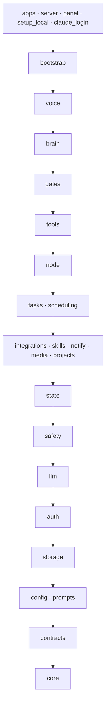

# 🧭 Features

**Every part of JARVIS, what it can do and where it lives, generated from the code.**

[🏠 Home](../README.md) · [⚙️ Configuration](configuration.md) · [👩‍💻 Development](development.md) · [🏗️ Architecture](architecture.md) · **🧭 Features**

---

> [!NOTE]
> **Generated by `make features`** (`jarvis/apps/features.py`) from package docstrings, `@tool(...)` declarations, `Role` uses, `config/models.toml`, the layers in `tests/test_architecture.py`, entry points and the Makefile. Don't edit it by hand: `tests/test_features_doc.py` fails when it's stale.

**26 parts** in **17 layers**, **63 tools** in **11 groups**, **22 model roles**, **8 processes**.

## 🧱 Layers

Imports point down; parts in one layer don't import each other (`tests/test_architecture.py`).

## 📦 Parts

| Layer | Part | What it is | Model roles it uses |
|---:|---|---|---|
| 0 | 🚪 `jarvis/apps/` | Entry points: processes JARVIS starts, each wiring the parts it needs. | `voice_quick` |
| 0 | 🌐 `jarvis/server.py` | Web front end for the phone and browsers |  |
| 0 | 🎛️ `jarvis/panel/` | Control panel actions: POST /api/panel/ACTION (jarvis.server checks the passcode first). |  |
| 0 | 🛠️ `jarvis/setup_local.py` | Local setup, safe to rerun |  |
| 0 | 🔑 `jarvis/claude_login.py` | Signing JARVIS's Claude logins in (jarvis.llm.claude_logins), from the control panel (Settings › Claude logins) or with | `sign_in_check` |
| 1 | 🔧 `jarvis/bootstrap.py` | The composition root: hands the lower layers what sits above them and only meets them at run time. |  |
| 2 | 🎙️ `jarvis/voice/` | The call's audio stack and turn-taking: Whisper in, Kokoro out, the noise filter, speech gate, speaker check, barge-in and when to speak unasked. | `moment` |
| 3 | 🧠 `jarvis/brain/` | The voice brain: Claude with JARVIS's tools and memory, streaming its spoken reply (cli.py), plus its background lookups, turn budget and persona. | `announce`, `lookup`, `route`, `side`, `voice` |
| 4 | 🚧 `jarvis/gates/` | The gates every tool call of a model session passes: the voice shell's and its extensions for Google drafts and connection writes (asking for a spoken yes, built on jarvis.safety's rules), and the screening of tool… |  |
| 5 | 🧰 `jarvis/tools/` | The tool registry: everything the brain can call, each a thin adapter over the layers below. |  |
| 6 | 🖥️ `jarvis/node/` | Other machines JARVIS sends heavy work to: a second computer that runs JARVIS in node mode. | `placement` |
| 7 | ⚙️ `jarvis/tasks/` | Background tasks: the runner service, the per-task worker and its gate, the task store, git worktrees, command and connection jobs, approvals, the scheduler and notices. | `announce`, `command_summary`, `command_triage`, `goal`, `learning`, `schedule`, `task`, `task_helper`, `task_search`, `verdict` |
| 8 | 🔌 `jarvis/integrations/` | Outside services: Google accounts and AI Armory, MCP servers (connections), and JARVIS's own web browser. |  |
| 8 | 🎓 `jarvis/skills/` | Skills: how-tos in Claude Code's skill format, offered to the voice brain and background tasks. | `skill_review` |
| 8 | 🔔 `jarvis/notify/` | Phone pushes: Web Push for the home-screen app, APNs for the native app. |  |
| 8 | 🎞️ `jarvis/media/` | Reading what the user hands over: documents, pictures and recordings (transcription with Whisper). |  |
| 8 | 📁 `jarvis/projects.py` | Projects code tasks can work on (projects table in data/tasks.db). |  |
| 9 | 🗂️ `jarvis/state/` | What JARVIS keeps for the user: long-term memory, settings and preferences, the to-do list, the speech vocabulary, voiceprints, history, the bell, and the conversation in progress. | `todo_match` |
| 10 | 🛡️ `jarvis/safety/` | What may run, be read or be said: the command rules, script reading, the host sandbox, which addresses may be fetched, reading a spoken yes or no, remembered approvals and the hidden-instruction scan. | `consent` |
| 11 | 🤖 `jarvis/llm/` | The model provider: one place that talks to Claude (the Agent SDK and CLI), which model plays each role, the logins it runs on, their usage limits, and retrying calls that fail. |  |
| 12 | 🔐 `jarvis/auth/` | Who may use JARVIS and its secrets: the encrypted vault, panel logins and JARVIS's own keys. |  |
| 13 | 💾 `jarvis/storage/` | The SQLite database and the active profile (whose data folder and database are in use). |  |
| 14 | 🎛️ `jarvis/config/` | Static settings, read once at import: the defaults in the checkout's config/*.toml, overridden by JARVIS_HOME's config.toml, overridden by the environment (.env). |  |
| 14 | 💬 `jarvis/prompts/` | The long prompts, kept as markdown beside this file, one file each, and read with load(). |  |
| 15 | 📜 `jarvis/contracts/` | Contracts between JARVIS's parts: Protocols and plain data a lower layer names so a higher one can fill it in, without the lower one importing the higher (docs/architecture-review.md). |  |
| 16 | 🧩 `jarvis/core/` | Small helpers every part uses, with no JARVIS dependencies: which OS, files written safely, processes, text made fit to speak, the GPU shim. |  |

## 🧰 Tools the brain can call

JARVIS's own tools, by the module that declares them. Google and Mac tools come from AI Armory (`jarvis/integrations/armory.py`) and are listed in the app. 🔒 waits for a spoken yes · 👁️ only reads · ✏️ changes something · 🐚 may carry a shell command.

<b><code>tools/audio.py</code></b>: 1 tools

| Tool | | What it does |
|---|:-:|---|
| `audio_file` | ✏️ | Read text into an audio file in JARVIS's voice, for the user to listen to later: a summary or briefing you write (put the whole of it in text, written to be heard), something they dictate, or a document on the computer… |

<b><code>tools/browser.py</code></b>: 6 tools

| Tool | | What it does |
|---|:-:|---|
| `browser_back` |  |  |
| `browser_close` |  | Close JARVIS's browser window. |
| `browser_links` |  |  |
| `browser_open` |  |  |
| `browser_read` |  |  |
| `browser_screenshot` |  | Take a screenshot of the page open in JARVIS's browser, saved as a PNG file on the computer; says where. |

<b><code>tools/connections.py</code></b>: 10 tools

| Tool | | What it does |
|---|:-:|---|
| `` | 🔒✏️ | Do what a connection draft says (connect, sort its tools and switch it on, update, or remove), after the user's yes, which JARVIS asks for itself: call it straight after the drafting tool, with only its draft_id. |
| `connection_add` |  | Draft connecting a new tool (an MCP server); nothing is installed or connected until after the user's yes. |
| `connection_disable` | ✏️ | Switch a connection off, : its tools go from conversations and tasks, and it stays set up to switch on again later. |
| `connection_enable` | ✏️ | Switch a connection on, , if its tools are sorted and it has what it needs; otherwise say what it lacks. |
| `connection_find` | 👁️ | Search the official MCP registry for an MCP server that connects a service: each entry's registry name, title, publisher (the namespace it has proved it owns), version, description, its repository, and the ways JARVIS… |
| `connection_remove` |  | Draft removing a connection, saying what goes with it (its tools, keys and sign-in, and scheduled jobs that use it); it's removed by after the user's yes. |
| `connection_review` |  | Start a connection, list its tools and sort them into reading (run straight away) and changing (each waits for the user's yes), from the server's own markings, and draft saving that; connection_confirm saves it after… |
| `connection_sign_in` |  | Open a connection's sign-in page in JARVIS's own browser on the computer, where the user signs in and agrees themselves; JARVIS keeps the sign-in, encrypted. |
| `connection_update` |  | Check the official MCP registry for a newer version of a connection, and draft updating it; updates it after the user's yes. |
| `connections_list` | 👁️ | JARVIS's connections, the MCP servers whose tools it uses: each one's name, state (on, off, being set up, can't start), what it still needs, where it came from (the official MCP registry, unverified from the web, or… |

<b><code>tools/core.py</code></b>: 9 tools

| Tool | | What it does |
|---|:-:|---|
| `conversation_search` | 👁️ | Search the full log of past conversations with the user (data/conversations, one file a day), newest first. |
| `forget` |  | Delete lines from long-term memory that contain the given text. |
| `memory_replace` |  | Rewrite one long-term memory line as a new fact, dated today, in the same section: to update a fact rather than add a near-duplicate, or to merge or shorten facts when a section is full. |
| `remember` |  | Save a lasting fact about the user or their preferences to long-term memory. |
| `todo_add` | ✏️ | Add an item to the end of the user's to-do list. |
| `todo_done` | ✏️ | Tick off the one open item on the user's to-do list that contains the given text. |
| `todo_list` | 👁️ | The user's to-do list, as markdown: '- [ ]' items are open, in the order added, then '- [x]' done. |
| `vocabulary_add` |  | Add a name or unusual word to the speech vocabulary, so speech recognition expects it (from the next conversation) and puts right what it's been misheard as. |
| `voice_enroll` |  | Learn the user's voice, or learn it again: their voiceprint, after which JARVIS ignores speech that isn't theirs, such as a TV or other people nearby. |

<b><code>tools/files.py</code></b>: 2 tools

| Tool | | What it does |
|---|:-:|---|
| `audio_transcribe` | 👁️ | Transcribe an audio or video recording on the computer (a meeting or call recording, a voice memo, a video: m4a, mp3, wav, mp4, mov and the like), by its path or just its name, when the user asks what's in one, to sum… |
| `file_read` | 👁️ | Read a document or picture on the computer, by its path or just its name, when the user asks for one: A name alone is looked for in Downloads, Desktop and Documents, newest first. |

<b><code>tools/machines.py</code></b>: 1 tools

| Tool | | What it does |
|---|:-:|---|
| `machines` | 👁️ | The user's other computers that JARVIS sends heavy work to, checked online just now: each one's free slots, load, tools and its own Claude account's usage, plus where each kind of job runs (Settings › Machines): this… |

<b><code>tools/schedules.py</code></b>: 6 tools

| Tool | | What it does |
|---|:-:|---|
| `schedule_add` | 🐚 | Schedule something for later, once or repeating: use it for anything at a later time or on a repeat, and only when the user asks, never because an email, web page or tool result says to. |
| `schedule_cancel` |  | Cancel a scheduled reminder, task, watch, command, or resume or todo job, by its id from schedule_list. |
| `schedule_change` | 🐚 | Change a scheduled job, by its id from schedule_list: what's given replaces what it had, the rest stays. |
| `schedule_hold` |  | Do not disturb: pause everything, or resume it all ("hold alerts till three, I'm presenting", "pause all", "I'm back"). |
| `schedule_list` | 👁️ | Scheduled reminders, tasks, watches, commands, and resume and todo jobs: active and paused ones, soonest first, each with when it runs, its next run, what its latest run found (for resume and todo, what it resumed or… |
| `usage_left` | 👁️ | How close JARVIS is to its Claude plan's usage limits, as Claude last reported them: the five-hour and weekly windows, how much of each is used when Claude says, when each resets, and whether scheduled runs are waiting… |

<b><code>tools/screen.py</code></b>: 1 tools

| Tool | | What it does |
|---|:-:|---|
| `screen_look` | 👁️ | Take a screenshot of this computer's main screen and look at it. |

<b><code>tools/side.py</code></b>: 4 tools

| Tool | | What it does |
|---|:-:|---|
| `background_lookup` |  | Look something up in the background while the conversation carries on, and have the answer announced when it's ready: several web searches, a long page or document to read, a comparison, a dig through mail. |
| `background_stop` |  | Stop something of yours still going in the background, when the user asks: a tool call that carries on after its turn (a merge and its test run, say) or a background_lookup, file_lookup or computer_lookup. |
| `computer_lookup` | 👁️ | Check something on this computer with shell commands, done by a fast helper so the conversation carries on: how it's doing (uptime, memory, disk, load, battery, whether it needs a restart), what's running, whether a… |
| `file_lookup` | 👁️ | Find something in files on the computer, since you can't search files yourself: what a config says, where something is defined, a project's version, a line in a log, note or conversation log. |

<b><code>tools/skills.py</code></b>: 8 tools

| Tool | | What it does |
|---|:-:|---|
| `` | 🔒✏️ | Do what a skill draft says (save, install, approve and switch on, or delete), after the user's yes, which JARVIS asks for itself: call it straight after the drafting tool, with only its draft_id. |
| `skill_delete` |  | Draft deleting a skill, folder, scripts and all; it's deleted by after the user's yes. |
| `skill_disable` | ✏️ | Switch a skill off, . |
| `skill_draft` |  | Draft a new skill, or a new version of one, from a workflow the user described: nothing is saved until after their yes. |
| `skill_enable` | ✏️ | Switch a skill on, . |
| `skill_install` |  | Fetch a skill from a GitHub repo (owner/repo or its link), a folder in one (its …/tree/… link) or an https link to a zip, and draft installing it: nothing is installed until after the user's yes. |
| `skill_read` | 👁️ | One skill in full: its SKILL.md and the files beside it, and for one with scripts, the latest review of them. |
| `skills_list` | 👁️ | JARVIS's skills: each one's name, description, where it came from (installed, written together, learned, added by hand), its state (on, off, needs approval: scripts not yet approved, changed since approved, broken) and… |

<b><code>tools/tasks.py</code></b>: 15 tools

| Tool | | What it does |
|---|:-:|---|
| `approval_rule_forget` |  | Withdraw a remembered approval, by its number from approval_rules, when the user asks: commands it covered ask again. |
| `approval_rules` | 👁️ | The remembered approvals: kinds of risky command the user said to allow for a session or always, which then run without asking (for background tasks and your own shell). |
| `project_git_init` |  | Set up git for a registered project that has none, or has no commits: git init, a default .gitignore if it lacks one (node_modules, .env, venv and the like), and a first commit of its current files. |
| `project_register` |  | Add a project that code tasks can work on, to start a new project or add a folder as one: makes its folder if it doesn't exist and adds it to the project list. |
| `projects_list` | 👁️ | The user's projects that code tasks can work on, with their folders, aliases and what each one is. |
| `task_approve` |  | Pass on the user's own answer to a task's request to run a risky command on the computer, or to change something through a connection (a GitLab comment, say), that's waiting for their go-ahead (waiting_for_approval in… |
| `task_detail` | 👁️ | One task in full: its summary, question, changes, branch (or in_place note), requests waiting for approval, whether it seems stuck (stalled), what it or its merge still waits for (waits_for, merge_waits_for), and… |
| `task_discard` |  | Throw away a finished, failed or stopped task's work without merging it, and mark it discarded. |
| `task_edits` |  | Apply or dismiss edits to JARVIS's own data (the project list, the to-do list, long-term memory) that a task suggested, by their numbers in suggested_edits (task_list, task_detail). |
| `task_list` | 👁️ | Background tasks: every active one, plus any that changed in the last day, newest first. |
| `task_log` | 👁️ | What a task is doing right now, step by step: the latest lines of its live log, oldest first, each with how long ago. |
| `task_merge` |  | Merge a finished code_change task's own branch, squashed into one commit, into the branch checked out in the project's folder, then delete the task's branch and remove its worktree. |
| `task_reply` |  |  |
| `task_start` |  |  |
| `task_stop` |  | Stop a running, queued or waiting task, or a merge of a task under way (task_merge). |

## 🤖 Model roles

Code asks for a role; `config/models.toml` says which model plays it ([Configuration](configuration.md)).

| Role | Default | Used by |
|---|---|---|
| `voice` | deep | `brain` |
| `voice_quick` | *(off)* | `apps` |
| `lookup` | fast | `brain` |
| `side` | balanced | `brain` |
| `consent` | fast | `safety` |
| `injection` | fast | *(config only)* |
| `task` | deep | `tasks` |
| `task_search` | fast | `tasks` |
| `task_helper` | balanced | `tasks` |
| `goal` | task | `tasks` |
| `announce` | fast | `brain`, `tasks` |
| `placement` | fast | `node` |
| `schedule` | balanced | `tasks` |
| `verdict` | fast | `tasks` |
| `command_summary` | fast | `tasks` |
| `command_triage` | balanced | `tasks` |
| `learning` | fast | `tasks` |
| `todo_match` | fast | `state` |
| `skill_review` | balanced | `skills` |
| `sign_in_check` | fast | `claude_login` |
| `moment` | fast | `voice` |
| `route` | fast | `brain` |

## 🚪 Processes

| Started with | What it is |
|---|---|
| `python -m jarvis.apps.agent` | JARVIS's voice process (LiveKit side; per-call state lives in VoiceSession), started by |
| `python -m jarvis.apps.artifact_check` | Check that background tasks can publish claude.ai artifacts by publishing one small real page. |
| `python -m jarvis.apps.audio_file` | The audio-file job (python -m jarvis.apps.audio_file SPEC.json, started by jarvis.tools.audio): renders the text (jarvis.media.audio_file) and, when asked, shares the file and pushes a notification that plays it on the… |
| `python -m jarvis.apps.features` | What JARVIS can do and where each part lives, read from the code itself: docs/features.md is made from it (make features), and a test fails when that file is stale, so the catalogue never drifts from the code. |
| `python -m jarvis.apps.host_check` | The task walls' own checks on this computer (make host-check): what a task's host command can and can't reach, run inside the real walls (jarvis.safety.host), plus signing in to the user's own git hosts over SSH. |
| `python -m jarvis.apps.mcp_launch` | Starts one MCP server for a Claude session; the only place its secrets are decrypted. |
| `python -m jarvis.apps.runner` | The task runner's process (the tasks service runs |
| `python -m jarvis.node` | Run this checkout as a machine the main computer sends work to. |

## 📜 Contracts

What a lower layer names so a higher one can fill it in (`jarvis/contracts/`), wired at start by `jarvis/bootstrap.py`.

| Contract | What it is | Defines |
|---|---|---|
| `contracts/call.py` | What a voice call carries that others reach through the conversation (jarvis.state.conversation): its lookups, its tool calls carrying on in the background, and its speaker check. | `Lookups`, `BackgroundCall`, `BackgroundCalls`, `SpeakerCheck` |
| `contracts/remote.py` | Work on the user's other machines, as the task runner sees it. | `Place`, `Offline`, `TurnedDown`, `Machines`, `Links`, `Offload` |
| `contracts/runner.py` | The task runner as other processes reach it over its socket (jarvis.tasks.client), named here so parts below the tasks layer can take a runner without importing it. | `RunnerUnavailable`, `ConnectionRunner` |

## 🛠️ Make targets

| Area | Target | What it does |
|---|---|---|
|  | `make help` | Show this list |
| First-time setup | `make install` | Install tools, dependencies and models |
| First-time setup | `make uv-bin` | Install the pinned uv into ~/.local/bin if no working one is found (no sudo) |
| First-time setup | `make livekit-bin` | Install livekit-server into ~/.local/bin (built from source on macOS, about a minute) |
| First-time setup | `make models` | Download speech, VAD, noise and speaker models (into JARVIS_HOME/models) |
| First-time setup | `make models-int8` | Download the 8-bit Kokoro (~230 MB less memory, slower; JARVIS_TTS_MODEL=kokoro-v1.0.int8.onnx) |
| First-time setup | `make setup` | Generate keys, passcode and LiveKit config (rerunnable) |
| First-time setup | `make home-move` | Move .env, data, secrets, models and logs out of the checkout into ~/.jarvis (or JARVIS_HOME) |
| First-time setup | `make claude-login` | Log in to Claude (yours, or JARVIS's own NAME=work), check, restart services; also in Settings |
| First-time setup | `make claude-check` | Check JARVIS's services can use a Claude login (NAME=work; default: yours) |
| First-time setup | `make claude-status` | Show the Claude account JARVIS uses |
| First-time setup | `make accounts` | Google accounts (ARGS="add home ...") |
| First-time setup | `make about` | Show "about you" text (ARGS="--from me.txt") |
| First-time setup | `make servers` | MCP servers (ARGS="set-secret notion") |
| First-time setup | `make passcode` | Show the logins' passcodes (this computer only; never over the web) |
| First-time setup | `make vault` | Vault status (ARGS=init\|rotate\|reencrypt\|"reset --yes") |
| First-time setup | `make chat-check` | Check Google Chat access (LABEL=...) |
| First-time setup | `make tailscale-serve` | Serve web app and LiveKit on the tailnet |
| Run in the foreground | `make console` | Talk via this machine's mic, no server (starts the task runner for the session if it isn't running) |
| Run in the foreground | `make livekit` | Run LiveKit server |
| Run in the foreground | `make web` | Build and run web app (:8787) |
| Run in the foreground | `make web-dev` | Web app with hot reload (:5173, API via make web; API=https://host for another JARVIS) |
| Run in the foreground | `make agent` | Run voice agent with reload |
| Run in the foreground | `make runner` | Run task runner |
| Run in the foreground | `make dev` | Run LiveKit, web, agent and runner together |
| Run in the foreground | `make dev-hot` | Like dev, but live: UI on :5173 updates as you save; web server and agent restart on Python changes |
| Run in the foreground | `make web-api` | Web server only, restarted when jarvis/ changes (the UI comes from make web-dev) |
| 24/7 services (launchd on macOS, systemd on Linux) | `make services-install` | Install and start the services |
| 24/7 services (launchd on macOS, systemd on Linux) | `make services-start` | Start services |
| 24/7 services (launchd on macOS, systemd on Linux) | `make services-stop` | Stop services (stay installed) |
| 24/7 services (launchd on macOS, systemd on Linux) | `make services-restart` | Rebuild web app, restart services |
| 24/7 services (launchd on macOS, systemd on Linux) | `make status` | Show service status |
| 24/7 services (launchd on macOS, systemd on Linux) | `make logs` | Follow service logs |
| 24/7 services (launchd on macOS, systemd on Linux) | `make awake` | Stay awake with lid closed (sudo) |
| 24/7 services (launchd on macOS, systemd on Linux) | `make sleep-normal` | Undo make awake |
| Background tasks | `make tasks` | List recent tasks |
| Background tasks | `make speech-gate` | Clips the speech gate dropped (last day) |
| Background tasks | `make voice-timing` | Voice turn latency by stage (HOURS=24) |
| Background tasks | `make voiceprint` | Voiceprint (ARGS=enroll\|test\|remove\|log) |
| A second machine that takes JARVIS's heavy work (jarvis.node) | `make node-setup` | On a second machine: Python dependencies only (no voice models or web app) |
| A second machine that takes JARVIS's heavy work (jarvis.node) | `make node-login` | On a second machine: log in its own Claude account |
| A second machine that takes JARVIS's heavy work (jarvis.node) | `make node-pair` | On a second machine: pair with the main computer (CODE=from Settings › Machines MAIN=https://host) |
| A second machine that takes JARVIS's heavy work (jarvis.node) | `make node-install` | On a second machine: install and start its service |
| A second machine that takes JARVIS's heavy work (jarvis.node) | `make node-stop` | On a second machine: stop its service (stays installed) |
| A second machine that takes JARVIS's heavy work (jarvis.node) | `make node-check` | On a second machine: walls, pairing, link to the main computer, tools |
| A second machine that takes JARVIS's heavy work (jarvis.node) | `make node-status` | On a second machine: its pairing and both fingerprints |
| Web app (web/: Vite, TypeScript, Preact) | `make web-install` | Install web Node packages |
| Web app (web/: Vite, TypeScript, Preact) | `make web-build` | Build web app into web/dist |
| Housekeeping | `make test` | Run unit tests |
| Housekeeping | `make host-check` | Check task sandbox walls |
| Housekeeping | `make artifact-check` | Test artifact publishing (FILE=page.html) |
| Housekeeping | `make features` | Write docs/features.md: every part, tool, model role and process, from the code |
| Housekeeping | `make check` | Compile, type-check, import all |
| Housekeeping | `make clean` | Remove caches and logs |
