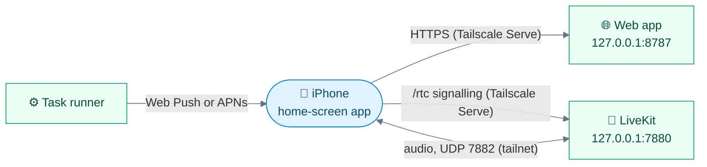

<div align="center">


# 📱 iPhone

**Talk to JARVIS from your iPhone: the installable web app, push notifications, and the native app.**

[🏠 Home](../README.md) · [🚀 Setup](setup.md) · [⚙️ Configuration](configuration.md) · [🗣️ Voice](voice.md) · [🛠️ Tasks](tasks.md) · [🔌 Integrations](integrations.md) · **📱 iPhone** · [👩‍💻 Development](development.md) · [🏗️ Architecture](architecture.md)

</div>

---

The phone reaches the Mac over **Tailscale**, so **nothing is exposed to the internet**.



## 🚀 Get it on your phone

Set it up once; the full walkthrough is [setup step 6](setup.md#-6-iphone-over-tailscale).

**1. Tailscale on both devices** — the Mac and the iPhone join the same tailnet.

**2. Serve JARVIS on the tailnet** — on the Mac:

```sh
make tailscale-serve
```

**3. Open it in Safari** — go to `https://<mac-name>.<tailnet>.ts.net` and enter your passcode.

**4. Add to Home Screen** — **Share** → **Add to Home Screen**, then open JARVIS from the icon.

> [!TIP]
> Each person can have **their own login**: **Settings → Logins and keys**. The passcode alone says who's connecting, so no two logins share one.

## ✨ What the app offers

<table>
<tr>
<td width="50%" valign="top">

**🎙️ Talk**<br>
Tap the core, or <kbd>Space</kbd> on a keyboard.

</td>
<td width="50%" valign="top">

**⌨️ Type instead**<br>
The message box sends a question as text; it **interrupts JARVIS like speech**, and the answer is spoken and captioned. Typing with no session starts one muted.

</td>
</tr>
<tr>
<td valign="top">

**🔇 Speaker off**<br>
The speaker button (or <kbd>S</kbd>) makes JARVIS reply in the transcript only; **no speech is generated** at all. A phone call turns mic and speaker off by itself.

</td>
<td valign="top">

**📷 Photos**<br>
The camera button in the message box ([Pictures](integrations.md#-pictures)).

</td>
</tr>
<tr>
<td valign="top">

**🎛️ Control panel**<br>
Tasks, to-dos, projects, history, memory, skills, connections and **Settings**.

</td>
<td valign="top">

**🔄 Reconnecting**<br>
If the session drops (a restart, the network), the page says *Reconnecting* and retries on its own, coming back as it was. A newer build reloads itself between sessions.

</td>
</tr>
<tr>
<td valign="top">

**🎧 Earphones**<br>
A stem press mutes and unmutes; see [Voice](voice.md#-earphones-and-switching-apps).

</td>
<td valign="top">

**🔔 Notifications**<br>
Task updates and heartbeat alerts, even when JARVIS isn't open. [Turn them on](#-notifications) below.

</td>
</tr>
</table>

## 🔔 Notifications

With push on (the default), **heartbeat alerts** and **task updates** (done, failed, has a question) reach the iPhone even when JARVIS isn't open.

| | What | Detail |
|:-:|---|---|
| 📡 | **How** | Standard **Web Push** for the home-screen app (iOS 16.4+), **APNs** for the native app. No third-party service |
| 👆 | **Tapping one** | Opens JARVIS on that task or alert, with a button to talk about it |
| 💓 | **Heartbeat pushes** | Follow the heartbeat's rules: never twice, nothing in quiet hours |
| 🔒 | **Lock screen** | Chat alerts say only who wrote, never what |

> [!IMPORTANT]
> iOS only allows push for a web app served over **HTTPS** and opened **from the Home Screen**. Tailscale Serve provides the HTTPS with a real certificate.

### Turning them on

**1. Push on, services running** — `JARVIS_PUSH` defaults to `on`. The first start makes JARVIS's VAPID key in `secrets/vapid_private.pem`.

**2. HTTPS reachable** — if the phone can't reach JARVIS over HTTPS yet:

```sh
make tailscale-serve
tailscale serve status    # check it
```

**3. Add to Home Screen** — open the address in Safari, enter the passcode, then **Share** → **Add to Home Screen**. Remove and re-add an older icon to pick up the service worker.

**4. Allow them** — open JARVIS **from the icon**, enter the passcode again (the Home Screen app has its own storage), tap **Enable notifications**, then **Allow**.

- **The bell** turns notifications off or on for that device; each device subscribes separately.
- **iOS Settings → Notifications → JARVIS** controls banners, sounds and Focus.

<details>
<summary><b>🩺 Pushes stopped?</b></summary>

<br>

**`BadJwtToken` in `logs/tasks.log`** means Apple refused the contact address. Add a Google account, or set:

```ini
JARVIS_PUSH_CONTACT=mailto:you@example.com
```

</details>

## 📲 Native app

A native iOS wrapper (**a separate project, not in this repository**) can load the same page and run the LiveKit session natively, so **the mic keeps going in the background**.

- The page detects it (`web/src/lib/native.ts`) and hands it the session.
- It can't use Web Push, so it registers with **APNs** and posts its device token to `POST /api/push/native`.
- Tokens are kept in `data/push_devices.json`, and every push then goes to the app too.

### On the Mac

**1. Create an APNs auth key** — at developer.apple.com: Certificates, IDs & Profiles → Keys → **+**, Apple Push Notifications service, Sandbox & Production.

**2. Save it** — as `secrets/apns_key.p8`:

```sh
chmod 600 secrets/apns_key.p8
```

**3. Enter its details** — the **Key ID** in **Settings → Logins and keys**, and the team in `.env`:

```ini
JARVIS_APNS_TEAM_ID=<your team id>
```

**4. Restart** — so the services pick it up:

```sh
make services-restart
```

| | Check | Where |
|:-:|---|---|
| ✅ | The app registered | `logs/web.log`: `app push token saved for iphone` |
| ❌ | A send failed | `logs/tasks.log`: `APNs push to iphone … failed` |

### In the app

The panel's **Notifications** switch asks iOS through the app's plugin. Once refused, it offers **Open Settings**, as iOS only allows them to be turned back on there.

Builds whose plugin supports it hand the token to the Mac **as soon as you allow them**; older builds do so at the next session start.

---

<div align="center">

[← 🔌 Integrations](integrations.md) &nbsp;·&nbsp; [🏠 Home](../README.md) &nbsp;·&nbsp; [👩‍💻 Development →](development.md)

</div>
