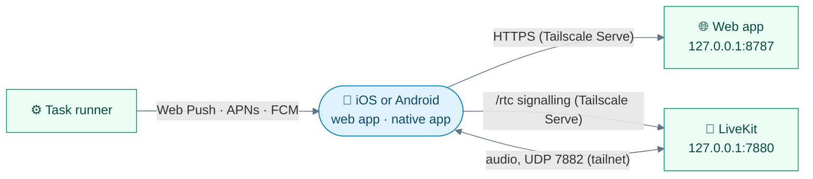

<div align="center">


# 📱 Mobile

**Talk to JARVIS from your phone, iOS or Android: the installable web app, push notifications, and the native app.**

[🏠 Home](../README.md) · [🚀 Setup](setup.md) · [⚙️ Configuration](configuration.md) · [🗣️ Voice](voice.md) · [🛠️ Tasks](tasks.md) · [🔌 Integrations](integrations.md) · **📱 Mobile** · [👩‍💻 Development](development.md) · [🏗️ Architecture](architecture.md)

</div>

---

The phone reaches JARVIS's computer over **Tailscale**, so **nothing is exposed to the internet**. The same web app runs on **iPhone, iPad and Android**.



## 🍎 Platform support

| | iOS / iPadOS | Android |
|---|:-:|:-:|
| **Web app** (talk, type, panel, photos) | ✅ Safari | ✅ Chrome |
| **Install to the home screen** | ✅ Share → Add to Home Screen | ✅ ⋮ → Add to Home screen |
| **Web Push notifications** | ✅ iOS 16.4+, from the Home Screen app | ✅ in Chrome, installed or not |
| **Earphone mute** | ✅ | ✅ |
| **Native app** (mic keeps running in the background) | ✅ | ✅ |
| **Native app notifications** | ✅ APNs | ✅ FCM |

## 🚀 Get it on your phone

Set it up once; the full walkthrough is [setup step 6](setup.md#-6-your-phone-over-tailscale).

**1. Tailscale on both devices** — JARVIS's computer and the phone join the same tailnet ([iOS](https://apps.apple.com/app/tailscale/id1470499037) · [Android](https://play.google.com/store/apps/details?id=com.tailscale.ipn)).

**2. Serve JARVIS on the tailnet** — on JARVIS's computer:

```sh
make tailscale-serve
```

**3. Open it** — go to `https://<computer-name>.<tailnet>.ts.net` in **Safari** (iOS) or **Chrome** (Android) and enter your passcode.

**4. Add it to the home screen**

| iOS | Android |
|---|---|
| **Share** → **Add to Home Screen**, then open JARVIS from the icon | **⋮** → **Add to Home screen** (or **Install app**), then open JARVIS from the icon |

> [!TIP]
> Each person can have **their own login**: **Settings → Logins and keys**. The passcode alone says who's connecting, so no two logins share one.

## ✨ What the app offers

<table>
<tr>
<td width="50%" valign="top">

**🎙️ Talk**<br>
Tap the core, or <kbd>Space</kbd> on a keyboard.

</td>
<td width="50%" valign="top">

**⌨️ Type instead**<br>
The message box sends a question as text; it **interrupts JARVIS like speech**, and the answer is spoken and captioned. Typing with no session starts one muted.

</td>
</tr>
<tr>
<td valign="top">

**🔇 Speaker off**<br>
The speaker button (or <kbd>S</kbd>) makes JARVIS reply in the transcript only; **no speech is generated** at all. In the native app, a phone call turns mic and speaker off by itself.

</td>
<td valign="top">

**📷 Photos**<br>
The camera button in the message box ([Pictures](integrations.md#-pictures)).

</td>
</tr>
<tr>
<td valign="top">

**🎛️ Control panel**<br>
Tasks, to-dos, projects, history, memory, skills, connections and **Settings**.

</td>
<td valign="top">

**🔄 Reconnecting**<br>
If the session drops (a restart, the network), the page says *Reconnecting* and retries on its own, coming back as it was. A newer build reloads itself between sessions.

</td>
</tr>
<tr>
<td valign="top">

**🎧 Earphones**<br>
A stem or button press mutes and unmutes; see [Voice](voice.md#-earphones-and-switching-apps).

</td>
<td valign="top">

**🔔 Notifications**<br>
Task updates, reminders and alerts, even when JARVIS isn't open. [Turn them on](#-notifications) below.

</td>
</tr>
</table>

## 🔔 Notifications

With push on (the default), **alerts** (reminders, what your monitors find, JARVIS's [notices](tasks.md#-notices)) and **task updates** (done, failed, has a question) reach your phone even when JARVIS isn't open.

| | What | Detail |
|:-:|---|---|
| 📡 | **How** | **Web Push** for the web app; **APNs** (iOS) and **FCM** (Android) for the native app |
| 👆 | **Tapping one** | Opens JARVIS on that task or alert, with a button to talk about it |
| 🔁 | **Notice pushes** | Never twice, nothing in quiet hours |
| 🔒 | **Lock screen** | Chat alerts say only who wrote, never what |

> [!IMPORTANT]
> Push needs JARVIS's **HTTPS** address (Tailscale Serve), not plain http. On **iOS** it also needs the app opened **from the Home Screen**; Android Chrome allows it in the browser too.

### Turning them on

**1. Push on, services running** — `JARVIS_PUSH` defaults to `on`. The first start makes JARVIS's VAPID key in `secrets/vapid_private.pem`.

**2. HTTPS reachable** — if the phone can't reach JARVIS over HTTPS yet:

```sh
make tailscale-serve
tailscale serve status    # check it
```

**3. Open the app** — on iOS, **from the Home Screen icon** (remove and re-add an older icon to pick up the service worker), entering the passcode again since the Home Screen app has its own storage. On Android, the installed app or Chrome.

**4. Allow them** — tap **Enable notifications**, then **Allow**.

- **The bell** turns notifications off or on for that device; each device subscribes separately.
- The phone's own settings (**Settings → Notifications → JARVIS** on iOS, **App info → Notifications** on Android) control banners, sounds and Focus or Do Not Disturb.

<details>
<summary><b>🩺 Pushes stopped?</b></summary>

<br>

**`BadJwtToken` in `logs/tasks.log`** means the push service refused the contact address. Add a Google account, or set:

```ini
JARVIS_PUSH_CONTACT=mailto:you@example.com
```

</details>

## 📲 Native app

A native app for **iOS and Android** ([**jarvis-app**](https://github.com/anilkumarmeena/jarvis-app), a separate repository) loads the same page and runs the LiveKit session natively, so **the mic keeps going in the background**.

- The page detects it and its platform (`web/src/lib/native.ts`) and hands it the session.
- **iOS:** its web view can't use Web Push, so it registers with **APNs** and posts its device token to `POST /api/push/native`. Tokens are kept in `data/push_devices.json`, and every push then goes to the app too.
- **Android:** it registers with **Firebase Cloud Messaging** by itself when a session starts and posts its token to the same endpoint (`"service": "fcm"`). Tokens are kept in `data/fcm_devices.json`.

### iOS push: on the computer

**1. Create an APNs auth key** — at developer.apple.com: Certificates, IDs & Profiles → Keys → **+**, Apple Push Notifications service, Sandbox & Production.

**2. Save it** — as `secrets/apns_key.p8`:

```sh
chmod 600 secrets/apns_key.p8
```

**3. Enter its details** — the **Key ID** in **Settings → Logins and keys**, and the team in `.env`:

```ini
JARVIS_APNS_TEAM_ID=<your team id>
```

**4. Restart** — so the services pick it up:

```sh
make services-restart
```

| | Check | Where |
|:-:|---|---|
| ✅ | The app registered | `logs/web.log`: `app push token saved for iphone` |
| ❌ | A send failed | `logs/tasks.log`: `APNs push to iphone … failed` |

### iOS push: in the app

The panel's **Notifications** switch asks iOS through the app's plugin. Once refused, it offers **Open Settings**, as iOS only allows them to be turned back on there.

Builds whose plugin supports it hand the token to JARVIS **as soon as you allow them**; older builds do so at the next session start.

### Android push: on the computer

FCM needs a **Firebase project**: the app is built with its `google-services.json`, and JARVIS's computer sends with a key from the same project.

**1. Create a service-account key** — in the [Firebase console](https://console.firebase.google.com): **Project settings → Service accounts → Generate new private key**.

**2. Save it** — as `secrets/fcm_service_account.json`:

```sh
mv ~/Downloads/<project>-firebase-adminsdk-*.json secrets/fcm_service_account.json
chmod 600 secrets/fcm_service_account.json
```

**3. Restart** — so the services pick it up:

```sh
make services-restart
```

> [!CAUTION]
> That key can send to **every install of your app**. Keep it in `secrets/` (git-ignored, hidden from tasks) and never commit it.

| | Check | Where |
|:-:|---|---|
| ✅ | The app registered | `logs/web.log`: `app push token saved for android (fcm)` |
| ❌ | A send failed | `logs/tasks.log`: `FCM push to android failed` |

### Android push: in the app

The app asks Android for permission and registers **by itself when a session starts**; there's no switch to tap. If nothing arrives, allow notifications for JARVIS in **App info → Notifications**.

---

<div align="center">

[← 🔌 Integrations](integrations.md) &nbsp;·&nbsp; [🏠 Home](../README.md) &nbsp;·&nbsp; [👩‍💻 Development →](development.md)

</div>
