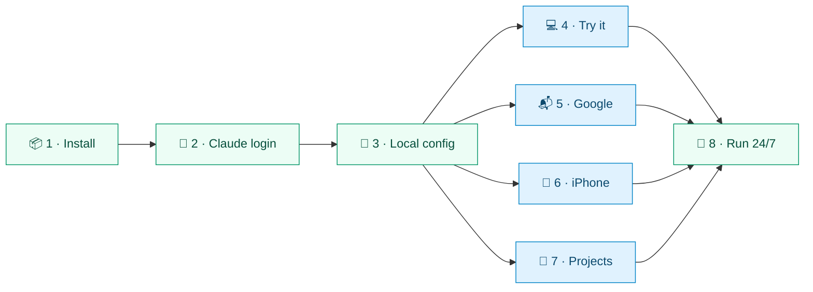
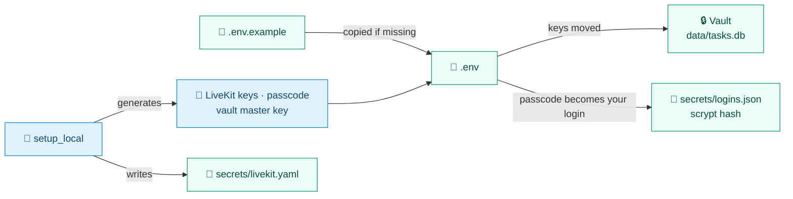

<div align="center">


# 🚀 Setup

**From a fresh clone to JARVIS answering on your iPhone and running around the clock.**

[🏠 Home](../README.md) · **🚀 Setup** · [⚙️ Configuration](configuration.md) · [🗣️ Voice](voice.md) · [🛠️ Tasks](tasks.md) · [🔌 Integrations](integrations.md) · [📱 iPhone](iphone.md) · [👩‍💻 Development](development.md) · [🏗️ Architecture](architecture.md)

</div>

---

Each step builds on the one before. Steps **1–3** get JARVIS talking; steps **4–7 are optional**; step **8** keeps it running.



> [!IMPORTANT]
> You need **macOS on Apple silicon** (M1 or later, 8 GB is enough), [Homebrew](https://brew.sh), [uv](https://docs.astral.sh/uv/), Node.js and the **Claude Code CLI** with a Claude account. Optional extras are listed in the [README](../README.md#-quickstart).

<details>
<summary><b>📑 On this page</b></summary>

<br>

| | Step | What you get |
|:-:|---|---|
| 📦 | [1. Install](#-1-install) | Tools, Python packages, models and the web app |
| 🔑 | [2. Claude login](#-2-claude-login) | JARVIS's own Claude account, apart from your everyday Claude Code |
| 🔧 | [3. Local config](#-3-local-config) | `.env`, LiveKit keys, the vault key and your passcode |
| 💻 | [4. Try it on the Mac](#-4-try-it-on-the-mac) | Talking in the terminal or the browser |
| 📬 | [5. Google](#-5-google) | Gmail, Calendar, Sheets, Docs, Slides, Drive and Chat |
| 📱 | [6. iPhone over Tailscale](#-6-iphone-over-tailscale) | The home-screen app on your phone |
| 📁 | [7. Projects for code tasks](#-7-projects-for-code-tasks) | Repos background tasks can work on |
| 🔁 | [8. Run it 24/7](#-8-run-it-247) | Four launchd services that never stop |
| 📂 | [Where things live](#-where-things-live) | Every file and folder JARVIS keeps |

</details>

## 📦 1. Install

**Install everything** — tools, Python packages, models and the web app:

```sh
make install
```

| | It runs | What for |
|:-:|---|---|
| 🍺 | `brew install livekit` | The local LiveKit server, only if it's missing |
| 🐍 | `uv sync` | Python 3.12+ and every dependency, into `.venv` |
| 🧠 | `make models` | Speech, VAD, turn, noise and speaker models (below) |
| 🌐 | `make web-build` | `npm install` (once) and a build into `web/dist` |

`make models` fetches **Kokoro** (TTS), **Whisper large-v3-turbo 4-bit**, **Silero VAD**, the **turn detector**, **DeepFilterNet 3** (noise filter) and **WeSpeaker ResNet34** (speaker check) into `models/` and the Hugging Face cache. The noise-filter and speaker models are pinned and **checked by hash**.

## 🔑 2. Claude login

JARVIS signs in to Claude with **a login of its own**, kept in `secrets/claude`, so it never touches your everyday Claude Code session.

```sh
make claude-login     # CLAUDE_CONFIG_DIR=secrets/claude claude auth login
make claude-status    # which account it uses
```

A **claude.ai subscription** login (rather than an API key) also lets background tasks publish mockups and previews as claude.ai artifacts. `make artifact-check` tests it.

## 🔧 3. Local config

**Write `.env`, keys and your passcode** — safe to rerun:

```sh
make setup            # uv run python -m jarvis.setup_local
```



> [!WARNING]
> Your passcode is **shown once: note it down.** Later changes, and logins for other people, are in the control panel under **Settings → Logins and keys**.

- It **asks once where your projects are kept** (default: the folder this checkout is in) and writes `JARVIS_NEW_PROJECTS_DIR` and `JARVIS_TASK_READ_DIRS`.
- Then **set who you are**: your name and time zone in **Settings → About you** (or `JARVIS_USER_NAME`, `JARVIS_TIMEZONE`), plus what JARVIS should know about you (below).
- Every other setting has a default: see **[⚙️ Configuration](configuration.md)**.

### About you

"About you" is what JARVIS knows about you, **in your own words**, one point per line: your job, your projects, what to keep apart when reporting. It goes into JARVIS's prompt, followed by your Google accounts. Edit it in **Settings → About you**, or:

```sh
make about                                                           # show it
uv run python -m jarvis.state.settings about --set "Works at Acme."  # replace; a newline starts another point
uv run python -m jarvis.state.settings about --from me.txt           # from a file (- for stdin)
uv run python -m jarvis.state.settings about --clear
```

## 💻 4. Try it on the Mac

| | Where | How |
|:-:|---|---|
| ⌨️ | **Terminal** | `make console` talks through the Mac's mic; no server needed |
| 🌐 | **Browser** | `make dev` (foreground) or `make services-install` (launchd), then open the app and enter your passcode |

```sh
make console                  # talk in this terminal
make dev                      # or run every part, then:
open http://localhost:8787
```

## 📬 5. Google

**1. Create an OAuth client** — in a Google Cloud project, under **APIs & Services → Credentials**, then enable these APIs under **APIs & Services → Library**:

> [!IMPORTANT]
> The client must be a **Desktop app** OAuth client, and every API JARVIS uses must be **enabled** in that project.

| | API | Used for |
|:-:|---|---|
| 📧 | Gmail, Google Calendar | Mail and calendar |
| 📝 | Google Sheets, Docs, Slides | Reading and editing your documents (Slides: read only) |
| 🗄️ | Google Drive | Finding and reading files; briefly holding images a Doc copies in |
| 💬 | Google Chat, People | Only for [Google Chat](integrations.md#-google-chat) |

- **Drive:** JARVIS finds files by name or content and reads Slides through it, but **only changes Drive files it made itself**.

**2. Give JARVIS the client** — paste its JSON in **Settings → Logins and keys**, which keeps it in the vault. Or drop Google's `client_secret_….json` into `secrets/`: JARVIS moves it into the vault on its next start, and you can then delete the file.

**3. Add each account** — under a label of your choosing, which signs it in:

```sh
uv run python -m jarvis.integrations.accounts add work --note "for work"
uv run python -m jarvis.integrations.accounts add personal --note "my own"
make services-restart
```

Managing accounts, permissions and Chat set-up: **[🔌 Integrations](integrations.md#-google-accounts)**.

## 📱 6. iPhone over Tailscale

**1. Install Tailscale** — on the Mac and the iPhone, signed in to the same account.

**2. Rerun setup** — so LiveKit advertises the Mac's Tailscale address for audio:

```sh
make setup
```

**3. Publish over HTTPS** — the web app and LiveKit signalling, reachable only by your own devices:

```sh
make tailscale-serve   # tailscale serve --bg 8787, and /rtc → 127.0.0.1:7880
```

**4. Add it to the Home Screen** — on the iPhone, open `https://<mac-name>.<tailnet>.ts.net` in Safari, enter the passcode, then **Share → Add to Home Screen**.

**5. Optional** — an Apple Shortcut that opens that URL, on the Action Button.

> [!WARNING]
> **No audio on the phone?** Make sure you reran `make setup` after installing Tailscale. If macOS asks whether `livekit-server` may accept incoming connections, **allow it**: audio uses **UDP port 7882**.

Notifications, earphones and the native app: **[📱 iPhone](iphone.md)**.

## 📁 7. Projects for code tasks

The projects code tasks can work on live in the `projects` table of `data/tasks.db`. Add them **by voice** ("add my billing api folder as a project") or from a terminal, with **aliases** for names speech recognition might mishear:

```sh
uv run python -m jarvis.tasks.projects add billing-api --path ~/code/billing-api \
  --aliases "billing api, the billing service" --about "Billing service (work)" --worktrees

# list them
uv run python -m jarvis.tasks.projects

# change one: --in-place, or --path, --aliases, --about, --worktrees
uv run python -m jarvis.tasks.projects set billing-api --in-place

# take it off the list; the folder stays
uv run python -m jarvis.tasks.projects remove billing-api
```

Changes apply at once. **In place** (the default) vs **worktrees** is explained in **[🛠️ Tasks](tasks.md#where-code-changes-go)**.

## 🔁 8. Run it 24/7

**Install the services** — installs and starts four launchd services, logging to `logs/`:

```sh
make services-install
```

| | Service | Runs |
|:-:|---|---|
| 📡 | `com.jarvis.livekit` | The local LiveKit server |
| 🎙️ | `com.jarvis.agent` | The voice agent |
| 🌐 | `com.jarvis.web` | The web app and control panel on 127.0.0.1:8787 |
| ⚙️ | `com.jarvis.tasks` | The task runner: background tasks, heartbeat, scheduler, learning review |

**Keeping it running:**

| | To | Do |
|:-:|---|---|
| 🔌 | Keep the Mac awake on the charger | Nothing: the agent's service runs under `caffeinate` |
| 💤 | Keep running with the lid closed | `make awake` (`sudo pmset -a disablesleep 1`) |
| 🌙 | Restore normal sleep | `make sleep-normal` |
| 🔁 | Apply a `.env` change or pulled code | `make services-restart` |
| ⏯️ | Stop or start them | `make services-stop` · `make services-start` |

`JARVIS_SERVICE_PREFIX` changes the `com.jarvis` part, to **run a second JARVIS** under the same Mac account; `make services-restart` moves the services to the new labels.

## 📂 Where things live

| | Path | Holds |
|:-:|---|---|
| ⚙️ | `.env` | Settings and the vault's master key (mode 600) |
| 🗃️ | `data/tasks.db` | Tasks, to-dos, projects, Google accounts, settings, voiceprint, scheduled jobs, encrypted vault |
| 🧠 | `data/memory.md` | Long-term facts under `## User` and `## Environment` (max 2,000 and 3,000 chars) |
| 📖 | `data/vocabulary.md` | Names and words speech recognition should expect, and their mishearings |
| 💬 | `data/conversations/` | Every conversation, one markdown file a day |
| 🌿 | `data/worktrees/` | Worktrees for tasks on their own branch |
| 🔐 | `secrets/` | Google sign-ins, JARVIS's Claude login, logins, LiveKit config, push keys |
| 📦 | `models/` | Downloaded models |
| 📜 | `logs/` | Service logs, voice timing, speech gate and speaker check logs |

🔒 All of `data/`, `secrets/`, `models/`, `logs/` and `.env` are **git-ignored** and stay on your Mac.

---

<div align="center">

[← 🏠 Home](../README.md) &nbsp;·&nbsp; [⚙️ Configuration →](configuration.md)

</div>
