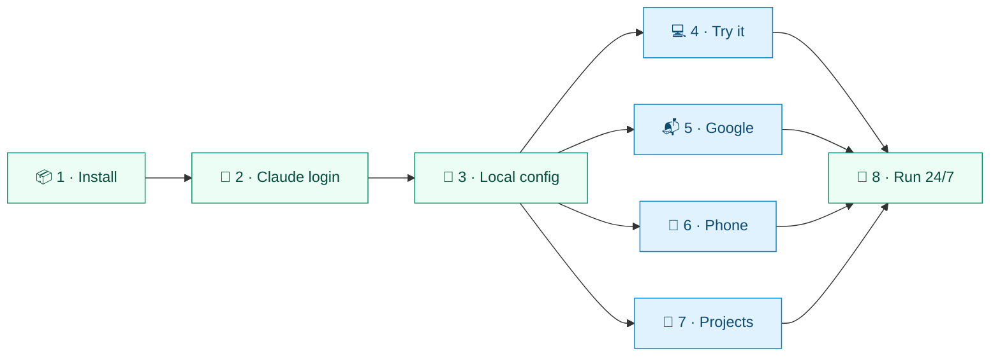
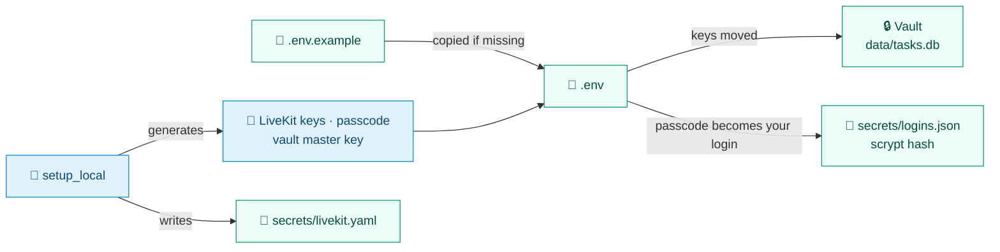

<div align="center">


# 🚀 Setup

**From a fresh clone to JARVIS answering on your phone and running around the clock, on macOS, Linux or Windows through WSL2.**

[🏠 Home](../README.md) · **🚀 Setup** · [⚙️ Configuration](configuration.md) · [🗣️ Voice](voice.md) · [🛠️ Tasks](tasks.md) · [🔌 Integrations](integrations.md) · [📱 Mobile](mobile.md) · [👩‍💻 Development](development.md) · [🏗️ Architecture](architecture.md)

</div>

---

Each step builds on the one before. Steps **1–3** get JARVIS talking; steps **4–7 are optional**; step **8** keeps it running. Only steps **1** and **8** differ by platform.



<details>
<summary><b>📑 On this page</b></summary>

<br>

| | Step | What you get |
|:-:|---|---|
| 🧭 | [Pick your platform](#-pick-your-platform) | macOS, Linux or Windows through WSL2 |
| 📦 | [1. Install](#-1-install) | Tools, Python packages, models and the web app |
| 🔑 | [2. Claude login](#-2-claude-login) | Uses your Claude Code login; sign in only if you haven't |
| 🔧 | [3. Local config](#-3-local-config) | `.env`, LiveKit keys, the vault key and your passcode |
| 💻 | [4. Try it](#-4-try-it) | Talking in the terminal or the browser |
| 📬 | [5. Google](#-5-google) | Gmail, Calendar, Sheets, Docs, Slides, Drive and Chat |
| 📱 | [6. Your phone over Tailscale](#-6-your-phone-over-tailscale) | The home-screen app on your phone |
| 📁 | [7. Projects for code tasks](#-7-projects-for-code-tasks) | Repos background tasks can work on |
| 🔁 | [8. Run it 24/7](#-8-run-it-247) | Four services that never stop: launchd or systemd |
| 📂 | [Where things live](#-where-things-live) | Every file and folder JARVIS keeps |

</details>

## 🧭 Pick your platform

<table>
<tr>
<td width="33%" valign="top">

**[🍎 macOS](#-macos)**<br>
**Apple silicon** (M1 or later, 8 GB is enough). Homebrew, **launchd** services, MLX Whisper on the GPU.

</td>
<td width="33%" valign="top">

**[🐧 Linux](#-linux)**<br>
**x86_64 or arm64** with **systemd**. Distro packages, systemd **user** units, faster-whisper on a CUDA GPU or the CPU.

</td>
<td width="33%" valign="top">

**[🪟 Windows](#-windows-wsl2)**<br>
**Through WSL2** (Ubuntu) with systemd turned on; from there, the Linux steps. Native Windows isn't supported.

</td>
</tr>
</table>

> [!IMPORTANT]
> Everywhere you need [uv](https://docs.astral.sh/uv/) (`make install` fetches it into `~/.local/bin` if it's missing), **Node.js 22** or later and the **Claude Code CLI** with a Claude account. Optional extras are listed in the [README](../README.md#-quickstart).

- **Intel Macs** get faster-whisper instead of MLX (which needs Apple silicon); they're untested.
- **Beyond install and services**, Linux differs in two places: tasks are walled in by **bubblewrap** instead of Seatbelt, and the Mac's tools (Shortcuts, opening apps by name) give way to Linux desktop tools where their programs exist. See **[🔌 Integrations](integrations.md)** and **[🏗️ Architecture](architecture.md)**.

## 📦 1. Install

**Get your platform's prerequisites**, then run the same `make install` everywhere.

### 🍎 macOS

```sh
brew install uv node   # plus the Claude Code CLI
```

<details>
<summary><b>🔒 No Homebrew or admin rights</b></summary>

<br>

Install everything into your home folder instead, with **no sudo**:

```sh
mkdir -p ~/.local/bin
echo 'export PATH="$HOME/.local/bin:$PATH"' >> ~/.zshrc && source ~/.zshrc
curl -o- https://raw.githubusercontent.com/nvm-sh/nvm/v0.40.3/install.sh | bash   # nvm, then in a new terminal:
nvm install 22                                                                     # Node.js
curl -fsSL https://claude.ai/install.sh | bash                                     # Claude Code CLI
```

Without `brew`, `make install` **builds the LiveKit server from source** into `~/.local/bin` (`make livekit-bin`), because LiveKit publishes no macOS binaries. That takes about a minute and needs no Go install.

> [!TIP]
> **uv needs nothing from you here:** `make` finds it in `~/.local/bin` or where `pip install uv` put it (`~/Library/Python/3.x/bin`), even off your `PATH`, and otherwise installs the pinned version into `~/.local/bin`. A wrapper such as **PMG** (`~/.pmg/bin/uv`) keeps working: make adds those folders to the end of `PATH`, so the wrapper finds the real uv.

</details>

> [!NOTE]
> **Behind a company proxy?** If the browser downloads fine but the terminal times out, `make install` uses the proxy macOS is set to for GitHub (a fixed proxy, a PAC file or WPAD) whenever `HTTPS_PROXY` isn't set, and says so. It passes that proxy to uv, curl, Go and npm, and has uv trust the macOS certificate store. To use a different proxy, set `HTTPS_PROXY` yourself.

### 🐧 Linux

**Packages** — Debian and Ubuntu names; Fedora's are alike (`portaudio` for `libportaudio2`, `libnotify` for `libnotify-bin`, `words` for `wamerican`):

```sh
sudo apt install bubblewrap socat dbus-user-session libportaudio2 wamerican curl git make   # required
sudo apt install ffmpeg libnotify-bin xdg-utils wl-clipboard    # optional (xclip on X11)
```

| | Package | What for |
|:-:|---|---|
| 🧱 | `bubblewrap` · `socat` | **Required.** bubblewrap walls in background tasks' commands; both are needed by Claude Code's own sandbox (the voice shell) |
| 🚌 | `dbus-user-session` | `systemctl --user`, which runs JARVIS's services (most desktops have it; log out and in after installing) |
| 🎤 | `libportaudio2` | The terminal mic: `make console` and `make voiceprint` |
| 📖 | `wamerican` | A word list, so the learning review can tell everyday words from real mishearings |
| ⬇️ | `curl`, `sha256sum`, `tar` | Fetching LiveKit and the models |
| 🔔 | `libnotify-bin` · `xdg-utils` | Desktop notifications · opening links, files and folders |
| 📋 | `wl-clipboard`, or `xclip` / `xsel` | The clipboard |
| 🔉 | `wireplumber` (`wpctl`) or `pulseaudio-utils` (`pactl`) | Setting the volume |
| 📸 | `grim` (Wayland/wlroots), `gnome-screenshot`, `spectacle` (KDE), `scrot` or `imagemagick` (X11) | Screenshots |
| 🎵 | `ffmpeg` (plus `lame` for mp3) | m4a and mp3 audio files |
| 📄 | `libreoffice-writer` or `pandoc` | `.doc`, `.rtf` and `.odt` documents (`pandoc` can't read `.doc`) |

Each desktop tool is offered only when its program is installed and a display is present.

**Then the tools** — [uv](https://docs.astral.sh/uv/getting-started/installation/), Node.js 22+ (your distro's, [NodeSource](https://github.com/nodesource/distributions) or nvm) and the Claude Code CLI. Make sure **`~/.local/bin` is on your `PATH`**: the LiveKit server goes there.

> [!WARNING]
> **Ubuntu 23.10 and later (24.04 included)** restrict unprivileged user namespaces through AppArmor, which stops bubblewrap. Background tasks' commands then **refuse to run**, with a message saying how to fix it. Run `make host-check` after `make install` to find out early.

<details>
<summary><b>🧱 Letting bubblewrap build its sandbox on Ubuntu</b></summary>

<br>

Either give `bwrap` an AppArmor profile that allows user namespaces, in `/etc/apparmor.d/bwrap`:

```text
abi <abi/4.0>,
include <tunables/global>

profile bwrap /usr/bin/bwrap flags=(unconfined) {
  userns,
  include if exists <local/bwrap>
}
```

then `sudo systemctl reload apparmor`. Or lift the restriction for the whole machine:

```sh
sudo sysctl kernel.apparmor_restrict_unprivileged_userns=0
```

On other distributions, check `sysctl kernel.unprivileged_userns_clone` and `user.max_user_namespaces`.

</details>

### 🪟 Windows (WSL2)

**1. Install Ubuntu in WSL2** — in PowerShell: `wsl --install -d Ubuntu`.

**2. Turn on systemd** — the services need it. Inside Ubuntu, make sure `/etc/wsl.conf` has:

```ini
[boot]
systemd=true
```

then run `wsl --shutdown` from Windows and open Ubuntu again.

**3. Follow the [Linux](#-linux) steps** inside Ubuntu, with the checkout in your Linux home rather than under `/mnt/c`.

- **Screenshots** aren't available: WSL2 can't see the Windows screen. The clipboard and notifications work only under WSLg.
- `make awake` has no effect: **Windows decides** when the computer sleeps.
- Your **phone** reaches JARVIS through **Tailscale installed inside WSL2** ([step 6](#-6-your-phone-over-tailscale)).

### ✅ Then, everywhere

```sh
git clone https://github.com/anilkumarmeena/jarvis.git && cd jarvis
make install
```

| | It runs | What for |
|:-:|---|---|
| 🍺 | `brew install livekit` | **macOS:** the local LiveKit server, only if it's missing |
| 📡 | `make livekit-bin` | **Linux:** the same, as the pinned **1.13.7** release (amd64 or arm64), **sha256-checked**, into `~/.local/bin`; no sudo. **macOS without Homebrew:** built from the pinned 1.13.7 source with a pinned Go, both **sha256-checked** |
| ⚡ | `make uv-bin` | **uv**, pinned, into `~/.local/bin`; only if none is found, no sudo |
| 🐍 | `uv sync` | Python 3.12+ and every dependency, into `.venv` |
| 🧠 | `make models` | Speech, VAD, turn, noise and speaker models for this machine (below) |
| 🌐 | `make web-build` | `npm install` (once) and a build into `web/dist` |

`make models` fetches **Kokoro** (TTS), **Whisper**, **Silero VAD**, **DeepFilterNet 3** (noise filter) and **WeSpeaker ResNet34** (speaker check) into `models/` and the Hugging Face cache. The noise-filter and speaker models are pinned and **checked by hash**. Which Whisper depends on the machine:

| | Whisper on | Live voice | Recordings |
|:-:|---|---|---|
| 🍎 | **Apple silicon** (MLX) | large-v3-turbo 4-bit | the same |
| 🟩 | **CUDA GPU** (faster-whisper) | large-v3-turbo | large-v3-turbo |
| 🧮 | **CPU** (faster-whisper, int8) | `small.en` | `small` (any language) |

<details>
<summary><b>🧮 Speech without Apple silicon: GPU or CPU</b></summary>

<br>

- **GPU:** used when one works, which needs **CUDA 12 cuBLAS and cuDNN 9**, from the system or pip (`nvidia-cublas-cu12`, `nvidia-cudnn-cu12`).
- **CPU:** int8, one thread per physical core. `small.en` took 0.61 s per 5 s clip on an M-series CPU; expect about **1–1.5 s on a 4–8 core x86**. On a weak CPU, set `JARVIS_STT=base.en`.
- `JARVIS_STT_DEVICE` forces `cuda` or `cpu` (empty: pick automatically); `JARVIS_TRANSCRIBE_MODEL` picks the recordings model. All settings: **[⚙️ Configuration](configuration.md)**.

</details>

## 🔑 2. Claude login

JARVIS uses **your own Claude Code login**: if `claude` already works on this computer, there is nothing to do. Your Claude Code settings, CLAUDE.md, hooks, plugins and MCP servers still stay out of JARVIS's sessions.

```sh
make claude-status    # which account JARVIS uses
make claude-login     # sign in, if you haven't (claude auth login)
```

> [!TIP]
> To give JARVIS **a separate account**, set `JARVIS_CLAUDE_CONFIG_DIR=secrets/claude` in `.env`, then run `make claude-login` (it signs in to that folder) and `make services-restart`.

A **claude.ai subscription** login (rather than an API key) also lets background tasks publish mockups and previews as claude.ai artifacts. `make artifact-check` tests it.

## 🔧 3. Local config

**Write `.env`, keys and your passcode** — safe to rerun:

```sh
make setup            # uv run python -m jarvis.setup_local
```



> [!TIP]
> Lost your passcode? **`make passcode`** shows it again, on this computer only. Later changes, and logins for other people, are in the control panel under **Settings → Logins and keys**.

- It **asks once where your projects are kept** (default: the folder this checkout is in) and writes `JARVIS_NEW_PROJECTS_DIR` and `JARVIS_TASK_READ_DIRS`.
- Then **set who you are**: your name and time zone in **Settings → About you** (or `JARVIS_USER_NAME`, `JARVIS_TIMEZONE`), plus what JARVIS should know about you (below).
- Every other setting has a default: see **[⚙️ Configuration](configuration.md)**.

### About you

"About you" is what JARVIS knows about you, **in your own words**, one point per line: your job, your projects, what to keep apart when reporting. It goes into JARVIS's prompt, followed by your Google accounts. Edit it in **Settings → About you**, or:

```sh
make about                                                           # show it
uv run python -m jarvis.state.settings about --set "Works at Acme."  # replace; a newline starts another point
uv run python -m jarvis.state.settings about --from me.txt           # from a file (- for stdin)
uv run python -m jarvis.state.settings about --clear
```

## 💻 4. Try it

| | Where | How |
|:-:|---|---|
| ⌨️ | **Terminal** | `make console` talks through this computer's mic (Linux needs `libportaudio2`); no server needed, and it brings up the task runner for the session |
| 🌐 | **Browser** | `make dev` (foreground) or `make services-install` (services), then open the app and enter your passcode |

```sh
make console                  # talk in this terminal
make dev                      # or run every part, then:
open http://localhost:8787    # macOS; xdg-open on Linux
```

## 📬 5. Google

**Everything is in the control panel:** open **JARVIS → Google accounts**. Until JARVIS has an OAuth client, the page walks you through making one, with links to each Google Cloud page.

**1. Create an OAuth client** — in a Google Cloud project of your own: set up the **Google Auth Platform** (External, with yourself as a test user), enable the APIs below, then create a client of either type:

| Client type | Signing in from the computer | Signing in from a phone | Extra set-up |
|---|---|---|---|
| **Desktop app** | Comes back by itself | Google's last page doesn't load: copy its address and paste it into the panel | None |
| **Web application** | Comes back by itself | Comes back by itself | Add the panel's callback addresses as **Authorised redirect URIs**; the page lists them, e.g. `https://<computer>.<tailnet>.ts.net/api/google/callback` and `http://localhost:8787/api/google/callback` |

| | API | Used for |
|:-:|---|---|
| 📧 | Gmail, Google Calendar | Mail and calendar |
| 📝 | Google Sheets, Docs, Slides | Reading and editing your documents (Slides: read only) |
| 🗄️ | Google Drive | Finding and reading files; briefly holding images a Doc copies in |
| 💬 | Google Chat, People | Only for [Google Chat](integrations.md#-google-chat) |

- **Drive:** JARVIS finds files by name or content and reads Slides through it, but **only changes Drive files it made itself**.

> [!IMPORTANT]
> While the app is in **Testing**, Google ends sign-ins after **7 days**. Publish it (Audience → Publish app) to keep them. A Workspace admin may also have to allow the app.

**2. Give JARVIS the client** — paste its JSON on the Google accounts page (or in **Settings → Logins and keys**); it's kept in the vault. Or drop Google's `client_secret_….json` into `secrets/`: JARVIS moves it into the vault on its next start, and you can then delete the file.

**3. Add each account** — **+ Add a Google account**, give it a label (`work`, `personal`…), say what it's for, switch on **Google Chat** for a Workspace account that uses it, then **Add and sign in**. Google opens in a new tab: pick the account and allow every permission. JARVIS uses it from the next conversation, **no restart needed**.

<details>
<summary><b>⌨️ Adding accounts from the terminal</b></summary>

<br>

On JARVIS's computer; then sign each one in from the Google accounts page:

```sh
uv run python -m jarvis.integrations.accounts add work --note "for work"
uv run python -m jarvis.integrations.accounts add personal --note "my own"
```

</details>

Managing accounts, permissions and Chat set-up: **[🔌 Integrations](integrations.md#-google-accounts)**.

## 📱 6. Your phone over Tailscale

**1. Install Tailscale** — on the computer and your phone (iOS or Android), signed in to the same account. On Windows, install it **inside WSL2** (the Linux package), not the Windows app. On Linux, `sudo tailscale set --operator=$USER` lets the next steps run without sudo.

**2. Rerun setup** — so LiveKit advertises the computer's Tailscale address for audio:

```sh
make setup
```

**3. Publish over HTTPS** — the web app and LiveKit signalling, reachable only by your own devices:

```sh
make tailscale-serve   # tailscale serve --bg 8787, and /rtc → 127.0.0.1:7880
```

**4. Add it to the Home Screen** — open `https://<computer-name>.<tailnet>.ts.net`, enter the passcode, then add it: **Share → Add to Home Screen** in Safari on iOS, **⋮ → Add to Home screen** in Chrome on Android.

**5. Optional** — a shortcut that opens that URL: an Apple Shortcut on the Action Button, or a home-screen shortcut on Android.

> [!WARNING]
> **No audio on the phone?** Make sure you reran `make setup` after installing Tailscale. Audio uses **UDP port 7882**: if macOS asks whether `livekit-server` may accept incoming connections, **allow it**; on Linux, open that port if a firewall such as ufw is on.

Notifications, earphones and the native app on iOS and Android: **[📱 Mobile](mobile.md)**.

## 📁 7. Projects for code tasks

The projects code tasks can work on live in the `projects` table of `data/tasks.db`. Add them **by voice** ("add my billing api folder as a project") or from a terminal, with **aliases** for names speech recognition might mishear:

```sh
uv run python -m jarvis.tasks.projects add billing-api --path ~/code/billing-api \
  --aliases "billing api, the billing service" --about "Billing service (work)" --worktrees

# list them
uv run python -m jarvis.tasks.projects

# change one: --in-place, or --path, --aliases, --about, --worktrees
uv run python -m jarvis.tasks.projects set billing-api --in-place

# take it off the list; the folder stays
uv run python -m jarvis.tasks.projects remove billing-api
```

Changes apply at once. **In place** (the default) vs **worktrees** is explained in **[🛠️ Tasks](tasks.md#where-code-changes-go)**.

## 🔁 8. Run it 24/7

**Install the services** — installs and starts four services, logging to `logs/`:

```sh
make services-install
```

| | Service | Runs |
|:-:|---|---|
| 📡 | `com.jarvis.livekit` | The local LiveKit server |
| 🎙️ | `com.jarvis.agent` | The voice agent |
| 🌐 | `com.jarvis.web` | The web app and control panel on 127.0.0.1:8787 |
| ⚙️ | `com.jarvis.tasks` | The task runner: background tasks, notices, scheduler, learning review |

| | On | They run as |
|:-:|---|---|
| 🍎 | **macOS** | **launchd** agents |
| 🐧 | **Linux** and WSL2 | systemd **user** units in `~/.config/systemd/user/com.jarvis.<name>.service`; the task runner at low CPU and idle disk priority |

**On Linux, once:** let the services run without a login session and start at boot. `make services-install` prints this hint when it's needed:

```sh
sudo loginctl enable-linger $USER
```

- Installing and starting hand your desktop session's display and D-Bus variables to the user manager, so **notifications, the clipboard and screenshots** work from the services.
- **No systemd** (say, WSL2 without it turned on)? `make services-install` stops with a hint; `make dev` still runs everything in the foreground.
- `uv run python -m jarvis.setup_local status` shows the units' state (`--help` for the rest).

**Keeping it running:**

| | To | Do |
|:-:|---|---|
| 🔌 | Keep the computer awake while JARVIS runs | Nothing: the agent's service runs under `caffeinate` on macOS (on the charger), `systemd-inhibit` on Linux when allowed |
| 💤 | Keep running with the lid closed | `make awake`: `sudo pmset -a disablesleep 1` on macOS; masks the sleep targets (sudo) on Linux; no effect on WSL2 |
| 🌙 | Restore normal sleep | `make sleep-normal` |
| 🔁 | Apply a `.env` change or pulled code | `make services-restart` |
| ⏯️ | Stop or start them | `make services-stop` · `make services-start` |
| 📊 | Check on them | `make status` |

`JARVIS_SERVICE_PREFIX` changes the `com.jarvis` part, to **run a second JARVIS** under the same user account; `make services-restart` moves the services to the new labels.

## 📂 Where things live

| | Path | Holds |
|:-:|---|---|
| ⚙️ | `.env` | Settings and the vault's master key (mode 600) |
| 🗃️ | `data/tasks.db` | Tasks, to-dos, projects, Google accounts, settings, voiceprint, scheduled jobs, encrypted vault |
| 🧠 | `data/memory.md` | Long-term facts under `## User` and `## Environment` (max 2,000 and 3,000 chars) |
| 📖 | `data/vocabulary.md` | Names and words speech recognition should expect, and their mishearings |
| 💬 | `data/conversations/` | Every conversation, one markdown file a day |
| 🌿 | `data/worktrees/` | Worktrees for tasks on their own branch |
| 🔐 | `secrets/` | Google sign-ins, JARVIS's own Claude login (if set), logins, LiveKit config, push keys |
| 📦 | `models/` | Downloaded models |
| 📜 | `logs/` | Service logs, voice timing, speech gate and speaker check logs |

🔒 All of `data/`, `secrets/`, `models/`, `logs/` and `.env` are **git-ignored** and stay on your computer.

---

<div align="center">

[← 🏠 Home](../README.md) &nbsp;·&nbsp; [⚙️ Configuration →](configuration.md)

</div>
