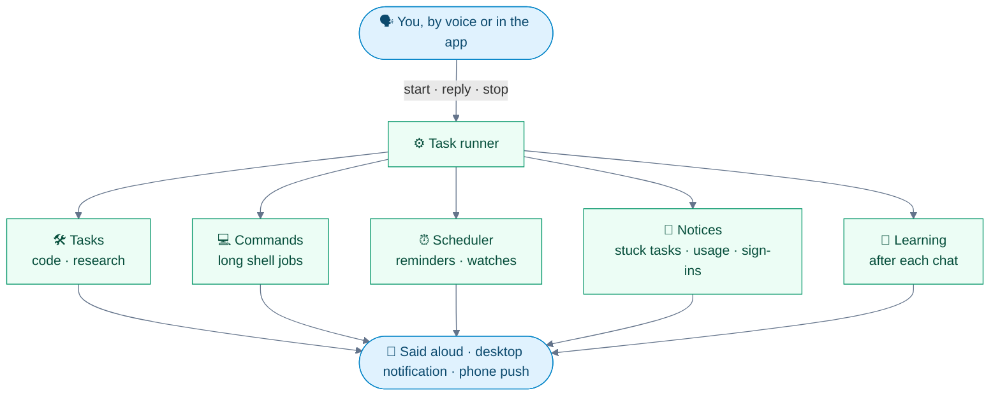
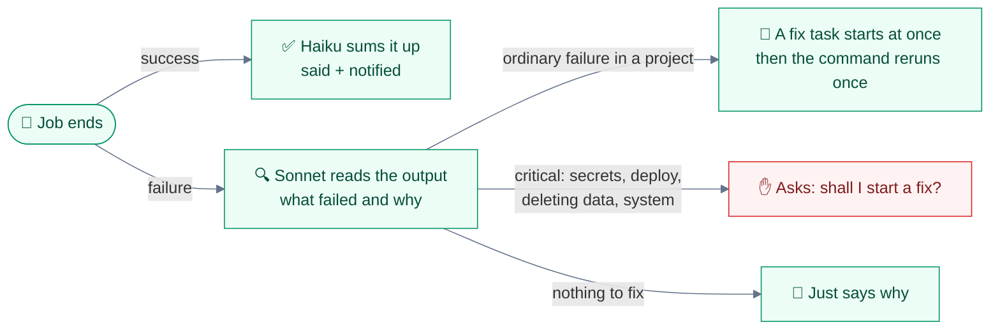
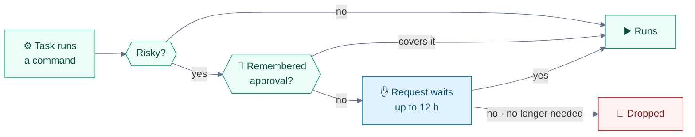

<div align="center">


# 🛠️ Tasks and proactive work

**Everything JARVIS does in the background: tasks you start by voice, shell jobs, approvals, the scheduler, monitoring, notices and the learning review.**

[🏠 Home](../README.md) · [🚀 Setup](setup.md) · [⚙️ Configuration](configuration.md) · [🗣️ Voice](voice.md) · **🛠️ Tasks** · [🔌 Integrations](integrations.md) · [📱 Mobile](mobile.md) · [👩‍💻 Development](development.md) · [🏗️ Architecture](architecture.md)

</div>

---

All of it runs in the **task runner** (`jarvis/tasks/`), apart from any voice session, so it **carries on after you hang up**.



> [!TIP]
> You never have to wait: start a task, **keep talking**, start another. JARVIS speaks up when each one is done or has a question.

<details>
<summary><b>📑 On this page</b></summary>

- [Background tasks](#-background-tasks)
- [To-do list](#-to-do-list)
- [Shell commands and long jobs](#-shell-commands-and-long-jobs)
- [Approvals](#-approvals)
- [Scheduler](#-scheduler)
- [Monitoring](#-monitoring)
- [Notices](#-notices)
- [Learning review](#-learning-review)

</details>

## 🧵 Background tasks

Ask for anything that takes a while and JARVIS starts a task. Keep talking, start more; JARVIS says when each is done or has a question, and you **answer out loud**.

| Say | What happens |
|---|---|
| "add retry logic to the weather app" | Starts a **code change** |
| "how does login work in the weather app?" | Starts a **code question** |
| "find out what changed in LiveKit 1.9" | Starts a **research** task |
| "What is task 12 doing?" | Its latest steps: commands, files, subagents, progress |
| "merge task 12" | After your yes: merges its branch, deletes the branch and worktree |
| "stop the merge" | Stops a merge under way: its tests stop and nothing is merged, the folder left as it was and the branch kept |
| "throw away task 12" | After your plain yes (checked in code, like a command's): discards it |
| "start a new project called weather app" | A folder in `JARVIS_NEW_PROJECTS_DIR`, added as an in-place project, no git |
| "set up git for weather app" | Puts it under git once the first version has settled |

- **Merge** goes into the project's own checkout, as one commit: the task's title and the start of its summary. Its in-between commits ("… (unfinished)", catch-up merges) stay off your branch.
- **Stopping** a merge (`task_stop`, or the CLI's `stop`) kills its test run and removes the checkout made for it; a stop while git squashes and commits lets git end, then undoes it. Once merged it's too late: the cleanup finishes and the reply says so.
- **Throw away** on an in-place task leaves its changes for you to undo.

### One after another

Work can wait for other work: say "once that's merged, start the rebuild" or "when the fix is done, merge it" and JARVIS sets it up there and then, rather than trying to remember it.

| Say | What happens |
|---|---|
| "after the login fix, update the docs" | The docs task is **saved now** and starts by itself once the fix has finished |
| "once the commits change is merged, start the two rebuilds" | Both wait for that **merge**, then start together |
| "when both are done, write the summary" | Waits for **every** task it names |
| "merge it when it's done" | The **merge** waits, then runs by itself in the background and says how it went |

- **Nothing runs while it waits.** No model, no slot, no checking in: the runner settles waiting work at the moment it already announces a task ending or a merge, and once at start for anything that ended while it was down. Waits survive restarts.
- **Chains of any length**, several tasks waiting for one, and one waiting for several all work. A wait that would make a loop (a merge waiting for a task that waits for that merge) is refused.
- **When it starts by itself**, JARVIS says so in a sentence.
- **When what it waited for goes wrong** (a task fails, is stopped or thrown away, or a merge fails), the waiting task **doesn't start**: it's held and you're asked whether to start it anyway ("go ahead" starts it, "stop it" drops it). A merge waiting on it is called off, and you're told. If the work it waited for comes right after all (you carry the failed task on and it finishes), a held task still starts by itself.
- **Waiting tasks show** in the task list with what they still wait for, and stop like queued ones; stopping one holds whatever waited for it in turn. "Stop" on a finished task whose merge is waiting calls that merge off.

### Where code changes go

| Mode | Behaviour |
|---|---|
| **In place** (default) | Straight into the project's folder, **uncommitted** for you to review, unless you ask it to commit ("fix it and commit"); one task at a time per project |
| **Worktree** (`projects set NAME --worktrees`) | Own worktree and `jarvis/<id>-...` branch per task, **committed but never pushed** |
| **JARVIS's own repo** | Always uses worktrees |

### What tasks can and can't see

| | Area | Access |
|:-:|---|---|
| 👀 | **Your other projects** (`JARVIS_TASK_READ_DIRS`), JARVIS's voice session logs | Read, not change. **Secrets stay hidden** |
| 🧩 | **The project's Claude Code setup** | Its CLAUDE.md, subagents, skills, slash commands; **not** its settings or hooks |
| 🔒 | **JARVIS's own data** (projects, to-dos, memory) | Off limits: tasks **suggest edits** instead |

- The project's setup is **scanned for hidden instructions** first; skipping its settings and hooks keeps JARVIS's permissions and sandbox in force.
- **Suggested edits:** small ones are applied when the task finishes and you're told; bigger ones (deleting memory, changing a project's settings) wait for your yes.
- **Goal loop:** when a task says it's finished, a short model call checks the result against what was asked and sends it back to finish what it can (`JARVIS_GOAL_LOOP`, up to 2 rounds) before you hear about it.
- **Stalled tasks:** a running task with no sign of progress for **15 minutes** is flagged and offered a nudge or a stop.
- **Out of steps:** a task that uses up its turns before finishing carries on by itself in the same session, keeping what it did, up to **3 times** per request (`JARVIS_TASK_CONTINUES`). Past that it stops and says so; a reply or message carries it on with a fresh three. A watch's check isn't carried on: it's checked again when next due.
- **Usage limit:** a task cut short by Claude's usage limit says so once (with a notification and push), waits queued (holding no slot or project folder) and carries on by itself when the limit resets, once per reset. A limit on its model alone doesn't wait: it carries on with a lighter model. A message to it, sent before or during the wait, sends it on at once. Scheduled runs leave this to the scheduler, which runs them again after the reset.

> [!NOTE]
> **JARVIS never stops a task on its own.** A stalled task is only flagged; you decide.

<details>
<summary><b>💻 From a terminal: the runner CLI</b></summary>

<br>

```sh
make tasks                                                         # list them
uv run python -m jarvis.tasks.runner show|log|reply|stop|merge|discard|rerun ID
uv run python -m jarvis.tasks.runner edits ID apply|dismiss N...   # a task's suggested edits
uv run python -m jarvis.tasks.runner approvals                     # requests waiting for a yes
uv run python -m jarvis.tasks.runner approve ID [session|always]   # or: deny ID
```

</details>

## ✅ To-do list

To-dos live in the `todos` table of `data/tasks.db`, not in memory.

| Say | What happens |
|---|---|
| "Add build a phone app to my list" | Adds it |
| "What's on my list?" | Reads it back, open items first |
| "Tick off the phone app" | Marks it done |
| "Start a task on the phone app from my list" | A task linked to the item |
| "At 3 a.m. start tasks for the next two to-dos" | [Scheduled](#-scheduler): linked tasks start then, on their own |

- A **linked task**, once checked finished, ticks its item off, or JARVIS offers to reword the item to what's left.
- A task started **without naming an item** is matched against your open items as it finishes; a clear match is **offered** for ticking off, never ticked unasked.
- **No repeats.** An item already on the list, open or done, isn't added twice, whether you ask for it or a task or the [learning review](#-learning-review) suggests it. Same wording (ignoring case and punctuation) is a repeat; an item sharing most of its words with others goes to a quick model check (`JARVIS_TODO_MATCH`). An open repeat stays, taking in any new detail; a done one comes back on the list when you ask for it, and is refused when a task suggests it. JARVIS says which item it matched. What you type in the panel goes in as it is.

## 💻 Shell commands and long jobs

JARVIS runs everyday commands itself: checks, builds, tests, renders, git commits. **Only risky ones wait for your yes**: deleting files, pushing, installing or removing software, stopping processes, changing system settings, sending data off the computer.

It asks **"Okay to go ahead?"**; answer within **five minutes**, even after talking about something else.

| | Your answer | Counts as |
|:-:|---|---|
| ✅ | "yes", "go ahead", "sure", "mm-hmm", "do it", "that's fine"... | **Yes**: it runs |
| ❌ | "no", "don't", "cancel", "never mind", "I'd rather not"... | **No**: dropped |
| ➖ | A lone "thank you" or "bye" | **Neither** |

A reply the word lists can't read goes to a short model call that sees only your words and what's waiting (`JARVIS_CONSENT`). A remark or apology alone ("JARVIS, good", "sorry") isn't a yes: JARVIS checks back instead of acting.

These voice commands run in Claude Code's own sandbox, which on Linux needs **bubblewrap** and **socat** installed.

### Long jobs

Anything over a minute (a video render, say) starts as a **command task**. It's listed with other tasks, with the same Stop button, notifications and output, kept as long as tasks are.

<table>
<tr>
<td width="50%" valign="top">

**🪶 No model while it works**<br>
It takes no task slot, and survives hanging up and runner restarts.

</td>
<td width="50%" valign="top">

**🗣️ By voice**<br>
"How's the render going?" and "stop the render" work. Output is kept in `data/commands/<task>.log`.

</td>
</tr>
</table>

When the job ends:



- The fix task **only fixes the code**: its walls hide the keys the command needs, so it never runs the command itself. When it finishes, **JARVIS reruns the command once**, as it always runs it (same folder, outside the walls, with its keys), and says how that went, unless the fix says the cause remains (an expired login, say).
- A rerun that fails again is **only reported**, so it can't loop.
- Jobs outside a project, or started with "don't fix it if it fails", are only explained.
- A `claude` the command calls runs on **the Claude login JARVIS runs on** (Settings › Claude logins, in priority order). If the run fails because Claude says that login is signed out or its limit is used up, JARVIS passes the login over and **reruns the command on the next one**; with none left, it just says so.

## ✋ Approvals

Background tasks run their commands on JARVIS's computer **inside walls** that hide secrets and JARVIS's own files. A **risky** command becomes a request that waits for your answer, up to `JARVIS_TASK_APPROVAL_HOURS` (**12 h**).



| | Ways to answer |
|:-:|---|
| 🗣️ | **By voice**, right after JARVIS asks, or later ("approve it") |
| 📱 | The **app's buttons** |
| 💻 | `runner approve N` in a terminal |

- A task **deleting files in its own folders**, or stopping processes it started, doesn't ask.
- The request is **withdrawn** once the task no longer needs it (finished, failed, stopped).

### Changes through a connection

A task with the **accounts** access uses your [connections](integrations.md#-connections) (those marked for research) the way the conversation does: **reading is free**, and each call to a **changing** tool (a merge request comment, an inline review note on a diff line, an issue, a merge) becomes a request like a risky command's. JARVIS reads out what it would do, from the tool's own phrase and the call's arguments ("Your task, the MR review, wants to run a GitLab call to comment on web/player merge request 280 at src/ads.ts line 42, saying '…'. Okay to go ahead?"), and the app's **Approve** and **Deny** buttons answer it too.

- **A yes covers that exact call once**, with exactly the same arguments: posting the same comment again asks again.
- **Never remembered**, and never covered by your words ordering something ("push it"): each call needs its own yes.
- Tools you **blocked**, or never sorted, are refused.

A task with a **GitLab** connection also gets two reading tools that use the connection's own key, which the task never sees: `mcp__repo__file` saves one file **whole**, however long (the connection's own reader cuts long files off), and `mcp__repo__download` unpacks a project, or one folder of it, at a branch, tag or commit (the files, without git history). Both save into the task's `downloads` folder in its temp folder, for `Read` and `Grep`, and send the key only to the connection's own `https://` address.

### The sandbox

| | macOS | Linux (and WSL2) |
|---|---|---|
| **Walls** | Seatbelt (`sandbox-exec`) | **bubblewrap** (`bwrap`), required |
| **Without them** | Always there | Commands **refuse to run**, saying how to fix it |
| **Restarting JARVIS** | A task runs `make services-restart` itself | A task can't reach systemd, so it **asks you** to run it |
| **Other processes** | Visible, their environments not | **Invisible**: a PID namespace of its own |
| **Keyrings** | Keychain reads refused | Keyring files and the Secret Service hidden |
| **Secret-named files** | Hidden anywhere, by a pattern rule | Found by a walk at launch (100k entries, 8 levels deep) |

- **Overall** the Linux walls match macOS's on most rules: **stricter** on processes and keyrings, **weaker** on secret-named files deep in your home.
- **Linux only:** your home and `~/.config` take **no new top-level entries**, so a tool that makes its own folder on first use (`~/.cargo`, say) must be **run once yourself**, outside JARVIS. **`sudo`**, setuid programs and **snap-packaged tools** don't work inside.
- **The GPU on macOS:** sandboxed commands, in tasks and the voice shell, can use Metal, so MLX Whisper and its tests run there. Only the GPU device and Metal's shader compiler are let in. Metal's shader caches stay closed, so code that compiles Metal source at run time (`mx.compile`, say) still needs a host command.
- **What host commands are for:** what the inner sandbox blocks: signed Xcode builds, `devicectl` and Homebrew on macOS; Docker, `adb` and emulators on Linux.
- **`make host-check`** tests the walls on either system.

> [!IMPORTANT]
> **Ubuntu 23.10 and later (24.04 too)** restrict user namespaces through AppArmor, and bubblewrap then can't start, so background tasks' commands refuse to run. Install bubblewrap (`sudo apt install bubblewrap`), then give `bwrap` an AppArmor profile that allows user namespaces, or set `sudo sysctl kernel.apparmor_restrict_unprivileged_userns=0`.

### What counts as risky

On every system: **deleting**, **pushing**, **installing or removing software**, **stopping processes**, **changing permissions**, **system settings**, **running as root** and **sending data off the computer**. On Linux the checker also knows:

| | Kind | Linux commands that ask |
|:-:|---|---|
| 🧩 | **Services** | `systemctl`, `systemd-run`, `loginctl` (status listings are fine) |
| 📦 | **Packages** | `apt`, `dnf`/`yum`, `zypper`, `apk`, `pacman` (and AUR helpers), `snap`, `flatpak`, `dpkg`, `rpm` (searches and listings are fine) |
| 🌐 | **Network and firewall** | `nmcli`, `ip`, `iptables`, `nft`, `ufw`, `firewall-cmd` |
| 🎨 | **Desktop settings** | `gsettings`, `dconf`, `xdg-settings` |
| 🕰️ | **Machine settings** | `timedatectl`, `hostnamectl`, `localectl` |
| 👥 | **Users and the kernel** | User and group commands, `mount`, `modprobe`, `sysctl -w` |
| 🚀 | **Startup files** | Writes into `~/.config/systemd`, `~/.config/autostart`, `/etc` and shell startup files |
| 🔑 | **Keyrings** | `secret-tool`, `kwallet-query`, `pass` and `nmcli --show-secrets`: **refused** to tasks |

### Remembered approvals

A yes can go:

| | Scope | Lasts |
|:-:|---|---|
| 1️⃣ | **Once** | This command only |
| ⏳ | **For this session** | The task, or the conversation, at most 12 h |
| ♾️ | **Always** | Until you withdraw it in **Settings → Approvals** |

Only some kinds can be remembered: **installing software, stopping processes, changing permissions, installing onto an iPhone (`devicectl`, macOS) or a simulator**. What a rule would cover is always read out or shown before an "always" is saved.

> [!WARNING]
> These **always ask**, every time, and can never be remembered: **deleting**, **pushing**, **sending data off the computer**, **system settings** and **secrets**, plus anything risky found **inside a script**, and code the check can't see.

Scripts a command runs (`python x.py`, `bash -c '…'`, a heredoc, `./x.sh`) are read and judged by what they do, so a harmless one just runs. A yes covers a script **as it was when asked**: change it and the identical command is checked, and if need be asked about, again; `host_run` and `start_job` also refuse a script that changed between the check and the run.

## ⏰ Scheduler

The runner runs what you schedule by voice, once or on a repeat. Jobs live in `data/tasks.db` and **survive restarts**.

| | Kind | Say | What happens |
|:-:|---|---|---|
| 🔔 | **Reminder** | "Remind me at five to call the bank" | Desktop notification, phone push, spoken if you're in a session |
| 🛠️ | **Task** | "Every weekday at nine, give me a morning brief" | A background task on a lighter model, with a **notepad** |
| 👀 | **Watch** | "Tell me when the deploy is live" · "tell me when Sam replies" | Checks until it happens (you hear once) or it ends |
| 💻 | **Command** | "Run `scripts/report.sh weekly` in my reports project every Monday at seven" | A [command task](#long-jobs) per run, no model while it works |
| ▶️ | **Resume** | "At 3 a.m. resume all stopped tasks" · "resume tasks 12 and 14 at three" | Carries those tasks on, as a follow-up would |
| ✅ | **To-dos** | "At 3 a.m. start tasks for the next two to-dos" | A task for each item, linked to it |

- **Resume and to-dos** do unattended, at your time, what you'd otherwise start by voice. One notification says what was resumed or started; a run with nothing to do stays silent.
  - **Resume** takes the tasks you name, or every task stopped in the last week ("and failed ones" adds those that failed, say on the usage limit). Scheduled runs and fixes for commands are left out: they retry by themselves.
  - **To-dos** takes the items you name, or the next open ones no task has taken on yet. One short model call writes each task's instruction from the item, your projects and memory, and passes over items that need you ("call the dentist"); what you add when scheduling (a skill code tasks must use, say) ends every instruction as you said it, and a code change's always names the `finish-code-change` skill. Each item is ticked off once its task is checked finished.
  - Both wait for a used-up usage limit to reset, keep to how many tasks run at once (the rest queue), and leave risky commands waiting for your yes.

- **Notepad:** each run keeps one for the next, so "only tell me if something's new" stays silent otherwise.
- **Watches** end after **24 h** unless you say otherwise, **a week** at most.
  - A **page** (answers, optionally showing some text) is checked with **no model**, every 5 minutes.
  - A **tool** watch calls one reading tool, of your accounts or a connection, every 10 minutes with **no model**: Gmail (a search, for matching mail), Chat (unread messages naming someone), or any connection's reading tool (say, a repo's issues). Only when its result has something new does a short model call read the new part and say it, if it's what you're waiting for.
  - Anything else is a **task-checked** watch every 15 minutes, at most five at once.
- **Managing:** "what's scheduled?", "move the morning brief to half past eight", "pause it", "cancel the deploy watch". The app's **Tasks** page lists jobs with their next run and recent runs.

| | Rule | Detail |
|:-:|---|---|
| 📥 | **Missed runs don't pile up** | A missed reminder or one-off runs once when JARVIS is back, saying how late |
| ⏭️ | **No overlaps** | A run whose previous one is still going is skipped |
| 🔁 | **Retries** | A scheduled task failing on a passing error retries after 5, 15 and 30 minutes |
| 🌙 | **Quiet hours** | Watches pause; reminders keep their times |
| ✋ | **Risky steps** | Wait for your yes, as in any task. Only you can create a command job, by voice |
| 🧹 | **Tidy** | Silent runs forgotten after 3 days, finished jobs after 30 |

A missed **daily** job runs once if missed by under 2 hours, else waits.

<table>
<tr>
<td width="50%" valign="top">

**🔕 Do not disturb**<br>
"Hold alerts till three", "pause everything for an hour", "I'm back", or the switch in **Settings → Do not disturb**. While on, nothing scheduled runs, notices wait and finished tasks send no notifications. When it ends, held reminders are said and each held job runs once.

</td>
<td width="50%" valign="top">

**📊 Claude usage**<br>
"How much usage do I have left?" Scheduled work **waits for the reset** once a limit is used up, or once the five-hour window is 90% used (`JARVIS_USAGE_HOLD`).

</td>
</tr>
</table>

## 👀 Monitoring

JARVIS watches **nothing on its own**: no mail, calendar, Chat or other service polling is built in (only each connection's [sign-in check](integrations.md#-sign-in-checks)). Ask for what you want kept an eye on ("let me know about new issues on my repo", "keep an eye on that price") and JARVIS offers the ways that fit, then sets up the one you pick:

| | Way | Costs | Good for |
|:-:|---|---|---|
| 📜 | **A small script, run as a command** | No model until the script prints something; then one short summary | Anything a script can read: a page, an API, a feed, a file |
| 🛠️ | **A scheduled task, "only if something's new"** | A model run each time | What needs judgement, or your mail, calendar and other accounts |
| 👀 | **A watch** | Cheap for a page or a reading tool (Gmail, Chat, a connection); a task otherwise | One thing you're waiting for: said once, then it stops |

The script prints only what's new, keeping its own note of what it has seen; a run that prints nothing stays silent and out of the task list. Every monitor is an ordinary scheduled job, listed on the app's **Tasks** page, and changed or cancelled like any other.

## 🔔 Notices

Every 15 minutes the runner checks on **JARVIS itself** and speaks up unasked:

| | Notice | When |
|:-:|---|---|
| 🛠️ | **Tasks** | Waiting for your answer for 15 minutes, cut off by a restart, or stalled |
| 📊 | **Claude usage** | Nearing or out of a plan limit, once per window |
| 🩺 | **Connections** | A connection's [sign-in check](integrations.md#-sign-in-checks) fails (checked hourly) |

- **You hear about it** as a desktop notification, a phone push if enabled, and **spoken at the next pause** if you're in a session.
- **Rules:** nothing said twice (a stall again only once it has cleared and come back); nothing checked in your quiet hours (23:00–08:00 unless changed in Settings → Do not disturb) or do not disturb.

## 🧠 Learning review

You needn't say "remember" for everything. Once a conversation is over (a minute after hanging up, or 10 quiet minutes), **one Haiku call with no tools** reads the new exchanges and suggests lasting facts for memory.

<table>
<tr>
<td width="50%" valign="top">

**✅ It keeps**<br>
Preferences, habits, goals, how you like to be spoken to; your machine, tools, projects, accounts. Plans are kept **as plans** until you say they're done, and a fact saying something was built or finished asks you first.

</td>
<td width="50%" valign="top">

**🚫 It skips**<br>
Trivia, one-off requests, anything memory already says, and **anything read from an email, page or Chat**.

</td>
</tr>
</table>

| | What | Then |
|:-:|---|---|
| 💡 | **New facts** | Saved at once and listed in the bell |
| ✋ | **Rewriting or deleting memory**, adding to-dos | Wait for your yes |
| 👂 | **Misheard words** ("Yavis" for JARVIS) | Go into the speech vocabulary so Whisper expects them (**Settings → Vocabulary**) |
| 🧩 | **A repeated multi-step workflow** | May be suggested as a [skill](integrations.md#-skills), always after your yes |

`JARVIS_LEARNING=off` turns it off.

---

<div align="center">

[← 🗣️ Voice](voice.md) &nbsp;·&nbsp; [🏠 Home](../README.md) &nbsp;·&nbsp; [🔌 Integrations →](integrations.md)

</div>
