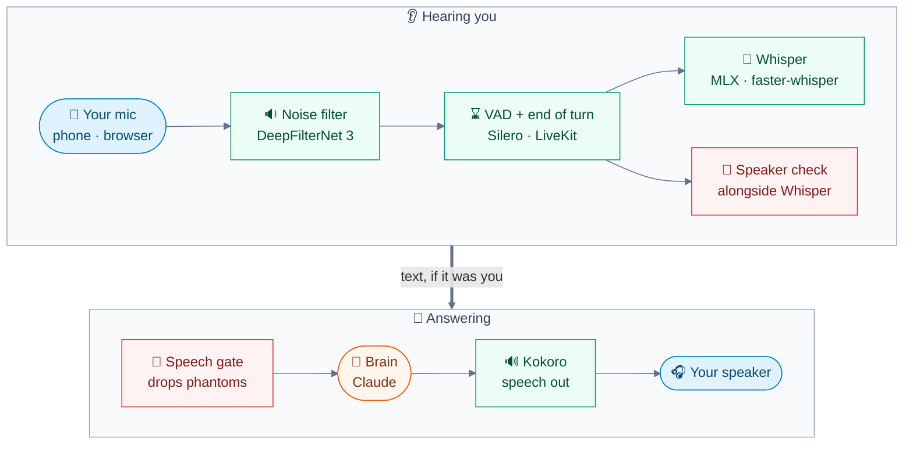

<div align="center">


# 🗣️ Voice

**How JARVIS hears you, decides you've finished, ignores what isn't you, and where the wait before it speaks goes.**

[🏠 Home](../README.md) · [🚀 Setup](setup.md) · [⚙️ Configuration](configuration.md) · **🗣️ Voice** · [🛠️ Tasks](tasks.md) · [🔌 Integrations](integrations.md) · [📱 Mobile](mobile.md) · [👩‍💻 Development](development.md) · [🏗️ Architecture](architecture.md)

</div>

---

Everything on this page runs **on JARVIS's computer**. One spoken turn passes through these stages:



| | Stage | Code | Settings |
|:-:|---|---|---|
| 🔉 | [Noise filter](#-noise-filter) | `jarvis/voice/denoise.py` | [Speech in and out](configuration.md#-speech-in-and-out) |
| ⌛ | [End of turn](#-when-youve-finished) | `jarvis/voice/agent.py`, `jarvis/voice/turn.py` | `JARVIS_TURN_SILENCE`, `JARVIS_VAD_*` |
| 📝 | [Whisper, Kokoro](#-whisper-in-kokoro-out) | `jarvis/voice/speech.py` | [Speech in and out](configuration.md#-speech-in-and-out) |
| 🚫 | [Speech gate](#-speech-gate) | `jarvis/voice/speech_gate.py` | [Speech gate](configuration.md#-speech-gate) |
| 🔐 | [Speaker check, barge-in](#-speaker-check) | `jarvis/voice/speaker.py`, `barge_in.py` | [Speaker check](configuration.md#-speaker-check) |
| 📈 | [Turn timing](#-voice-timing) | `jarvis/voice/timing.py` | none |

> [!TIP]
> Say **"learn my voice"** once. With a voiceprint, only **you** get answered and only you can interrupt JARVIS.

<details>
<summary><b>📑 On this page</b></summary>

- [Noise filter](#-noise-filter)
- [When you've finished](#-when-youve-finished)
- [Whisper in, Kokoro out](#-whisper-in-kokoro-out)
- [Speech gate](#-speech-gate)
- [Speaker check](#-speaker-check)
- [Earphones and switching apps](#-earphones-and-switching-apps)
- [Voice timing](#-voice-timing)

</details>

## 🔉 Noise filter

Your mic goes through **[DeepFilterNet 3](https://github.com/Rikorose/DeepFilterNet)** before anything listens to it, whichever device you talk from.

| | |
|---|---|
| **Hooks in** | LiveKit's frame processor on the room's mic input: VAD, barge-in and Whisper all hear filtered audio |
| **Runs on** | ONNX Runtime, one CPU core: ~1.4 ms per 10 ms of audio, ~40 ms added delay |
| **Model** | `models/deepfilternet3-streaming.onnx` (16 MB), downloaded by `make models`, checked by hash |
| **If it's missing** | The agent log says so and JARVIS uses the original audio |
| **Not filtered** | Terminal console mode (`make console`), which uses this computer's own mic |

**Knobs**

| Setting | Effect |
|---|---|
| `JARVIS_DENOISE_ATTEN_DB` (`18`) | The most the filter takes off any sound, so speech it mistakes for noise stays audible to Whisper |
| `JARVIS_DENOISE=vad` | VAD hears filtered audio (turn-taking unchanged), Whisper the original: for comparing |
| `JARVIS_DENOISE=off` | No filter |

**Inspect:** `logs/agent.log` names the mode at start, logs the filter's time per frame when a call ends, and warns if a frame ever takes longer than real time.

## ⌛ When you've finished

**Silero VAD** cuts your speech into utterances; **silence alone** decides you're done. Nothing reads your words to guess whether you've finished, so nothing waits on a model.

| | Rule | Knob |
|:-:|---|---|
| ⏱️ | The turn ends **0.8 s** after you stop speaking, once Whisper has all your words (a pause mid-sentence splits your speech into clips; the turn waits for the last one) | `JARVIS_TURN_SILENCE` |
| 🔗 | **Went on?** If you carry on before hearing the reply, the two parts are answered together as one thought | |
| ❓ | **Unsure words:** a turn Whisper heard with low confidence is marked, so JARVIS checks back with its best guess | `JARVIS_WHISPER_UNSURE_LOGPROB` |
| 🏃 | **Your own pace:** if talking to JARVIS seems to take a speaker effort (unsure words, going on often, slow speech), replies get plainer | `voice_pace:<speaker>` row |

- The pace is kept as `voice_pace:<speaker>` in the settings table; **delete the row to start again**.
- The VAD needs **0.2 s of unbroken speech** to start an utterance (`JARVIS_VAD_MIN_SPEECH`), so a lone click never reaches Whisper.
- If JARVIS cuts you off mid-thought too often, raise `JARVIS_TURN_SILENCE` a little; lower answers sooner.

**Inspect:** `make voice-timing` shows how long turn ends took, and its outcome counts how many turns you went on from before hearing the reply (`unspoken`; see [Voice timing](#-voice-timing)).

## 📝 Whisper in, Kokoro out

**Whisper** turns each utterance into text; **Kokoro** speaks the reply, on the CPU everywhere. All knobs are in [Speech in and out](configuration.md#-speech-in-and-out).

Whisper runs on whichever backend suits the machine, picked at start:

| | Machine | Backend | Live voice model |
|:-:|---|---|---|
| 🍎 | **Apple silicon** | MLX Whisper on the Apple GPU | `large-v3-turbo`, 4-bit (~0.5 GB) |
| 🟩 | **NVIDIA GPU** (Linux, WSL2) | faster-whisper, CUDA float16 | `large-v3-turbo` |
| 💻 | **CPU only** (other Linux, Intel Macs) | faster-whisper, int8, a thread per physical core | `small.en` |

- **CPU speed:** `small.en` takes **0.61 s per 5 s clip** on an M-series CPU; expect **~1–1.5 s** on a 4–8 core x86. Large models would take several seconds a clip on a CPU, hence the smaller default.
- **Weak CPU?** `JARVIS_STT=base.en` trades a little accuracy for speed.
- **GPU** needs CUDA 12's cuBLAS and cuDNN 9, from the system or pip (`nvidia-cublas-cu12`, `nvidia-cudnn-cu12`). If it fails to load, JARVIS falls back to the CPU and logs why; `JARVIS_STT_DEVICE=cpu` skips trying.
- **Before Kokoro**, everything said (and shown as text) passes `jarvis/voice/unspoken.py`, which drops the brain's private notes and says internal details plainly; see [The Brain](brain.md#-one-turn-end-to-end).
- **Recordings** use their own model, multilingual (`small` on a CPU): see [`JARVIS_TRANSCRIBE_MODEL`](configuration.md#-speech-in-and-out).
- **`make models`** downloads the models this machine will use.
- **Intel Macs** get faster-whisper too (MLX needs Apple silicon), but are **untested**.

| Knob | Default | Effect |
|---|---|---|
| `JARVIS_STT` | Per backend (above) | Whisper model for live voice |
| `JARVIS_STT_DEVICE` | *(auto)* | faster-whisper: `cuda` or `cpu` |
| `JARVIS_STT_PROMPT` | `on` | Gives Whisper the speech vocabulary and project names |
| `JARVIS_TTS_VOICE` | `bm_george` | Kokoro voice: `bm_*`/`bf_*` British, `am_*`/`af_*` American |
| `JARVIS_TTS_SPEED` | `1.05` | Speaking speed, 0.5 to 2.0 |

**Inspect:** `make voice-timing` reports `transcript` (Whisper's text ready) and `tts_first` (Kokoro's first audio) per turn. `logs/agent.log` names the Whisper model, device and threads when it loads.

## 🚫 Speech gate

On near-silent clips Whisper invents words, most often a lone **"Thank you."** The speech gate drops those clips before the brain hears them, judging **mostly from the audio**.

Words only count against a clip when the **whole transcript** is a known phantom ("Thank you.", "You", "Bye.", "like", "Mm-hmm."...), which must then be said clearly. A real **"yes", "no", "okay" or "go ahead"** is never on that list.

A clip is dropped when **any** check holds:

| | Check | Holds when (defaults) |
|:-:|---|---|
| 🔇 | **No speech** | The VAD, run again over the clip, finds under 0.1 s of speech |
| ✂️ | **Too short** | The clip is under 0.3 s |
| 🔈 | **Too quiet** | Its loudest 100 ms is below -55 dBFS |
| 🙉 | **Whisper hears nothing** | No-speech probability ≥ 0.8 **and** under 0.25 s of VAD speech |
| 🌫️ | **Faint** | Under 0.25 s of speech, quieter than -28 dBFS **and** under 1.4 s long |
| 👻 | **Phantom phrase** | A known phantom **and** quieter than -22 dBFS, under 0.6 s of speech, or unsure |
| 🤷 | **Whisper unsure** | Average log-probability under -1.0 **and** under 0.5 s of speech |
| ∅ | **No words** | No letters or digits: `,` `...` `♪` |
| 🔁 | **Repetitive** | gzip compression ratio over 2.4: a phrase looping |

Whisper's confidence alone is no help (**phantoms score like real short replies**), so it only counts alongside weak audio evidence.

### Modes

In the app it's **Phantom filter**.

| `JARVIS_SPEECH_GATE` | Behaviour |
|---|---|
| `enforce` (default) | Drops phantoms, logged as `speech gate dropped` |
| `shadow` (**Only log**) | Drops nothing; logs `speech gate would drop (shadow)` and saves every judged clip as a WAV |
| `off` | No checks |

### Reviewing

```sh
make speech-gate                                  # the last 24 hours' drops, counted by reason
uv run python -m jarvis.voice.speech_gate 72      # the last three days
```

| Where | Shows |
|---|---|
| `logs/speech-gate.jsonl` | Every clip, kept or not: length, loudness, VAD speech, Whisper's probabilities, transcript, WAV path (`audio`) |
| `logs/speech-gate-audio/` | 16 kHz WAVs of what Whisper heard; play one with `afplay` (macOS) or `aplay` (Linux). The newest 300 are kept |

- **A real reply among the drops?** Loosen the threshold named in brackets.
- In `enforce` mode, short clips the gate lets through are still saved (`JARVIS_SPEECH_GATE_SAVE_SHORT`), so a phantom that slips past can be heard.

## 🔐 Speaker check

Real speech from someone else (a TV, a colleague on a call) would otherwise reach the brain as if you'd said it. Once you've **enrolled your voice**, the speaker check drops it and JARVIS stays silent.

> [!NOTE]
> **Without a voiceprint, nothing changes.** If the model fails, clips go through as if no voiceprint existed, and the agent log says so.

- **How.** A [WeSpeaker ResNet34](https://huggingface.co/Wespeaker/wespeaker-voxceleb-resnet34-LM) embedding (25 MB, ONNX) of each utterance's speech, compared with your voiceprint by cosine similarity. It runs on the **CPU alongside Whisper**, so it adds no wait.
- **Stored** in `data/tasks.db` (`voiceprints` table), never in the code.

### Enrolling

Each way **replaces** the previous voiceprint:

| | Way | How |
|:-:|---|---|
| 🗣️ | **By voice** (best) | Say "learn my voice" and talk for about thirty seconds; same mic and filter later calls use |
| 📱 | **In the app** | Settings → Behaviour → Voice ID → **Enroll my voice**, then read the text shown (hang up first) |
| 💻 | **On the computer** | `make voiceprint ARGS=enroll`, then read the passage it prints (uses its own mic) |

### What a clip needs

Short utterances say less about who spoke, so they need a **lower similarity score**:

| Case | Needs (defaults) |
|---|---|
| **Long**: 3 s of speech or more | 0.35 (Settings: Lenient 0.25, Normal, Strict 0.45) |
| **Short**: 1 s or less | 0.25, sliding up to 0.35 by 3 s |
| **In a conversation** | 0.1 less again for short clips; under 0.4 s of speech passes as too short to tell |
| **This call**: after 3 s of clearly-you speech | A second reference tuned to this call's mic and room also counts |

- **In a conversation** means you were the last voice heard (within 30 s), or JARVIS finished speaking under 10 s ago.
- Once someone else has been heard, short clips **lose that leniency** until you're heard again, so a TV's "okay" isn't taken for you.

### Interrupting JARVIS

With a voiceprint and the check on, **only your voice cuts JARVIS off**; someone else's speech never interrupts.

- While it replies, speech is checked from **0.5 s** in (about 15 ms of CPU), then every **0.25 s** more until it matches or you stop.
- If the check misses you, your words still interrupt once the whole utterance is transcribed and passes.
- `JARVIS_SPEAKER_BARGE_IN=off` lets any voice interrupt.

### Modes and reviewing

| Settings → Voice ID → **Other voices** | Behaviour |
|---|---|
| **On** (default) | Drops other voices |
| **Only log** | Drops nothing, any voice interrupts; logs what it would have done |
| **Off** | No checks. **Forget** removes the voiceprint |

```sh
make voiceprint                  # status
make voiceprint ARGS=log         # the last day's verdicts with score range, and ignored barge-ins
make voiceprint ARGS=test        # records 5 s and says how alike it is
```

> [!NOTE]
> **Terminal mic on Linux:** `make console` and `make voiceprint` record through **PortAudio**; install it first (`sudo apt install libportaudio2` on Debian/Ubuntu). macOS needs nothing extra.

`logs/speaker-check.jsonl` has every clip and barge-in: score, what it needed, verdict, transcript.

| If… | Then |
|---|---|
| Your own replies get dropped | Pick **Lenient** or lower `JARVIS_SPEAKER_SHORT_MARGIN` |
| A TV still gets through | Pick **Strict** |

## 🎧 Earphones and switching apps

On a phone (iOS or Android):

<table>
<tr>
<td width="50%" valign="top">

**🎧 Stem press to mute**<br>
While JARVIS is on screen, pressing the earphone button (AirPods, wired or Bluetooth) mutes or unmutes the mic: a **falling tone** for muted, a **rising** one for listening. The on-screen mute follows.

</td>
<td width="50%" valign="top">

**🔄 Coming back to the app (iOS)**<br>
iOS takes the mic from a Home Screen web app in the background. On return, JARVIS shows **Mic paused**, takes the mic back and carries on (muted if you'd muted), reconnecting if the session dropped.

</td>
</tr>
</table>

- Presses are traced to `logs/web.log` (lines starting `iphone:` or `android:`). **Phones and tablets only**, so a computer's media keys still control music.
- If iOS won't hand the mic back, the page says *Tap the core to turn the mic back on*.

## 📈 Voice timing

Every turn that reaches JARVIS is timed stage by stage, in **seconds after you stopped speaking**: one JSON line in `logs/voice-turns.jsonl` and a readable `voice turn` line in `logs/agent.log`.

```sh
make voice-timing            # the last 24 hours
make voice-timing HOURS=2    # the last two
```

| | Stage | Meaning |
|:-:|---|---|
| 📝 | `transcript` | Whisper's text ready |
| ⏸️ | `turn_end` | Silence ended your turn |
| 🧠 | `brain` | The reply started |
| 📤 | `sent` | Your words went to the CLI (after any yes/no check, a running command, photos) |
| 💬 | `first_text` | The reply's first words |
| 🔧 | `first_tool` | The model began its first tool call |
| 🔊 | `first_audio` | JARVIS's voice started |
| ✅ | `done` | The model's reply ended |

<details>
<summary><b>Other fields in each record</b></summary>

<br>

| Field | Meaning |
|---|---|
| `speech`, `words` | How long you spoke, how many words |
| `tts_first` | Kokoro's first-audio time |
| `ack` | Words said before the first tool call |
| `tools`, `tool_names` | Tool calls made |
| `spoke` | How long JARVIS spoke |
| `ended` | **spoken**, **interrupted**, **unspoken** (you went on before it was heard; `resumed` is your pause) or **closed** |
| `speaker`, `logprob` | Who spoke and how well Whisper heard it |

</details>

### Reading the summary

| Line | Tells you |
|---|---|
| First line | How turns ended. Many **unspoken** means JARVIS answers before you've finished; "pause before going on" shows those pauses |
| Seconds after the user stopped speaking | Each stage's median, p90 and max |
| **Where the wait goes** | Time to first audio, split: waiting for the turn to end, before the model, model to first words, first words to voice |
| Slowest turns | The worst turns, as log lines |

> [!IMPORTANT]
> In **Where the wait goes**, the **biggest share is the next thing to fix**.

A single turn in `logs/agent.log`:

```text
voice turn 4 (1.5 s of speech, 5 words): transcript 0.30, turn end 0.90, brain 0.95, sent 1.00,
first text 2.20, first tool 2.20, first audio 2.70, done 4.50; 2 tools; spoken;
ack 'Checking your calendar.'
```

---

<div align="center">

[← ⚙️ Configuration](configuration.md) &nbsp;·&nbsp; [🏠 Home](../README.md) &nbsp;·&nbsp; [🛠️ Tasks →](tasks.md)

</div>
